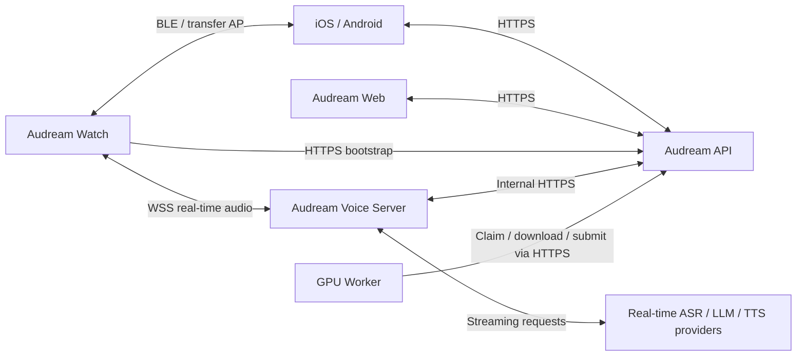

# Audream 手表与语音助手实现方案

状态：In Progress（组合模式可通过实验开关接入，默认关闭；未完成固件构建与真机验收）

审查状态：已按当前本地代码修订；新增接口、硬件唤醒能力和性能指标仍需实施验证。本文不代表生产环境实时测量结果。

更新日期：2026-09-15

产品边界更新（2026-09-14）：用户已明确语音助手不需要保存为 Note。助手会话独立于录音/Notes，不自动或手动导入 Note，不触发录音的转录、纠错、总结或其他生成流程；`create_note` 已移除。下方第 25 节为按时间追加的实现记录，其中旧的 Note 导入计划已由本条及第 25.82 节取代，不能继续作为待实现要求。原有长按录音生成 Note 的功能保持不变。

适用工程：`firmware/note-watch-206`、`server`、`audream-voice-server`

## 0. 当前交付清单（避免重复实现）

2026-09-15 按实际代码、调用位置和第 25 节最新记录核对。第 4 节是原始基线，第 25 节是追加历史，早期的“未完成”可能已被后续章节覆盖，**不能直接据此重新开发**。后续每项工作先检查已有实现，只补缺口；主机测试通过与真机交付通过分别记录。

### 已有实现，不重复新建

| 功能 | 现有实现依据 | 后续性质 |
| --- | --- | --- |
| 表盘、日期、闹钟、倒计时、秒表、时间持久化及定时唤醒调度 | `watch_view`、`watch_time_service/runtime`，25.3–25.7、25.68 | 外部 RTC/真实唤醒源另列；不是重新做计时器 |
| 长按录音、标记、最近录音、删除、本地播放、音量与跳转 | `local_recording_service`、`watch_recording_library`、播放器，25.18–25.19、25.59–25.67 | 组合模式真机回归；保留原录音路径 |
| 活动计步、历史、抬腕校准及设置 | `watch_motion_*`、`watch_wrist_control`，25.55–25.58、25.84–25.85 | 实际姿态、精度、电流及休眠能力验证 |
| iOS ANCS、Android 通知转发、手表通知列表/详情与独立权限 | `watch_ancs_client`、`watch_android_*`、Android notifications，25.69–25.78 | 真机权限、后台、重连验收；不重写通知协议 |
| 独立语音服务、原处理器迁移、PTT、多轮及手动打断、设备时间工具 | `audream-voice-server`、助手会话/音频协调器，25.27–25.48、25.86–25.87 | 部署与设备端到端验收；不重写 ASR/LLM/TTS，不生成 Note |
| 设备身份/设置 API、bootstrap、确认回执、手机与手表三种功耗设置、按需 Wi-Fi | `server/devices`、`watch_voice_*`、`watch_network_application`、移动端设置，25.38–25.54、25.88–25.95 | 首次绑定与实机接线另列；不重新做设置/授权服务 |
| 制造身份、签名、独立安全配对窗口、GATT 传输和只读凭证验证 | 25.96–25.99 | 复用这些模块完成首次绑定，不再设计第二套协议 |

### 真正剩余的实现/接通工作

1. **统一安全添加设备与云端绑定闭环**：复用 iOS/Android 原有添加设备入口，将自有固件的蓝牙 SC/MITM 加密配对纳入该流程，普通控制、配网和 BLE 音频传输复用安全连接，不再另做一套添加设备。离线蓝牙添加与云端账号授权分开，不能要求先联网才能建立安全连接；第三方 CB08/AI08 按原厂能力处理。具体迁移、当前缺口及验收见 [secure-device-addition.md](secure-device-addition.md)。现有 `PairingController`、签名/GATT/凭证验证和物理页面继续复用，Application 资源 hooks 与抢占调用已接入 `watch_pairing_application.cc`；同一控制器的 `Open(true)` 及手表按钮已支持离线本地安全确认，云端模式仍要求 Wi-Fi。实验移动端已接入原添加入口的受保护读取和订阅，BLUFI 双向准入及 BTC/BTA 队列授权已有桌面测试；批准 bond 存储和认证后重连恢复已接到原生状态机并通过主机联测，不可据此启用生产安全功能。现有板级启动已调用 control-only BLE host，安全服务同步初始化失败传播与分阶段清理见 25.116，不另建 host。iOS 与 Android 均已接通实验配置下 API/GATT 同连接授权和助手设置，分别见 25.122–25.124、25.125–25.127；不再重复实现这两套客户端工作流。异步注册/广播与重启验收、批准 bond 的真机持久化/重连与删除迁移验收、SDK 余下生命周期及下层缓存审计、中断恢复和完整手机/服务端/手表验收仍未完成。
   本机云端绑定清除、当前安全手机 bond 移除及原配对页面的二次确认已接通，见 25.129–25.131，不再重复开发。离线已授权手机列表、选择与二次确认删除也已接入同一控制器和页面，见 25.135–25.136；仍需全量重置与真实手机系统 bond 的迁移验收。本地删除、云端撤销和录音擦除不是同一操作。
2. **硬件时间与深睡能力**：PCF85063 UTC 读写、有效性校验、手机校时异步保存、冷启动恢复及休眠访问隔离已接通，见 25.133；仍需目标编译与真机时钟保持/I2C/供电验收。原理图 RTC_INT 为 GPIO39，不能直接用于 ESP32-S3 EXT0/EXT1 深睡唤醒，保留已有 ESP 定时唤醒，不虚构外部中断唤醒能力。深睡触摸/抬腕不能与普通熄屏触摸/运行时抬腕混为一谈。
3. **语音剩余交互**：用户指定唤醒词为“小龙小龙”，直接复用现有 ESP-SR `wn9_xiaolongxiaolong_tts`，不再安排新模型训练。手表板型构建配置已选择该模型，仍须更新实际模型资产并真机验证。TTS 播放时无需按键的说话打断已接入实验组合模式，见 25.137；必须完成真实 AEC 回声抑制、双讲误触发、首音节与切换间隙验收，不能由主机测试认定声学效果合格。现有唤醒后单句 VAD、PTT/手动打断继续复用。
4. **屏幕策略验收**：显式防误触锁、持续按住两秒后释放解锁及表盘/锁屏静态文字的每分钟像素偏移已接入现有 `WatchView`，见 25.132，不再重复开发。保留原熄屏与首次触摸唤亮保护，目标屏幕、触摸控制器、实体录音键和实际功耗仍需实机验收。
5. **BLE 低功耗收尾**：低占空比/重连策略与通知、配网、配对的资源交接；已有 STA 按需连接不重新实现。
6. **安全升级**：后台控制器和手表检查/确认安装页面已实现（25.142–25.143），录音抢占与启动分区提交的原子资源边界已补充（25.144）；Application 实例化、按需网络、排队取消、电源和重启源码接线已实现（25.145）。资产签名与兼容性校验、离线签名工具已补充（25.146），双副本存储/试用回退状态机及分区/NVS 适配已实现（25.147），仍需实际 Assets 启动映射、模型健康确认和更新 owner/UI 接线、生产信任配置、完整目标构建及真机更新验收。原 `Ota::Upgrade` 的流式完整性检查和失败句柄收尾已修复（25.138）；组合模式离线启动确认已接入（25.139）；固件签名清单、镜像型号/发布序号、摘要校验及发布签名工具已接入原升级入口（25.140）。发布发现 API、设备查询、固定清单安装入口及原子目录发布已实现并通过跨端主机测试（25.141），不要重复新建发现协议。不代表生产公钥已配置、发现服务已部署、模型资产已有回退或真实启动回退验收已经完成。

### 已有代码但尚未完成交付验收

- 制造身份/受保护 NVS 的实际配置、量产写入及首次绑定恢复验收；不能运行时自动烧 eFuse。
- 完整 ESP 目标构建、板级外设检查、真实手机联调、AEC/音量/唤醒/打断声学验证。
- 录音、助手、播放、同步和睡眠交错压力测试，以及三种模式的仪器功耗测量。
- 独立语音服务生产部署、容量/故障测试、监控与回滚演练；已有 uv 项目、安装脚本和服务单元不重新写。

分工更新：用户负责固件编译、烧录和硬件测试；后续软件实现不等待硬件验收，助手负责代码、桌面测试及明确的实机验收清单。不代替用户执行目标构建/烧录。用户已要求每完成一个可验证阶段即提交；安装 App、推送和生产部署仍需明确授权。这些验收未执行不意味着上述现有功能需要重写。

优先级纠偏（2026-09-15）：用户指出原语音助手已有正常使用基础，当前实现耗时过长。后续不增加新范围，不重写原 ASR/LLM/TTS；优先核对原助手复用、手表入口、长按录音与两者资源切换的基础闭环。升级、模型自检等扩展单列，不把底层测试数量当作主线已交付的依据。全范围仍保留，组合模式默认关闭且未完成设备端到端验证的事实不变。

资产升级进展补充（25.148）：实际 Assets 启动映射及按需唤醒路径的模型试用健康确认已经接通。上方第 6 项中的这两项不再重复实现；真正剩余的是独立于云端授权的本地模型自检、显示资产检查、HTTP 更新 owner/页面、联合版本回退及生产信任配置。

下载进展补充（25.149）：资产 HTTP 客户端和同一更新控制器的双目标支持已实现，不另做下载器或平行任务控制器。Application 尚需完成当前 Store 的独占交接、配置/发布发现地址及页面接入。

页面与 owner 进展补充（25.150）：同一 Application 已接通当前 Mapping 的独占更新会话和按需网络，手表软件更新页已提供固件/模型与资源选择及带目标的确认、取消和重启。上方所列 owner/页面接入不再重复实现；清单 URL 配置默认空，实际生产清单发布、离线模型自检、显示资源检查、试用恢复页面及联合版本回退仍未完成。

模型准备修复（25.151）：核对真实 AudioService 时发现暂停状态与 AFE 初始化准入冲突，已修复并添加真实方法级回归。既有 Application 替身测试不能证明真实模型初始化链路此前可运行；本地离线自检的采集/确认 owner 仍未接通，不能把这项准备修复当作离线自检已完成。

## 1. 背景

`note-watch-206` 当前在 Waveshare ESP32-S3 Touch AMOLED 2.06 硬件上主要运行 Audream 本地录音模式。工程源自小智 ESP32 项目，原有实时语音助手能力仍保留在代码中，但当前板级实现通过 `IsRecordingOnlyMode()` 进入录音专用启动分支，跳过了完整的联网、唤醒词、AFE、实时会话和显示交互流程。

本次目标不是用手表功能替换原有语音助手，也不是把设备改成只运行唤醒词。目标是把以下三类能力完整组合到同一个产品中：

1. Audream 长按录音、标记、低功耗、同步和 Note 处理流程。
2. 原小智实时语音助手能力，并统一改造成 Audream/追音语音助手。
3. 真正可用的手表基础功能，包括表盘、时间、电量、通知、计时和运动信息。

## 2. 核心决策

### 2.1 产品统一，运行服务隔离

Audream API 与实时语音助手统一账号、设备归属、权限和产品设置。结合已有 GPU Worker，服务分工如下：

- `audream-api`：负责账号、Notes、API Key、音频上传/转换、任务调度、结果合并以及纠错/Insights 的外部 LLM 调用；云端设备归属与助手设置为本方案新增能力。
- GPU Worker：已经独立承担 FunASR、CAM++、pyannote 等音频模型推理；API 没有可用 Worker 时返回明确错误，不回退到本机模型推理。
- `audream-voice-server`：负责设备实时连接、流式音频、VAD、流式 ASR、对话 LLM、工具调用、流式 TTS 和打断。

当前 API 是 REST 控制面和批处理调度器，重型音频模型的系统内存、显存和计算负载已移至 GPU Worker。API 仍有请求处理、数据库连接、FFmpeg 子进程、音频分发和结果数据的内存与 I/O 开销。不能将“GPU Worker 已分离”理解为 API 零内存，也不能把旧模型运行时的内存需求继续作为 API 的常驻需求。

`setup-api-systemd-linux.sh` 默认的 `MemoryMax=6G` 是服务 cgroup 的硬限制，既不预分配 6 GiB，也不代表当前 RSS。API 实际内存及适合的新上限需要根据生产 RSS、`MemoryCurrent`、`MemoryPeak`、并发上传和转换峰值测量；本文不预设“只占几百 MB”或直接把上限降为 2 GiB。

实时服务仍建议独立进程，依据是 WebSocket 生命周期、流式取消/背压、依赖和部署重启边界。API 的文件转换、数据库和外部 LLM 请求也可能带来抖动，但不能再以“API 内运行重型音频推理”解释服务拆分。若实时 provider 需要本地模型，应在实时服务或专用推理服务中运行，不重新引入 API 进程，也不直接复用 Note 批任务队列承载实时音频。

初期 API 与实时服务可以部署在同一台服务器，使用独立 systemd unit 或容器、端口、健康检查和资源限制。独立进程仍共享主机 CPU、内存、网络和磁盘，不保证完全隔绝抖动；通过并发压测决定是否迁移到独立主机。GPU Worker 保持已有独立部署。

建议公共入口：

- REST API：沿用现有客户端/API 部署配置中的地址；本文不要求迁移现有 API 域名。
- 实时语音：`wss://voice.audream.ai/v1/device`

### 2.2 保留原语音助手，不保留原管理系统

从 `/root/xiaozhi-esp32-server` 迁移以下运行能力：

- WebSocket 设备会话和二进制 Opus 音频传输。
- `hello`、`listen`、`abort`、IoT 和 MCP 等协议能力。
- VAD、ASR、LLM、TTS provider 抽象。
- 流式输出、打断、会话上下文、工具调用和设备状态上报。
- 必要的音频编解码、队列、背压和超时控制。

不继续使用以下独立系统：

- 原 manager API 的用户和设备归属体系。
- 原 manager web/mobile 管理前端。
- 原独立 OTA 所有权和静态认证方式。
- 原小智品牌、域名和面向用户的名称。

迁移必须从已确认的上游提交创建干净分支。生产目录中的本地修改不能直接覆盖或丢弃，应先导出 diff，逐项审查后再迁移。当前确认的参考提交为：

```text
435860d339d0efab07f1555560f5bacd363e92cf
```

### 2.3 本地录音优先级最高

长按录音是现有核心行为，必须在任何语音助手状态下可靠执行。音频资源由统一协调器独占管理，禁止本地录音和语音助手同时读取麦克风、编码 Opus 或播放 TTS。

优先级从高到低：

1. 低电量安全停止与文件落盘。
2. 用户长按发起的本地录音。
3. 文件传输。
4. 实时语音助手。
5. 后台唤醒检测。

这里的优先级由协调器实现：传输期间收到长按先安全停止传输并释放文件句柄，再开始录音。存储或 codec 不可用属于明确失败条件，必须反馈失败；不能在未开始采集时显示录音成功。

## 3. 范围

### 3.1 本期实现范围

- 为板级代码引入组合运行模式，不再把 Waveshare 手表固定为录音专用模式。
- 保留长按开始/结束录音和录音中单击标记。
- 恢复并接入原实时语音助手链路。
- 新增音频会话协调器，解决录音、AFE、唤醒词、TTS 和文件传输冲突。
- 建立 Audream 设备注册、设备凭证和语音助手设置。
- 将原实时服务迁移为独立的 `audream-voice-server`。
- 实现手表基础 UI、RTC、IMU、通知和快捷设置。
- 提供普通手表待机、常开语音和深度省电三种功耗策略，语音开关不决定是否保持手机通知连接。
- 完成可观测性、压力测试、功耗测试和回归测试。

### 3.2 非目标

- 不在第一阶段重写 ASR、LLM 或 TTS 引擎。
- 不把长音频转录改成实时流式识别。
- 不默认保存实时语音的原始音频。
- 不让设备持有用户的 Audream API Key。
- 不在第一阶段移除所有原小智内部类名；先完成公共品牌、协议入口和服务边界迁移，再逐步清理内部命名。
- 不承诺深度睡眠状态下运行 ESP32-S3 AFE 唤醒词。

## 4. 当前实现基线

### 4.1 固件启动分支

基线 `main/application.cc` 在 `board.IsRecordingOnlyMode()` 为 `true` 时执行本地录音专用初始化后直接返回。当前实现读取 `GetRuntimeProfile()`，基类单向映射现有布尔值。Waveshare 在默认关闭的 `CONFIG_AUDREAM_WATCH_UI` 下保持原录音初始化分支；显式打开实验开关后进入组合模式。StickS3 不使用该开关，仍使用原 profile。

Waveshare 板级类当前：

- 继承 `WifiBoard`。
- 实验开关关闭时 `IsRecordingOnlyMode()` 返回 `true`；开启时返回 `false` 并明确选择 `kWatchAssistantRecorder`，没有两个虚方法互相调用。
- 开关关闭时 `StartNetwork()` 只启动 Audream BLE 控制流程；开启时还调用 `WifiBoard::StartNetwork()`，本地手表就绪不依赖 Wi-Fi 连接或旧 OTA 激活。
- 已有稳定的长按录音、录音标记、存储检查、低电量停止和休眠唤醒逻辑。

因此不能只把 `IsRecordingOnlyMode()` 改为 `false`。这样虽然可能进入原助手流程，但会绕开现有录音专用初始化假设，并引入 BLUFI 生命周期、音频资源和休眠策略冲突。

### 4.2 音频能力

完整模式下的 `AudioService` 已经具备语音助手与本地录音的基础共存能力：

- 初始化编码器、解码器、重采样和 AFE/audio processor。
- 输入任务能够优先把本地录音 PCM 送入本地 Opus 编码路径。
- 本地录音服务已经通过 `EnableLocalRecording()`、packet callback 和 metadata 生成文件。

缺少的是明确的会话仲裁、状态切换和队列清理，而不是重新实现一套 AudioService。

此外，Waveshare 原录音 profile 将 `kRecordingAudioOutputPathEnabled` 设为 `false`，不会创建 ES8311 输出设备。组合模式已将该值设为 `true`，具备创建输出路径的条件，输出仍按音频任务需求启停；原录音 profile 不变。这只是代码接入，不代表 TTS 音量、扬声器和真机 I2S 切换已验证。

### 4.3 设备硬件

目标板硬件能力包括：

- 410 x 502 AMOLED 触摸屏。
- FT3168 触摸控制器。
- QMI8658 IMU。
- PCF85063 RTC。
- AXP2101 电源管理。
- TF 卡。
- 两路麦克风输入、ES7210 ADC/ES8311 DAC 音频链路和扬声器；第三路参考输入用于播放回声参考。麦克风器件类型和实际接线需以本机原理图/实物核实，不由 PCM 数字输出推断为数字麦克风。

上述 RTC、IMU 和触摸型号作为目标硬件清单，Phase 0 必须对照板卡版本和原理图核实。当前触摸适配代码使用 `esp_lcd_touch_ft5x06`，构造函数尚未启动完整触摸流程；不能仅凭目标型号认定驱动和唤醒已经可用。

目前 RTC 和 IMU 尚未形成完整的手表服务层。尤其需要验证 RTC/IMU/触摸中断是否接到可用唤醒 GPIO、休眠时供电是否保留。现有 deep sleep 路径主要是按键唤醒，新增触摸、抬腕和闹钟唤醒都属于待实现能力。

### 4.4 服务端基线

当前 Audream 服务已经具备账号、会话/API Key、Note、转录、Insights 和任务处理能力，但没有完整的云端设备注册和实时设备凭证体系。

本次本地代码核对依据：

- [`server/api.py`](../../../server/api.py)：`/health` 声明 `transcription.execution=gpu_worker_only`。
- [`server/remote_transcription.py`](../../../server/remote_transcription.py)：使用远程 Worker 调度，不执行本地模型。
- [`server/test_api_inference_boundary.py`](../../../server/test_api_inference_boundary.py)：包含 API 不导入推理模块、无 Worker 时不本地回退的回归测试。
- [`server/pyproject.toml`](../../../server/pyproject.toml)：FunASR/PyTorch 等位于 `gpu-worker` 可选依赖。
- [`setup-api-systemd-linux.sh`](../../../setup-api-systemd-linux.sh)：默认保留 6 GiB 硬限制；本次未修改部署配置或测量生产占用。

以上是当前工作区实现依据；远端实际版本、服务限制和占用需在部署阶段重新确认。相对链接面向整个 ispeak 工作区，单独检出固件仓库时这些服务文件不在仓库内。

原实时语音服务具备独立 WebSocket 和 OTA HTTP 服务，支持多种 provider、MCP、IoT 和打断，但其账号、设备绑定和配置依赖原 manager API。迁移时需要替换这一依赖，而不是把两个数据库并存。

## 5. 总体架构



Web 只访问云端功能，不承担设备 BLE 配对或临时 AP 导入。GPU Worker 使用已有任务领取协议，网络连接由 Worker 发起。

服务端只统一领域数据和身份，不共享实时连接进程。实时服务通过内部接口读取设备授权和写入会话事件，不能直接访问 Audream API 的内部 Python 对象或任务队列。

## 6. 固件运行模式

### 6.1 引入运行 Profile

使用明确的运行 profile 替代单一的 `IsRecordingOnlyMode()` 布尔值：

```cpp
enum class BoardRuntimeProfile {
    kAssistant,
    kRecordingOnly,
    kWatchAssistantRecorder,
};
```

最终目标映射（当前 Waveshare 尚未切换到组合模式）：

| 设备 | Profile | 行为 |
| --- | --- | --- |
| 原语音助手开发板 | `kAssistant` | 保持原助手流程 |
| StickS3 endurance 测试设备 | `kRecordingOnly` | 保持录音续航测试流程 |
| Waveshare 2.06 手表 | `kWatchAssistantRecorder` | 手表、助手和本地录音组合流程 |

为避免一次性修改所有板级类，可以先新增 `GetRuntimeProfile()`：基类默认调用现有 `IsRecordingOnlyMode()`，映射到 `kRecordingOnly` 或 `kAssistant`，Waveshare 显式覆盖为组合模式。兼容映射只能单向，不能让两个虚方法互相调用。`Application` 的启动和事件处理统一读取新 profile；旧录音分支仍服务于未迁移的板卡。

### 6.2 组合模式启动顺序

`kWatchAssistantRecorder` 建议按以下顺序启动：

1. 初始化电源、按键和启动诊断，读取 profile、用户设置及深睡录音意图，异步挂载存储。
2. 创建单一 `AudioSessionCoordinator`，暂存尚未具备执行条件的用户事件。
3. 创建 profile 对应的 codec，初始化完整 AudioService 基础编解码资源，先注册音频、录音和错误回调，再调用一次 `AudioService::Start()` 创建任务。
4. 检查必需任务和资源是否成功创建。若存储 ready 且有长按录音意图，优先开始采集，不等待联网、激活或 Watch UI。
5. 通过唯一显示所有者初始化 panel、LVGL 和触摸，再启动表盘；RTC/IMU 在同一外设生命周期中初始化并报告能力。
6. 初始化 BLE 控制、凭证和网络管理器；只按用户策略或显式对话请求连接 Internet STA。
7. 已配对且联网后异步执行 Audream bootstrap、设置同步和协议准备；离线也进入可用的手表/录音界面。
8. 协调器按功耗策略允许唤醒检测或等待 push-to-talk。所有迟到初始化事件都要检查当前会话，不能中断已开始的录音。

显示、IMU、RTC、Wi-Fi 或语音服务失败时降级运行，不阻止本地录音。存储、codec、必要内存或编码任务初始化失败时不能启动录音，应反馈错误并允许恢复重试。存储仍沿用异步初始化和 ready 回调；深睡长按唤醒保留 pending recording intent，优先恢复录音必需资源，避免等待联网或整套 Watch UI。

### 6.3 组合模式必须改造的现有入口

| 现有代码入口 | 直接复用的问题 | 组合模式实现要求 |
| --- | --- | --- |
| 板级 `GetAudioCodec()` / `BoxAudioCodec` | 输出设备被构造参数禁用，TTS 无声 | 在首次构造时确定双工能力；播放时打开 DAC/PA，录音前关闭，不能反复构造 static codec |
| `PrepareForLocalRecording()` | 关闭输出并禁用 I2S TX | 增加明确的助手输出恢复步骤，验证 TX 时钟、ES8311 和参考通道恢复；不能只恢复软件状态 |
| `InitializeRecordingFeedbackDisplayTask()` 与 `InitializeSH8601Display()` | 分别创建同一个 SPI panel；反馈屏不会设置完整 `display_` | 组合模式只创建一个 panel/backlight，录音反馈改为其 overlay；录音专用模式保留轻量路径 |
| `Application::Initialize()` / `AudioService::Start()` | 只初始化对象不会启动采集/输出/编码任务 | 区分初始化、注册回调、启动任务和启用采集；每个任务只创建一次并检查结果 |
| `HandleStateChangedEvent()` | idle 直接启用 wake word，listening/speaking 直接启停 AFE | 将资源变更转成协调器意图，所有入口服从当前录音和功耗策略 |
| `HandleNetworkConnectedEvent()` / `ActivationTask()` | 原流程只在部分状态激活，并串行检查 assets、OTA 后才初始化协议 | bootstrap 与可用界面状态分离；不以旧 `starting/activating` 作为是否可联网的唯一判断 |
| `HandleActivationDoneEvent()` / `Alert()` / `PlaySound()` | 迟到联网成功音、错误提示音可能进入录音 | 全部扬声器请求经过协调器，录音/暂停期间仅视觉反馈 |
| `McpServer::AddUserOnlyTools()` | reboot、升级和资源下载可能越过录音保护 | 工具动作进入相同状态门控；录音期间拒绝重启/OTA 写入，不使用“请求已投递”作为完成结果 |

源码依据：[`application.cc`](../main/application.cc)、[`audio_service.cc`](../main/audio/audio_service.cc)、[`BoxAudioCodec`](../main/audio/codecs/box_audio_codec.cc)、[Waveshare 板级代码](../main/boards/waveshare/esp32-s3-touch-amoled-2.06/esp32-s3-touch-amoled-2.06.cc)、[`mcp_server.cc`](../main/mcp_server.cc)。

原 `CheckAssetsVersion()` / `CheckNewVersion()` 不作为组合模式首次对话的强制前置条件。已安装资源校验通过即可按需初始化助手；检查升级失败不阻塞录音和表盘。OTA 仅在无录音、传输和对话时执行，写 Flash 期间持有 maintenance blocker，长按需明确反馈暂不可用，不能强行中断 Flash 写入。可中止的下载阶段与不可中断的写入阶段分别处理。

## 7. 音频会话协调器

### 7.1 状态模型

现有 `DeviceState` 继续表示语音助手协议和 UI 状态。新增独立的音频资源状态，避免把录音、传输和语音助手全部塞进原状态机：

```cpp
enum class AudioSessionMode {
    kIdle,
    kAssistantConnecting,
    kAssistantListening,
    kAssistantThinking,
    kAssistantSpeaking,
    kTransitioning,
    kLocalRecording,
    kRecordingPaused,
    kFileTransfer,
};
```

协调器建议暴露以下接口：

```cpp
class AudioSessionCoordinator {
public:
    void RequestAssistantStart();
    void RequestAssistantStop();
    void RequestLocalRecordingStart();
    void RequestLocalRecordingStop();
    void RequestLocalRecordingPause();
    void RequestLocalRecordingResume();
    void BeginFileTransfer();
    void EndFileTransfer();
    void PrepareForSleep();
    AudioSessionMode mode() const;
};
```

所有 codec、microphone input、speaker output、AFE、Opus encoder 和 audio queue 的启停必须经过协调器。板级按钮不得直接拼接多组启停调用。

上面的接口表示投递请求，不表示操作同步完成。协调器在单一任务中顺序处理事件，以完成/失败事件更新 UI；`kTransitioning` 期间保留待执行意图，并对重复开始、停止、暂停和取消保持幂等。沿用现有录音暂停/恢复功能，暂停期间仍归本地录音会话所有，不能切入助手。

`DeviceState` 表示助手子状态，`AudioSessionMode` 表示资源归属，Watch UI 自身保留导航页面状态。助手进入 idle 或网络断开不得自动退出用户正在看的计时器/录音页面。`AudioSessionMode` 的助手状态由同一协调器根据协议事件更新，不能由两个状态机互相无条件回调，形成唤醒/停止循环。

切换时为音频会话分配 generation id，丢弃前一代的迟到 TTS/ASR 和网络回调。停止采集要等待输入任务退出读取，再关闭 codec；停止录音要等编码队列排空、文件和 metadata 完成后释放资源。所有等待均有超时和失败恢复，不在 UI 或 BLE callback 内阻塞。协调器保留录音本身的低功耗输入路径，不把助手 AFE/AEC 或额外数字增益强加给本地录音。

`kTransitioning` 和暂停录音也持有阻止休眠的资源租约；只有 codec 停止、编码排空、metadata 写入与存储句柄释放均已确认，才交回 power manager。`PrepareForSleep()` 请求失败或超时必须取消本次休眠，不得使用一个无法表达失败的 pre-sleep callback 继续进入 deep sleep。

### 7.2 状态切换规则

| 当前状态 | 事件 | 结果 |
| --- | --- | --- |
| Idle | 长按 | 启动本地录音 |
| Assistant listening | 长按 | 发送 abort，停止助手，启动本地录音 |
| Assistant speaking | 长按 | 立即停止 TTS，发送 abort，启动本地录音 |
| Assistant thinking | 长按 | 取消请求，启动本地录音 |
| Local recording | 单击 | 添加 highlight |
| Local recording | 长按 | 完成本地录音并落盘 |
| Local recording | 唤醒词 | 忽略 |
| Local recording | 暂停 | 保存录音会话，停止采集，不启用助手 |
| Recording paused | 恢复/结束 | 恢复同一录音，或安全完成文件 |
| Local recording / paused | 助手/文件传输请求 | 拒绝，不能读取正在写入的文件或切换其音频资源 |
| File transfer | 助手请求 | 拒绝并显示忙碌状态 |
| File transfer | 长按 | 取消传输、释放存储占用后开始录音；取消失败则明确提示 |
| Local recording / paused | 闹钟或通知 | 更新视觉提醒，禁止扬声器污染录音 |
| Any | 电量低于安全阈值 | 停止音频、写 metadata、准备关机 |

Any 行受已验证的电量有效性、充电状态和安全停止规则约束，不将一次电量读取失败当成 0%。OTA Flash 写入属于第 6.3 节的独立维护状态，不接受录音抢占。

### 7.3 从助手切换到录音

切换顺序必须固定：

1. 阻止新语音输入和新 TTS packet 入队。
2. 发送有界的 best-effort `abort`，停止并关闭旧 WebSocket 音频连接，不等待服务器确认；取消连接中的握手和重试任务。
3. 停止扬声器并清空 decoder/output queue。
4. 停止 AFE/wake processor 消费输入。
5. 清空残留 assistant encoder queue。
6. 启动本地录音文件和 metadata transaction。
7. 打开录音输入并开始本地 Opus 编码。
8. 更新 UI、LED 和电源 blocker。

整个切换不得依赖服务器在线。设备已醒且存储 ready 时，以“1.5 秒长按被确认”到“首个有效录音 PCM 被保留”为口径，提出 300 ms 的待测目标。深睡冷启动和安全取消传输单独统计耗时，不承诺同一上限。

首版不默认引入常开预卷采集。深睡或麦克风未开启时无法保留按键之前的音频；助手会话中的 PCM 也不能隐式写入本地录音。开始反馈以实际采集成功为准，首尾完整性验收覆盖该时刻之后至用户停止之间的有效音频。

### 7.4 从录音恢复助手

1. 停止录音输入并完成剩余 packet 编码。
2. 原子更新 segment 和 session metadata。
3. 关闭录音文件并释放录音电源 blocker。
4. 恢复助手可用的输入/输出配置，但不自动打开麦克风、I2S TX 或扬声器。
5. 根据用户功耗模式和助手开关决定是否启用 wake processor；原 AFE/唤醒对象的 stop 不等于释放模型内存，恢复时不能重复初始化。
6. 按网络策略恢复连接能力，WebSocket 只在下一次显式对话或已允许的唤醒事件后建立；普通手表待机和深度省电不因录音结束自动联网。

### 7.5 BLE 命令完成语义

现有 [`AudreamDeviceControl`](../main/boards/common/audream_device_control.cc) 对暂停/恢复使用同步 `bool` callback，随后按原 `request_id` 返回成功或错误。迁移到异步协调器时必须同步改造此适配层：BLE callback 解析命令后交给命令任务，保存请求上下文，待协调器实际完成才发原格式结果，保持 App 可识别的 request id/status 语义。

不能把排队成功当作 `kSuccess`，也不能在 BLE callback 内等待录音 drain。命令队列有上限，超时返回原协议可表达的错误，并取消尚未开始的命令；重复请求通过 request id/操作状态处理。实测完成时间若超出现有 App 超时，需通过 capability/version 协商增加 accepted/completed 两阶段协议并同时更新 App，不能单边改变状态含义。

## 8. 按键、触摸和交互

### 8.1 物理按键

保留现有行为：

- 长按 1.5 秒：开始或结束本地录音。
- 录音中单击：添加 highlight。
- 未录音且屏幕关闭时单击：只唤醒屏幕，不启动助手；录音中熄屏单击仍优先添加 highlight。

建议新增但不与本地录音冲突的行为：

- 双击：可配置为打开语音助手或最近录音。
- 软件关机从快捷设置进入；不把同一次超过 1.5 秒的持续按压再解释为软件关机，避免刚开始录音就停止。PMIC 硬件强制关机单独标明，不由软件承诺拦截。

### 8.2 语音助手入口

语音助手有两个入口：

- 表盘或应用列表中的麦克风按钮，使用 push-to-talk，第一阶段优先实现。
- 用户开启常开语音后使用本地唤醒词；普通手表待机可持续接收通知而不开麦克风。

面向用户统一显示 `Audream Voice Assistant` 或本地化的“追音语音助手”。用户指定实际唤醒短语为“小龙小龙”（2026-09-14），使用现有 ESP-SR `wn9_xiaolongxiaolong_tts`，无需重新训练，也不把助手产品名改为小龙。Waveshare 2.06 板型 `config.json` 选择 `CONFIG_SR_WN_WN9_XIAOLONGXIAOLONG_TTS=y` 并关闭该板原默认“你好小智”模型，不修改其他板型的默认值。此设置只选择模型，不自动启用 AFE/常开监听；仍遵循助手许可和功耗模式。已有 build/sdkconfig 或设备上的旧资产不会因为修改板型配置自动更新，后续构建必须核对模型选择并同步资产，再进行实录验证。只修改文本和提示音不会改变唤醒词。

### 8.3 手表页面

第一版页面结构：

1. 表盘：首页显示时间、日期、电量、连接状态和录音状态。
2. 录音：开始/停止、时长、标记、剩余容量和同步状态。
3. 语音助手：会话状态、识别文本、停止和打断。
4. 通知：最近通知列表与详情。
5. 计时：闹钟、计时器和秒表。
6. 活动：步数和基础活动信息。
7. 最近录音：本地文件、时长、同步结果。
8. 快捷设置：亮度、音量、Wi-Fi、BLE、助手模式和省电模式。

UI 复用工程已有 LVGL 和 `esp_lvgl_port`（当前声明约束为 `~9.4.0` / `~2.7.0`），不引入第二套显示框架。所有 LVGL 更新走现有显示锁/任务；表盘按秒或按分钟刷新，显示关闭后停止无效动画。以局部 framebuffer、字体资源按需加载和有上限的会话文本列表控制 RAM/PSRAM，占用需和 AFE、Opus、Wi-Fi/BLE 同时启用的峰值一起测量。

## 9. 手表领域服务

UI 不直接操作硬件寄存器。新增以下服务边界：

### 9.1 `RtcService`

- 封装 PCF85063 初始化、读写和闹钟中断。
- 网络同步时间后写入 RTC。
- 无网络时使用 RTC 保持时间。
- 提供本地时区和 12/24 小时格式给 UI。
- RTC 和持久化事件使用 UTC；时区仅影响显示和日历闹钟。记录时间有效性，RTC 失效时显示待同步，不把虚构时间写入录音。
- 闹钟/计时器必须安排 deep sleep 可用的唤醒源；外部 RTC 中断未验证前使用经测试的 ESP 定时唤醒方案。整合现有进入休眠前清空 wake source 的逻辑后统一重新配置，避免新增闹钟被清除。
- 秒表、计时器和录音时长与墙钟分离：运行中使用单调时钟，跨 deep sleep 通过持久化起点及经过验证的休眠计时恢复；校时不能让时长跳变。断电后的恢复策略需明确提示，不保证任意断电期间秒表持续准确。

### 9.2 `MotionService`

- 封装 QMI8658 初始化和采样。
- 支持抬腕亮屏、步数和静止检测。
- 通过低频任务或中断运行，禁止 UI 高频轮询 I2C。
- 原始运动数据默认不上传服务器。

### 9.3 `NotificationService`

- iOS：系统通知优先使用手表作为 GATT client 接入 ANCS，配对、权限、service discovery 和订阅与 Audream BLE 控制 service 共存。不能假设普通 iOS App 能读取其他应用通知并转发。[Apple ANCS 规范](https://developer.apple.com/library/archive/documentation/CoreBluetooth/Reference/AppleNotificationCenterServiceSpecification/Introduction/Introduction.html)
- Android：App 通过用户授予的通知访问权限使用 `NotificationListenerService`，再经 BLE 转发；实现时覆盖后台限制、重连和撤销权限，不保证收到被系统限制的敏感通知。[Android 官方接口](https://developer.android.com/reference/android/service/notification/NotificationListenerService)
- Audream 自身 Note 状态事件可使用现有 App/BLE 协议同步。手机端 OS 权限与 Audream 应用设置分别处理，不能用一个开关伪装为已获得系统权限。
- 手表只保存有限条最近通知。
- 支持应用名、标题、正文摘要、时间和已读状态。
- 通知内容必须受手机端授权控制，并提供一键清空。
- deep sleep 或录音策略关闭 BLE 时不接收实时通知；恢复连接后按平台支持范围刷新，不承诺补回全部历史通知。手表本地已读不等同于手机通知被删除。

### 9.4 `WatchPowerPolicy`

- 管理屏幕、IMU、Wi-Fi、BLE、AFE 和 CPU profile。
- 根据录音、助手、传输和充电状态设置 blocker。
- 统一决定 light sleep/deep sleep，避免多个模块分别调用睡眠 API。
- 作为现有 `AudreamPowerManager` 的策略扩展提供 blockers 和计划唤醒源，不再创建第二个独立睡眠控制器。

## 10. 网络与 BLUFI

### 10.1 两类 Wi-Fi 必须分离

设备存在两类完全不同的 Wi-Fi 用途：

- Internet STA：连接路由器，用于实时语音助手、OTA 和时间同步。
- Temporary transfer AP：设备临时开启 AP，由手机连接后同步录音文件。

两者不能共享一个模糊的 `connected` 状态。建议引入：

```cpp
enum class NetworkPurpose {
    kNone,
    kInternet,
    kFileTransfer,
};
```

文件传输期间暂停实时语音连接。结束时关闭设备 AP、清理手机侧临时配置并按功耗模式恢复设备 Internet STA。手机是否、何时重新连接办公室 Wi-Fi 由手机 OS 决定，App 只能清理配置和显示当前状态。设备或状态栏显示的单一 `connected`/4G 图标都不能作为传输可达性的充分判断，应验证目标连接及真实数据通道。

### 10.2 BLUFI 生命周期冲突

基线板级 `StartNetwork()` 使用 `Blufi::init(false)` 进入 Audream control-only 模式，而原 `WifiBoard::StartNetwork()` 连接流程会在联网后调用 `Blufi::deinit()`。直接同时调用两者会导致：

- 配网完成后 Audream BLE 控制通道被关闭。
- 重复初始化 singleton。
- 录音同步事件与配网事件竞争 callback。

本轮已将 BLUFI 的配网和控制职责拆分，保留旧助手的配网后退出策略：

```cpp
enum class BlufiRole : uint32_t {
    kControlOnly = 1,
    kWifiProvisioning = 2,
    kProvisioningAndControl = 3,
};
```

实现要求：

- 未配置 Wi-Fi 时启用 provisioning + control。
- 配网成功后只关闭 provisioning 能力，保留 control service。
- 进入临时文件传输时不销毁 BLE 控制状态。
- 重连和休眠恢复必须幂等。
- Wi-Fi SSID/password 只保存在设备 NVS，不上传 Audream 服务。

代码进度：同角色 `init()` 幂等，活动栈直接切换角色，组合配网成功后回到 control-only；旧配网角色在发送结果后关闭 BLE。`WifiBoard` 不再在 connected callback 中提前销毁 BLUFI。连接与退出任务使用生命周期 ticket，失效结果不能关闭新会话；SSID/密码读取有长度边界，不记录明文密码。实验手表模式已接入无凭据时的组合配网入口，以及 25.23 节的本地 Wi-Fi 许可和热点无线资源占用。录音取消配网、完整助手/传输交接与功耗模式恢复仍未完成，不能据此宣称已经通过真机配网和传输验证。

## 11. 功耗模式

### 11.1 Always Available

适用于充电或用户明确开启常开语音：

- Wi-Fi 保持可恢复的在线状态。
- AFE 和 wake word 持续运行。
- 屏幕按超时关闭。
- 使用 light sleep/动态频率，不进入会停止 AFE 的 deep sleep。

该模式必须在 UI 中明确显示更高耗电，不可将其作为默认省电模式。

### 11.2 Battery Saver

深度省电模式：

- 屏幕关闭后允许 deep sleep。
- 不在 deep sleep 中承诺唤醒词。
- deep sleep 默认只承诺已验证的按键唤醒，再使用 push-to-talk。触摸、抬腕唤醒需验证中断布线、GPIO、电源域和驱动，未验证前不向用户显示为可用；普通熄屏与 deep sleep 应区分。
- Wi-Fi 按需连接，BLE 使用低占空比。
- 进入 deep sleep 后 BLE/Wi-Fi 断开，手机不能通过普通 BLE 控制主动唤醒；该模式不提供持续通知和连续 IMU 计步保证。全天计步需验证传感器低功耗计数/缓存能力，或采用保持采样的待机策略并重新测量功耗。
- 本地录音开始后沿用当前关闭屏幕、暂停非必要无线模块和降低 CPU profile 的逻辑。

### 11.2.1 Watch Standby

完整手表默认建议使用 `watch_standby`，避免用户必须在“持续开麦”与“收不到通知”之间二选一：

- 助手可保持启用，但待机不运行 wake word/AFE、不打开麦克风；使用 push-to-talk。
- BLE 维持手机通知所需连接，Wi-Fi 按对话或升级需求连接。
- 屏幕按超时关闭，保留经验证的 IMU 采样/唤醒与闹钟功能。
- 有通知连接或连续采样需求时不进入 deep sleep；light sleep 是否可进入取决于真实驱动与 PM locks。
- 用户可主动改为 `battery_saver`，接受通知/采样中断；`always_available` 另增加持续语音唤醒。三种策略均不改变本地录音的既有省电规则。

新安装采用 `watch_standby`；升级用户保留已有录音/休眠设置，通过新设置页选择模式，不能升级后静默打开麦克风或改成更高耗电策略。三种待机策略的电流目标均在 Phase 0/硬件验证后确定。

当前实验固件进度：完整 `kWatchAssistantRecorder` profile 默认禁用空闲自动深睡，屏幕空闲与系统睡眠分开处理；原 `kRecordingOnly` 和其他板型的默认策略不变。现已接入 `watch_standby` 与 `battery_saver` 的空闲深睡策略动态切换、按设备归属持久化/离线恢复，以及 iOS/Android 模式选择。`always_available` 已接通有条件的模型准备、确认后授权监听、撤销及熄屏刷新主机测试；手机按能力显示的模式入口和请求契约已接通，真实手机显示、目标板唤醒与三种模式的真机功耗验收仍未完成，无线按需连接/低占空比也仍有剩余工作。不把服务端配置 accepted 等同于设备应用成功；普通熄屏保留触摸输入，不代表支持深睡触摸唤醒。见 25.83、25.88、25.92、25.93。

### 11.3 Recording

- 本地录音持有录音 blocker。
- 关闭屏幕和扬声器。
- 停止实时语音 WebSocket、TTS 和 wake processor。
- BLE 是否保留由同步/控制需求决定，但必须沿用已验证的后台低功耗策略。
- 低于 5% 电量时安全停止，确保 metadata 完成。

### 11.4 功耗验收

每种模式需要使用同一硬件和同一电池条件测量：

- 表盘常亮。
- 表盘熄屏待机。
- Always Available 熄屏待机。
- Watch Standby 熄屏、BLE 通知连接和 IMU 采样。
- Battery Saver deep sleep。
- 本地录音。
- 实时语音对话。
- 临时 AP 文件传输。

文档记录平均电流、峰值电流、测试时长、固件 commit、电池电压和无线信号条件，不能只用电量百分比估算。

## 12. 实时语音服务

### 12.1 目录与模块

建议新建独立仓库或顶层服务目录 `audream-voice-server`：

```text
audream-voice-server/
  audream_voice/
    transport/
    sessions/
    audio/
    providers/
      asr/
      llm/
      tts/
      vad/
    tools/
    mcp/
    auth/
    events/
    observability/
  tests/
  deploy/
  pyproject.toml
```

职责划分：

- `transport`：WebSocket、消息解析、兼容协议和连接保活。
- `sessions`：每设备会话状态、取消、打断和超时。
- `audio`：Opus、VAD、缓冲、背压和时间戳。
- `providers`：ASR、LLM、TTS、VAD provider adapter。
- `tools`/`mcp`：设备工具、Audream MCP 和外部 MCP。
- `auth`：设备 JWT 验证和权限。
- `events`：向 `audream-api` 写入会话摘要和事件。
- `observability`：结构化日志、指标和 tracing。

### 12.2 协议迁移

第一阶段保持原设备协议兼容，使现有固件可以先验证新服务。当前 `websocket_protocol.h` 默认 `version_=1`，`websocket_protocol.cc` 对版本 2/3 使用不同二进制包头；不能为增加 feature 字段直接把版本升为 2。以下为默认版本 1 的拟扩展示例；配置已有 2/3 的设备必须分别验证，服务端只使用双方确认支持的 feature：

```json
{
  "type": "hello",
  "version": 1,
  "transport": "websocket",
  "features": {
    "local_recording": true,
    "barge_in": true,
    "mcp": true
  },
  "audio_params": {
    "format": "opus",
    "sample_rate": 16000,
    "channels": 1,
    "frame_duration": 60
  }
}
```

协议迁移原则：

- 不在同一版本中改变二进制音频格式。
- 每个消息定义 schema 和最大尺寸。
- 所有长任务可取消。
- 断线后不自动重放用户音频。
- 旧协议设定明确的兼容期限和 telemetry。

当前 version 1 的二进制消息只有 Opus payload，没有 turn id；version 2/3 的已有包头也不能直接当作新的语义 generation id。固件本地 generation 只标记 callback/队列，无法分辨同一连接上延迟抵达的旧音频。因此跨录音、传输、主动取消和首版 barge-in 都关闭旧音频连接，callback 捕获该连接固定 generation，重连后才接受下一轮音频。旧连接销毁回调只能清理对应资源，不能把新的录音状态改为 idle。

如后续优化为同一连接内打断，必须增加双方确认的取消屏障：服务端取消旧 provider、排空旧发送队列，确认旧回合音频不会继续发送后才发送新回合开始事件；需要独立的乱序/迟到包测试。首版不只依赖一个本地自增整数声称解决了同连接串音。

### 12.2.1 连接、背压与打断

- Wi-Fi/认证/WS hello 分别有超时，输入在收到可用状态前不无限缓存；只有收到 server hello 和匹配音频参数才进入 listening。界面在实际可接收语音时提示开始。
- 音频缓冲按媒体时长设上限，初始预算沿用现有 2400 ms 队列量级并实测；达到上限时结束本次会话并反馈网络异常，不静默丢音后继续生成误导性结果。
- 重连使用带抖动的有界退避，录音、休眠、助手关闭时取消全部重连任务。每次长按取消应覆盖 connecting/listening/thinking/speaking。
- 首版 barge-in 使用经 AEC 验证的实时输入检测；触发后立即本地静音、取消旧会话，再按上文重建音频连接。唤醒短语打断与任意语音打断分开测量，不能只验证发送 `abort`。
- bootstrap token 只保留到期前可用的生命周期，设备重启重新获取；在过期前的回合边界更新 token/连接，过期则停止接收音频并重新认证。服务端拒绝过期 token 的既有连接，不靠无限 WebSocket 延长授权。
- 同一设备首版最多一个活动音频连接；新连接经过授权后替换旧连接并撤销其音频 generation，避免重连产生双会话。

对 LLM/ASR/TTS 的取消可停止后续输出，但不能撤销已成功创建的日历项或外部工具动作。具有副作用的调用使用独立 `operation_id` 幂等执行并记录结果，网络重试前先查状态；不能因用户打断就声称操作已回滚。

### 12.3 Provider 策略

实时语音和 Note 长音频处理使用不同 provider 策略：

- 实时 ASR 优先低首包延迟和 partial transcript。
- Note 转录继续使用长音频 FunASR/diarization 管线。
- Note 推理继续在 GPU Worker 中执行。实时 voice provider 若与其共用物理 GPU，必须验证调度隔离和延迟；否则使用独立实时 provider，不能让实时请求排在整段录音推理之后。
- 实时 LLM 使用流式输出，不能等待完整 JSON 后再启动 TTS。
- TTS 必须支持分句或流式合成和快速取消。
- Provider 故障要支持超时、有限重试和降级，不能阻塞整个 event loop。

## 13. Audream API 扩展

设备/设置/bootstrap/内部授权/JWKS 路由已在本地 API 实现并通过隔离测试，尚未部署；无正文会话事件和明确授权后的会话文本保存已接通网关有界投递。助手文本仅作为独立会话历史，不导入 Note，也不触发 Note 处理。历史界面及其真实设备集成仍待完成。实际契约见 `server/docs/device-voice-api.md`、`server/docs/voice-events.md` 及 `server/docs/voice-transcripts.md`，以下保留整体接口设计。

### 13.1 设备注册

```http
POST /v1/devices/register
Authorization: Bearer <user-session>
```

请求：

```json
{
  "challenge_id": "00000000-0000-4000-8000-000000000001",
  "firmware_version": "2.3.0",
  "proof": "BASE64_ED25519_SIGNATURE"
}
```

返回设备归属结果和一次性 credential provisioning 数据。设备不能在日志中打印完整 credential。模型与能力来自管理员预登记，不能由用户注册请求自行声明；签名覆盖服务端 challenge 返回的精确 UTF-8 payload，包含 canonical device/user、nonce、到期时间及用途。设备受保护身份读取与本地批准签名状态机已实现，见 25.96；物理配对 UI、安全 BLE 传输与凭证交付尚未接入，不能视为真实设备已经可配对。

### 13.2 设备语音 bootstrap

```http
POST /v1/devices/{device_id}/voice/bootstrap
Authorization: Device <device-credential>
```

返回短期 token 和 voice endpoint：

```json
{
  "access_token": "short-lived-device-jwt",
  "expires_in": 3600,
  "websocket_url": "wss://voice.audream.ai/v1/device",
  "protocol_version": 1
}
```

实时网关使用公钥本地验证 JWT，不能对每个音频 packet 回调 `audream-api`。

`protocol_version` 必须匹配设备支持的封包版本。JWT 离线验签只证明 token 的签名和有效期，不能单独判断最新的设备解绑状态；连接授权和撤销机制见第 15 节。

### 13.3 助手设置

```http
GET /v1/devices/{device_id}/voice-settings
PATCH /v1/devices/{device_id}/voice-settings
```

建议设置模型：

```json
{
  "enabled": false,
  "activation_mode": "push_to_talk",
  "wake_word_enabled": false,
  "language": "zh-CN",
  "voice": "default",
  "save_transcript": false,
  "power_mode": "watch_standby",
  "revision": 1
}
```

服务端提供完整默认值并验证组合：`enabled=false` 时停止所有助手入口和当前会话，保留本地录音；`push_to_talk` 对应 `wake_word_enabled=false`；持续唤醒只在硬件/模型支持且为 `always_available` 功耗模式时接受。保存会话文本为独立授权，不包含创建 Note。设置包含修订号，App 更新后由设备 bootstrap/同步接口取得，设备未联网时展示待同步状态。

允许的 `power_mode` 为 `watch_standby`、`battery_saver`、`always_available`；`activation_mode` 为 `push_to_talk` 或 `wake_word`。`wake_word_enabled` 作为由 `activation_mode`、`enabled`、`power_mode` 和设备能力计算出的只读有效值，不再接受两个可写字段互相矛盾。该 GET 示例显示新设备默认值；PATCH 提交目标配置与已读 revision，冲突返回 409。调整助手 enabled 不改变手表通知和计步策略。

新设备默认关闭助手，与当前固件默认权限一致；用户主动开启后才可获取语音 token。关闭状态的首次 bootstrap 仍确认凭证已写入并激活绑定，返回设置与空 token，不迫使用户为了完成配对而开启麦克风。

### 13.4 内部事件接口

`audream-voice-server` 使用 service credential 批量写入事件：

```http
POST /internal/v1/voice-events/batch
Authorization: Service <service-token>
```

内部接口不向用户 API Key 开放，并限制来源网络、audience 和速率。

每个事件具有 `event_id`、`session_id` 和会话序号；批次可有多个事件，服务端按事件 id 幂等入库，并返回逐项接受结果。重试使用有界队列和退避；未开启文本保存时只投递无正文的状态/聚合事件。授权保存的会话文本按会话 id 幂等入库，不写入 Notes。

### 13.5 必需的配套接口

这些接口与前述四组接口一起交付，不能只完成 bootstrap 而把客户端和网关需要的操作留为内部约定。路径为本方案拟定，落地时纳入统一 OpenAPI：

| 接口 | 调用身份 | 关键语义 |
| --- | --- | --- |
| `GET /v1/devices` | 用户会话 | 只列当前用户有权管理的设备及能力、绑定和同步状态 |
| `POST /v1/devices/pairing-challenges` | 用户会话 | 签发短时、单次、与用户/目标设备绑定的 challenge，作为 register proof 的输入 |
| `POST /v1/devices/{id}/unbind` | 当前 owner | 原子解除归属并吊销凭证，重复请求幂等；不隐式擦除录音 |
| `GET /v1/devices/{id}/voice-settings` | owner 或本设备 device credential | 返回 desired settings/revision；设备身份只可读取自己设置 |
| `PATCH /v1/devices/{id}/voice-settings` | owner | revision 校验，原子更新目标设置 |
| `POST /v1/devices/{id}/voice-settings/ack` | 本设备 device credential | 回报 applied revision、降级能力或应用错误，供 App 显示实际生效状态 |
| `POST /internal/v1/voice/authorize` | voice service | 校验 token 对应当前 owner、credential version、enabled 和有效期，返回生效策略 |
| `GET /internal/v1/voice/jwks` | voice service | 签名公钥按 kid 发布、支持轮换缓存；不返回私钥 |
| `POST /internal/v1/voice-sessions/{id}/transcript` | voice service | 校验所属用户和保存授权后幂等保存助手文本历史，不创建 Note |

没有常驻语音 WebSocket 的设备在 App/BLE 提示配置变化后或下次联网时拉取设置；已有对话的网关策略最多在 60 秒授权重验窗口内更新，禁用时停止收发音频并关闭连接。设备收到禁用设置后立即停止助手采集和唤醒检测；不能把服务端断开连接等同于离线设备已经关麦，App 以 applied revision 展示设备生效状态。设备端设置编辑先写本地 pending revision，经已认证 App 以 owner 身份提交后再 ack；离线关闭助手立即本地执行，后续旧云端配置不得重新开启。冲突提示同步，不能静默覆盖。

注册凭证交付使用 pending/active 两阶段：登记 owner 后，设备成功写入并用新 credential 完成首次 bootstrap 才标记 active；手机断连时可用原 pairing operation 恢复交付。原 bearer credential 不能由 hash 反算，恢复失败就吊销 pending credential，在重新验证 pairing proof 后换发，不能另建一个重复设备记录。

设备 id 在 API 中为 canonical id。旧 WS `Device-Id`（MAC）和 `Client-Id`（板级 UUID）只是兼容元数据，voice gateway 始终以已验证 JWT 中的 canonical device/user id 授权，不把 header 当作所有权证明。

## 14. 数据模型

建议新增以下表，字段名称以实际 ORM 规范为准。

客户端提交的设备 UUID 是身份声明，不能作为持有设备的证明。`devices.hardware_id` 唯一；每设备只能有一个 active owner，绑定/解绑/凭证吊销在事务中完成。注册接口必须先完成一次性 challenge 校验；`proof` 示例为待定义的协议字段，不是已经存在的安全机制。Phase 2 需明确制造凭证或物理配对窗口中的证明流程，覆盖重放和两个账号竞争绑定。

### 14.1 `devices`

- `id`
- `hardware_id`
- `model`
- `firmware_version`
- `status`
- `capabilities`
- `pairing_operation_id`
- `last_seen_at`
- `created_at`

### 14.2 `device_owners`

- `device_id`
- `user_id`
- `role`
- `paired_at`
- `unbound_at`

必须支持明确解绑。重新配对时，如果设备仍属于其他账号，客户端应提示先解绑，而不是静默覆盖归属。

### 14.3 `device_credentials`

- `device_id`
- `credential_hash` 或 public key
- `version`
- `created_at`
- `revoked_at`

不在数据库保存可直接使用的明文长期 secret。

### 14.4 `voice_assistant_settings`

- `device_id`
- `enabled`
- `activation_mode`
- `revision`
- `applied_revision`
- `apply_error`
- `language`
- `voice`
- `save_transcript`
- `power_mode`
- `updated_at`

### 14.5 `voice_sessions`

- `id`
- `device_id`
- `user_id`
- `started_at`
- `ended_at`
- `termination_reason`
- `asr_provider`
- `llm_provider`
- `tts_provider`
- `latency_summary`
- `settings_revision`
- `save_transcript_authorized`

### 14.6 `voice_turns`

- `id`
- `session_id`
- `event_id`
- `sequence`
- `role`
- `text`
- `tool_name`
- `started_at`
- `ended_at`
- `interrupted`

只有用户开启保存记录时才持久化完整 turn 文本。否则仅保存必要的错误和聚合指标。

## 15. 身份、授权和安全

### 15.1 配对和凭证

1. 手机 App 登录 Audream 账号。
2. App 通过 BLE 验证附近设备和物理配对动作。
3. App 调用设备注册接口建立 owner 关系。
4. 服务端签发设备长期 credential 或注册设备公钥。
5. App 通过加密 BLE 会话把凭证写入设备 NVS。
6. 设备使用长期凭证换取短期 device JWT。
7. 实时网关验证 JWT 的 signature、audience、device id、expiry 和 credential version。

连接建立时，网关另向内部授权接口检查最新 owner、撤销状态和 credential version，检查成功后才接受音频。授权结果最多使用 60 秒；网关提前异步重验，达到有效期仍无成功结果则停止音频并关闭会话，不额外叠加网络超时延长授权窗口。新的连接在授权服务不可用时拒绝。

首版以定期重验保证解绑传播上界，可在此基础上增加事务 outbox 投递撤销事件，提前清除各副本缓存并关闭连接；事件丢失不影响 60 秒上界。JWT 的 expiry 若更早到达则以 expiry 为准。该方案不能宣称只靠一小时 JWT 本地验签便实现立即解绑。

内部授权检查接口、周期撤销检查和签名公钥/JWKS 分发属于 Phase 2 必需交付项，和 bootstrap 一起实现；撤销事件推送是缩短生效延迟的后续增强。设备 RTC 无有效时间时必须先走受控校时/首次配网流程，不能通过关闭 TLS 证书验证绕过时间问题。

### 15.2 安全要求

- 用户 API Key 不下发到设备。
- 设备长期 secret 不写日志、不进入 crash report。
- WebSocket 必须使用 TLS。
- JWT 有短有效期并支持设备解绑后撤销。
- 工具调用按用户、设备和 tool scope 授权。
- IoT/MCP 参数必须 schema 校验，禁止任意 shell 或任意 URL 请求。
- 服务间 token 使用独立 audience，不能作为用户 token 使用。
- OTA 包必须签名并验证型号、版本和 hash。

## 16. 数据与隐私

实时语音默认行为：

- 原始音频只在流式处理内存中存在，处理后释放。
- 默认不写磁盘、不放对象存储、不加入 Note。
- 用户明确开启保存 transcript 时才保存文本。
- 助手会话不创建 Note，也不提供转 Note 开关或导入接口。
- 调试日志不能包含原始音频、完整 token 或完整用户对话。

独立会话历史保留设备、会话和识别语言元数据；没有音频存档时不显示可播放音频。实时 ASR 已有文本，不发起录音文件的 GPU 转录任务。会话历史与已有 Note 表、列表和生成队列保持分离。

Auto Summary、转录纠错、顿悟、深度研究和播客的现有设置继续仅控制录音/Note 流程，不作用于助手会话。助手通过实时对话 LLM 回答请求，不自动启动这些批处理任务。默认未保存文本时，助手记忆只在当前会话内保留；跨会话记忆需要独立、明确的用户授权和删除能力。

会话文本保存成功以独立历史接口的持久化回执为准，不返回或伪造 note id。关闭保存设置后，丢弃尚未获准持久化的待发送正文；已保存记录可独立删除，账号删除统一清除所属数据。不把关闭开关当成自动删除，也不能恢复已经释放的未保存内容。

原服务器 provider 的临时 WAV、语音报告和调试录音路径需要逐项审计。实时接入只启用符合内存流式处理要求的 adapter；需要文件的 provider 应先改造或明确列为不满足本期默认策略，不能保留写盘行为同时宣称“音频不落盘”。原 provider 能力清单与最终启用清单分别记录。

## 17. 建议代码改动边界

### 17.1 固件

```text
main/
  application.cc
  audio/
    audio_session_coordinator.h
    audio_session_coordinator.cc
  watch/
    rtc_service.h
    rtc_service.cc
    motion_service.h
    motion_service.cc
    notification_service.h
    notification_service.cc
    watch_power_policy.h
    watch_power_policy.cc
  boards/waveshare/esp32-s3-touch-amoled-2.06/
    ...
```

现有 `LocalRecordingService`、`AudioService` 和 power manager 继续复用。协调器只统一编排，不复制编码、文件和功耗实现。

### 17.2 Audream API

按现有服务结构新增 device domain、voice settings、bootstrap 和 internal events。不要继续扩大单一 `api.py`；路由、schema、service 和 repository 应分层，具体命名遵循当前项目已经采用的模块模式。

### 17.3 Voice server

从干净的原服务器 fork 开始，先保留协议和 provider 测试，再逐步替换 manager API、认证、配置和品牌。禁止从正在运行且有未提交改动的生产目录直接 `rsync --delete` 到新仓库。

## 18. 实施阶段

### Phase 0：建立可回退基线

- 固定固件、Audream API 和原语音服务 commit。
- 导出生产目录本地修改清单。
- 保存当前长按录音、同步、低电量和后台功耗测试结果。
- 为现有语音协议建立消息样本和最小集成测试。
- 建立 6.3 节入口清单和三种 profile 的初始化矩阵，检查录音输出禁用、反馈屏所有权、激活回调和 MCP 工具副作用。
- 核实硬件型号、中断接线、RTC/触摸/IMU 供电及当前 TDM 通道映射；保留已有录音增益与参考通道配置。
- 保留源项目许可证及版权声明；记录参考 commit、实际本地 patch 和模型/资源来源。

完成条件：三套基线均可独立重建，已知生产修改不丢失。

### Phase 1：迁移实时语音服务

- 创建 `audream-voice-server` 干净仓库。
- 保留 WebSocket、VAD、ASR、LLM、TTS、MCP 和打断。
- 移除 manager web/mobile 和原用户设备体系依赖。
- 接入本地开发用的临时设备认证。
- 临时认证只用于受限测试环境，在正式设备 JWT 和归属检查完成前不开放生产入口。
- 增加 health、readiness、结构化日志和指标。
- 核对各 provider 的临时音频/报告保存行为，并明确取消、队列和 token 生命周期。

完成条件：未修改原助手协议的测试固件可以通过新域名完成一次语音对话和打断。

### Phase 2：统一设备身份

- 在 Audream API 增加设备、owner、credential 和 voice settings。
- 实现配对、解绑、credential rotation 和 device bootstrap。
- Voice server 改为验证 Audream device JWT。
- App 增加助手设置和设备凭证 provisioning。
- 实现连接授权检查、凭证撤销传播、会话关闭、公钥轮换和事件幂等。
- 完成 13.5 节配套接口、凭证交付中断恢复、配置 applied revision 与独立助手历史保存。
- 定义 OTA 发现/配置与签名升级路径，保留旧 firmware/assets 可回退版本；旧 OTA 入口在新路径验收后再退出。

完成条件：被解绑设备无法建立新会话；同一用户的 App 和设备显示一致设置。

### Phase 3：固件组合模式

- 引入 `BoardRuntimeProfile`。
- 引入 `AudioSessionCoordinator`。
- Waveshare 板使用完整 AudioService 初始化。
- 完成双工 codec/TX 恢复与唯一 panel/LVGL/触摸初始化，迁移原 idle/激活/提示音/MCP 入口的资源操作。
- 先实现屏幕按钮 push-to-talk，不启用常开唤醒。
- 保留长按录音、highlight、低电量停止和同步。
- 把现有暂停/恢复、BLE 录音控制和存储 ready 回调接入协调器；测试传输取消后录音与迟到 TTS 隔离。

完成条件：连续执行助手、打断、录音、停止、再次助手至少 100 次，无死锁、崩溃、损坏文件或资源泄漏。

### Phase 4：唤醒词、AEC 和打断

- 恢复 AFE 和 device AEC 配置。
- 验证麦克风/参考通道顺序。
- 接入已选“小龙小龙”WakeNet 模型，不重复训练已有模型。
- 实现说话打断 TTS。
- 增加 Watch Standby、Always Available 与 Battery Saver 切换，验证待机关闭唤醒词仍可接收通知。

完成条件：安静、播放 TTS、近讲和远讲场景均达到既定唤醒率、误唤醒率和打断延迟。

### Phase 5：手表功能

- 完成 Watch UI 框架和表盘。
- 接入 RTC、IMU、通知、闹钟、计时器和秒表。
- 分别验证 iOS ANCS、Android 通知权限与 BLE 生命周期；验证闹钟唤醒和低功耗计步能力。
- 完成最近录音和快捷设置。
- 增加屏幕防残影策略和触摸锁。

完成条件：断网仍能显示正确时间、使用计时功能和本地录音；通知和运动功能故障不影响录音。

### Phase 6：功耗与生产化

- 对所有功耗模式执行仪器测量。
- 完成断网、弱网、provider 超时、服务器重启和 OTA 回归。
- 为实时服务建立容量模型和自动扩容指标。
- 灰度开启新固件和新语音服务。

完成条件：达到定义的延迟、稳定性、功耗和隐私验收标准，并具备一键回退路径。

## 19. 测试方案

### 19.1 固件单元与组件测试

- Runtime profile 默认值和板级覆盖。
- 单向 profile 兼容、任务单次启动、输出/TX 恢复和 display 单一所有者。
- Audio session 合法/非法状态转换。
- 长按和单击事件去抖。
- RTC 时间读写和断网恢复。
- 设备设置持久化和版本迁移。
- BLE 命令 pending/completed/timeout、重复 request id 和 applied revision 冲突。
- JWT 过期、时钟偏差和 credential rotation。
- metadata 原子写入和低电量停止。

### 19.2 固件硬件测试

- 从助手 listening/speaking/thinking 状态长按录音。
- 录音开始和结束首尾音频完整性。
- 录音中忽略唤醒词和禁止 TTS。
- 录音中到达旧 TTS、联网成功音、MCP reboot/OTA、设置更新和深睡请求，均不越过资源仲裁。
- 对话后录音，再恢复对话并验证实际扬声器和参考通道；校验录音/暂停期间 TX 与 PA 关闭。
- 文件传输与 Internet STA 恢复。
- 配网后 BLE control service 仍可用。
- 100 次睡眠/唤醒、断网重连和录音循环。
- Watch Standby 待机不开麦仍有 BLE 通知；按键唤醒时不重复创建 SPI panel 或音频任务。
- RTC、IMU、触摸、显示和按键并发。
- 5% 电量安全停止和 metadata 完整性。

### 19.3 服务测试

- WebSocket 协议兼容和版本协商。
- 设备 token 伪造、过期、撤销和错误 audience。
- 建连授权失败、最长授权缓存截止、跨 token 到期、同设备重复连接与旧 header 冒用。
- 流式 ASR partial/final 顺序。
- LLM/TTS 取消和 barge-in。
- 慢客户端、队列上限和背压。
- Provider 超时、断流和降级。
- 旧连接回调/二进制帧隔离、队列溢出明确失败、打断期间工具已完成的结果幂等。
- 设备凭证交付中断恢复、文本导入保存失败/重试和 provider 不落盘检查。
- Audream API 不可用时已有会话的有限降级。
- 分别测量 API 并发上传/FFmpeg/结果合并、GPU Worker 满载对实时服务 P95 的影响；共享 GPU provider 时增加同卡竞争测试。

### 19.4 端到端场景

1. App 配对手表并下发设备凭证。
2. 手表 push-to-talk 完成语音对话。
3. TTS 播放期间长按，助手立即停止并开始录音。
4. 录音中添加 highlight，结束后 metadata 完整。
5. 手机通过临时 AP 同步录音。
6. 手表恢复 Internet STA 和语音助手。
7. 用户解绑设备，设备的新语音会话被拒绝。
8. 未录音时离线启动到表盘，再联网获取 bootstrap，无需依赖旧 OTA 激活状态。
9. 未授权时不保存会话正文；明确授权后只保存独立助手历史，重试幂等，Notes 列表及录音处理任务不受影响。

## 20. 可观测性

### 20.1 固件指标和日志

- Runtime profile 和功耗模式。
- Audio session 状态切换及原因。
- 开始保留 PCM 的长按响应延迟。
- 输入/输出队列深度和 dropped frames。
- WebSocket 重连次数和原因。
- 录音 metadata 成功/失败。
- Wi-Fi purpose 和 BLUFI role 变化。

所有日志使用英文，不记录 secret、Wi-Fi 密码或完整对话。

### 20.2 服务指标

- Active WebSocket connections。
- Connection authentication failures。
- First ASR partial latency。
- End-of-speech to first TTS audio latency。
- Barge-in stop latency。
- Input/output queue depth。
- Dropped audio frames。
- Provider error/timeout rate。
- Session reconnect and termination reasons。
- Internal API latency and failures。

建议为 voice server 设置独立告警，不与 Note worker 的队列和内存告警混合。

## 21. 验收标准

### 21.1 录音回归

- 已醒且存储 ready 时，从长按确认到保留 PCM 的 300 ms 为待验证目标；深睡冷启动和传输取消单独测量，不混用统计口径。
- 录音文件可播放，实际采集开始至停止之间首尾无明显截断；麦克风未开启之前的声音不属于录音覆盖范围。
- highlight、metadata、低电量停止和手机同步与现有版本一致。
- 助手和本地录音不会同时占用 codec 或 encoder。
- 录音期间不会播放 TTS，也不会把录音上传到实时语音服务。

### 21.2 语音助手

- Push-to-talk 可完整完成 ASR、LLM 和 TTS。
- 常开模式可用唤醒词进入会话。
- 用户说话可以打断 TTS。
- 网络中断后会话正确结束，设备仍可本地录音。
- 设备解绑或 token 撤销提交后，连接授权检查拒绝新会话；已有会话在撤销事件送达或最多 60 秒重验窗口内关闭。

### 21.3 手表

- 时间、日期、电量和连接状态正确。
- 无网络且 RTC 时间有效、供电正常时保持时间；RTC 无效需提示同步。
- 闹钟、计时器、秒表和基础运动信息可用。
- 屏幕、IMU 或通知异常不阻止录音。
- 显示休眠、抬腕和触摸行为一致且无明显误触。

### 21.4 服务质量

- 在约定并发和资源预算内，API 工作负载和 GPU Worker 满载测试不造成实时服务不可用；同机资源竞争仍须实测。
- 实时首响应和打断延迟满足发布前设定的 P95 指标。
- 单连接内存稳定，无持续增长。
- 压测前在测试记录中固定固件/server commit、provider、并发数、网络 RTT、媒体长度和资源预算；分别统计冷启动、稳态及重连 P50/P95。具体阈值是待定发布门槛，未填数值和未实测时不能标记通过。
- 原始实时语音默认不落盘。
- 服务支持滚动重启、连接排空和快速回退。

## 22. 风险与约束

| 风险 | 影响 | 缓解措施 |
| --- | --- | --- |
| 直接取消 recording-only 分支 | 音频、网络和休眠冲突 | 使用 runtime profile 和分阶段迁移 |
| BLUFI 配网与控制共用 singleton | 配网后 BLE 控制失效 | 拆分 role 和生命周期，增加硬件回归 |
| AFE/wake 与录音竞争输入 | 丢音、编码异常或死锁 | 统一 AudioSessionCoordinator 独占资源 |
| 将 API 与 GPU Worker 内存混为一谈 | 错估部署容量和隔离理由 | 标明 GPU-only 推理边界，分别测量 RSS/cgroup 峰值 |
| 实时服务与 API 共进程或共享主机资源 | 重启影响长连接及 I/O/CPU 抖动 | 独立进程、并发压测，必要时独立主机 |
| 仅离线验签、不传播设备撤销 | 解绑后 token 仍可用 | 建连授权检查、撤销事件和周期重验 |
| 深睡时承诺持续通知/计步/触摸唤醒 | 功能与真实供电能力不符 | 分模式声明能力，硬件唤醒与传感器逐项验收 |
| 新唤醒词只有文案没有模型 | 无法实际唤醒 | 将 wake model 作为独立交付物验收 |
| Always Available 功耗过高 | 续航明显下降 | 普通手表默认不开麦，提供显式深度省电策略并实测 |
| 录音专用 codec/显示仍被直接复用 | TTS 无声或重复初始化 SPI | 组合模式建立输出能力和单一 panel 所有权 |
| idle/激活/MCP 回调绕开协调器 | 意外开麦、播音或重启中断录音 | 6.3 节入口逐项迁移并注入迟到事件测试 |
| 同连接旧音频没有回合标识 | 打断后串音 | 首版关闭旧连接隔离，复用连接需取消屏障协议 |
| 原服务生产目录有未提交改动 | 迁移遗漏或不可复现 | 干净 fork + 独立导出和审查 patch |
| 实时语音被默认保存 | 隐私和存储风险 | 默认不落盘，显式设置才保存独立会话文本，不创建 Note |

## 23. Definition of Done

满足以下条件才视为“完整接入”，而不是仅能演示：

- Waveshare 手表运行 `kWatchAssistantRecorder`，StickS3 endurance 行为未被破坏。
- 本地录音全部现有功能通过回归。
- Audream/追音语音助手具有独立生产服务、正式域名和设备认证。
- 原实时助手的 ASR、LLM、TTS、打断和 MCP 核心能力可用。
- App、API、voice server 和固件使用同一设备归属及设置。
- 手表基础页面、RTC、IMU、通知和计时功能完成。
- BLUFI、Internet STA 和临时传输 AP 生命周期已通过真机测试。
- Watch Standby、Always Available、Battery Saver、Recording 和 Transfer 均有实测功耗记录。
- 指标、告警、灰度、回退和隐私策略完成。
- 所有新增代码、日志、错误信息和测试名使用英文，用户文案进入 localization/resource 文件。

## 24. 本轮文档审查记录

本轮修改依据为本地代码、既有录音行为及文档内部一致性；未执行固件编译、真机验证、生产内存测量或部署。

已修正：

- API/GPU Worker 分工、6 GiB 上限含义和实时服务隔离依据；架构图补全 Worker，明确 Web 不连接设备。
- 录音优先级与传输冲突、录音暂停/恢复、异步资源释放、迟到回调和存储/codec 失败处理。
- 不可保证的预卷、深睡触摸唤醒、手机自动恢复指定 Wi-Fi，以及软件长按关机与录音按键冲突。
- 手表 LVGL 复用、RTC 时间有效性、闹钟唤醒、深睡计步和两种手机平台的通知接入边界。
- 协议示例版本与现有音频包头不匹配、默认文本保存与隐私要求矛盾、JWT 解绑撤销缺少实施路径。
- 助手会话不创建 Note，不启动录音转录、纠错或其他自动生成任务；原录音流程不变。

实施前仍需验证：板卡实际接线/外设型号、唤醒词模型可获得性、设备配对 proof 方案、OTA 信任与回退链路、服务容量以及录音切换和实时响应的目标值。这些内容是明确的实施验收项，不能视为现有能力或已完成测试。

### 24.1 第二轮审查

本轮沿实际启动、音频切换、BLE 应答和云端设置同步路径再次核对代码，修正以下实施缺口：

- 明确板级输出路径关闭会导致 TTS 无声，以及录音后需要恢复 I2S TX；补充唯一 panel 初始化，避免轻量反馈屏与 LVGL 冲突。
- 补齐 AudioService 任务启动和原 idle/activation/提示音/MCP 入口改造，避免绕过新协调器。
- 将 BLE 同步 callback 到异步命令结果的迁移纳入实现，并为 sleep/暂停持有资源租约。
- 修正本地 generation 无法区分同一旧 WebSocket 二进制音频的问题；定义取消、背压、token 到期和重连规则。
- 增加不开麦仍保留通知的普通手表待机，分离语音开关和手表连接策略。
- 补全设备列表/解绑、配置 revision/ack、网关授权/JWKS、独立助手历史接口，以及 pending 凭证交付恢复。
- 明确保存成功确认、provider 临时文件审计和外部工具副作用不能因取消而自动回滚。

## 25. 实施记录

### 25.1 第一批：运行 Profile 与 BLUFI 基础

本地实施起点：

- 固件 HEAD：`caaeac0ae75fd79b2d0f724e1b09d54875029a22`。
- ispeak/API 工作区 HEAD：`c9ed811a93583c2a698e46401571890e6d327551`；不是本轮重新核验的生产部署版本。
- 原语音服务参考提交仍见 2.2 节；本轮未修改或部署远端服务。
- 保留工作区已有的 StickS3 板级和 README 修改，未将其混入本批实现。

本批已落地：

- `BoardRuntimeProfile` 与兼容映射，Application 使用新入口判断原录音模式。
- BLUFI control-only、旧配网、配网加控制三种角色，以及重复初始化保护。
- 配网结果发送与 BLE teardown 分离，组合角色配网成功保留控制连接。
- 并发连接去重、角色变化/断连/重启后的迟到结果隔离和退出任务校验。
- 配网连接移到任务执行，校验实际连接的目标 SSID，不把连到其他已保存网络报成成功。
- 异步 Wi-Fi 列表扫描，不在 BLE 回调中循环等待，不为扫描切换正在使用的 AP。
- 32-byte SSID / 64-byte key 的边界处理及 Wi-Fi 密码日志移除，继续复用 `SsidManager`。

主机验证命令：

```sh
bash scripts/test_watch_runtime.sh
```

12 项主机测试覆盖 profile 兼容、角色完成/失败/重试、重复初始化、并发请求、生命周期失效和凭证边界；使用 AddressSanitizer/UndefinedBehaviorSanitizer。该测试只编译主机 C++ 测试程序，不构建固件、不改 sdkconfig、不烧录。测试未覆盖 ESP-IDF 实际蓝牙栈、Wi-Fi 驱动或真机功耗，不能替代硬件验收。

下一批接入顺序：

1. 音频/网络用途仲裁与配网取消，暂停/恢复和 BLE 完成应答。
2. 唯一 panel/LVGL/触摸初始化及本地表盘，保留深睡长按录音意图。
3. 双工输出恢复、组合启动和受控 push-to-talk；在 Audream 身份及网关完成前不暴露未经授权的云端对话入口。
4. 按 18 节继续设备身份、实时服务、RTC/IMU、通知和功耗验收。

Phase 0 的生产差异导出、完整协议样本和真机基线仍未完成；本批不是任何整阶段的验收完成声明。当前板级没有启用 `kWatchAssistantRecorder`，长按录音、增益、显示反馈与功耗策略保持原路径。

### 25.2 第二批：音频排空、录音生命周期与休眠占用

本批已落地到代码：

- 新增 `AudioSessionCoordinator`，采用 reserve/complete 两步转换，区分连接、听音、思考、播放、录音、暂停、传输、维护、休眠和失败状态。generation 拒绝旧会话结果，失败清理期间保留占用。
- Application 的组合 profile 分支向 AudioService 和电源管理器注入同一个协调器。现有录音专用 profile 不强制依赖它；当前仍未把任何板型切换为组合模式。
- AudioService 增加输入/输出/编码/解码在途标记和有界排空，停止采集后先等待编码回调完成，再关闭输入 codec。外部声学配网读取也纳入输入占用检查。
- 切走助手时暂停输入事件，清空助手队列，禁止提示音、唤醒回调和处理器回调重新进入音频队列；已经在解码的旧帧按 generation 丢弃。此机制不替代后续 WebSocket 连接代际隔离。
- 音频任务只启动一次，检查 codec/编解码器/重采样器/任务和 timer 创建结果，关闭任务有完成等待。Application 在注册回调后启动任务；关闭失败不执行重启/Flash 升级。
- LocalRecordingService 对开始、暂停、恢复和停止操作串行化，超时不再继续关闭 writer 或释放休眠 blocker。暂停/停止可重试，恢复 codec 失败保留文件；metadata 采用临时文件提交并检查写入、关闭和 rename 结果。
- 移除 BLE 恢复请求对“非暂停即成功”的简化判断，实际调用 recorder；停止未完成不发送录音结束事件。按键及低电量停止路径遵循相同规则。
- StickS3 endurance 仅适配音频启动失败和排空失败返回值；保留其既有板级、README 改动和专用录音模式。
- BoxAudioCodec 在开启 DAC 前恢复录音阶段关闭的 I2S TX。原录音 profile 的输出路径开关不变。
- 电源管理器在组合 profile 下检查会话占用，申请休眠前重新检查，并在音频排空失败时取消休眠。

主机测试增加：

- 6 组协调器测试：抢占、暂停、故障恢复、旧回调、并发请求和传输/维护边界。
- 4 组真实 LocalRecordingService/OggOpusWriter 生命周期测试：排空超时重试、metadata 提交失败重试、恢复失败后停止、录音专用兼容。仅 codec、时钟、电源和存储挂载使用测试替身；音频文件和 metadata 写入在临时目录实际执行。

明确未完成：Application 所有助手/OTA/MCP 入口的会话适配、BLE 命令转主任务及完成应答、传输抢占的实际资源释放、旧网络回调隔离、组合 profile 的正式启动路径。不能因为协调器测试通过就把这些集成标为完成。

### 25.3 第三批基础：本地计时领域模型

新增 `WatchTimeTools`：

- 秒表开始、暂停、恢复、重置和最多 20 条 lap。
- 倒计时开始、暂停、恢复、取消和一次性到期事件，上限 7 天。
- 5 个闹钟，支持单次或星期掩码，校时回退与同一分钟重复 tick 不重复触发。
- 计时 checkpoint 带 RTC epoch，同一 RTC 基准的深睡恢复计入经过时间；冷启动或时钟基准失效时暂停恢复并标记 interrupted，不推断未知关机时间。
- 无有效墙钟时不触发日历闹钟，倒计时仍可工作。

增加 6 组主机测试，覆盖计时、闹钟、深睡恢复、冷启动恢复、错误 checkpoint 和整数溢出边界。

这一批只完成领域模型；持久化和系统唤醒源的后续代码接入见 25.4。LVGL 页面、板级 RTC 和手机时间设置仍未接入，不等同于真机手表功能已经可用。

本批结束时 `bash scripts/test_watch_runtime.sh` 共执行 28 项/组测试，AddressSanitizer 和 UndefinedBehaviorSanitizer 通过；`git diff --check` 通过。遵循不编译固件的要求，没有运行 ESP-IDF 构建、烧录、App 安装或远端部署。AudioService/FreeRTOS/codec 的实际任务时序、LVGL 显示和功耗仍必须通过固件构建及硬件验收。

### 25.4 计时持久化、日历时区和休眠唤醒接入

新增 `WatchTimeService`、`WatchTimeState`、`WatchCalendar` 和 NVS 平台适配器：

- 使用独立 NVS namespace `audream_watch`、key `time_state`，保存 5 个闹钟、时区、12/24 小时偏好、秒表/倒计时状态、最多 20 条分圈记录和待确认提醒。不覆盖原 Wi-Fi 凭证或录音 metadata。
- cJSON 结构化编解码，状态上限 4 KiB；uint64 时间和 epoch 使用十进制字符串，避免 JSON double 精度丢失。读取检查版本、类型、取值范围、分圈顺序及计时状态组合。
- 操作确认以 NVS set/commit 成功为准；失败回滚本次操作并暴露 storage error。已有数据损坏时不以默认值自动覆盖；可在存储恢复后重试初始化。
- 普通 tick 不写 Flash。用户修改、提醒触发和准备深睡时保存；正在运行的计时按 RTC epoch 恢复，分圈记录跨深睡保留。
- 当前支持 18 个明确列出的时区 ID，包括中国、日韩相邻地区、印度/尼泊尔的非整小时偏移及部分欧美/澳新时区。不是完整 IANA 时区数据库。POSIX 规则参考 [IANA tzdb](https://data.iana.org/time-zones/tzdb/)；政策变化后必须更新规则并回归验证。
- 下一次闹钟按本地日历求解，不直接加 24 小时。夏令时跳过不存在的分钟，重复分钟按日期去重。已有启用闹钟但墙钟无效时拒绝无限期深睡；纯倒计时不依赖墙钟。
- `PrepareForSleep` 保存并冻结计时状态；冻结期间设置操作返回失败，tick 不再修改已保存的计划。取消休眠解除冻结，已到期提醒在随后 tick 交付。
- Application 仅在 `kWatchAssistantRecorder` 分支初始化此服务、接入 clock tick 和休眠回调。录音专用 profile 不读取/写入手表 NVS，不新增定时唤醒。
- 电源管理先验证按键唤醒源，再保存计时状态、排空音频、配置 ESP timer wake，最后关闭板级外设。准备阶段失败或用户操作打断时回滚休眠预约，音频排空失败继续保留 fault 占用。
- 关闭外设之后重新扣除经过时间；若截止时间已经过去或校时使计划失效，安排 1 ms 定时唤醒以重新处理，而不是把零时长误当成无唤醒。最终重新配置异常时保留先前已配置的定时器并记录错误，可能延迟本次唤醒，不能宣称严格准点保证。

主机测试新增 15 项/组，总计 43 项/组：

1. 7 组计时状态/持久化/日历测试，包括精确整数、分圈恢复、损坏状态、保存失败、日历夏令时、休眠冻结及无效墙钟。
2. 5 组实际 `AudreamPowerManager` + `WatchTimeService` 联合测试，硬件 API 使用替身；覆盖关闭耗时扣除、保存/音频失败、定时器/按键唤醒配置失败、准备时用户操作、待确认提醒及旧录音 profile 兼容。
3. 3 组实际 NVS 适配器测试，NVS API 使用替身；覆盖恢复、读取失败/损坏重试、set/commit 失败回滚和句柄关闭。

测试使用主机 C/C++ 编译器和 sanitizer，cJSON 从本地 ESP-IDF 源码目录读取；可通过 `CJSON_SOURCE_DIR` 指定其他本地 cJSON 源码。没有调用 IDF 构建、刷机、安装 App 或部署服务器。

本批结束时仍未完成：当前没有板型开启组合 profile；表盘/计时页面、提醒的视觉与受控声音呈现、PCF85063/IMU/触摸中断、手机配置同步和完整助手会话仍需继续实现。后续 UI 进展见 25.5。板级休眠清理仍是 void callback，外围关闭失败恢复及休眠最后窗口的并发动作需要在组合板级接入时完善；本批主机测试不代表 FreeRTOS/NVS Flash/实际唤醒源和深睡供电已通过真机验收。整体目标未完成。

### 25.5 手表计时 UI 和真实状态接入

新增 `WatchView` 与不依赖 LVGL 的 `WatchViewState/WatchViewRequest`：

- 在已有 LVGL display 上创建表盘、应用入口、倒计时、秒表、5 个闹钟列表、闹钟编辑和时间设置页面，不创建第二套 LVGL display。
- 表盘显示实际时间快照、电量/充电、Wi-Fi/BLE 连接状态和录音时长；倒计时支持时分秒步进、1/5/15 分钟预设、暂停/恢复/取消；秒表显示分圈记录。
- 闹钟编辑包含启用开关、时间和重复星期；设置包含 18 个本地化时区名称及 12/24 小时制。存储仍使用规范时区 ID，不保存翻译后的城市名。
- LVGL 回调只投递请求。Application 主任务执行计时服务，持久化结果返回后才确认成功；pending 期间禁止重复提交，失败保留页面并显示错误，过期 request ID 不改变状态。
- 提醒使用常驻确认条，提醒导致的重绘保留正在编辑的时间、星期和设置草稿。所有 LVGL 子对象销毁都推迟到 render timer，不在产生点击的回调中销毁按钮。
- Display 增加可选 UI/状态/完成接口；仅组合 profile 调用。熄屏隐藏页面并暂停 UI render timer，亮屏恢复状态。尚未接入真实触摸和唯一 panel 生命周期，不能据此启用组合板型。
- 中英文文案进入语言资源文件。手表采用现有完整普惠 30px 字库及 48px 数字字体；精简普惠字库缺少部分手表汉字。图标使用现有 Font Awesome 对应码点，图标字体的空格回退至文本字体。
- 新增内部 `AUDREAM_WATCH_UI` 编译能力开关，默认关闭且当前不对菜单开放，限定 Waveshare 2.06，选中时启用 48px 字体。新增页面与完整字库引用只在此开关下进入板级代码，避免原录音专用模式引入完整 UI/字体。后续组合 profile 接入时才启用；完整字体的最终 Flash 占用仍需固件链接验证。

主机验证：

```sh
bash scripts/test_watch_runtime.sh
WATCH_UI_LANGUAGE=en-US bash scripts/test_watch_ui.sh /private/tmp/audream-watch-ui-shots-en
WATCH_UI_LANGUAGE=zh-CN bash scripts/test_watch_ui.sh /private/tmp/audream-watch-ui-shots-zh
```

UI 测试使用本地受管 LVGL、实际普惠/图标字体和 `WatchTimeService`，生成 410×502 截图，检查非空像素、标签/按钮裁切、缺失字形、导航、真实保存结果、旧应答、提醒期间编辑草稿以及时区 ID 映射。测试还实际打开时区下拉框，验证图标与列表显示。所有测试产物在临时目录，不进入固件资源。

测试过程中发现受管 LVGL roller 路径在 sanitizer 下出现负值左移，页面已改为有边界的数值步进控件，未修改第三方库。修正了中文字形缺失、LVGL 默认符号与图标字体码点不一致、按钮和英文标题裁切问题；这些缺陷不能仅靠非空截图检测，因此增加对应检查。

43 组既有主机测试和两种语言的 LVGL 测试通过 ASan/UBSan。没有编译 ESP-IDF 固件、修改 sdkconfig、烧录、安装 App 或部署服务器。当前板型仍是原录音专用 profile。

本批结束时仍待实现/验收：唯一 panel 与触摸初始化、组合离线启动和长按意图接入、录音/助手/通知/活动等其余页面、RTC/IMU 及唤醒源、助手会话与网络仲裁全入口、服务端迁移和身份体系、手机端设置/通知、实机并发与功耗测试。后续 panel/触摸生命周期进展见 25.6。桌面 LVGL 测试不覆盖 ESP-IDF 的 Application/板级编译和真实外设，不能宣称整套手表或语音助手已完成。

### 25.6 屏幕初始化复用与触摸资源管理

- 将原轻量录音反馈与 LVGL 两份 SH8601 初始化合并为 `CreateSh8601Panel`，保留 vendor commands、偏移、镜像和初始化顺序。只在每一步成功后发布 panel/IO，失败依次删除 driver 和 IO，不覆盖已有句柄。
- 板级用同一个初始化 mutex 保护屏幕创建，SPI 成功初始化后复用；不把其他调用方的 `ESP_ERR_INVALID_STATE` 当成自己初始化成功。反馈 task 启动使用原子 exchange 去重，反馈状态使用原子标记交付。
- 轻量反馈已经拥有 panel 时，拒绝同一启动周期再创建 LVGL。LVGL 已拥有 panel 时，录音反馈只安排主任务唤醒已有屏幕，不启动反馈 panel、不直接绘制其 framebuffer。组合启动仍须先选择 LVGL 路径，不能先初始化反馈屏再强行切换。
- 反馈屏首次绘制失败后的重试复用已创建 panel/backlight，修复原来重复申请 IO/driver 的问题。SPI/driver 初始化失败可以重试，不通过 abort 重启设备。
- 触摸初始化要求板级 LVGL handle 有效，绑定该 handle 而不是 `lv_display_get_default()`。重复调用不重复注册；I2C IO、触摸 driver 或 LVGL input 创建失败时清理已分配资源，成功后保留句柄以便后续休眠关闭。
- 组合模式提前启动 clock tick，不再依赖助手音频启动成功。录音专用模式的启动与定时器策略不变。

主机测试新增 1 组 panel factory 测试，覆盖 IO、driver 和后续 6 个初始化步骤的逐点故障、逆序清理、重试、已有句柄保护，以及实际工厂函数的调用顺序和参数传递。既有 43 组测试与新增测试均通过 ASan/UBSan。测试替换的是 ESP LCD API，不是 SH8601 工厂逻辑；没有覆盖物理 SPI/I2C、板级多任务竞争或触摸硬件。

本轮没有运行 ESP-IDF 构建、烧录、App 安装或服务器部署。当前板型仍未启用组合模式。触摸依旧沿用板级已有 FT5x06 兼容驱动与 GPIO 配置，尚未完成实际芯片/接线核验；休眠前卸载触摸、显示刷新排空、外设关闭失败恢复、完整组合离线启动及助手流程仍须继续实现，不能把本批资源初始化改造当作真机验收完成。

### 25.7 可回滚的外设休眠准备

- 电源管理新增可失败的 `SetPeripheralSleepCallbacks(prepare, restore)`，位于计时 checkpoint、音频排空、唤醒配置之后，旧的最终关闭回调之前。没有 restore 时不执行 prepare，原录音专用板型的 void 最终回调保持兼容。
- 外设 prepare 失败，或准备过程中出现用户操作/按键低电平时，先调用 restore，不执行最终关闭和 Wi-Fi stop。恢复成功后才释放音频 transition；计时状态的冻结通过独立 cancel 回调解除。
- restore 失败时保持同一个音频 transition，占用不得由新录音或助手获取；电源任务每 5 秒重试一次，回调不在 power mutex 内执行。恢复成功只释放一次 reservation，恢复任务本身也阻止再次休眠。若 reservation 意外失效，保持阻塞并记录错误，不擅自释放其他会话的资源。
- 将音频恢复请求从计时 cancel 中拆出。音频排空失败时保持 fault，不能因为计时状态解冻就调用 `ResumeAssistantAudio`；只有成功排空且资源恢复后才允许调用它。
- Waveshare 组合路径在 checked prepare 中依次移除 LVGL touch、删除触摸 driver/IO、暂停 WatchView 与 LVGL timer、发送屏幕关闭/睡眠命令。暂停在 LVGL lock 内执行，之后的同步 SPI parameter command 等待已排队的 color transfer 完成。
- 取消时按已有 panel 唤醒、恢复 LVGL、重新初始化触摸、恢复亮度的顺序处理。触摸删除失败保留对应句柄，以便重试，不把失败删除报成已释放。成功 checked prepare 后，最终板级关闭不再重复发送屏幕 sleep 命令。

新增 4 组真实 PowerManager + WatchTimeService + AudioSessionCoordinator 主机测试，总计 48 组：外设准备失败回滚、恢复失败/限速重试/恢复成功、准备中用户活动或 GPIO 打断、缺少 restore 与成功关闭顺序。补充音频排空失败不触发 resume 的断言。ASan/UBSan 与 `git diff --check` 通过。

边界：本批测试没有执行真实 LVGL port、触摸 driver、SPI DMA 或 PMIC；其板级调用链依据本地 SDK 代码接入，仍需固件构建与真机验证。checked prepare 之后的原最终关闭回调仍不可回滚，最后窗口的用户活动仍使用原有短定时唤醒策略；电源轨关闭失败、协调器最终提交异常的恢复仍未完成。当前组合 profile 继续保持未启用；不编译/烧录固件，不部署服务。整体手表、助手、服务端和手机端范围不变，尚未完成。

### 25.8 助手 WebSocket 解析与握手校验

- 新增 `assistant_wire_format`，保留 v1 原始 Opus、v2 16 字节包头、v3 4 字节包头的音频格式。按字节读写大端字段，不再把接收数据强制转换为可写 packed struct，也不改写网络层借出的缓冲区。
- 音频只接受 type=0；检查版本、完整包头、实际与声明长度相等、非空及 65535 字节上限。保留字段暂不作协议扩展解释。type=1 不会再被错误送入 Opus 解码器；控制 JSON 继续使用原来的 WebSocket 文本帧。
- 文本按显式长度解析，不依赖末尾 NUL；限制为 64 KiB、嵌套不超过 32 层，拒绝原始 NUL、尾随垃圾、非对象及缺失/无效 type。错误日志只记录类型和长度，不输出整段私有内容。
- hello 校验 transport、可选版本、session ID 类型/长度、Opus 格式、单声道、支持的采样率和整数帧长。校验全部成功后才提交参数。为了兼容已有协议文档，旧服务端省略 audio_params 或其中字段时沿用 24 kHz/60 ms 默认值；这不是已完成严格新版 bootstrap 协商的声明。
- 新连接清除旧 hello event、session ID 和音频参数，拒绝不支持的协议版本。只有收到有效 hello 才允许收发音频和转发其他控制消息；重复 hello 不改写当前解码参数，无效消息不刷新活跃时间。
- 连接失败、发送 hello 失败或握手超时后关闭连接；握手唤醒后还检查连接实际状态。析构顺序调整为先释放 WebSocket，再删除协议 event group。仅这一顺序调整不能解决第三方网络库全部并发析构问题。

新增 9 组测试，总计 57 组主机测试通过 ASan/UBSan：5 组 wire-format 测试覆盖三版本往返、大端字段、未对齐/只读输入、截断与伪造长度、JSON 边界、旧 hello 兼容和无效参数不部分提交；4 组真实 `WebsocketProtocol` 集成测试使用网络/事件组替身，覆盖握手前音频和控制隔离、无效 hello、重连清理、重复 hello、创建/连接/发送失败以及握手后立即断开。测试编译实际协议实现，不只是复制解析逻辑或检查源码文本。

仍未完成：本批只限制送到协议回调的完整消息，第三方 WebSocket 的分片重组缓冲上限仍需处理。回调仍捕获协议对象，尚未接入不可变连接 generation、旧回调排空与销毁屏障；`SendAudio`、关闭连接和网络回调之间的线程安全也不能由一个 hello 原子标记解决。底层 TCP 主动断开的等待超时及被动断开的任务退出顺序需要独立修复/验证，不能宣称录音抢占助手已具备完整隔离。组合板型仍未启用，没有运行 ESP-IDF 构建、烧录、App 安装或服务器部署，整个目标仍未完成。

### 25.9 连接独立接收队列与主任务分发

- 每个物理 WebSocket 连接持有独立的 `ReceiveSession`，其中包括固定协议版本的 `AssistantReceiveQueue` 和独立 event group。网络层的数据/断开回调只捕获该 session，不再捕获 `WebsocketProtocol*`。握手、活跃时间和接收队列由 mutex 保护，应用逻辑不在该 mutex 内执行。
- 关闭时先永久退役旧队列、清除待消费事件，再销毁连接。已复制出去或延迟执行的旧回调仍可安全访问自己保有的 session，但无法再接收 hello/音频、发送断开事件或影响新队列。旧 session 的 event group 随最后一个引用释放，不依赖协议对象寿命。
- 主任务通过新事件位调用 `Protocol::Poll()`，每次分发一个消息。`Run()` 先执行上轮排队的应用动作再 Poll 下一条，保证 TTS start 引起的状态变化先于后续音频；有剩余事件时重新唤醒主任务。MQTT 的 Poll 默认为空，原有接收方式不在本批改造范围。
- 接收队列限制为最多 512 个事件、64 KiB payload 和 2400 ms Opus 音频。超过任意上限会生成单次 overflow 终止事件，主任务关闭会话并报告错误，不把不完整语音当成正常播放。此上限仅指新接收队列，不是整个解码/播放链的总内存或总延迟预算。
- 增加不可复用的事件失效令牌。WebSocket 关闭和重新打开会使旧令牌永久失效；排队中的 TTS 状态、文本、表情、远端重启请求、MCP 工具调用和回复在执行前检查令牌。使用布尔原子标记而非 64 位原子自增，避免给 32 位 MCU 增加该操作依赖。已执行的工具副作用不作自动回滚。
- `InitializeProtocol` 从 activation worker 移到 `HandleActivationDoneEvent`，先初始化协议再释放 OTA 结果。协议生命周期、发送、Poll 和回调注册要求由主任务拥有；本批没有将 WebsocketProtocol 声明为可被任意线程同时 Open/Close/Send 的通用线程安全对象。
- 补充 TTS type/state 的字符串类型检查，避免缺失 state 的服务端消息触发空指针访问。

主机测试增加 7 组，总计 64 组通过 ASan/UBSan：新增 5 组接收队列测试，覆盖 hello 前隔离、FIFO 与容量归还、时长/字节/事件数溢出、退役后迟到数据和并发退役；真实 WebsocketProtocol 测试从 4 组增加为 6 组，覆盖旧回调在重连及协议析构后到达、新会话不被旧断开事件关闭、失效令牌、每次只分发一个事件和 overflow 只报告一次。

边界与后续工作：测试使用真实协议和队列实现，但使用 WebSocket/FreeRTOS 替身，没有编译完整 Application/MCP/板级，也不证明第三方 `WebSocket`/`EspTcp` 自身的回调与析构安全。仍须修复底层 TCP 退出屏障、分片重组上限和连接可取消性，继续接入录音/传输抢占、同一连接内 barge-in 的强制换代、解码队列拒绝后的受控结束、总体缓冲预算和所有跨任务入口的所有权检查。组合板型仍未启用；完整手表页面、RTC/IMU/通知、独立助手服务端及手机端范围均保持不变，尚未完成。没有编译或烧录固件、安装 App、提交或部署服务器。

### 25.10 组合模式的 SDK 传输生命周期补丁

- 新增版本受控的 `patches/esp-ml307-3.6.4-lifecycle.patch` 和构建目录 overlay。只在 `CONFIG_AUDREAM_WATCH_UI` 启用时应用；原录音模式不会复制/修补 SDK。没有直接修改 `managed_components`，五个原始文件的 SHA-256 核对仍与补丁前一致。
- CMake 验证被修补文件的原始哈希，再复制源文件、头文件和 LICENSE；在生成的副本应用补丁，并验证每个目标文件确实变化。构建目标的全部源文件和 include 路径一并指向副本，避免构造函数与其他编译单元使用不同的类布局。
- TCP 被动断开后不再跳过 join。主动关闭先 `shutdown` 唤醒读取，接收任务退出后才 `close`，不在仍有读者时释放/复用 descriptor。任务创建失败和 event group 分配失败返回错误并清理已分配资源。
- TLS 不再手动 close 一个稍后又由 TLS destructor 关闭的 socket；改为 shutdown、等待任务结束、再销毁 TLS context。设置 TLS 连接超时，WANT_READ 重试让出一个 tick。接收任务创建失败不等待一个不存在的任务。
- WebSocket 析构先销毁 TCP/TLS，再删除握手 event group；注册 stream/disconnect 回调和清理事件位提前到 TCP connect/send 握手请求之前，避免快速响应在回调尚未注册时丢失。握手失败位与成功位同时出现时不报告连接成功。
- SDK 的 Tcp connected 状态、WebSocket connected/handshake 状态改为原子标记。回调内请求 Disconnect 不等待自己；实际 join 与资源释放由 owner task 完成。不能在接收回调内直接析构整个 transport。

新增 14 组主机验证，总计 78 组：2 组 host CMake 配置覆盖开启/关闭 overlay、重复配置、全部源文件与公共/私有 include 重定向；12 组编译补丁后真实 SDK 源码的测试覆盖 TCP/TLS 主动关闭、被动断开时尚未返回的回调、接收任务创建失败、回调请求关闭后由 owner join、event group 分配失败及立即返回的 WebSocket 握手。FreeRTOS/socket/TLS API 使用替身，线程交错是真实的主机线程，未访问网络或硬件。

测试中发现 Git 在嵌套工作树内可能跳过补丁；已使用 canonical ceiling 限制仓库发现，并增加目标文件变化检查。重复配置测试在一个临时 Git 仓库内执行，避免只验证“仓库外临时目录恰好可用”的情况。

限制：原 SDK 的 void Disconnect 仍采用等待任务真正结束的策略，尚不是有 deadline 的异步取消接口。这里优先消除“等十秒后仍释放活跃对象”的内存风险，不能据此声称关闭时间有界；任务异常卡住时仍可能阻塞 owner。后续必须完成保留所有权的可失败/异步关闭，并接到录音/休眠交接中。分片重组上限、WebSocket 握手真实性校验、DNS/TCP connect 可取消性和实际网络任务栈空间也仍待完成。本批没有调用 ESP-IDF 编译、烧录、安装 App 或部署；组合 profile 仍未启用，完整目标未完成。

### 25.11 保留所有权的可失败连接关闭

- SDK overlay 为 Tcp、EspTcp、EspSsl、WebSocket 增加 `DisconnectWithin(timeout_ms)`。未支持的 transport 返回 false，不调用旧的阻塞关闭来伪装有界完成。新增两个头文件纳入原始哈希校验，managed component 原文件保持不变。
- 主动关闭先清除 connected 并 shutdown；退出确认超时返回 false，保留 socket descriptor、接收 task、TLS context 和回调存储。后续 owner 可用 timeout=0 轮询，只有确认接收任务结束后才释放。接收任务不能等待自己，必须交回 owner 完成 join。
- 组合模式的 WebsocketProtocol 首次关闭会永久退役接收 session、使旧应用回调失效。关闭未完成时保留连接，拒绝发送和重连，主任务每秒 clock tick 重试，不通过紧密自唤醒形成忙循环。成功后才清空对象并发送一次关闭通知。
- 原模式不要求 patched API；正常 Close 使用原兼容路径。协议集成测试现在分别以 watch=0 和 watch=1 编译、执行；旧 SDK 不支持有界关闭时不能误报成功。

本阶段新增 3 组真实 patched transport 生命周期测试以及 1 组协议关闭测试：确认超时后资源保留、回调退出后可继续关闭、重复关闭不重复释放，以及关闭期间禁止重连/发送、丢弃迟到音频。82 组不同场景通过 ASan/UBSan，其中 7 组协议场景额外在另一 profile 执行一次。

边界：最终析构和旧 void Disconnect 仍会等待真正退出，不能在 checked close 返回 false 后直接销毁对象并宣称不阻塞。Application 的所有最终 reset、录音/传输/休眠抢占入口尚未完成接入；当前 LocalRecordingService 的音频排空不能代替网络退出屏障。没有编译或烧录固件、安装 App、提交或部署；组合 profile 仍未开启。

### 25.12 WebSocket 底层接收与分片限额

- 在同一个仅组合模式启用的 overlay 内，按最多 1024 字节小段消费每次 TCP 回调，解析后再追加，避免一个包含多个合法消息的大 TCP chunk 被当作一条超限消息。HTTP upgrade 响应限制为 8 KiB；帧负载和分片合并后的消息各限制为 64 KiB。
- 读取长度字段后立即验证，不等待或分配伪造的巨大负载；拒绝非最短长度编码、掩码服务端帧、保留位/未知 opcode、孤立 continuation、分片未结束就开始新消息，以及非法控制帧。允许合法 Ping 插入分片消息，不破坏原消息组装。
- 完整帧的 payload 直接借用接收缓冲，不额外分配同大小的临时 vector。逻辑接收缓存最多 64 KiB 加 10 字节包头，消息组装另占最多 64 KiB；这不是总堆上限，容器 capacity、TCP chunk 和上层队列仍需计算。
- 协议错误会一次性退役接收、通知 owner，不再处理迟到数据。Close 帧立即停止交付，同一 TCP chunk 后面的消息也被丢弃。正常升级的连接标记在接收端确认时设置，避免 Connect 返回前收到关闭又将连接标记恢复为 true。
- HTTP status 必须位于响应开头，不能因为其他头字段含有 `HTTP/1.1 101` 就接受。完整的 Upgrade/Connection/Sec-WebSocket-Accept 校验仍待实现，不能把本阶段当作握手真实性校验完成。

新增 4 组真实 patched WebSocket 接收测试：逐字节半包与合法控制帧插入、超过单消息大小的多消息粘包、64 KiB 边界、12 种非法帧/顺序/长度、错误后停止分发、Close 后停止分发、握手响应容量和握手后的同包数据。独立 transport 测试的 19 组生命周期/接收场景及 2 组 host CMake 配置检查通过 ASan/UBSan。

完整 `scripts/test_watch_runtime.sh` 回归通过，共 86 组不同场景；其中 7 组协议场景分别在 watch=0/1 执行，共 93 次场景执行。仅出现本地 SDK cJSON 的既有 deprecated sprintf 编译警告。`git diff --check` 通过，没有运行 ESP-IDF 构建、烧录或部署。

解析约束依据 [RFC 6455 第 5 节及 10.4 节](https://www.rfc-editor.org/rfc/rfc6455.html)，不宣称完整 RFC 一致性。尚未完成 UTF-8、Close code/reason 校验与完整优雅关闭；send/pong 仍可能阻塞。录音/休眠网络交接、总体音频缓冲预算、DNS/TCP connect 可取消性、其余手表页面、服务端及手机端范围继续保留，没有真机验收或部署。

### 25.13 录音和休眠的主任务网络交接

- 增加 `AssistantTransportHandoff`，只把网络关闭交给 protocol owner 执行。主任务调用可直接执行；其他任务提交带 generation 和截止时间的请求，等待结果。排队期间已超时/已失效的请求不再执行关闭，已经开始的关闭即使迟到成功也不能把调用方的超时改成成功。
- `AudioSessionCoordinator::HoldsExclusiveResources` 在同一把锁内检查 generation 与独占模式；故障清理可指定原 generation，旧录音的恢复任务不能接管新的 maintenance 或其他故障。调度对象和回调目标由 Application 持有，不能在仍有排队工作时析构。
- 组合模式将前置交接注册到公共 `LocalRecordingService::Start`，按钮长按和手机设备控制指令都会经过同一流程。先检查存储可用，再占用资源、关闭助手连接、排空助手音频，之后才创建文件、安装录音回调并启动采集。存储不可用不会改变正在运行的助手会话占用。
- 前置交接失败保持故障占用，不创建空文件、不宣称开始录音。记录失败 generation；后续 Start 可重试清理，主任务 clock tick 也会以零等待尝试清理。只有对应资源确实退出才能恢复 idle；不可清理其他 generation 的故障。前置交接成功后若文件/音频启动失败，确认回滚完成才重新允许助手音频。
- 休眠前置回调复用网络关闭加音频排空流程，不再只有本地音频屏障。失败则取消计时休眠 checkpoint，但保持原 sleep transition，每 5 秒重试资源清理；成功后释放占用并恢复音频，不继续执行原来已取消的睡眠请求。重试不在 power mutex 内执行，也不立即重复消耗一次关闭超时。
- 在助手打开/继续连接、开始收听、唤醒词事件及调用、音频收发、控制 JSON 和文本发送等入口检查独占状态，避免录音/休眠准备期间重新启动助手。该检查还不能代替完整助手 generation/会话占用状态机，所有入口最终接入仍需继续。

验证增加 5 组实际跨任务交接模块测试：owner 直接关闭、worker 调度与返回、排队超时后不得关闭新会话、过期 generation、执行中超时不得误报成功，以及故障清理 generation。公共录音服务增加 3 组测试，覆盖前置失败不创建文件、保留占用、清理与重新开始、存储失败不抢占助手、拒绝清理其他故障。现有 PowerManager 测试扩展了失败后限速重试、同一 reservation 保留、恢复一次且不执行取消睡眠的断言。音频/网络/文件系统分别使用实际相应模块或明确替身，未编译完整 Application/ESP-IDF 板级。

最终 `scripts/test_watch_runtime.sh` 回归通过：94 组不同场景，协议 7 组分别以 watch=0/1 执行，共 101 次执行；ASan/UBSan 无报错。仅有 SDK cJSON 的既有 sprintf 弃用警告，`git diff --check` 通过。

边界：网络关闭与音频 drain 共用调用方剩余等待预算，但 mutex 获取、SDK send/connect、codec/外设同步调用仍未全部有界，不能承诺整条实机路径严格在 3 秒内返回。当前仅 WebSocket 具备 checked close，MQTT fallback 的生产选择必须在组合启动接入时处理；组合 profile 仍未开启。网络线程调度、完整 Application/板级编译和实机按钮/BLE/睡眠交错仍待验证。传输抢占、所有 protocol reset/OTA/Reboot 路径、完整助手 lease 生命周期、剩余页面、服务端和手机端范围未缩减，尚未完成。不编译或烧录固件，不安装 App，不提交或部署。

### 25.14 离线组合启动与长按录音意图

- `AUDREAM_WATCH_UI` 由内部隐藏开关改为明确标记实验性的菜单项，仍默认关闭且只适用于 Waveshare 2.06。没有改动 sdkconfig、构建固件或启用生产组合模式。
- 实验模式在板级只初始化一套 SH8601/LVGL/触摸，随后启动表盘、计时服务和完整音频任务；状态机允许 starting 直接进入 idle，不等待联网、旧 OTA 升级或激活。显示/触摸初始化失败不直接退出录音初始化，且不会另外创建轻量反馈屏抢占同一 panel。
- 联网继续复用 `SsidManager` 的 NVS `wifi` 命名空间及 `ssid`/`password`、`ssid1`/`password1` 等键；不清除或重写旧 Wi-Fi 配置。无保存网络时进入 BLUFI 配网加控制角色，但不进入旧 Wi-Fi 全屏页面，不启动声学配网或占用麦克风。已有网络时仍先使用 control-only，避免无条件开放配网写入。
- Wi-Fi 连接后，若已有 NVS `websocket/url`，准备原兼容 WebSocket 协议对象；没有 URL 只记录需要设置，继续使用离线表盘和录音。组合模式不回退 MQTT，不自动执行旧 OTA/资产/激活流程。完整 Audream bootstrap、设备归属与首次助手设置仍待实现，不将旧缓存配置当作新的身份体系。
- 手表默认 idle 不再启用原助手的后台唤醒词；失败后的唤醒检测恢复也遵循 profile 默认策略。保留原助手模式的唤醒词默认行为和会话处理代码。用户可配置的 Always Available 与新的 wake model 尚未接入，不能把此默认策略当作三种功耗模式已全部实现。
- 新增带 mutex 的 `RecordingButtonIntent`，供按键和启动定时器确认长按、主任务消费一次性 token。确认后松键仍保留操作；SDK 长按、松键和启动 timer 竞态只产生一次操作；已消费或迟到的旧 token 不重复切换。短按不产生录音操作，已确认长按不再同时产生标记。
- 冷启动和按键深睡唤醒都在较早的板级初始化阶段注册按键并检查 GPIO。启动 timer 在自己的回调中确认仍被按住的阈值，不依赖存储初始化或主任务已开始运行；只看到 GPIO 已松开而不知道准确松开时间时不推定长按。
- 已确认的操作在主队列等待最多 10 秒；开始录音后对存储/音频资源的重试另有 10 秒期限。资源仍不可用则取消，不无限自动重试；另一次长按可以取消等待中的开始操作。实际成功采集后才执行录音开始反馈和 BLE 上报。此期限不代表同步 codec/网络调用已全部具有严格执行上限。
- BLE 初始启动失败不会在组合模式中跳过外设睡眠回调注册和 Wi-Fi 初始化；原录音模式保留既有返回路径。组合模式的 Wi-Fi 节能等级交由 WifiBoard 实现，不再沿用录音专用板级的空操作。

新增 6 组长按意图测试，覆盖阈值、先松键后主任务消费、启动检测与 SDK 重复回调、token 失效、并发确认、时钟异常。新增 3 组真实 `DeviceStateMachine` 测试，覆盖离线就绪、既有联网激活路径和非法转换；补充 profile 默认唤醒词与启动策略断言。

最终 `scripts/test_watch_runtime.sh` 回归通过：103 组不同场景，协议 7 组分别以 watch=0/1 执行，共 110 次执行；ASan/UBSan 无报错。仅有 SDK cJSON 既有的 sprintf 弃用警告，`git diff --check` 通过。

本批没有编译完整 Application、Waveshare 板级、Wi-Fi/BLUFI 驱动或 ESP-IDF 固件；主机单元测试不能代替启动时序、音频采集、Wi-Fi 恢复和物理按键的真机验证。完整助手 lease/入口、传输抢占、protocol reset/OTA/Reboot 释放、剩余页面、RTC/IMU/通知、服务端身份与实时服务、手机端设置仍需继续。没有烧录、安装 App、提交或部署。

### 25.15 助手占用生命周期与受控收尾

- 新增实际接入 Application 的 `AssistantSessionLifecycle`，由 protocol owner 主任务调用；录音等其他任务仍只通过线程安全的协调器竞争资源。先取得并提交 AssistantConnecting 占用再打开网络，听音、等待回复和播放期间保留同一 generation，阻止被当作空闲进入睡眠。
- 协调器增加在同一把锁内验证 generation 和用途的助手占用查询，以及只允许当前助手开始清理的 reservation。旧助手不能使用通用 idle 转换释放正在开始的录音或新的助手会话。
- 停止先退役当前助手、申请清理 reservation，再按顺序 checked close 网络、排空音频。任一步未完成都保留清理状态，主任务每秒重试，不允许重连或休眠；全部退出才回到 idle 并恢复音频准入。开始时恢复音频失败也进入相同清理路径。
- Application 将连接失败、断网、接收错误、手动结束、录音/休眠抢占接到该状态；抢占后清除旧的待开始操作。已排队的协议动作同时检查物理连接 guard 和助手 generation。助手状态切换及协议 callback guard 的捕获要求在主任务执行，非 owner 请求会被拒绝并记录日志，后续异步扩展应携带由 owner 捕获的不可变 guard。
- 实验模式的按钮/显式唤醒入口准备受控的新一轮会话。用户打断时先关闭旧物理连接，不把缺少 turn ID 的旧二进制音频交给下一轮。若关闭尚未完成，保留最多 10 秒的待开始操作；另一次取消或资源抢占会清除它。该变化不等于服务端跨连接上下文恢复已经完成，gateway 的授权/会话恢复协议仍待接入。
- 手动停止听音后不立即释放占用，先关闭输入处理并等待当前采集、编码和发送队列排空，再发送 listen stop。组合模式拒绝已停止输入处理器的迟到输出进入发送编码队列，包括等待队列空间后才返回的旧输出。已接受的编码尾部仍由主任务发送；AFE 内部尚未输出的数据沿用现有 Stop/reset 行为，不能宣称 AFE 尾部无损。
- 等待回复使用 120 秒截止时间；TTS 数据到达刷新 30 秒接收空闲期限。TTS stop 后保留占用直到已排队播放结束，手动模式再关闭会话，连续模式恢复听音。解码队列拒绝数据会结束会话，不把丢失的回复片段当作完整播放。回复等待状态目前复用应用 idle 显示，但协调器为 AssistantThinking；专门的助手页面和状态文案还需接入。
- `ResetProtocol()` 在实验模式下改为延迟销毁：先结束会话并等待 checked close 完成，之后才 reset 协议对象；不会在关闭超时后直接进入 SDK 的无限等待析构。新助手操作在 reset 期间被拒绝，后续可从已保存配置重新准备协议。

验证新增 6 组真实生命周期与协调器测试：正常各阶段/睡眠占用、网络与音频分别超时、录音抢占、旧 turn 回调、音频启动失败及恢复、恢复音频期间被录音抢占。再新增 2 组真实 WebsocketProtocol 联合测试，验证网络先退出而音频未排空仍持有占用、重连后的迟到音频丢弃，以及握手失败但 socket 未退出时不提前释放。实际 socket/FreeRTOS 和音频硬件使用明确替身。

最终 `scripts/test_watch_runtime.sh` 回归通过：111 组不同场景，7 组共有协议测试在 watch=0/1 各执行一次，共 118 次执行。ASan/UBSan 无报错，只有既有 cJSON sprintf 弃用警告；`git diff --check` 通过。

边界与下一步：上述测试编译生命周期、协调器和协议的实际实现，但没有编译整个 Application、AudioService/AFE 或 ESP-IDF 板级；主任务事件交错、尾部音频和实际超时必须继续做集成验证。离线启动不再执行整包 assets.Apply，原 AFE/model 初始化还需改成独立的模型加载及失败检查，不能仅凭网络打开成功就判定助手可用。所有 OTA/Reboot/维护路径、录音与文件传输优先级、AEC 实时打断的 turn 隔离、后台设置/唤醒、助手/录音等剩余 UI、RTC/IMU/通知、Audream 身份与独立实时服务及手机端仍未全部实现。实验开关继续默认关闭，没有编译/烧录固件、安装 App、提交或部署。

### 25.16 独立语音模型加载与处理器就绪检查

- 组合模式取得助手占用后、打开连接前，调用 `LoadAssistantModels` 和 `PrepareVoiceProcessing`。只加载语音模型，不执行整包 `Apply`、主题/字体替换、OTA、激活或后台唤醒词初始化；未启用 AFE 的配置不强制要求语音模型。准备失败进入已有助手清理流程，不开始远端听音。
- ESP-SR 使用进程共享模型表；复用已加载列表，不再反复 deinit 并替换仍被 AFE 引用的指针。加载后的模型资源保持映射，在当前启动周期禁止覆盖资源分区。模型升级需在下次启动、初始化音频模型之前执行；完整维护模式的资源升级流程仍待接入。
- 新增供实际加载器使用的二进制边界校验：mmap 资源表的条目数量、名称终止、偏移、长度及 ZZ 前缀；srmodels 的模型/文件数量、名称、数据范围和数据区不覆盖元数据。独立读取 index.json 限制为 64 KiB。资源分区只有完整校验通过才标记可用，校验和明确按无符号字节计算。
- `AudioProcessor::Initialize/Start/Stop` 返回结果。AFE 检查输入布局、帧长、配置/实例创建、chunk size 和任务创建，失败释放已取得的 AFE 资源并允许重试；成功前不设置 AudioService 初始化标记。配置创建后调用 SDK 释放函数。没有 reference 的输入不启用设备 AEC。
- AFE fetch 改为 100 ms 有界等待，worker 输出/VAD 回调有独立的活动屏障；Stop 先拒绝新输入，再等 worker/Feed 退出、reset 缓冲并清除本地残留。超时或 reset 失败保留停止屏障，Start 被拒绝，后续清理可以重试。析构等待 worker 完成最后一次成员访问后才释放 AFE 实例。
- AudioService 在等待处理器停止前先清除采集事件并唤醒编码队列等待者，迟到输出不能继续入队。这项门控也用于原助手路径，因为两者共用处理器。助手资源排空与处理器 Stop 共用同一期限；Stop 超时不关闭 codec 并假定交接成功。采集启动失败不发送 start-listening 命令。
- 无 AFE 的助手旁路处理器同样检查就绪和停止结果；Feed 与 Stop 的缓冲访问同步，停止超时不能直接重启。多通道旁路仅取第一个麦克风，不再把三路 PCM（包括 reference）直接拼作单声道。本地录音的输入选择、混音、增益和编码路径未修改。

新增 `scripts/test_audio_processors.sh`，编译实际 AFE 和旁路处理器，替换的边界为 codec 硬件、FreeRTOS 任务和 ESP-SR SDK。7 组测试覆盖五处初始化失败及重试、无 reference/非法输入、输出阻塞后的停止超时、重启隔离与声道选择、析构等待、reset 失败、两类资源包的截断/越界/非法元数据。

`scripts/test_watch_runtime.sh` 全量通过：118 组不同场景，7 组共用协议测试在两种 profile 执行，共 125 次执行。ASan/UBSan 无报错，仍只有既有 cJSON 弃用警告。

边界：这些测试没有编译完整 Application、AudioService、Assets/LVGL 或 ESP-IDF 固件，也没有执行真实 ESP-SR 运算。SDK 模型加载器内部 malloc 和 C++ 容器分配失败尚未全部转成可恢复错误，不能宣称任意 OOM 均可恢复。Stop 丢弃尚未输出的尾部，并未实现 AFE 尾部无损排空；SDK 内部处理任务、实际 Feed/fetch 时序仍需真机验证。整体服务析构、AEC 设置失败反馈、OTA/Reboot/维护交接、文件传输抢占、剩余助手界面、RTC/IMU/通知及云端/手机端集成继续按前述计划完成。实验开关仍默认关闭，没有编译/烧录固件、安装 App、提交或部署。

### 25.17 助手页面、真实会话状态与有限对话记录

- 表盘增加麦克风入口，应用列表增加语音助手页。页面由现有 LVGL 显示实例承载，入口只打开页面，不自动开启麦克风。中英文名称使用本地化资源，回复角色为 Audream Voice / 追音语音助手；没有更改实际唤醒模型或声称唤醒短语已更换。
- 新增 `WatchAssistantState`，由应用主任务维护展示数据。Connecting、Listening、Thinking、Speaking、Stopping 均来自实际音频协调器及会话清理状态，不由按钮点击自行推定。播放尾部仍在队列时继续显示回答状态；录音/传输/维护/睡眠等占用优先显示音频正在使用中。
- 提供点击“说话”开始手动会话、点击“发送”结束采集并等待回复、等待/回答期间“打断”请求新一轮、以及“结束”取消整个会话。打断继续通过已实现的关闭旧物理连接和 generation 隔离，而不是直接复用旧二进制通道。这里实现的是两次点击的手动听音入口，按住说话、松开即发送的手势及连接等待期间松手的语义仍需后续补齐。
- UI 请求只入主任务队列，主任务重新检查实时能力再执行。等待结果时禁止重复开始，但结束/返回可以取消尚未完成的开始操作；旧 request ID 的完成事件不能清掉新的取消请求。返回表盘会请求结束正在进行或待启动的助手会话，不把页面退出当成后台继续听音的许可。时钟持久化尚未就绪不阻塞助手控件，硬件休眠准备仍会阻止新会话。
- STT 与 TTS sentence_start 接到独立助手记录，而非不可见的旧聊天组件。RAM 只保留最近 6 条消息，每条最多 512 个 UTF-8 字节；无效编码和控制字符被过滤，不切断有效多字节字符。当前用户识别文本可更新，助手分句在容量允许时合并。清除按钮只清除本机易失对话文本，不删除云端 Note 或本地录音。
- 对话区独立滚动，底部操作区固定；只有原本处于底部时跟随新回复，上翻阅读时保持位置。未配置、Wi-Fi 断开、音频占用、模型/音频失败、网络失败和超时都有本地化状态；未完成配置不显示可用的说话按钮。配置可用目前只依据已有 WebSocket 配置，尚不代表新 Audream bootstrap/授权已经验证。
- 组合模式网络错误改为携带助手 token 排队处理，上一轮迟到错误不再通过无 generation 的通用错误位关闭新会话。播放队列拒绝数据和手动结束采集失败也会记录音频错误并进入受控清理，不显示正常结束。

新增 5 组状态测试，覆盖配置/联网、真实协调器阶段、录音等抢占优先级、记录数量/长度上限、UTF-8 与非法输入。`scripts/test_watch_runtime.sh` 通过 123 组不同场景，共 130 次执行，ASan/UBSan 无报错。

英文和中文的实际 LVGL 主机渲染/交互测试均通过，新增 11 个助手页面状态截图；校验真实字形、标签边界、非空像素、请求完成语义、重复点击、返回时取消、录音禁用、长文本滚动及底部控件可见性。检查过程中发现当前 LVGL 对空 transition descriptor 的解引用问题，改用合法的零时长描述符后重新通过 UBSan。截图位于 `/private/tmp/audream-watch-ui-shots-en` 和 `/private/tmp/audream-watch-ui-shots-zh`，不提交生成产物。

边界：这不是完整手表与助手功能验收。上述主机测试编译真实展示、计时与会话领域类，Application 的实际调度绑定仍需完整集成和真机验证；没有固件构建或服务端会话测试。按住说话、听音期限、快捷设置及其错误反馈、录音/最近录音页面、通知/活动、RTC/IMU、资源维护交接、设备身份、独立实时服务和手机端设置仍未全部完成。未编译/烧录固件、安装 App、提交或部署。

### 25.18 录音页面与共享录音控制（主机验证）

- 表盘与应用菜单新增录音入口。录音页提供开始、暂停、继续、结束和时间点标记，展示真实录音时长、启动等待、暂停、结束等待、SD 卡不可用以及保存结果。返回表盘不停止录音；表盘区分录音、暂停和结束等待状态。
- 新增轻量 `WatchRecordingSnapshot` 和操作能力校验，录音控件不依赖时钟初始化成功。文件传输、维护、休眠和音频故障等占用下禁止新录音；正在录音或清理时仍允许请求结束，避免保存失败后没有重试入口。助手使用音频时仍可由录音流程按既定优先级抢占。
- 页面回调仅向 Application 排队；主任务再次检查实际状态，调用 Waveshare 的统一录音控制。屏幕和长按开始/结束使用相同启动重试、录音服务、反馈、电量遥测与 BLE 状态报告；暂停/继续复用已有 BLE 回调的处理函数。没有新增录音写入器，也没有修改 StickS3 的录音实现。
- `LocalRecordingService::GetSnapshot()` 在一把锁内返回真实阶段、时长和上次提交的元数据。Opening、Pausing、Resuming、Stopping 不被当成稳定录音/暂停；仅有效提交的元数据标记为“已保存到设备”，不代表已同步到手机或云端。读取 SD 状态使用现有缓存，不在页面每秒刷新中扫描目录。
- 启动中可以取消，排队中的开始请求也可由后续结束请求覆盖其 UI 等待状态；迟到完成事件不会清除新请求。重复开始/结束被抑制，点击不会提前显示录音已开始或保存成功。启动清理仍占用 Opening 时保留重试，不再错误地把它当成已经开始的录音；达到既有 10 秒启动期限后显示失败。
- 新增录音能力边界主机测试，并扩展真实 LocalRecordingService 测试，验证暂停/结束超时的阶段与冻结时长、保存完成的元数据身份。完整主机回归通过 124 组不同场景、131 次执行；ASan/UBSan 无错误，仍只有既有第三方 cJSON 的弃用警告。
- 英文、中文实际 LVGL 渲染与交互验证覆盖录音页 9 个新增状态截图，包括重复点击、取消、旧请求回调、没有时钟初始化、返回不停止、存储不可用和保存失败时结束按钮保持可见。截图仍输出到 `/private/tmp/audream-watch-ui-shots-en` 与 `-zh`，不提交生成文件。

边界：最近录音列表、文件详情/播放/同步状态、快捷设置、按住说话、通知/活动、RTC/IMU、服务端身份与实时服务、手机端设置仍未全部完成。当前板级控制绑定按源码检查，未完整构建 Application/板级固件，也未真机验证触摸与 BLE/长按并发。遵循限制，未编译或烧录固件、安装 App、提交或部署。

### 25.19 最近录音索引、详情与存储读取占用（主机验证）

- 应用菜单新增最近录音列表，显示最近 20 条本地音频及可用的时间、时长和大小。打开时请求实际目录读取，支持刷新、空列表、读取中、中断和不可用状态；错误不再等价于空目录。进入详情展示文件名、准确字节数、可用的元数据日期/时长及本地保存状态，返回保留原列表滚动位置。
- 新增只读 `WatchRecordingLibrary`，不直接复用一次性扫描/排序全部目录的旧 BLE 列表方法。每个主任务批次最多处理 4 个目录项（接口硬上限 8），每批后重新排队并检查请求 ID、音频占用与 15 秒总期限；旧批次不会继续扫描新请求的目录。内部只保留最近 20 条候选，多余项立即丢弃，不构造全量文件向量。
- 元数据读取限制为 32 KiB，先检查最多 12 层嵌套，再使用 cJSON 严格解析；检查版本、录音 ID、整数范围、时长及实际音频大小。文件存在而元数据损坏、缺失、过大或不匹配时仍显示该文件，但时长/日期和保存确认标为不可用，不伪造数据。只接收安全 ID 对应的非空普通 `.opus` 文件；正在处理的录音可通过 ID 排除。该实现不修复元数据、不改文件时间、不删除录音。
- 读取由主任务分批执行，不在 LVGL 回调内访问 SD。离开列表或录音抢占会取消扫描并关闭目录；新录音始终复用前面实现的优先级与资源交接。单次 SD/VFS 调用自身的硬件延迟仍需真机测量，分批并不等于底层 I/O 有硬实时保证。
- 新增独立计数的存储读取占用，目录打开期间阻止深度睡眠，完成/取消/失败后匹配释放。该计数不受原有挂载/容量操作的 `SetStorageBusy(false)` 清除，深度睡眠准备期间拒绝新的读取；没有把目录扫描长期占成不可被录音打断的音频维护任务。
- 当前固件没有“手机已经保存该录音”的持久化确认协议；现有 `sync_state=pending` 不能证明未同步，也不能证明已同步。因此详情明确显示手机同步“尚未确认”。后续还需打通手机回执与持久化状态，不能以 TCP/BLE 传输结束或 BLE 状态 ACK 代替手机保存确认。

新增 6 组真实文件系统索引测试，覆盖目录失败/空目录、100 文件的限量排序、坏元数据/大小与数值边界、当前文件排除、反复取消重开、相同时间排序与未校时 RTC。新增 1 组真实电源管理测试，验证多读取占用、旧存储标志解除不会提前睡眠，以及休眠准备期间拒绝新读取。完整主机回归通过 131 组不同场景，共 138 次执行，ASan/UBSan 无报错；仍仅有既有第三方 cJSON 弃用警告。

英文、中文 LVGL 测试新增 8 个列表/详情状态截图，检查读取不依赖时钟初始化、重复刷新抑制、陈旧行点击、退出取消、迟到回调、详情返回位置、坏元数据状态，以及最后一条录音可滚动到达。截图在既有 `/private/tmp/audream-watch-ui-shots-en` 与 `-zh` 目录，不提交生成产物。

边界：列表/详情目前是最近文件的只读快照，刷新时重读；没有实现全量分页、删除或本地音频播放。手机同步确认、录音页剩余容量的可靠刷新、快捷设置、按住说话、通知/活动、RTC/IMU、独立实时服务、身份与手机端设置仍未全部完成。索引和电源核心使用真实实现做主机测试，Application 队列绑定及 ESP VFS/SD 的实际并发时延尚未真机验证。未编译/烧录固件、安装 App、提交或部署。

### 25.20 按住说话、松开发送及采集意图门控

- 助手主按钮改为真正的按住说话/按住打断，正常松开发送，移出按钮、退出页面、隐藏屏幕或重建控件时取消。连接和请求尚未确认时保持按下控件能够接收松手事件，不靠禁用按钮防止重复点击；松手后的 CLICKED 不重复发送。非按住模式的听音仍保留明确的发送按钮。
- 新增线程安全 `WatchPushToTalk`，触摸回调先同步更新带唯一 token 的意图，再将网络和音频操作交给主任务。主任务在准备会话、连接完成和打开采集时复查意图；旧释放/旧清理不能取消下一次按住。取消和发送完成只消费一次，长时间按住到期后的物理松手不会再次提交。
- AudioService 在启动工作任务前安装一次不可替换的采集门控，读取前、AFE Feed 前和编码队列等待前后检查。用户松手立即通知编码队列等待者；即使主任务正等待网络，后续处理器输出也不能继续进入发送队列。本地录音编码与输入选择未修改；旧非手表 profile 不安装该门控。
- 按住后最多等待 10 秒连接/准备；仍未开始采集时到期显示超时，而主动取消不显示连接失败。采集就绪后最多 60 秒，重复就绪不会延长；到期停止接受新输入，由主任务停止处理器、排空已接收的发送队列并发送结束命令。非按住的手表听音也增加 60 秒上限，旧非手表助手模式不受该上限影响。
- 状态以运行时为准：会话状态已变为 listening、但处理器尚未运行时仍显示连接中。按钮已按住但请求尚未处理时不伪造麦克风已经就绪。为按住状态覆盖 LVGL 默认按压变色/过渡，保持发送按钮可读。

新增 7 组意图核心测试，覆盖握手期间松手、正常发送一次、滑出取消、陈旧 token、两阶段期限、时钟边界及并发松手/采集就绪。完整主机回归通过 138 组不同场景、145 次执行，ASan/UBSan 无错误，仍只有既有第三方 cJSON 弃用警告。英文、中文桌面 LVGL 测试覆盖真实 PRESSED/RELEASED/PRESS_LOST、待确认请求被取消、旧回调、退出/隐藏/重建、非按住发送，以及中英文布局和字体；截图保留在既有临时目录。

验证边界：测试使用真实意图核心和 LVGL 页面，但没有完整编译 Application/AudioService/板级固件；它们的绑定当前按源码审查，尚未真机验证主任务阻塞、I2S/AFE 尾部及录音抢占的实际时序。松手拒绝尚未提交的处理器输出，不能宣称 AFE 尾音无损。实验开关仍默认关闭；没有编译/烧录固件、安装 App、提交或部署。快捷设置、可靠容量刷新、播放/手机同步确认、RTC/IMU/通知、维护交接及独立语音服务/身份/手机端仍按原范围继续实施，整体未完成。

### 25.21 快捷设置的亮度、音量及持久化恢复

- 应用菜单新增快捷设置页，使用独立滑块调整亮度和扬声器音量，并提供时间设置入口。亮度范围 10–100，避免正常设置把屏幕完全关闭；音量范围 0–100，0 表示静音。拖动只更新草稿，松手提交一次请求；请求未完成时禁用重复提交，失败显示未保存并恢复运行时确认的值。中英文提供忙碌、不可用和保存失败状态。
- 实际操作由 Application 主任务执行，要求协调器空闲、音频队列空闲、没有正在启动的录音，并取得已有存储读取计数占用以阻止休眠准备。接口名称仍为 BeginStorageRead/EndStorageRead，但这里利用的是其阻止休眠的独立占用计数；该名称后续可随统一维护占用梳理。录音、助手及文件传输期间不直接操作这些控件。
- 新增有返回值的 NVS 读写路径，复用原有 `display/brightness` 与 `audio/output_volume`，不改变旧配置命名空间或写入全新默认配置。NVS open/read/set/commit 错误返回失败，不调用 ESP_ERROR_CHECK 终止程序；每次关闭取得的句柄。没有设置时使用 75/70 默认值，越界旧值回退默认但不隐式改写；读取失败则页面显示不可用。
- 手表模式亮度恢复使用同一数值校验规则；读取失败时维持可见的 75 亮度回退并记录错误，不把它显示为已保存配置。设置成功后使用既有渐变背光 API；成功表示 NVS 提交及亮度命令已发起，不表示已经完成 panel 亮度读回验证。
- 新增 BoxAudioCodec 的手表音量应用入口，与输入/输出配置共用 data_if_mutex。DAC 未启用时只更新后续输出配置，不为了调整音量启动功放或音频输出。已启用时检查 esp_codec_dev_set_out_vol 返回值；NVS 保存失败时尝试恢复先前音量，回滚失败单独记录。SDK 自身没有把所有底层寄存器失败完整向上传递，不能宣称硬件音量已经读回确认。
- 实际 AudioCodec::Start 在手表模式保留已保存的 0 音量；NVS 读取错误时先静音，不意外恢复到可听音量。旧小智助手和录音专用 profile 的原有恢复分支保持不变。

新增 5 组主机测试，包含旧键复用、无配置/越界/静音边界、读取不写 Flash、各阶段 NVS 失败与句柄关闭，以及编译实际 AudioCodec::Start 后验证手表静音恢复、读取错误静音、两个旧 profile 的恢复行为。完整回归通过 143 组不同场景、150 次执行，ASan/UBSan 无错误。新增 5 个英文和中文 LVGL 截图状态，测试松手单次保存、迟到重复事件、保存失败、静音确认、忙碌拒绝及存储不可用；截图检查无裁切。

边界：此次只落地快捷设置中的亮度和音量。Wi-Fi、BLE、助手模式、省电模式及软件关机仍需接入资源仲裁、恢复策略和权限状态，尚未完成；没有用无效开关占位或声称快捷设置已经完整。主机测试的 NVS/codec 硬件为替身，未编译完整 Application、CustomBacklight 或 BoxAudioCodec，也未真机验证渐变计时器与休眠竞争。其余手表、手机端和独立语音服务的原有范围不变。未编译/烧录固件、安装 App、提交或部署。

### 25.22 本地助手许可开关与关闭优先

- 快捷设置新增实际助手开关，使用 `audream_watch/voice_enabled` 保存本机许可。缺失配置默认关闭，损坏/读取失败也不启用；已有 Wi-Fi、WebSocket、录音和旧非手表 profile 配置不被清除。开启仅允许在资源空闲且持久化成功后生效，不会因打开页面或网络恢复而开启麦克风。
- 关闭操作先在触摸回调中设置原子音频许可屏障并取消按住意图，然后排队到主任务结束会话、停止唤醒检测和保存关闭状态。AudioService 的助手输入、编码、解码和播放入口共用该许可检查；通知等待中的队列消费者后，不能继续接受新的助手音频工作。已经进入 I2S 的一帧不能从物理硬件撤回，实际停止延迟仍待测量。本地录音分支不读取此许可，继续使用自己的采集/编码占用。
- 许可独立于临时音频悬挂状态，普通清理/ResumeAssistantAudio 不会把用户已经关闭的许可重新打开。主任务轮询发现助手被禁用而会话仍持有资源时继续清理，连接/监听/发声状态转换也拒绝禁用状态；迟到的网络音频不得继续提交到播放队列。
- 开关请求使用最新请求序号，观察关闭意图和确认开启结果共用短临界区。较早的开启请求即使完成 NVS 保存，也不能覆盖已经观察到的新关闭意图；后续关闭请求负责保存最新状态。UI 在保存期间展示请求中的开关位置及保存状态，但实际音频许可保持关闭，待开启可被再次关闭取消。
- 关闭不受音频忙碌限制。NVS 保存失败时，本次运行保持助手关闭并明确显示“助手设置未保存”，不为了回滚配置而重新开启麦克风。只有保存成功才可承诺重启保持；断电发生在保存完成之前，或保存失败时，重启可能读到上次成功保存的设置，不能伪造持久化保证。即使重启读到开启，当前手表模式仍不会自动开启唤醒词。
- 助手页区分关闭、正在清理、离线、未配置及协议错误。关闭时主操作进入快捷设置，不直接开麦；清理阶段不显示为已关闭资源。音频启停后的系统通知声当前也属于共享助手音频域，后续闹铃/通知声需要独立的音频所有权，不能仅靠该开关兼作全局静音。

新增 2 组 NVS 配置测试及 1 组助手展示能力测试，覆盖默认关闭、明确启用/停用、损坏值、读取/写入/提交失败及重试，以及所有助手阶段在禁用后拒绝说话/发送/打断。完整主机回归通过，ASan/UBSan 无报错。英文、中文实际 LVGL 测试新增待开启取消、旧确认不覆盖新请求、忙碌时仍可关闭、保存失败保持运行时关闭、关闭页面入口及滚动到快捷设置底部；新增截图包含开启、关闭未保存、关闭助手页和底部可达状态。

边界：上述测试编译真实设置读写及展示逻辑，但 NVS 和硬件是替身；完整 Application/AudioService 绑定及 I2S 在途工作仍未做整机编译或真机验证。此开关是本地隐私许可，不等于已实现 13.3 节的云端 desired/applied revision、账号授权、唤醒/功耗模式和手机设置同步。接入云端时，有效许可还必须服从云端禁用与本地关闭意图，不能用远端旧值解除本地屏障。Wi-Fi/BLE、电源策略、RTC/IMU/通知、播放/同步确认及独立语音服务等原有剩余范围不变。没有编译或烧录固件、安装 App、提交或部署，整体仍未完成。

### 25.23 本地 Wi-Fi 许可与热点无线资源互斥

- 快捷设置新增 Wi-Fi 开关和失败重试。许可保存在 `audream_watch/wifi_enabled`，缺失时默认允许，保留旧固件自动读取已保存 SSID 的行为；读取失败或值损坏时本次启动禁止联网。关闭不删除 SSID/password，也不关闭持久 BLE 控制连接。重新开启继续走现有 SsidManager：有凭据连接 STA，无凭据进入 BLUFI 组合配网。
- 展示区分切换中、允许但未连接、已连接、已关闭和设置未完成。开关位置表示联网许可，不代表关联成功；连接状态仍由 Wi-Fi 运行时提供。停止或 NVS 保存失败时不显示“Wi-Fi 已关闭”，可直接重试关闭，无须先重新打开。录音、热点传输和其他占用期间禁用切换；迟到的控件事件再次检查占用。
- 新增可独立测试的 `WatchWifiGate`。触摸回调只记录最新请求并立即撤销关闭意图对应的联网许可，不等待驱动；主任务处理持久化和驱动。开启必须保存成功、请求仍有效后才能恢复许可。无线操作与停止串行，防止在途启动刚结束、旧请求又重新打开 Wi-Fi。已经开始的驱动操作不能撤回，实际关闭仍须等待并检查驱动停止结果。
- STA 自动连接、超时转配网、BLUFI 扫描/连接/模式切换、临时传输 AP 启动均接入门控。关闭先使旧配网 ticket 失效并保留 control-only，再停止连接计时器和 station/原始 Wi-Fi 驱动；不在持有无线锁时获取 BLUFI 生命周期锁。助手会话/采集入口也检查联网许可，禁用后不继续提交新的在线语音工作，本地录音不使用该许可。
- Wi-Fi 设置主任务使用短暂 maintenance 预留防止与录音/睡眠状态转换交错。审查发现临时 AP 原先只有电源阻塞标记，并没有实际的 audio coordinator file-transfer lease，因此额外增加从 AP 启动到检查清理成功的无线占用，不能仅依赖 audio coordinator 的 idle 判断。热点占用期间禁止 STA 操作和直接关闭；部分启动或停止失败保留占用，并保持电源阻塞，等待服务清理重试。
- 临时 AP 不再在没有自身无线占用时停止或反初始化其他连接。WifiManager 已初始化时，进入 AP 前停止其 station；AP 清理后保留 WifiManager 所有的驱动，避免其内部 initialized 状态与已反初始化的驱动不一致。独立录音 profile 的 AP 仍自行初始化/反初始化驱动。此处尚未实现按省电策略自动恢复 Internet STA，不能把保留驱动等同于已恢复联网。

验证：新增 2 组真实 NVS 读写函数的替身测试、6 组真实无线门控测试，覆盖升级默认值、凭据键保留、损坏/读写提交失败、取消待开启、在途操作串行、热点占用、失败清理及重试。完整主机测试通过，ASan/UBSan 无报错。中英文实际 LVGL 测试覆盖 Wi-Fi 状态、失败重试、旧确认、忙碌时迟到事件和底部滚动可达；截图位于 `/private/tmp/audream-watch-ui-shots-en` 与 `/private/tmp/audream-watch-ui-shots-zh`。

边界：没有编译完整 Application、WifiBoard、BLUFI、TemporaryAPTransferService 或 ESP-IDF 固件，真实驱动/HTTP 服务及跨任务绑定目前仅做源码检查。无线门控测试不等于验证了整机传输。HTTP 服务停止/下载结束、助手与传输的完整交接、录音优先级和 STA 自动恢复仍需继续实施和验证。NVS 保存失败或保存前断电不保证下次启动沿用新设置。实验开关仍默认关闭；没有编译或烧录固件、安装 App、提交或部署。BLE/功耗模式、RTC/IMU/通知、播放/同步确认、独立语音服务及身份/手机端的原有范围不变，整体仍未完成。

### 25.24 传输服务的可检查异步停止与收尾

- 原 `StopLocked()` 持有服务 mutex 调用 `httpd_stop()`，而下载处理器返回前的 guard 又需要同一 mutex，存在相互等待。现在所有清理走一个独立任务；HTTP 任务退出等待在服务锁外执行，清理在途期间不允许重复启动清理或覆盖会话。
- 新增 `StopWithin(timeout_ms)`，超时预算包含获取服务锁及等待清理的时间。服务 mutex 改为 timed mutex；停止意图先取消下载并推进 generation，即使启动线程暂时占有锁，已经超时的停止请求也会使在途启动失效。超时只表示本次未确认释放，不能作为录音已经可以安全抢占的证据。对话/录音资源仲裁调用该接口的绑定仍待下一阶段接入。
- 停止请求立即拒绝新下载。当前同步 HTTP 处理器的 socket 在 guard 释放前受服务锁保护，清理任务对它执行 shutdown 中断阻塞发送，由 HTTP server 负责最终 close，避免直接关闭后发生描述符复用。音频发送分块之间、读取队列等待和 metadata 发送检查取消标志。SD 读取任务仍通过完成信号确认退出，不能强杀后释放它还在使用的栈、文件或缓冲区；存储驱动卡住时等待者超时，资源继续保留。
- HTTP 停止失败保留 server handle，无线停止失败保留无线占用和电源阻塞。已成功释放的 HTTP handle 不会在无线清理重试中再次停止。创建清理任务失败也保持停止状态，不重新允许下载；`Complete`、`Start` 或 `StopWithin` 的后续调用可重试调度。
- 过期回调重新检查当前 session 的实际 deadline，不允许旧定时回调提前关闭新会话。`IsActive()` 包含启动中的无线资源及清理中/失败后仍占用的资源，不能仅因 token 过期就对电池遥测隐藏占用。
- `Complete(token)` 的返回表示清理请求已接收，不等于设备 AP 已关闭。移除设备控制应答路径中过早的 `kTransferStopped` 事件，改为服务确认释放后记录；遥测采样在服务锁外进行，因为板级采样可能重新查询服务状态。失效 token 不能停止其他批次。

新增 `scripts/test_ap_transfer.sh`，在主机编译真实 `temporary_ap_transfer_service.cc` 和无线门控，替换 ESP-IDF/FreeRTOS/HTTP/存储边界。11 组测试覆盖实际 metadata handler/guard 与清理并发、HTTP 等待超时、互斥锁争用纳入 deadline、启动中/续期中取消、失败资源保留与重试、停止事件不能提前记录、过期回调、共享和独占驱动清理；ASan/UBSan 通过。该脚本也已加入完整手表主机回归。日志：`/private/tmp/audream-watch-ap-tests.log`、`/private/tmp/audream-watch-ap-runtime-tests.log`。

验证边界：这是实际服务代码的主机验证，不是 ESP-IDF 固件构建。测试执行了 metadata 数据路径，没有真实运行音频预读 DMA/SD 队列、lwIP socket 或 ESP Wi-Fi 驱动，不能据此声称真机超时和内存释放已经验证。完整助手/传输 audio coordinator lease、录音优先抢占、STA 按功耗策略恢复及其他原有手表/服务端/手机端范围仍未完成。没有编译或烧录固件、安装 App、提交或部署。

### 25.25 热点传输的音频占用与录音抢占交接

- 手表启动时向实际 TemporaryAPTransferService 注册音频协调器及助手停止回调。注册后缺少有效回调时拒绝传输，不回退到无仲裁模式；运行中不能替换已注册的所有者。旧录音专用 profile 不注册，保留原有行为。
- 传输先取得 FileTransfer 预留，再检查关闭助手 WebSocket、停止音频处理；确认成功后才能启动 AP/HTTP。失败或被录音抢占时，不把该批次报告为成功。助手关闭失败即使尚未启动无线资源，也保留音频故障占用，后续清理重试不能绕过它。
- 新增按 generation 和占用目的检查的 ReleaseFileTransfer，旧传输不能释放新的录音、其他维护或助手占用。正常传输及以 FileTransfer 为目标的准备/故障状态可由本地录音接管；接管仅转移清理责任，不等于立即允许 I2S 采集。
- 本地录音的手表专用交接先 StopWithin 确认热点服务完全清理，再使用同一总时间预算的剩余时间关闭助手传输和音频。热点或助手没有确认退出时，录音启动失败并保持故障占用。旧传输的收尾不恢复新录音期间的助手音频。

验证：音频协调器测试由 6 组增至 8 组，实际热点服务由 11 组增至 18 组。覆盖预留前拒绝、助手交接失败、活动传输被抢占、阻塞中的传输准备被抢占、陈旧 generation 清理、故障清理责任移交以及录音自身失败不能继续绕过清理。完整主机回归通过，日志为 `/private/tmp/audream-watch-transfer-ownership-runtime.log`。

边界：AP 服务和协调器是实际源代码，助手关闭回调使用主机替身；Application、LocalRecordingService、音频与板级的完整绑定没有做 ESP-IDF 构建或真机验证。不能把这些测试表述为实际录音/SD 传输无损抢占已经验证。BLE 文件传输仍需统一占用策略。

### 25.26 热点收尾后延后恢复已保存的 Wi-Fi

- 热点服务增加独立的清理完成通知，在实际资源确认释放、服务 mutex 解锁后发出。正常音频占用释放与清理完成是两件事：录音接管了音频占用时不恢复助手，但仍可登记稍后恢复 STA 的请求。清理失败不发成功通知，无资源的重复停止也不重复通知。
- 主任务拥有 WatchStationRecovery 请求状态。助手、录音/暂停、传输、维护、睡眠以及故障占用期间保持等待；实际发起连接前取得 Maintenance 预留，并取得电源管理存储读取计数以阻止休眠准备。该预留仅覆盖原生连接发起调用，不等待关联/IP 完成。原生驱动调用的真实延迟尚未测量。
- 用户关闭 Wi-Fi 取消待恢复请求；用户显式切换设置也取消旧恢复计划。实际无线门控再次检查许可，不能只凭主任务先前的 enabled 快照启动 Wi-Fi。单次原生启动失败间隔至少 2 秒重试，最多 3 次；失败后显示现有 Wi-Fi 设置未完成状态，可从快捷设置手动重试，不循环重启无线。
- 恢复仅使用原来的 SsidManager 保存凭据，不更换 NVS namespace，不删除或改写原小智 SSID/password。无凭据时结束恢复请求，不自动启动新配网。发起 STA 成功只表示接受连接尝试，页面连接状态仍以真实网络事件为准；60 秒关联超时停止该尝试，不因为传输收尾而重新进入 BLUFI 配网。普通开机和用户显式开启 Wi-Fi 的原有配网行为不变。

验证：新增 7 组恢复核心测试，覆盖请求单次消费、预留及活动占用延期、用户取消、失败次数/退避、时钟回退及溢出边界、新批次重置、故障清理和许可二次检查。实际热点服务测试增加失败不通知、通知在服务锁外、无资源停止不重复通知、录音接管后仍通知清理完成的断言。完整主机回归及 ASan/UBSan 通过，日志为 `/private/tmp/audream-watch-station-recovery-runtime.log`；`git diff --check` 通过。

边界：恢复核心和热点回调运行了主机测试；WifiBoard/SSID/ESP Wi-Fi 发起及超时回调的硬件绑定仅做源码检查，尚未验证真实网络的掉线/重连或完整固件链接。此次没有宣称统一网络功耗策略已经完成：原有 STA 自动重连、BLUFI、BLE 传输与录音/睡眠的全部竞争仍需继续收敛。RTC/IMU、通知、录音播放/同步确认、完整维护交接、独立语音服务和身份/手机端仍按原范围继续，整体未完成。实验开关仍默认关闭；未编译或烧录固件、安装 App、提交或部署。

### 25.27 独立语音服务的协议与授权基础

- 工作区顶层新增 `audream-voice-server`，使用独立 Python package 和依赖定义；不导入 `server.api`、Note 转录管线或 FunASR/PyTorch。当前未注册生产入口，未改动现有 Audream API 路由或 GPU Worker。
- 只读复查远端原服务仍为 `435860d339d0efab07f1555560f5bacd363e92cf`。下载版本化源码参考压缩包（不含运行配置、模型、录音和数据库），另存 ASR/requirements 未提交 patch。后者兼容 ASR 返回字符串或字典，并把 sherpa_onnx 从 1.12.17 更新到 1.12.29；迁移时不能覆盖遗漏。文件及 SHA-256 记录在新目录 README。临时目录不是持久备份，尚不能据此判定 Phase 0 全部完成。
- 新服务 wire 模块对齐当前固件实际实现：保持 version 1 原始 Opus、version 2 的 16 字节头和 version 3 的 4 字节头，明确包长和 timestamp 检查。hello 必须匹配已授权版本与合法单声道 Opus 参数；不通过版本升级偷偷改变旧设备封包。JSON 限制 64 KiB/32 层，拒绝重复键、非法 Unicode、内嵌 NUL、非有限数及尾随内容。
- 设备 JWT 只使用配置的 RSA 公钥验签，限定 RS256、issuer/audience、canonical device/user UUID、credential version、协议版本、iat/exp/jti 和最多一小时时效。旧 MAC/Client-Id header 不能作为此模块的身份输入；不从 token 自带 URL 获取信任公钥。公钥集合可原子替换以支持后续轮换接入，未知 kid/不匹配算法/过期等失败不打印 token。
- 增加当前授权策略客户端，按拟定 internal authorize 契约检查最新 owner、credential version、enabled、配置 revision 和文本保存权限。仅向固定 HTTPS API origin 使用 Service credential；禁止重定向和压缩响应，整个请求含读取共 5 秒上限，正文最多 16 KiB。不可用时 fail closed，不能仅凭尚未过期 JWT 绕过解绑或禁用。该客户端自身没有后台计时器，入站和至多 60 秒重验仍需由后续网关生命周期实际调用。
- 未开启 save_transcript 时不能接受 create_note，非法唤醒/功耗组合拒绝。语言、voice 和版本字段检查类型与边界。这里是消费服务端策略，不替代 API 对硬件能力、当前 owner、签发及撤销的验证。

验证：`bash audream-voice-server/scripts/test.sh` 使用已有 Python 环境，编译桌面 helper 链接真实固件 `assistant_wire_format.cc`，双向比较 1/2/3 版本、最大 65535 字节音频包、时间戳边界，并让真实固件解析新服务 hello；不是两份 Python 编解码互相自证。另有真实 RSA JWT、httpx 替身授权、超时/取消/错误/隐私和独立进程导入边界测试。测试日志在 `/private/tmp/audream-voice-contract-tests.log`，未调用 ESP-IDF 编译或刷写。

边界：独立服务当前只有协议和授权基础，尚不能通过新域名完成语音对话，Phase 1/2 未完成。WebSocket 会话与队列生命周期、ASR/LLM/TTS/VAD、MCP/副作用幂等、health/readiness、实际设备注册/bootstrap/JWKS/授权端点、事件入库、手机端和部署仍须继续实现。未把接口客户端或 mock 测试宣称为线上接口已经存在；本轮未提交、部署、重启生产服务、编译或烧录固件、安装 App。

### 25.28 独立语音网关的连接、队列和取消生命周期

- 新增真实 FastAPI/Starlette `/v1/device` WebSocket 路由及 `/health`、`/ready`。只有已配置 JWT 验证、当前策略授权和声明就绪的后端才能接收连接；未配置时 readiness 为 503，不使用固定成功音频或绕过鉴权的默认 provider。
- 先验证 JWT 和最新归属策略，再接收合法 hello，最后取得设备会话占用。拒绝 URL query credential、重复 Authorization 和协议版本矛盾；旧 MAC/UUID header 不参与授权。无效 hello 不能顶掉工作中的连接。
- 同设备新连接先撤销旧会话输入/输出，最多等待 3 秒确认实际收尾。旧 provider 任务和异步生成器 finalizer 必须退出后才能释放占用，迟到收尾不能删除新连接。默认最多 32 个设备占用、64 个含认证/握手在内的连接任务；替换在途时不无限排队。该 registry 当前仅适用于单进程，生产启动必须限制单 worker，不能宣称已经支持跨进程互斥。
- 输入队列分别限制排队媒体 2400 ms 和 256 KiB，队列满则关闭连接，不静默丢帧后继续出答案。包时长由后端 codec 校验，必须与 hello 帧长一致；队列模块没有自行伪造 Opus 解码。正在由 provider 处理的一帧及 ASGI 传输缓冲不计入该队列预算，需要在真实 provider 接入时一并测量。
- listen start/stop 和 abort 接入真实生命周期。stop 排空已接受输入，abort 清空并关闭旧物理连接，不在同一连接上假设版本 1 音频具有 turn id。只接受后端已声明的 listen mode；text、wake detect、MCP 仍未接入，不能静默应答成功。
- 输出采用受限的 transcript/sentence/audio 事件，不能由 provider 任意发送设备控制命令；每条文本最多 4096 UTF-8 字节。网关直接等待有 deadline 的发送，不积累无限输出队列；音频按媒体时长发送，最多提前约 300 ms。供应商内部的流式缓存/取消仍需实测。
- 持续授权重验从最初授权请求起点计算，每 55 秒发起、最多 5 秒完成；慢 hello 和连接替换不延长撤销窗口。配置 revision 或策略内容变化、服务端禁用/授权不可用时终止当前会话。JWT 到期后每次输入/输出均拒绝，空闲连接也有定时检查。hello、发送、采集、响应、空闲分别有默认 10/5/60/120/120 秒期限。
- 关闭超时不算资源已释放。新增故障测试发现 TimeoutError 属于 OSError，若先捕获 OSError 会误把超时当作已断开；已调整异常顺序并验证失败占用保留。无法确认传输关闭的故障目前仍需要运维恢复，强制关闭/回收和进程停机排空监督尚未完整实现，不能据此声称生产化已完成。

验证：新服务测试总计 42 项通过，包括真实 RSA/HTTP 客户端边界、真实固件 C++ 双向封包、实际 ASGI 对话/取消/替换/期限、慢 hello 授权窗口、阻塞发送、provider 清理等待、关闭失败占用，以及独立进程导入边界。另启动临时本机 TCP/Uvicorn/WebSocket listener 验证正常往返和超大消息关闭 1009；测试配置最大消息 65552 字节、传输排队 8 条、关闭压缩，listener 测完退出。日志为 `/private/tmp/audream-voice-gateway-tests.log`；第三方 cJSON 和 Uvicorn WebSocket 适配器仍有已知弃用警告，未修改第三方代码。

边界：HTTP 授权响应及语音后端仍是测试替身，当轮尚未接入供本服务使用的 Opus codec/provider，不能把测试包当作可播放语音，也没有真实 ASR/LLM/TTS 或 AEC 验证。API 注册/bootstrap/授权/JWKS、供应商迁移、MCP/副作用幂等、事件/文本 Note、配置同步、部署及固件/手机端剩余范围继续保留，Phase 1/2 和整体目标仍未完成。没有部署新域名、修改/重启生产服务、提交、编译/烧录固件或安装 App。

### 25.29 原服务迁移基线与新旧实现按模块取舍

用户确认可以移植原服务，也允许有明确优势的模块全新实现。实现路线调整为：保留原语音助手功能，以原 `ConnectionHandler`、ASR/LLM/TTS、对话和工具链路为复用基线；新鉴权、协议兼容、资源约束和取消验证按模块接入，不以代码新旧作为优劣依据。不是把原服务全部推翻重写，也不是无条件沿用其安全和资源管理问题。

- 再次只读确认生产参考服务 HEAD 为 `435860d339d0efab07f1555560f5bacd363e92cf`。新增 `audream-voice-server/upstream.lock.json` 和源码准备脚本，已实际从原 GitHub 仓库获取此版本至忽略的 `.upstream` 目录，保留原 MIT 许可证。脚本使用固定版本、检查补丁及必要源文件，目标目录已存在时拒绝覆盖，不安装依赖、不复制私有运行配置、不启动服务。
- 固定补丁保留原生产的 sherpa-onnx 1.12.29；原 ASR 修复的兼容目标通过移除日志中不安全的 `text['content']` 访问实现，返回识别结果的路径不变，同时不再在该日志输出识别正文。移除原连接入口完整请求头日志，避免令牌输出。其他上游正文和音频日志仍需单独审计，不能宣称已完成隐私整改。
- 本机发现已安装 libopus。新增薄原生接口用于真实单声道包结构、时长校验和 PCM 往返测试；支持 8/12/16/24/48 kHz，编码测试覆盖 5/10/20/40/60 ms。独立会话状态、显式关闭、坏包拒绝、编码输入不隐式补齐。探索阶段新增的独立 ASR 客户端已移除，不维持两套未连接的识别链路。
- 新增 `UpstreamDeviceSocket`，把经过授权的规范设备身份及已验证 hello 交给原处理器，去掉凭据和用户伪造身份头；将版本 2/3 音频封包转为原处理器使用的裸 Opus，输出重新封包。原 hello 会回显输入音频参数，适配器改为公布调用方配置的真实 TTS 输出格式，避免设备输入 16 kHz 而输出 24 kHz 时错误声明。TTS 的真实配置仍必须与声明一致。
- 适配器保留原控制消息内容及 MCP 特性声明，检查会话 ID、实际音频时长和授权到期/撤销；发送和关闭有期限。它本身不是完整鉴权 listener，也不能证明原线程已退出，不将它等同于已完成原服务集成。

验证：源码准备脚本真实执行成功，固定源码的 Python 语法编译通过；60 项完整主机测试通过，其中原 hello 测试执行固定源码的实际函数体，不导入不相关模型。真实 Opus 音频通过三种版本适配，撤销和身份检查通过。测试日志为 `/private/tmp/audream-voice-migration-tests.log`。原依赖固定 websockets 14.2，受 Coze <15 约束；现有主机测试环境为 16.0，完整原依赖隔离环境还未安装或验证，不能直接批量升级生产依赖。

剩余边界：还须把适配器接到实际认证 listener 和完整 `ConnectionHandler`，接通策略重验/同步、线程和队列收尾、真实 ASR/LLM/TTS、多轮及打断、MCP 副作用权限。原 `executor.shutdown(wait=False)` 和未追踪初始化任务不能作为安全释放依据。注册/bootstrap/API/手机端、手表 RTC/IMU/通知/播放及其他既定目标均未缩减，整体仍未完成。本轮未提交、部署、修改生产运行配置、重启服务、编译或烧录固件、安装 App。

### 25.30 原对话处理器的分阶段收尾

- 新增固定源码初始化补丁并实际应用到本地上游依赖：保存后台初始化 Task，等待线程池中的组件初始化完成，组件初始化线程等待 ASR/TTS/工具通道打开返回。避免初始化 Task 已返回而其工作线程仍在创建 provider，关闭后又出现新资源。
- 新增 `ManagedConnectionMixin` 和组合原 `ConnectionHandler` 的工厂。保留原对话算法，分离 `close()` 的停止/断开请求与外层处理器退出后的真实收尾。原因是原 ASR/TTS 线程可能同步等待一个调用 `close()` 的协程，若该协程反过来 join 此线程就会死锁。
- 请求关闭先设置停止和中断标志、撤销 socket，再断开连接；外层退出后独立收尾 Task 等待初始化，依次等待已知 ASR/上报/TTS/播放线程退出，在线程外等待 executor 完整 shutdown，再清队列并关闭 provider/tool/VAD。外层任务取消不会取消这项收尾；未确认 socket 关闭或 provider 清理失败，不设置 `cleanup_complete`。
- 原 `_save_and_close` 分离线程自动保存记忆的路径暂时被禁止。最终记忆功能仍保留在范围内，后续按 Audream 许可和撤销策略接入，不用旧的脱离生命周期线程绕过同意检查。

验证：新增 8 项测试，包括真实线程池工作、ASR 工作线程主动请求关闭、迟到初始化、外层取消、provider 清理失败、socket 未确认关闭，以及直接执行已补丁的原 `_background_initialize` 函数。完整回归 68 项通过，日志 `/private/tmp/audream-voice-retirement-tests.log`；固定源码语法编译与补丁 diff 检查通过。

边界：尚未安装并运行完整供应商环境；测试线程/provider 为受控对象，不能覆盖所有自定义供应商的线程/协程，也没有证明真实语音对话和关闭期限。新生命周期仍须接到认证 listener 和设备 registry，故障保留/监督恢复、记忆许可、供应商队列限制及其余 API/手机/手表范围继续推进。本轮未编译/烧录固件、安装 App、部署或修改生产服务。

### 25.31 认证入口接入原处理器会话适配

- `create_app` 接受显式 `UpstreamConversations` 后端，默认未就绪。通过 JWT、当前归属/策略、hello 和设备占用检查后，才调用原处理器工厂；工厂收到规范 `DevicePrincipal` 与 `VoicePolicy`，后续隔离运行环境负责把语言、音色、许可等应用到真实上游配置。
- 新增 `UpstreamSession` 将 ASGI socket、原处理器适配、持续策略校验、期限和既有设备 registry 接通。新连接不能绕过旧处理器的 provider 收尾；只有 managed cleanup 和 socket 关闭都确认后才释放占用。后台清理期间外层取消不应让新连接提前获得设备资源。
- 原设备控制消息保留，但拒绝设备凭据调用 `server` 管理命令；abort 关闭旧物理连接，防止无 turn id 的旧音频进入后续对话。输入除了实际 Opus 包校验，还限制采集墙钟时间、媒体累计时长及每次采集 4 MiB 含封包字节，重复 start 不能刷新既有采集期限。内部供应商队列仍需独立限制，不能把整次采集预算冒充队列预算。
- 默认只接受已测试的单声道 16 kHz/60 ms 和 manual 模式，其他格式/模式需要后端显式声明并实测；唤醒、自动聆听和实时打断仍属于最终范围，没有以默认拒绝作为这些功能已完成的证明。

验证：新增 11 项真实 ASGI 入口集成测试，使用真实 JWT 验证、策略 HTTP 客户端、native Opus 和 managed 收尾，对话输出仍为受控 fixture。覆盖三种协议版本、错误认证/禁用不创建处理器、旧清理未完成时拒绝替代、策略变更、管理命令拒绝、abort、采集期限和快速发送不能绕过媒体预算。完整回归 79 项通过，日志 `/private/tmp/audream-voice-upstream-gateway-tests.log`。

边界：尚未提供加载真实上游 provider 配置的隔离运行工厂，完整 `ConnectionHandler` 的真实语音、多轮、工具和供应商自有任务仍待验证。API 注册/bootstrap/授权/JWKS/设置同步、用户记忆许可、部署及手表/手机剩余功能都保留，目标没有完成。本轮没有提交、部署、编译/烧录固件或安装 App。

### 25.32 独立 uv 项目与真实上游导入验证

- 按用户要求使用 uv，不使用 Miniconda，不修改系统 Python 或 `server/.venv`。本地项目固定为 `ispeak/audream-voice-server`；生产目标固定为 `/home/node/ai/audream/audream-voice-server`，运行用户为 `node`。已只读核对现有 API systemd 的工作目录为 `/home/node/ai/audream`。原 `/root/xiaozhi-esp32-server` 仅作参考，不是新部署目标。
- 已创建项目自己的 Python 3.11.15 `.venv` 和 `uv.lock`；测试入口默认使用本项目解释器。新增可选 `upstream` 依赖组合，固定原 OpenAI/Edge TTS/MCP 等依赖和 WebSocket 14.2。该组合不安装 FunASR/PyTorch 或语音模型，文档工具的间接依赖包含 ONNX runtime，不将其描述为完全没有模型相关依赖。
- 只读检查原生产实际选项：Silero VAD、本地 FunASR、OpenAI 兼容 ChatGLM、Edge TTS、`nomem`、`function_call`，未启用旧 Java 管理端。未复制或打印生产密钥，未加载线上模型或调用供应商。
- 增加固定源码外部配置补丁：`AUDREAM_UPSTREAM_CONFIG` 指向新项目下的绝对文件路径。显式模式要求完整配置，不合并上游默认 provider；缺失文件不回退到源码内私有配置；禁止旧管理端读取。日志、数据、ASR/TTS 输出目录在创建之前检查绝对路径，避免依赖当前工作目录而写入源码或其他服务目录。
- 新增真实子进程导入测试：不是提取函数体，而是加载完整原 `ConnectionHandler`、managed 组合类和原 OpenAI/Edge/nomem 类并构造对象。测试显式禁止连接、DNS 和监听，不启动 ASR/VAD 模型、不请求线上语音。缺失依赖可由 `AUDREAM_REQUIRE_UPSTREAM=1` 强制失败，不把跳过当验证成功。

验证：独立 uv 环境中 85 项完整回归通过，日志 `/private/tmp/audream-voice-upstream-uv-tests.log`；`uv pip check` 确认已安装的 77 个包兼容。源码补丁 diff 与反向应用检查通过，`.venv` 和 `.upstream` 均被忽略，锁文件与补丁属于项目代码。此轮只在本地新项目安装 Python 依赖，没有部署、提交、重启生产、编译/烧录固件或安装 App。

剩余边界：工厂仍须将授权语言、音色和保存许可应用到真实 provider，不能忽略 `DevicePrincipal`/`VoicePolicy`；原记忆初始化使用旧设备身份和自动文件保存语义，须改为 Audream 用户归属及同意约束。原 provider 动态加载仍有相对工作目录依赖，内部队列和任务、真实 ASR/LLM/TTS、多轮/打断/MCP、API/手机及手表全部既定范围继续保留。上述导入和构造测试不等于完成语音联调，也不证明可部署。

### 25.33 用户策略绑定与 provider 路径独立

- 增加固定 provider 路径补丁：原 ASR/VAD/LLM/TTS/Memory/Intent 工厂根据源码位置查找模块，不再要求进程工作目录是 `.upstream/main/xiaozhi-server`。在源码外的临时目录实际调用原 `initialize_modules` 构造 OpenAI、Edge、nomem、nointent 成功，不通过切换工作目录掩盖依赖。
- 新增 `UpstreamHandlerFactory`，将已验证 `DevicePrincipal` 和 `VoicePolicy` 绑定到真实 managed 原处理器。语言与音色由服务端显式目录匹配，不把设备任意字符串直接当供应商配置。每次连接深复制配置，创建自己的原 memory/intent 对象，TTS 同时覆盖 `voice` 和优先级更高的 `private_voice`，初始输出约定为单声道 Opus 24 kHz/60 ms。
- 新处理器以 Audream 用户 UUID 初始化记忆身份，并禁止原自动文件保存；不把旧 summary memory 或 voiceprint 配置带到新用户。回答使用 Audream 身份及当前授权语言，避免原被动 IP 查询、设备级 prompt 增强覆盖用户选择。这里设置的是回答语言，不声称所有 ASR 已支持对应识别语言提示。
- 工厂提供 `ready=False` 的 backend 和 admission 前的策略验证。当前未接通保存转录/创建 Note 后端、未验证唤醒模式时会明确拒绝，不能表面接受设置却丢弃输出；该拒绝不占用设备，也不驱逐正在运行的会话。保存、Note、记忆、唤醒及其他 provider 仍需完成，临时拒绝不是最终功能。

验证：90 项完整主机回归通过，日志 `/private/tmp/audream-voice-policy-factory-tests.log`。新增测试覆盖源码外原工厂调用、同一设备三个语言/用户会话的真实处理器构造与策略应用、memory/intent/config 隔离、旧数据清除、未配置策略与过期身份拒绝，以及真实 ASGI admission 不抢占/不泄漏设备占用。固定补丁反向检查、源码 diff 和 uv 锁文件检查通过。

边界：VAD/ASR 在新增离线构造测试中仍是占位资源，测试不运行真实语音或联网 LLM/TTS。运行环境仍须初始化真实 provider、验证所有内部队列/任务与清理、接通保存和工具权限，再建立 readiness。API 注册/bootstrap/授权/JWKS/手机设置、完整手表和其他既定功能继续推进；目标未完成。本轮未提交、部署、重启线上服务、编译/烧录固件或安装 App。

### 25.34 原采集链路的初始化与停止顺序

- 确认原 `listen stop` 会直接复制 `asr_audio`，未等待此前收到但仍在 ASR 队列中的包，存在截断已接收音频的时序问题。新 managed 路由先等待后台初始化完成，再允许 hello/采集；停止时等待排队和正在处理的包完成，之后才转交原 listen handler。
- 新增 `InboundAudioQueue`，限制 40 个包（当前 60 ms 帧对应 2400 ms）及 256 KiB，另有一个消费者持有的包。生产者始终非阻塞，超限明确失败，不阻塞需要同一个事件循环的消费者，也不静默丢包。
- 固定源码补丁只对 `audream_managed` 启用新行为：ASR base worker 在处理协程完成后确认包；处理出错请求关闭会话，不继续输出缺音频结果；组件/后台初始化错误向上传播，不再仅写日志后假装可用。关闭丢弃待处理包，同时保留正在处理包的任务计数。
- 停止排空有 5 秒期限，以可取消的异步等待实现，不留下阻塞于 `Queue.join` 的线程。初始化失败后的收尾仍等待已启动的 ASR/TTS 线程和 executor，并关闭部分创建的 provider，而非因初始化 Task 抛错而跳过收尾。

验证：99 项完整回归通过，日志 `/private/tmp/audream-voice-capture-drain-tests.log`。新增队列容量、字节数、消费者确认、取消/超时、abort 计数测试。新增完整原处理器测试实际运行原路由、ASR base worker、listen handler、Edge TTS 通道与线程初始化，注入受控 ASR 延迟/失败，核对停止收到全部包、未初始化不接受 hello、故障不产生截断成功、真实线程全部退出。输入为 native Opus，但 ASR 子类只记录音频包，没有调用识别模型或联网 LLM/TTS。补丁反向应用及源码 diff 检查通过。

边界：TTS/上报/供应商其他内部队列仍需独立约束，不能把 ASR 输入限制当作整个进程内存边界。真实模型/语音、保存/工具权限、API/手机和完整手表范围继续保留，readiness 未改为可用，目标未完成。本轮未提交、部署、修改线上环境、编译/烧录固件或安装 App。

### 25.35 真实本地 ASR/VAD 验证

- 新项目 uv 中增加可选 `local-asr` 组合，固定原 FunASR 1.2.7、PyTorch/torchaudio 2.2.2、ModelScope 1.32.0 等依赖。只安装到 `audream-voice-server/.venv`，不改 `server/.venv`、系统 Python、生产环境或 GPU Worker。
- 新增可复跑的 `scripts/check_local_speech.py`。它要求本地模型和短音频，禁止模型测试进程的 Python socket 连接/DNS/监听并设置离线变量，通过原 factory 加载真实 FunASR/Silero，测试原始 PCM 和 native Opus 两条 ASR 路径，以及静音/语音 VAD。报告默认只包含统计和哈希，可显式选择保存识别正文；不覆盖旧报告，不静默截断长输入。
- 本次只读使用本机已有 SenseVoiceSmall 权重及随模型提供的中英文示例；从原服务复制单个 Silero 权重到新项目被忽略的数据目录，复制前后 SHA-256 一致。原生产配置中的 SenseVoiceSmall 目录实际缺失，不能把该配置当作当前原服务可用的证据。
- 中文 5.616 秒，PCM 识别 1.460 秒、Opus 识别 0.364 秒；英文 7.176 秒，PCM 0.371 秒、Opus 0.387 秒。英文结果一致，中文有一字差异。静音 40 帧的 VAD 阳性为 0，中英文均检出语音，无遗留音频文件。两条示例不能代表总体识别准确率。
- 首次 provider 初始化含延迟导入约 76.405 秒，加载后 RSS 709.3 MiB、推理后 1327.0 MiB，均为时点 RSS 而非峰值。测试进程正常结束，内存不常驻在 Note API。服务启动应先加载/预热再开放 readiness，不能放入设备 hello 的十秒期限内。

验证：实测报告和资产哈希已保存到 `audream-voice-server/docs/local-speech-20260914.json` 与 `docs/local-speech-verification.md`。完整主机回归 104 项通过，日志 `/private/tmp/audream-voice-real-asr-tests.log`；uv 检查 123 个已安装包依赖兼容。新增单元测试不加载模型，独立检查验证脚本的输入时长、解码格式、空结果拒绝和 VAD 状态隔离。

边界：本次真实模型测试直接调用原 ASR wrapper，不经过完整鉴权 WebSocket 对话；真实 LLM/TTS、多轮、并发安全、流式延迟、打断、保存/工具权限和 API/手机/完整手表仍须完成。未将 readiness 改为可用，未部署、重启服务、编译/烧录固件或安装 App，整体目标未完成。

### 25.36 原 LLM 与 Edge TTS 的真实调用

- 只读核对参考服务的实际 LLM 选择：OpenAI 兼容的 `glm-4-flash`，地址 `https://open.bigmodel.cn/api/paas/v4/`。这是参考助手配置，不修改 Note API 模型或决定新服务的生产默认模型。
- 新增 `audream-voice-server/scripts/check_cloud_speech.py`，使用固定公开英文文本，调用固定原源码中的 LLM 和 Edge TTS 类。凭据由标准输入进入进程内存，不写到运行配置或报告，不输出供应商原始错误；诊断设置请求、输出和进程期限。单元测试不自动联网调用模型。
- LLM 流式输出非空，19 个字符，首段 3.711 秒、总计 4.672 秒；正文仅保存哈希。Edge TTS 返回 27,792 字节 MP3，解码得到 4.632 秒单声道 24 kHz PCM，再经 native libopus 编码为 78 个 60 ms 包，每包均解码校验成功。TTS 合成、转换与检查合计 2.453 秒，不是首音频延迟。
- 复测方法和原始统计写入新项目 `docs/cloud-speech-verification.md`、`docs/cloud-speech-20260914.json`。完整主机回归 108 项通过，日志 `/private/tmp/audream-voice-cloud-provider-tests.log`，桌面协议辅助程序不属于固件构建。

边界：本次 LLM/TTS 是独立实测，TTS 输入仍是固定文本，不是 LLM 回答；不能据此声称完整鉴权语音会话、设备播放或中文质量已验证。完整会话、打断、并发、工具与保存、API/手机和手表范围继续保留。没有修改生产配置、部署、重启服务、编译/烧录固件或安装 App，readiness 未开放，整体目标未完成。

### 25.37 真实本机鉴权语音会话

- 新增 `scripts/check_spoken_session.py`，在本机临时 TCP/WebSocket 端口上实际运行网关、临时 RS256 设备 JWT 校验、当前策略客户端、原会话处理器和真实 FunASR/Silero/LLM/Edge TTS。策略 HTTP 响应是明确标注的诊断 fixture，不是生产 API。输入为模型自带公开英文示例，经 16 kHz/60 ms Opus 实时发送；回答使用原 TTS/Opus/速率控制链路，并逐包解码校验。
- 第一次实测在 ASR 后无回答，最终超时。定位原意图处理即使 `nointent` 也读取旧唤醒词缓存必填配置，而新工厂未设置，原 ASR 停止处理又吞掉异常。手动模式现在明确关闭旧缓存；新增固定补丁仅对 managed 会话传播停止处理异常，避免等待无结果。真实原意图路由和失败传播均已加入回归。
- managed 清理增加等待当前音频发送任务退出，不能只请求取消就报告资源已释放；延迟取消测试验证不会提前释放设备。该检查不替代其他原任务和供应商队列的完整审计。
- 最终实测：7.176 秒输入、120 包；预加载后 hello 0.008 秒，停止到转录 0.549 秒、首音频 5.885 秒、完成 10.694 秒。输出 79 包、4.74 秒音频全部解码成功；检查到一个已完成 LLM 回答，排除仅播放错误兜底也算通过；cleanup、音频发送任务退出和零遗留音频均已确认。
- 报告及复测方法写入 `audream-voice-server/docs/spoken-session-20260914.json` 与 `docs/spoken-session-verification.md`。完整主机回归 112 项通过，日志 `/private/tmp/audream-voice-spoken-final-tests.log`。通过 `prepare_upstream.py` 从远程重新获取锁定 revision，并在 `/private/tmp/audream-voice-pinned-integration-20260914` 成功依次应用全部六个补丁，不依赖当前手工工作区。

边界：这是一轮英文手动会话、本机 WebSocket v1、测试身份与策略数据，不是生产授权/API/设备端验证。生产 bootstrap/JWKS/设置、TLS/部署、多轮/打断/并发/中文、工具/保存和完整手表功能继续实现。仅诊断临时 backend 设置 ready，生产默认仍未开放；未部署、重启服务、编译/烧录固件或安装 App，整体目标未完成。

### 25.38 API 设备归属、设置与语音授权

- 新增独立 `server/devices` 模块并挂入 API，包含 schema、SQLite/PostgreSQL 事务存储、语音专用 RSA token 和路由，不导入语音 provider。实现设备列表、签名配对挑战/注册、解绑、设置 GET/PATCH/ack、bootstrap、内部 authorize/JWKS；模型、能力和配对公钥只能经管理侧预登记，提供 `server.ops.provision_voice_device` CLI，未在生产执行。
- 采用预登记 Ed25519 公钥和两分钟单次挑战；签名绑定用户、设备、用途、nonce 和到期时间。事务内保证同一 proof 并发只有一次成功，其他 owner 不能覆盖；pending 交付失败需新 challenge/proof 换发凭证，旧凭证立即无效。仅保存随机长期凭证的哈希，首次 bootstrap 确认设备完成交付后转 active。
- 设置默认关闭助手、手动 PTT、不保存文本、不创建 Note；enabled 不影响本地录音和其他手表功能。PATCH 校验 revision/组合/设备能力，ack 明确记录实际应用版本与限定错误。解绑原子吊销凭证并重置隐私设置，内部授权检查已删除账号、当前 owner、凭证版本、enabled 和 JWT 有效性。
- 语音 JWT 使用独立 RSA 密钥，约束 issuer/audience/canonical UUID/时效/整数版本；JWKS 只返回公钥，可保留旧公钥以支持轮换。缺少签名配置时接口返回 503，不自动生成弱密钥。用户 API Key 不可管理设备，内部接口要求独立 Service credential；生产来源网络限制和网关 JWKS 刷新仍须接入。
- 隔离测试覆盖 SQLite 与本机临时 PostgreSQL，及 API 签发的真实 JWT/JWKS、实际 authorize 路由被独立语音 verifier/CurrentPolicyAuthorizer 接受，解绑后重验拒绝。API 推理边界回归确认没有引入 FunASR/Torch。完整接口、安全与部署前提写入 `server/docs/device-voice-api.md`；没有连接或迁移生产数据库。

验证：设备 SQLite/PostgreSQL、跨服务契约、原账号会话/API Key、API 推理边界合计 51 项通过，日志 `/private/tmp/audream-device-release-tests.log`。测试 PostgreSQL 仅监听私有 Unix socket，验证完成后已停止；未安装数据库或修改既有实例。

边界：制造凭证/设备物理配对证明、加密 BLE 交付、固件 NVS/bootstrap、手机端设置与 ack、事件/文本 Note、生产网关与部署仍须完成。不能把本地 API 测试当作真实设备配对完成；没有编译/烧录固件、安装 App、部署或重启生产服务，整体目标未完成。

### 25.39 网关公钥刷新与进程生命周期

- 独立服务新增 `RemoteDeviceJwtVerifier`，仅访问受信 HTTPS API origin 下的内部 JWKS 路由。限制 5 秒请求、64 KiB 响应、最多 32 个 RSA 公钥；拒绝重复 key、私钥字段和不支持的算法。默认每 60 秒刷新，缓存从请求开始计算最多 300 秒；失败不延长旧公钥的有效期，新集合一次性替换，未知 kid 不触发额外请求。
- 新连接在策略校验和 hello 等待后再次验证 token，防止握手期间缓存过期仍创建会话。公钥不可用使 readiness 和接入失败关闭；已有会话继续通过当前策略接口检查撤销和设置变更。刷新任务有明确启动/关闭归属，关闭后在途请求不能恢复公钥信任。
- `create_authenticated_app` 将内部 HTTP 客户端、公钥刷新和 provider 异步资源上下文接到 ASGI lifespan：先取公钥，再初始化 provider；初始化失败会清理已创建资源。不会把尚未通过验证的 backend 自动设为 ready，缺少完整配置/模型加载器时仍不能宣称生产可运行。
- `GatewayLifecycle` 管理包括策略请求、hello、排队接入和活动会话在内的退出流程。停止时先关闭接入，再请求会话退出；排空超时仅返回未完成，不强杀 provider、不释放未确认清理的设备。替换等待与停止之间的竞态已覆盖；获准接入后尚未创建 handler 就收到关闭请求，不再启动 provider。
- `create_listener` 固定单进程、开启 lifespan、WebSocket 最大消息 65552 bytes、队列深度 8、关闭压缩及访问日志；默认绑定 loopback，端口显式传入。先等待网关排空，再执行 Uvicorn shutdown，避免 Uvicorn 的 ASGI 任务取消抢先破坏清理。进程共享依赖在会话确认清理后才关闭，重复取消退出协程也不会遗弃后台清理任务。
- 退出但清理未确认的会话保留故障占用，并使 `/ready` 返回 503；`/health` 只公开故障计数，不公开凭证或 provider 异常内容。永久卡死/清理失败会继续阻止共享资源释放，生产仍须配置外部进程终止和恢复策略，不能把协程超时视为资源已释放。
- 项目 `AGENTS.md` 与 README 固定本地路径 `ispeak/audream-voice-server`、部署路径 `/home/node/ai/audream/audream-voice-server`、运行用户 `node` 和独立 uv `.venv`；原小智目录只读参考，现有 Note API 不移动、不复用 Python 环境。

验证：独立 uv 环境完整回归 138 项通过，日志 `/private/tmp/audream-voice-service-lifecycle-tests.log`。覆盖真实 TCP/WebSocket 监听器、退出期间 readiness、延迟 provider 清理、重复取消、上游线程/executor 清理和失败启动回收。实际 API 路由与组合网关的隔离契约、设备 API、API 推理边界合计 27 项通过，日志 `/private/tmp/audream-api-owned-gateway-tests.log`；验证真实 bootstrap token、公钥获取、当前策略和解绑后关闭活动会话。此处 provider 为传输测试 fixture，不将它计为真实 ASR/LLM/TTS 实测；真实语音证据仍见 25.37。

边界：生产 provider 配置/模型加载与完整所有权、工具权限、会话保存、多轮/打断、设备配对凭证及 bootstrap、手机端设置、手表 RTC/IMU/通知/文件播放和低功耗真机验收等仍未完成。尚未添加完整生产命令入口、安装 systemd 或部署；没有修改线上配置、重启服务、编译/烧录固件、安装 App，整体目标仍未完成。

### 25.40 共享 provider 归属与本地推理取消

- 检查原 provider 后确认：FunASR 的 `speech_to_text` 将 `model.generate` 放到线程执行，取消等待协程并不能终止底层推理；原会话清理还会对进程共享 ASR 调用 `close()`。虽然当前原 local ASR 的 close 是空实现，仍不能沿用这个所有权约定关闭未来的共享资源。
- 新增 `ManagedLocalASRMixin`，复用原 FunASR 模型加载、音频预处理、识别参数和语言标记过滤，仅接管推理调度：同一个模型串行运行，每次使用独立 cache；等待中的请求取消不启动推理，已运行请求被取消后等待真实线程结束才释放锁和会话。process close 阻止新请求并等待当前推理，尚未运行的排队请求不再进入模型。
- `UpstreamHandlerFactory` 显式标记共享 ASR，managed 会话仍停止并 join 自己的 ASR worker，但不关闭共享实例；会话独有 provider 的关闭流程不变。原 handler 路由/初始化失败/消费失败测试均验证共享 ASR 未被会话关闭。
- 新增 `shared_provider_resources(config)`，在线程中顺序初始化原 OpenAI-compatible LLM、Silero 和 managed FunASR，不阻塞事件循环。取消启动后仍等待构造线程，接收并清理迟到的已构造实例，不继续创建后续 provider；中途失败清理此前实例；关闭时按反序处理，单个失败不会跳过其他清理。原 LLM HTTP client 在进程资源退出时关闭，SDK retries 设为 0；只接受明确安装的本地模型路径，不借此安装模型或依赖。
- 真实语音诊断脚本改为使用共享 provider 上下文；完整云端会话尚未重新执行，旧 25.37 报告不冒充新生命周期实测。离线检查新增 `--managed-asr`，已用模型自带中英文公开音频分别走 PCM 与 Opus；四份结果 hash 与原 provider 基线逐一匹配。

验证：完整独立 uv 回归 150 项通过，日志 `/private/tmp/audream-voice-shared-provider-tests.log`。新测试包括模型调用互斥、独立 cache、活动/排队推理取消、close 等待、重复取消初始化、启动失败及反序清理。离线 managed ASR 报告保存为 `audream-voice-server/docs/managed-local-speech-20260914.json`：中文 PCM/Opus 为 0.845/0.352 秒，英文为 0.368/0.370 秒；VAD 语音命中仍为 69/94、81/120，静音 0/40，遗留音频 0。模型加载 6.210 秒，加载/推理后 RSS 为 891.5/1340.5 MiB，仅为时点测量；测试进程已退出，没有在 Note API 中加载模型。

边界：生产配置校验与命令入口、原 LLM/TTS 流与队列的完整资源审计、并发容量、多轮/打断、工具与保存权限、设备/手机接入及完整手表功能继续保留。串行模型调用不等于通过生产吞吐量或长时间内存测试；永久阻塞仍需外部进程终止策略。未部署、重启生产、编译/烧录固件或安装 App，整体目标未完成。

### 25.41 独立配置与实验性运行入口

- 独立项目新增严格的 `RuntimeConfig` 和 `audream-voice check/serve` 命令。未知字段、隐式类型转换、重复 JSON key、不安全 URL、重复语言/音色映射、模型/源码与运行数据路径重叠均拒绝。凭证只从当前运行用户拥有且无其他用户权限的普通文件读取，拒绝符号链接、FIFO、超长或无效内容，不放入配置值、命令行或生成的上游配置。
- `check` 校验可选运行依赖、FFmpeg/ffprobe、模型文件存在性、固定上游提交和完整补丁序列；不加载模型、不启动监听。Git 校验使用临时 index，不修改实际 index 或源码。缺少补丁的测试最初在克隆 partial clone 时失败，现改为临时仓库引用已有 Git 对象并检出固定服务目录，实际验证相同提交但缺少补丁时被拒绝；不把测试夹具失败当作产品校验通过。
- `serve --experimental` 接通真实 provider 资源上下文：先获取 API 公钥，再离线加载共享 ASR/VAD、初始化云端 provider，并实测 native Opus 16/24 kHz 编解码。就绪仅表示本地初始化与 API 信任可用，不保证后续云请求成功；启动/退出失败返回非零。原 provider 的日志在隐私审计完成前禁用，临时上游引导配置不含真实凭证；关闭时退休日志 sink 并恢复导入路径/环境，要求每次使用新进程。
- 生产配置示例、源码规范和文档统一为 `/home/node/ai/audream/audream-voice-server`、`node` 和独立 uv `.venv`；原小智目录只读参考。`config/*` 默认忽略，只保留示例 JSON。

验证：运行入口回归 163 项通过（20.111 秒），日志 `/private/tmp/audream-voice-runtime-entry-tests.log`。已记录的离线 provider 启动报告为 `audream-voice-server/docs/configured-provider-startup-20260914.json`：加载 6.700 秒、正常资源退休 0.001 秒、网络禁用、云请求 0、无监听器。它不验证实际 API 授权、云凭证或设备语音会话。独立 uv Python 3.11.15 环境的 123 个包兼容性检查通过。

边界：仍是明确标记的实验性 PTT 入口，不代表完整语音助手与手表完成。多轮/打断、LLM/TTS 完整资源审计、工具权限、会话保存、制造与手机/固件 bootstrap、设置同步和硬件验收继续保留；未部署、重启服务、编译/烧录固件或安装 App。

### 25.42 独立 Linux 服务单元与安装检查

- 新增 `deploy/audream-voice.service`，固定 `node:node`、独立项目工作目录和 `.venv`，不引用或修改现有 Note API unit。仅监听 `127.0.0.1:8091`，运行数据仅允许写入项目 `data/runtime` 及私有临时目录；源码、模型和凭证保持只读。配置检查拒绝与 unit 不一致的监听地址/端口、运行数据路径和越界路径；凭证必须位于 `config/secrets`，不能放在可写 runtime 中。
- unit 添加外部 90 秒停止期限、control-group 回收、失败重启与五分钟最多三次启动限制；原生 provider 永久阻塞时由外部进程管理最终终止，不能把强杀算作正常会话完成。初始 `MemoryHigh=2G`、`MemoryMax=3G`、`TasksMax=256` 只是独立语音进程的保护预算，需 Linux 实际峰值和并发验证，不是分配量、不修改 API 的限制。
- 新增 `scripts/install_systemd.py`，默认仅以 `node` 身份检查配置和依赖，再执行目标主机的 unit 校验；`--install` 才写入独立语音 unit 并 daemon-reload，绝不自动 enable/start/restart。不同的已有 unit 要显式 `--replace` 并备份；拒绝符号链接，reload 失败恢复旧字节及权限，或删除本次新增的 unit。安装不修改原小智目录、API 环境/数据库、DNS/TLS/代理或模型安装。
- 实测发现 systemd 249 对无效 `TimeoutStopSec` 可能只报诊断而退出 0；安装器和临时校验器都拒绝诊断输出，不能只检查退出码。`Type=exec` 不代表 provider ready，文档要求独立检查 `/ready`；公开路由、启动及开机自启均为单独验收后的操作。
- 部署准备、uv 环境、凭证、模型、显式安装/启动、检查、资源预算与回滚写入 `audream-voice-server/docs/linux-deployment.md`。同为 `node` 用户并不提供完整跨服务秘密隔离，该限制已明确记录。

验证：独立 uv 最终回归 173 项通过（20.340 秒），日志 `/private/tmp/audream-voice-runtime-deployment-final-tests.log`。新增 10 项安装/配置测试覆盖默认只检查、前置失败不安装、路径与符号链接、备份、失败回滚、忽略指令仍退出 0 的诊断以及不启动服务。目标服务器 systemd 249 在临时 unit 搜索目录内解析本 unit 通过；仅替换两条命令的可执行文件路径为临时占位文件，没有执行它们。无效停止期限的负例被拒绝。临时文件自动清理，没有安装 unit、加载模型或重启线上服务。

边界：语法校验不证明真实 Linux 环境/模型安装、沙箱内运行、API 授权、云服务、多轮/打断、并发与功耗验收通过。全目标仍包含完整手表功能、原语音助手能力、工具与保存、手机和固件接入，尚未完成。本轮没有提交、部署、固件编译/烧录或 App 安装。

### 25.43 LLM 响应流与聊天 worker 的资源归属

- 检查固定上游源码确认：普通响应和工具响应生成器都创建了 OpenAI SDK 流，但没有显式 `finally` 关闭；原 `chat()` 在 abort 分支提前跳出迭代，也没有可靠地关闭仍被引用的生成器。不能依赖垃圾回收证明 HTTP 连接已经释放。
- 新增 `ManagedCloudLLMMixin`，继续继承原 provider 的配置、请求参数构造及普通/工具响应解析，仅通过窄客户端适配器登记每个响应实际创建的 SDK stream。迭代完成、读错误或显式关闭生成器时释放流；每个 chat worker 的 scope 在函数返回前关闭保留的生成器。SDK retries 仍为 0，共享 OpenAI client 仍由进程关闭，不在单轮结束时关闭。
- 资源范围通过 ContextVar 隔离同一 provider 的并发 worker 和递归 chat。响应上下文只在推进原生成器时安装，yield 前恢复；同线程交错消费两个响应并按非后进先出顺序关闭，也不会把请求登记到错误范围。
- 单个流关闭失败仍继续尝试其他流，使用固定英文错误信息；即使原 chat 捕获了迭代异常，外层 scope 也保留清理失败状态。handler 在 executor 真正 join 后检查该状态，防止退出期间迟到的流清理失败被忽略；失败时不发布 `cleanup_complete`，保留设备故障占用。

验证：独立 uv 完整回归 186 项通过（21.567 秒），日志 `/private/tmp/audream-voice-llm-stream-final-tests.log`。新增 11 项流生命周期测试、1 项原 provider/SDK 对照和 1 项退出期间迟到清理失败测试。对照使用真实固定上游 provider、原 `chat()` 和已安装 OpenAI SDK，HTTP 层为离线 MockTransport：普通/工具请求体与解析结果和原实现一致，原 chat 提前 abort 的分支关闭真实 SDK Response。没有发起新云请求，也没有把旧云端计时报告计作此次适配器的云端验证。

尚未解决的实际轮次问题：`listen stop` 路由仍等待 ASR，期间不能及时继续接收控制消息；`listen start` 会清除 response deadline，但不代表旧轮次已停止；原 chat 及 TTS FIRST 还会重置共享 `client_abort`。下一步需实现非阻塞控制接收、旧轮次工作退休和带 generation 的输出隔离，不得仅靠拒绝新轮次或修改超时声称完成多轮打断。已阻塞的同步 HTTP read 仍由原 worker 等待返回/SDK 超时，这一轮没有强制取消线程。

边界：完整多轮/打断、TTS 资源与队列、工具权限、会话保存、设备/手机 bootstrap、完整手表和硬件低功耗验收仍未完成。没有提交、部署、生产重启、固件编译/烧录或 App 安装；整体目标保持进行中。

### 25.44 识别期间的紧急控制接收

- `UpstreamSession` 新增唯一的独立 ASGI 接收任务，由现有会话监督与清理流程持有。原 handler 仍按顺序处理普通消息，`listen stop` 仍等待音频队列排空及识别；但等待期间接收任务可以观察 `abort`、物理断开及畸形消息，不再等识别返回才开始关闭会话。
- 普通控制/音频保持 FIFO，capture/response 状态仍在消费时更新，避免接收器提前改变轮次状态。新增传输缓存最多 8 条消息及 256 KiB payload，另有当前接收的一条；单条 JSON/音频在入队前限制大小。它与 ASR 40 包缓存、Uvicorn 队列独立，不宣称这是整个进程的内存上限。持续积压触发关闭，不静默丢包，也不无限等待满队列而阻塞紧急控制；ready 队列读取主动让出调度机会，允许正常消费者消化突发消息。
- abort 立即撤销当前物理会话，保持已有协议的退出语义，不将旧 v1 音频当作下一轮数据。确认物理断开后，即使监督任务尚未运行，也拒绝继续消费缓存消息及发送迟到输出。清理先取消并等待接收任务，再清空缓存；关闭 socket 不等于释放设备，仍等待拥有的识别工作、原 ASR/TTS 线程、executor 与 provider 清理完成。
- 原 ASR/LLM provider、识别参数、固件 wire format 与 Note API 均未因此改变。没有把识别改成不受管理的 detached task，也没有通过强制取消线程冒充完成。

验证：独立 uv 完整回归 201 项通过（23.717 秒），日志 `/private/tmp/audream-voice-urgent-receiver-final-tests.log`。新增 10 项接收器测试覆盖 FIFO、abort、断开、字节/消息上限、畸形/过大消息、突发公平性和断开调度窗口；3 项网关测试在识别被保持时验证及时关闭及设备继续占用直到工作结束；2 项隔离原始 handler 测试使用真实 ASR 基类消费者、listen 路由、Edge TTS 线程初始化与 native Opus，验证识别期间 abort/断开、迟到输出被拦截、worker 全部退出、共享 ASR 未被单个会话关闭。

测试 recognizer 是受控实现，不在这两项新增集成测试中调用真实模型或云服务；不能据此给出原生推理的打断延迟或手表功耗结论。修复的是紧急传输控制，不是完整新轮次协调：新 listen-start、旧 TTS 队列、共享 abort 标志及 generation 输出隔离仍待处理。工具与保存、手机/固件接入、完整手表及真机验收等仍保留。本轮没有提交、部署、生产重启、固件编译/烧录或 App 安装，整体目标未完成。

### 25.45 Edge TTS 合成任务和流清理

- 上轮仅重新核对项目与部署目录，没有功能进展；本轮继续检查原 TTS，确认其合成音频无累计上限，失败最多重试五次，连接关闭不主动取消合成。新增 `ManagedEdgeTTSMixin` 并接入 policy factory，继承原分句、MP3 转换、Opus 编码与播放线程，不修改固定上游补丁或 Note API。
- 每次合成限制文本 4,096 字符、压缩音频 2 MiB、请求期限 45 秒，仅接受内存输出。正常完成、异常、超限和停止都显式关闭 Edge 异步流。停止/失败后禁用该连接的后续合成，原重试循环不会重新访问云端；失败主动请求关闭连接，不伪装成已完成语音回复。
- 合成仍在原 worker 的独立 asyncio loop 中运行，连接关闭通过线程安全调用取消任务。重复停止、调用方重复取消、恰在正常 finalization 时停止，都等待流关闭而不是放弃任务。关闭操作本身失败或被取消时保留故障状态，原 worker 捕获异常也不能让最终 retirement 发布成功。迟到初始化的 TTS 在 join worker 前再次收到停止请求。
- 合成返回前及 Opus callback 入队前检查停止状态，避免原共享 `client_abort` 被重置后继续接受旧音频。已运行的同步解码仍由原 worker 负责完成或抛错后退出，不宣称可以取消 native 解码；单请求上限也不代表原文本、音频和 rate-controller 队列或进程总内存已受限。

验证：最终独立 uv 完整回归 218 项通过（26.249 秒），日志 `/private/tmp/audream-voice-edge-final-complete-tests.log`。新增 14 项 TTS 单测、原始 TTS worker 隔离集成、迟到初始化停止和诊断 CLI 测试。集成使用真实固定上游 worker/native encoder 初始化与受控云流，验证关闭期间继续保留 worker/设备占用、原重试不重新请求、关闭失败不释放设备；原与新 Edge 调用参数及输出字节一致。未用受控流测试声称真实云服务打断延迟。

新增真实公开英文文本验证，不读取 LLM 凭证、不发送用户录音：managed Edge 返回 27,792 字节 MP3，解码为 4.632 秒单声道 24 kHz PCM，编码为 78 个有效 60 ms Opus 包、10,280 字节，合成/解码/编码校验合计 2.430 秒，provider close 成功。报告 `audream-voice-server/docs/managed-edge-speech-20260914.json` 与诊断原始报告逐字节一致；没有保存音频文件。此测量不是整轮对话、首包延迟、并发能力或真机验收。

边界：45 秒是合成期限，不是无限阻塞的 cleanup 的强制回收期限，后者仍依赖外部进程停止策略。原 TTS 队列上限、背压、完整轮次协调和 generation 隔离仍待实现；工具与保存权限、手机/固件配对和设置同步、完整手表与低功耗硬件验收均继续保留。未提交、部署、重启生产、编译/烧录固件或安装 App，整体目标保持进行中。

### 25.46 TTS 队列背压与有归属的节奏发送

- 检查原发送路径发现：播放线程消费 TTS 音频队列后，仍将数据追加到另一个无上限的 `AudioRateController` deque。因此不能仅限制前一层队列并声称解决积压。新增 `ManagedSpeechFlowMixin`，替换当前 policy-bound Edge 的文本/播放消费循环，继续复用原分句、MP3 解码及 native Opus 编码 helper。
- 文本队列同时限制 128 项和 64 KiB；音频队列同时限制 64 项和 256 KiB。计入 UTF-8 元数据、音频 payload 和固定项/包开销，不冒充精确 Python heap 测量。同步生产者遇满等待消费释放容量，不丢包、不扩容；停止清空队列并唤醒生产者/消费者，在途项目仍需 task_done。非法、超大项目关闭连接；事件循环调用者遇满立即报错关闭，不阻塞 event loop。当前 LLM 生产者在线程中，未来异步工具生产者需要异步接入背压。
- 播放线程逐条等待真实 event-loop send task 结束，不再移入原无上限发送 deque，也不保留未使用的整句音频上报列表。先预填 5 个 60 ms 包，之后按实际发送完成时刻间隔 60 ms，网络阻塞后不突发追赶。句子控制消息按 FIFO；最终 stop 等待估算剩余播放时长及两帧余量，不声称已经获得设备扬声器播放确认。
- FIRST 不再清除旧共享 abort 标志；待分句文本限 4,096 字符，并及时压缩已消费内容及空 delta 列表。停止取消真实 paced/socket task，而不是取消跨线程 Future 后误判结束。socket finalizer 尚未完成时，worker 和设备占用继续保留；发送失败关闭连接、取消合成、唤醒满队列生产者，不生成假的完成控制消息。

验证：独立 uv 完整回归 232 项通过（24.767 秒），日志 `/private/tmp/audream-voice-speech-flow-final-tests.log`。新增队列/节奏测试涵盖字节与数量双限制、UTF-8、背压恢复、停止唤醒、在途计数、主循环保护及阻塞后不追赶。隔离集成由 FFmpeg 生成公开正弦波 MP3，运行固定原 provider 转换 helper/native Opus 和 managed workers，刻意保持 socket 到文本队列 128 项、音频队列 64 项均满；恢复后两句话、句子控制及全部音频按顺序发送，各 Opus 包时长为 60 ms。另测停止与发送异常，验证无迟到音频、worker 全退出、队列/在途计数归零。

集成测试的 pacing clock 是模拟时钟，不据此宣称实际网络吞吐、云端首包延迟或真机播放/功耗已经验收。本轮没有新云请求；25.45 的独立真实 Edge 测量不作为新发送循环的网络验收。上限只覆盖当前 managed PTT 语音路径，另有每阶段在途数据、MP3/PCM 缓冲与模型/会话内存。其他工具/provider、旧 LLM 与新 capture 的 generation 隔离、完整多轮打断、保存权限、手机/固件接入、完整手表及硬件验收仍待完成。未提交、部署、生产重启、固件编译/烧录或 App 安装，整体目标保持进行中。

### 25.47 协商式会话轮次隔离与手表传输边界

- 服务端新增可协商的 `audream_turns` 扩展，不改变 v1/v2/v3 音频封装。一个已授权物理连接使用固定外部 session ID，每次 `listen start` 带连续递增的整数 turn ID。协调器为每轮创建独立原始 handler、队列、TTS 和 abort 状态；旧逻辑 socket 立即撤销，但原生线程、executor、发送任务和 provider 清理仍由协调器持有，不能因为 socket 已关闭就释放设备。
- 新轮次接收不再等待旧 LLM 返回。每个逻辑输入队列最多 64 条消息、256 KiB payload；一个物理会话最多拥有三个 handler（一个活动、最多两个退休中），超过则关闭并等待已有工作清理。共享 ASR 仍串行执行；不能据此声称阻塞的 native ASR 已被强制取消或新 ASR 可以绕过旧 native 工作。
- `turn/accepted` 与真实输出使用同一发送锁，排在旧在途 send 及其 finalizer 后；旧等待发送者被撤销，新输出必须等对应确认。边界测试发现重复 task.cancel 会打断旧 socket finalizer，已改为仅对尚未取消的任务发起取消，防止新确认提前越过清理。旧清理失败保留设备故障占用，旧 worker 尚未退出不影响已隔离的新 LLM 回复。
- 外层 chat 完成后才发布 idle，递归 chat 返回不能提前发布。完整回复最终 stop 后复制历史，保留最多十组 user 对话和 64 KiB 序列化内容，按整组裁剪，避免切断工具链。中断轮次只在已识别时携带用户文本，不携带未完成助手回复；新 handler 获得深拷贝，旧线程迟到写入不会污染新历史。历史只在内存中，不等于已实现用户授权的持久化记忆或 Note 保存。
- 手表构建在 hello 声明此能力；非手表构建不声明，服务器不回显时仍使用原协议。实际 `AssistantReceiveQueue` 增加互斥保护的轮次控制准备：start 清空旧接收事件、增加 turn ID 并设置十秒确认期限；收到匹配 session/turn 的确认前丢弃下行音频，旧/缺失/畸形轮次 JSON 不进入界面。确认不作为 UI/播放消息。上传可在确认前开始，但不能早于首个 start。stop、abort、MCP 控制带当前轮次，物理重连后从 1 开始。
- `WebsocketProtocol` 开始新轮次时使已排队的协议回调 guard 失效。主循环手表 clock tick 即使没有网络输入也轮询协议，使丢失的确认能超时退出。现有录音优先级、采集 lease、播放 drain、物理关闭及非手表行为均保留，不以改协议代替声音设备所有权。

验证：独立 uv 协议回归 243 项通过，包括编译实际固件 C++ helper 的跨语言测试，日志 `/private/tmp/audream-voice-turn-contract-tests.log`（27.867 秒）。三轮集成使用原 handler、ASR 基类路由、TTS 转换 helper、FFmpeg 生成的正弦波和 native Opus，ASR/LLM/云合成为受控实现：旧 LLM 保持未返回时，新轮次完成语音回复；随后再一轮验证历史继承及全部 worker 退休。实际 v1 消息记录重放进固件队列，控制 JSON 与音频 payload 逐项一致。固件主机测试通过，涵盖 7 组接收队列、手表 10 组及非手表 7 组 WebSocket 测试，轮次封装覆盖 v1/v2/v3；确认期限用受控时钟测试。运行脚本只编译桌面 helper，没有生成 ESP-IDF 固件。

协议与边界详见 `audream-voice-server/docs/conversation-generations.md`。尚需接入手表应用层保持连接的多轮交互、已进入解码/扬声器队列的打断与清空，以及异步工具请求原始轮次的权限/所有权；仅给迟到工具回复贴当前 turn ID 并不安全。原 watch PTT 退出时仍执行现有关闭流程，因此本轮不宣称真机端到端多轮打断完成。持久化授权、手机/固件配对及设置同步、完整手表功能、Linux 实际部署和硬件低功耗验收仍保留。没有提交、部署、重启生产、编译/烧录固件或安装 App；整体目标未完成。

### 25.48 手表手动多轮交接与有界待续聊

- 手表 `RequestWatchListening` 在已协商轮次协议、当前为思考/播放/待续聊且上一段上传 stop 已发送时，复用现有物理连接；旧协议、仍在采集/排空上传和唤醒词路径继续使用原物理关闭流程，不擅自启用自动监听。重新开始时先屏蔽旧下行并使旧协议 callback guard 失效，然后进入音频交接。
- `AudioSessionCoordinator::RotateAssistant` 原子更新助手音频 lease；`AssistantSessionLifecycle` 的新轮次在 drain 期间不属于 active，旧 token 的更新、停止及已排队操作立即失效。交接复用既有 `QuiesceAssistant`，清除旧采集、编码、解码、播放和发送队列，等待实际在途工作及处理器停止确认，再恢复音频并发出下一次 listen start；不在中间释放为 idle。交接期间本地录音仍可抢占，原助手不清理新录音所有者的资源。
- 接收队列增加 suspended 状态：清空已有消息、丢弃后续旧 JSON/音频，同时阻止上传及非 start 控制；下一次 start 才解除屏蔽并等待新确认。此阶段不是“确认等待”，不错误触发前一轮确认期限；应用层待启动仍有十秒期限。清理完成前松手/取消、恢复失败或期限到达均转入已有完整关闭流程，不留下只有 pending 意图却永远无法启动的轮次。
- 最终 TTS stop 后仍等待实际播放队列排空；支持轮次协议的手动会话会屏蔽迟到输出并停止麦克风、扬声器和处理器，然后最多保留连接三十秒用于下一轮。期间 UI 显示 ready、允许继续按住说话或结束，而非持续显示“思考中”。无后续操作正常关闭，不展示回复超时；显式退出、关闭助手/Wi-Fi、录音抢占仍按原资源收尾。三十秒连接保持不代表零功耗，需真机测量。

验证：固件桌面回归通过，日志 `/private/tmp/audream-watch-live-turn-verified-tests.log`。新增交接、取消、录音抢占、恢复失败和 UI ready 用例，当前包括 9 项助手会话生命周期、7 项助手状态、11 组手表 WebSocket 和 7 组非手表协议测试。组合测试使用实际协议/资源协调器/生命周期类，在受控 drain 未完成时保持同一 socket，拒绝旧输出与新采集；drain 释放后开始 turn 2 并接受新音频，最终正常关闭，旧 token 不能关闭新轮次。服务端及跨语言协议 243 项通过，日志 `/private/tmp/audream-voice-live-turn-final-tests.log`（31.283 秒）。

边界：组合测试的音频 drain 回调受控，未模拟真实 I2S/DMA/AFE 硬件。完整 `Application` 的目标 SDK 构建、按键到扬声器的实际打断时序、云端/设备互通、待续聊及整夜耗电均未据此宣称通过；遵守当前不编译/烧录固件、不安装 App 的要求。新增异步工具必须携带原轮次完成令牌，不能以当前轮次贴标签替代权限控制。完整手表功能、持久化授权、配对与手机设置同步、Linux 部署及硬件验收等全目标仍未完成，未提交、部署或重启生产服务。

### 25.49 手机端账号设备列表与语音启停设置

- iOS 与 Android 在偏好设置的“设备”分组新增追音语音助手入口，读取账号真实绑定的 `GET /v1/devices`，不把手机已有蓝牙标识、MAC 或序列号猜测为服务端 UUID。页面包含加载、空列表、错误、刷新与详情状态，中英文资源及 iOS 工程文件均已接入。
- 刷新详情重新核对账号设备列表与最新设置，覆盖 pending 到 active 及设备解绑后的变化；保存只 PATCH `revision` 和 `enabled`，不覆盖语言、音色、功耗及保存授权，不改变录音、Auto Flow 或手机通知设置。
- “服务器已保存，等待设备应用”“设备确认应用”和“设备未确认成功应用”分开展示；服务端返回成功不等于固件完成应用。无效版本范围不能显示成功。409 保留用户草稿并要求显式刷新，不自动重试覆盖其他客户端的修改。账号切换重建页面状态，迟到响应不回填；新增 iOS 请求的 401 清理也核对请求所属账号。
- 当前语音 runtime 仅接通手动模式且未提供保存能力，所以启用要求设备 active、push-to-talk、未开启对话保存；其他已启用配置仍允许关闭。启动方式、语言和音色此阶段只读，后续继续接入完整设置、配对凭证交付、固件 bootstrap 和应用确认，不能把临时能力限制定义为最终需求。

验证：`scripts/test_device_voice_mobile.sh` 使用独立 uv 环境、临时数据库与真实 API 路由产生不含凭证的消息记录，再由实际 Swift 模型和 Android Retrofit/DTO 消费。1 项 API/Swift 契约与 5 项 Android 测试通过（无跳过），覆盖 pending/active、窄字段 PATCH、应用成功/失败、409 及解绑；日志 `/private/tmp/audream-mobile-voice-contract-final.log`。设备 API SQLite 与跨服务回归 21 项通过，日志 `/private/tmp/audream-voice-mobile-server-final.log`。iOS Debug 模拟器两架构构建通过，日志 `/private/tmp/audream-voice-mobile-ios-final.log`。

边界：Android 请求测试用本地 HTTP interceptor 接入真实 API 测试消息，不访问生产；Swift 契约验证模型，不替代完整 URLSession 与界面自动化。尚未安装 App、进行渲染/交互验收或实际设备设置同步。完整手表、助手工具/保存授权、制造与 BLE 配对、Linux 实际部署及硬件低功耗验收继续保留；没有提交、部署、重启生产或编译/烧录固件，整体目标未完成。

### 25.50 设备 bootstrap 客户端与内存授权交接

- 新增 `watch_voice_cloud` 类型/解析与原生 ESP-IDF HTTP 客户端，覆盖 bootstrap、读取设置和应用确认。使用受信配置的 HTTPS origin 与精确 WSS 端点，拒绝重定向、认证信息注入、错误协议版本、重复 JSON key、超限深度/字段数/16 KiB 正文、无效修订及不一致的关闭状态响应。错误不会留下上次 token。协议版本 1/2/3 与真实 API 响应已做桌面交叉验证。
- HTTP handle 按请求持有并清理；15 秒总预算与每次最多 5 秒 I/O 超时是协作式期限，不强杀 DNS/TLS 或清理。取消在 I/O 间和结果返回前检查，未来应用层必须在独立 worker 中运行，等真实退出才释放无线/电源 lease。要求有效时钟，使用证书 bundle，不关闭 TLS 主机名/时间验证；`HTTP_CLIENT` 日志限制到 WARN，避免 SDK DEBUG 打印 Authorization。
- 短期 token 仅驻留内存，过期时间以发起请求前的单调时钟计算，最多一小时并留五秒余量；不改写旧 `websocket` NVS。`SetCloudAuthorization` 在 transport 完全空闲时接收授权及 canonical device id，发送相应版本、token 和身份头。启用云端授权后的过期、清除或无效替换不能回退旧 NVS token。当前手动 runtime 仍拒绝未完成的唤醒/保存配置，最终模式支持仍需继续实现。
- 授权过期仍走已有可等待关闭流程；网络或音频未排空时继续持有会话资源，不能提前进入休眠或覆盖在途授权。设备列表、修改、ack、解绑响应补齐 `no-store`，防止手机缓存旧绑定/应用状态。

验证：API SQLite/跨服务/固件契约 23 项通过，日志 `/private/tmp/audream-bootstrap-api-final.log`；独立语音服务 243 项通过，日志 `/private/tmp/audream-bootstrap-voice-final.log`（30.214 秒）。固件桌面回归通过，包括 13 组手表、8 组非手表 WebSocket 测试及既有录音、时间、电源、NVS、传输生命周期测试，日志 `/private/tmp/audream-watch-bootstrap-final.log`。HTTP 测试使用 SDK 真实头文件与受控函数实现，JSON/URL 使用 SDK 实际解析器，并非模拟全部固件硬件。

边界：本批客户端和授权交接尚未由 Application 调度，不能宣称手机开关已应用到真实设备。制造 proof、加密 BLE 交付、受保护的原子凭证保存、离线关闭优先级、异步 bootstrap、实际应用后 ack、完整设置和 UI/硬件验收仍需接入。未测试真实 Wi-Fi/TLS、未编译/烧录 ESP-IDF 固件、未安装 App、未提交部署或重启生产；完整手表、助手工具与保存、生产部署及低功耗验收等全目标继续保持进行中。详细契约见 `audream-voice-server/docs/device-bootstrap.md`。

### 25.51 绑定凭证存储与跨启动回退限制

- 新增 `watch_voice_binding`，使用 `audream_voice/binding_v1` 单个 176 字节 NVS blob 保存版本、状态、绑定 generation、canonical UUID 和有界 `adv_` 凭证。短期 bootstrap token 不在此记录中；写入和解绑检查预期 generation，旧交付不能覆盖新绑定。读取长度先校验，再使用固定缓冲区，不按存储内容申请无界内存。
- 解绑写入不含凭证的 tombstone，不删除键后恢复旧配置。存储错误、版本/字段/长度损坏均明确失败；写入或 commit 报错可能发生在 flash 已变化之后，因此本次启动锁定凭证读取，重启后重新读取验证，不能假定失败意味着旧记录仍然有效。记录替换不等于擦除全部历史 flash 页，仍必须执行服务端撤销。
- 目前只支持默认 `nvs_flash_init()` 配合 NVS 加密、flash-encryption 密钥保护方案及实际开启 flash encryption 的环境。未满足条件拒绝写入，不读取凭证正文；HMAC NVS 尚未接入。没有自动生成密钥、修改分区、烧写 eFuse 或启用加密，也不宣称当前开发板已经符合保护条件。
- 手表 `Application::InitializeProtocol` 在存储电源 reservation 内检查绑定。仅明确缺失记录允许旧 WebSocket 初始化；已绑定、已解绑、保护不足、读取错误都禁止旧 token 回退。非手表分支未改。本地 `voice_enabled` 仍是独立许可，绑定存储不改写它；异步设置应用仍需保留这个约束。

验证：`scripts/test_voice_cloud.sh` 桌面 ASAN/UBSAN 测试使用 SDK 实际 NVS 头文件和受控 NVS 实现，覆盖无加密构建、运行时保护丢失、代际冲突、解绑、损坏记录、generation 溢出及写入/commit 失败锁定；最终日志 `/private/tmp/audream-watch-binding-storage-final.log`。完整手表桌面回归通过，日志 `/private/tmp/audream-watch-binding-regression.log`，包含既有 13 组手表和 8 组非手表 WebSocket、录音、时间、NVS、电源与传输生命周期测试。之后补充的 tombstone/generation 边界已单独重跑存储测试。

边界：尚未进行完整 Application 的 SDK 构建或真机验证；主应用新增存储检查不代表 bootstrap worker 已接通。制造 proof、鉴权加密 BLE 交付、异步同步、实际设置应用及 ack、完整模式/工具、手表其余功能与生产/硬件验收仍待实现。未编译/烧录固件、安装 App、提交、部署或重启生产，整体目标继续进行中。

### 25.52 Application 异步 bootstrap 与电源占用交接

- 已由手表 `Application` 接入 bootstrap：网络连接后及活跃状态的时钟 tick 可发起请求，成功后重新核对绑定 UUID/generation、本地操作版本、音频资源 generation 和 token 时效，再通过现有 `SetCloudAuthorization` 创建内存授权 WebSocket。非手表仍保留原协议选择；云端绑定状态不能回退旧 token。
- 新增单请求、可 join 的 `BootstrapTask`，HTTP 运行在独立 pthread，申请 16 KiB 栈（平台最小值更大时使用该值）。取消只撤销结果，不强制删除线程；HTTP 清理和请求捕获对象析构完成后，仍须 join 实际线程才释放独立的 voice-network 电源 reservation。另一个接管者等待清理时，主循环的 Poll 不等待它持有的互斥锁。原生清理及 pthread finalization 仍不是可强制截止操作，不能把配置超时宣称为硬实时关闭保证。
- 本地助手开关、Wi-Fi 开关、断网、协议重置及录音/文件传输接管会撤销请求。关闭后立即开启也不能复用旧响应；Wi-Fi 设置操作在请求实际退出后执行。刷新旧协议时保留 maintenance transition 到实际 close 完成，避免旧连接尚未清理就释放资源。现有录音接管流程等待 bootstrap，再进行原传输和音频收尾，共享同一个剩余超时预算。
- 首次绑定激活允许在本地助手许可关闭时执行，但不创建可用语音协议、不启用麦克风，也不改写本地许可。这避免服务端 pending 状态与手机开启条件互相等待。当前本地总许可仍独立于手机云端开关；制造/配对向导和完整设置 UI 还需要清晰表达授权关系。
- 可信 HTTPS/WSS 地址来自 Kconfig，不允许 BLE 改写。将已有同步且范围有效的设备 RTC 时间设置到 TLS 使用的 POSIX 时钟；没有可用时间或设置失败则不发请求，不绕过证书校验。本轮未引入 SNTP、新的 BLE 时间信任机制或自动加密配置。
- 六十秒刷新/退避仅在设备 awake、active、音频空闲时运行。发现仅限制“不深睡”仍可能每分钟打断 idle 的三十秒休眠倒计时，故电源 reservation 与调度都拒绝在 idle 新建请求。不会为刷新唤醒设备或开启 Wi-Fi，避免后台同步永久阻止深睡。
- 当前实际授权应用仅接受手动、不保存对话的 `watch_standby` 配置。未支持的唤醒、功耗模式、保存授权和设置应用状态不会假装成功；本轮没有自动发送成功 ack。token 获取与设置全部应用仍是不同状态，后续必须完成实际设置生效与确认流程。

验证：完整桌面回归通过，日志 `/private/tmp/audream-watch-async-bootstrap-final.log`，包含四组实际 pthread 生命周期测试、七组 bootstrap Application 方法测试、十一组电源集成测试及既有十三组手表/八组非手表 WebSocket、录音、时间、NVS 和传输生命周期回归。Application 测试编译实际 `watch_voice_application.cc`，外围主类与硬件受控，不是完整 `application.cc` 的 ESP-IDF 目标构建；时钟测试替换 `settimeofday`，没有修改本机时钟。SDK 原生 HTTP 客户端、真实 API 消息和协议类另有契约测试覆盖。

最终 API/固件契约两项通过（8.199 秒），日志 `/private/tmp/audream-api-async-bootstrap-final.log`；该命令重新运行当前 HTTP、绑定存储、任务与 Application 方法测试，验证后续日志及关闭响应 fixture 调整。生产数据、服务进程与本机系统时间均未改动。

边界：鉴权加密 BLE 交付、制造安全配置、完整设置持久化与 ack、现场 TLS/时钟、栈峰值与实际收尾延迟、完整手表功能、助手工具/保存、多端 UI、生产部署及硬件低功耗验收继续保留。未编译/烧录固件、安装 App、提交或部署；整体目标未完成。服务仍是 `ispeak/audream-voice-server` 独立 uv 项目，部署目标 `/home/node/ai/audream/audream-voice-server`。

### 25.53 手动模式设置应用、异步确认与手机错误状态

- 将单任务执行器泛化为 `RequestTask`，以类型安全的 bootstrap/settings 响应复用同一 worker。设置确认不另开并行请求链，仍在实际请求清理与 pthread join 后释放网络电源 reservation；录音接管可以取消并消费确认结果，不遗留 in-flight 状态。
- bootstrap 返回后先保留音频 maintenance transition，反复检查 `QuiesceAssistant(0)`，真实排空前既不安装新协议也不确认成功。排空后重新检查绑定代际、本地操作版本、Wi-Fi 和协议重置状态。关闭配置保持采集关闭；支持的手动、不保存、`watch_standby` 配置安装内存授权协议。这里表示本地配置准备完成，不是已建立 WebSocket 或成功完成云端语音通话。
- 本地总许可关闭返回 `local_disabled`，不覆盖本地开关；未支持的模式返回 `unsupported_mode`，过期授权或协议初始化失败返回 `application_failed`。实际应用后发送 revision/error；成功确认核对 revision、error 和 applied_revision。版本冲突使授权失效，网络错误六十秒退避；只在 awake/active 且无线可用时重试，不为确认唤醒或延长 idle 倒计时。
- API 接受 `local_disabled`，错误确认不推进 applied_revision，后续成功确认清除错误。历史成功后再收到错误可能保留相同 applied_revision，手机必须优先显示 apply_error。iOS/Android 新增中英文提示，明确需要在手表上开启本地语音助手。

验证：API、固件客户端与 Swift 契约 22 项通过；完整手表桌面回归通过，日志 `/private/tmp/audream-settings-ack-host.log`。新增桌面用例涵盖音频延迟排空、模式拒绝、确认失败与冲突、录音接管确认、排空期间本地操作/绑定/Wi-Fi 变化。`scripts/test_device_voice_mobile.sh` 的 API/Swift 契约与 Android 五项测试通过（无跳过），日志 `/private/tmp/audream-settings-ack-mobile.log`。桌面外围对象受控，不能替代完整 Application 目标构建及真机验证。

最终确认：API/固件/Swift 22 项重新通过（12.927 秒），日志 `/private/tmp/audream-settings-ack-api-final.log`。随后补充协议初始化失败和确认前授权失效处理，当前桌面客户端、NVS、任务与十三组 Application 测试再次通过，日志 `/private/tmp/audream-settings-ack-cloud-final.log`；完整回归没有在这两处小修改后重跑。根仓库及固件仓库 `git diff --check` 均通过。

边界：本轮未增加跨启动本地设置 receipt；重启仍重新获取并应用云端设置。完整模式支持、受保护的配对交付、真实 TLS、硬件录音优先级与低功耗验收、手表其余功能及生产部署仍未完成。未编译或烧录固件、安装 App、提交、部署或修改原小智服务；全目标保持进行中。

### 25.54 绑定隔离的设置应用记录持久化

- 新增 `audream_voice/settings_v1` 单个 64 字节 NVS blob，保存格式版本、错误码、enabled、绑定 generation、设备 UUID、最近观察版本与历史成功应用版本。不是完整配置缓存，不保存 token、凭证、对话或音频；重启后仍获取新授权并重新应用设置，历史成功不能开启麦克风或覆盖本地许可。
- receipt 与绑定操作共用存储互斥锁，保存前重新核对完整绑定。不同绑定 generation 的有效旧记录视为缺失，旧调用者不能写入新绑定；拒绝更低 revision 和相同 revision 改变 enabled。错误记录保留历史 applied revision，成功重试清除错误；相同结果不重复写 flash。
- Application 在音频实际排空后读取历史记录，拒绝旧版本替换新版本。实际设置应用完成后先提交 receipt，再发送成功 ack。读取或保存失败清除缓存授权、回报 `application_failed`；绑定冲突或旧版本不发送成功确认。存储及音频 maintenance reservation 覆盖同步 NVS 操作，真实 flash 延迟仍需测量。
- receipt 仅在已有受保护 NVS 条件下读写，不自动开启加密或烧 eFuse。长度、版本、字段错误明确失败；写入/commit 可能已改变 flash，故失败后本次启动禁止继续使用不确定 receipt，重启后重新读取。单独的 receipt 写失败不修改绑定凭证，也不阻止用有效凭证回报应用失败；绑定本身写失败仍按原规则禁止凭证与 receipt 使用。
- 原并发测试有一个调度竞态：设置停止标志后，主循环 Poll 仍可能先拿到 owner mutex，此时 `StopWithin` 返回 false 是预期契约。测试改为同一两秒总预算内重试，未放宽资源释放断言；并将该组并发交接重复验证 32 次。

验证：桌面 ASAN/UBSAN 使用 SDK 实际 NVS 头文件和受控 NVS 实现，覆盖去重写入、成功/失败历史、旧版本、新绑定、损坏记录、保护丢失、并发版本和写入/commit 不确定状态。另将测试绑定与 receipt 序列化到临时文件，在新进程中重读，确认不是 RAM 缓存造成的假恢复。Application 十五组测试包含存储失败不报成功及恢复记录不覆盖本地许可。完整桌面回归日志 `/private/tmp/audream-settings-receipt-regression-final.log`，覆盖既有录音、Wi-Fi、音频、十三组手表/八组非手表 WebSocket、十一组电源测试；最新 API/固件契约两项通过（7.781 秒），日志 `/private/tmp/audream-settings-receipt-api-final.log`，并重新执行增加 32 次并发交接后的当前桌面客户端测试。

边界：真实 NVS 加密/掉电/flash 延迟未验证，损坏 receipt 的用户恢复入口仍需实现；也没有把完整云端配置改为离线可执行缓存。受保护配对与制造流程、全部助手模式/工具/保存、完整手表交互、生产部署和硬件功耗验收继续推进。未编译/烧录固件、安装 App、提交或部署；未改动原小智服务和既有录音按键映射。整体目标未完成。

### 25.55 运动传感器适配与活动状态机

- 新增 QMI8658 适配层，复用固定版本 SensorLib 的硬件计步配置；逐次检查底层通信，区分零步与读取失败，不把命令超时后的 ACK 当成成功。关闭后回读 enable 位，失败必须交由电源管理处理，不能仅依赖软件 running 标志释放 I2C 引脚。发现上游 HAL 基类析构缺陷，保留最小生命周期补丁，并在临时副本验证。
- 新增计步累计、七个最近访问日期的历史、未定日期步数与 64 字节检查点编码。处理 generation、计数器回绕/重置、观察超时、日期/时区变化、饱和与损坏记录；实际 NVS 写入尚未接入。
- 新增独立抬腕判定策略，包含 away/view dwell、连续采样要求、冷却与许可门控。板级轴向、低功耗采样和深睡唤醒 IRQ 仍需验证，不能据此宣称实机抬腕已完成。
- 详细来源、接口约束、测试方法和后续接入清单见 [watch-motion.md](watch-motion.md)。驱动及活动模块尚未接入板级 worker、目标依赖/CMake、设置或活动页；本轮没有打开硬件传感器，也未改变原录音或 StickS3 行为。

验证：`scripts/test_watch_motion.sh` 使用实际固定版本 QMI8658 源码和受控寄存器总线运行桌面 ASAN/UBSAN，七组活动测试、五组驱动测试通过，包含初始化和启动每次 I/O 的失败注入。活动测试已加入完整桌面回归入口。未编译/烧录固件、安装 App、提交或部署；全目标继续进行中。

最终复核：当前运动模块测试日志 `/private/tmp/audream-watch-motion-final.log`；完整桌面回归通过，日志 `/private/tmp/audream-watch-motion-regression.log`，包括既有录音、时间/NVS、十三组手表/八组非手表 WebSocket、十一组电源和十九组传输生命周期测试。根仓库及固件仓库 `git diff --check` 通过。上述检查不覆盖尚未接入的板级运动任务和实机耗电。

### 25.56 计步任务、活动页与休眠交接接入

- Note Watch 在 `CONFIG_AUDREAM_WATCH_UI` 下创建单个可等待退出的运动 worker，独占 QMI8658 操作及活动检查点读写；Application 只读取缓存快照。新增活动页及中英文资源，显示今日步数、未定日期步数、暂停、采样中断、传感器和存储错误。历史保存七个最近访问日期，但尚未提供七日图表。
- 活跃时每 250 ms 读取计步器；录音非 closed 状态、临时 AP 传输、准备深睡时暂停计步，最后读取后关闭传感器并回读确认。录音暂停由轮询检测，不承诺开始录音前已经同步关闭 IMU；普通暂停期间每秒检查恢复，实际开销需测量。没有修改原长按录音映射或 StickS3 行为。
- `audream_watch/activity_v1` 保存完整 64 字节 NVS blob，活动时每 60 秒保存有变化的记录，暂停/深睡前也保存。损坏记录不覆盖、不继续计步，UI 显示错误；用户恢复入口仍待完成。commit 失败允许幂等重写完整记录，不能把失败视为 flash 必然未改变。意外掉电仍可能丢失尚未提交的步数。
- 深睡前等待 worker 完成传感器关闭和检查点提交，再允许板级释放外设。关闭或存储失败不提前确认；取消深睡须等待真实独占 I/O 返回后才能释放恢复 reservation。成功休眠交接后 worker 停泊，不继续定时访问硬件。传感器初始化/关闭长期失败可能阻止深睡，故障功耗策略仍需真机验收。
- 新增固定版本 SensorLib manifest 依赖和隔离构建 overlay，校验关键源文件 hash、应用 HAL 生命周期补丁、同时重定向源码与公开头文件。原生驱动要求补丁标记，不修改 managed component 下载源码。运动源码仅加入手表配置；依赖声明适用于 ESP32-S3，并非仅手表。尚未通过固件 configure 更新 lockfile。
- 修复启动传感器跨越日期边界时混用启动前日期/启动后单调时间的问题：硬件启动后同一次时钟快照建立基线，新增跨午夜 worker 回归。补齐独立存储测试的日志替身，实际 NVS helper 的失败分支不再停留在编译失败状态。

验证：运动桌面 ASAN/UBSAN 通过，日志 `/private/tmp/audream-motion-verified.log`，包括七组累计策略、六组真实 pthread worker、NVS helper 故障/ownership、两类隔离 overlay 检查及五组固定版本 QMI8658 驱动测试。依赖声明通过本机 ESP-IDF Component Manager 的 manifest 校验。活动页英文/中文 LVGL 测试通过，日志 `/private/tmp/audream-motion-ui-en.log`、`/private/tmp/audream-motion-ui-zh.log`；该测试验证界面与布局，不验证传感器硬件。

边界：112 Hz 六轴配置尚未测量功耗或步数准确率；抬腕策略没有接入实际轴向、用户设置或唤醒 GPIO。完整板级 ESP-IDF 构建、真实 I2C/NVS/电源轨、手腕动作、长按录音与持续工作均仍需授权后的设备验收。未编译或烧录固件、安装 App、提交或部署；语音服务仍为 `ispeak/audream-voice-server` 独立项目，部署目标不变，为 `/home/node/ai/audream/audream-voice-server`，不改动原小智服务。完整手表和助手目标继续进行中。

最终复核：跨日期修复后的完整桌面回归退出码为 0，日志 `/private/tmp/audream-motion-runtime-verified.log`，包含六组运动 worker、既有录音、十三组手表/八组非手表 WebSocket、十一组电源和十九组传输生命周期测试。NVS helper/固定版本驱动验证见上述独立运动日志；完整回归入口不包含这两项。重新查看中文活动暂停截图，最大无符号步数显示未裁切。根仓库与固件仓库 `git diff --check` 均通过。

### 25.57 活动历史与无损存储重试

- 活动页新增步数历史入口，使用 worker 同一次发布的实际累计快照，显示最多七个已记录日期，按日期倒序排列。缺失日期不补零，不将未定日期步数重分配到今天。日期格式化按既有 `year * 366 + day_of_year` 身份还原，校验闰年和支持范围，未知身份明确显示未知日期，不根据新时区改写历史。
- 历史行保持稳定控件与尺寸，步数刷新不重建列表、不重置滚动。桌面 LVGL 验证第七条日期和步数均可完整滚动进入可视区，以及最大无符号步数的中英文布局。首次滚动测试调用了行内标签的非递归滚动 API，未滚到列表；改为滚动完整记录行，并增加最后一行全范围可见断言，不是放宽断言。
- 存储异常时提供“重试存储”。LVGL 仅排队，Application 转交板级运动 worker；确认通过 snapshot 携带原请求 ID 返回，pending 或其他请求结果不能触发成功。有效 RAM 计步存在时重试提交当前记录，不能加载旧 NVS 覆盖未保存步数；首次历史不可读时重新读取。重复、旧请求及准备睡眠后的新请求被拒绝，已排队但未开始的重试可被深睡取代。
- 重试不清空记录。持续损坏的历史继续报错，不视为空记录，也不自动覆盖；永久损坏仍需后续显式确认的维修/重置入口。正在进行的正常 NVS I/O 继续持有原存储 reservation，不能因 UI 超时而提前交出引脚或开启第二个 writer。

验证：运动 ASAN/UBSAN 日志 `/private/tmp/audream-motion-history-final.log`，七组累计策略、九组真实 pthread worker、NVS helper、隔离 overlay 和五组固定版本驱动测试通过。完整桌面回归退出码为 0，日志 `/private/tmp/audream-motion-history-runtime.log`；新增八组时间/日历测试中覆盖 2020-2099 各月首日的实际日历往返、闰日及无效身份。中英文 UI 日志 `/private/tmp/audream-history-ui-en-final.log`、`/private/tmp/audream-history-ui-zh-final.log` 均通过，另使用实际 worker 与 LVGL 组合验证阻塞读取保持处理中、失败不写回、重试恢复后显示真实检查点。组合测试的底层存储受控，不是完整 Application/ESP-IDF 板级或真实 flash 运行。

边界：没有编译或烧录固件、安装 App、提交或部署；本轮没有改动录音按键、音频处理或语音助手流程。永久损坏记录恢复、抬腕设置/轴向/唤醒和实机功耗等仍待完成，完整目标继续进行中。独立语音项目与 `/home/node/ai/audream/audream-voice-server` 部署结构不变。

### 25.58 损坏活动记录的确认恢复

- 区分 NVS 通信/打开/读取失败与已确认的记录长度或编码损坏。普通失败仍先重试；只有损坏记录提供“重置步数历史”。确认页明确说明会删除本机全部日期及未定日期步数，不影响录音、闹钟和其他设置；进入页面和确认前取消都没有存储操作。
- 确认携带当前 repair token，再次读取改变或清除 token 后旧确认失效。重试与重置互斥，确认操作经 Application 和板级接口排队到同一个 worker。只有实际完成且 ID 匹配的结果才能关闭确认页；开始执行后禁用取消，返回页面不代表撤销正在进行的原生 I/O。
- worker 重置前重新读取。如果已恢复有效记录或记录已不存在，直接恢复正常计步状态而不删除恢复的数据。新的读取错误中止重置；再次确认损坏且传感器已经初始化并验证关闭后，才提交新的空版本检查点。仅操作 `audream_watch/activity_v1`，不擦除整个 namespace/分区。保留历史中断标记，不能把当日重置前的空缺视为完整计步。
- 录音、传输或准备深睡会阻止尚未开始写入的重置。写入中仍使用正常存储 reservation，休眠不能绕过真实完成。commit 失败可能已经改变 flash：结果仍报失败，清除重置授权，要求先重新读取；不能继续计步或拿旧记录写回。重读成功后恢复实际存储内容，仍损坏时可重新确认。

验证：最新独立运动桌面测试通过，日志 `/private/tmp/audream-motion-reset-verified.log`，包括十四组 pthread worker，以及累计策略、实际 NVS helper 和固定版本 QMI8658/overlay 测试。新增覆盖旧确认、阻塞 commit、重新读取故障、记录提前恢复、提交不确定状态、录音期间禁止写入和深睡取消。中英文真实 worker/LVGL 组合测试通过，日志 `/private/tmp/audream-reset-ui-en-verified.log`、`/private/tmp/audream-reset-ui-zh-verified.log`，确认取消不写入、处理中不报成功、实际重置完成后才返回活动页，并验证有计时提醒条时取消按钮仍可完整滚动显示。

完整桌面回归通过，日志 `/private/tmp/audream-motion-reset-runtime.log`，覆盖当前生产代码、八组时间日历、十三组手表/八组非手表 WebSocket、十一组电源和十九组传输生命周期测试；该次完整入口运行时运动 worker 为十三组，随后新增的录音期间重置测试由上述十四组独立运动测试验证。英文确认页与中文处理中截图已查看。

边界：上述恢复是逻辑记录替换，不是旧 flash 页安全擦除，也不能修复 NVS 分区或硬件故障。实际加密/掉电/flash 延迟、I2C 和电源时序仍需设备验收；未编译或烧录固件、安装 App、提交或部署。抬腕、手机通知、完整助手能力及整个目标的其余未完成项仍继续推进，部署路径不变。

### 25.59 本地录音库双向分页

- 原最近 20 条目录改为每页最多 20 条的录音库，提供固定底栏“较新 / 较早”，刷新回到最新页。详情返回保留当前页和滚动位置；新页完成后回到列表顶部。读取中、请求未完成或准备睡眠时禁用分页，不在加载过程中打开旧行。
- 游标采用既有排序键与文件 ID，时间相同用 ID 稳定排序。向较早方向保留边界之后最近的 20 条；向较新方向保留边界之前最近的 20 条，不直接跳到整个目录最前面。每次扫描仍每批默认 4 个目录项、最多 8 个，候选超过 20 条立即淘汰，不保存全量目录或无限页栈。
- Application 验证显示版本、Ready 状态和方向可用性，继续使用实际存储 reservation、音频空闲检查及 15 秒总期限。离开列表可取消两个方向的扫描；旧结果不能完成后来发出的取消请求。没有更改长按录音、录音采集、编码或传输代码。
- 每页重新读取目录，不是冻结的文件系统快照。新增较新的文件不会改变当前较早游标；删除使目标页变空时保留返回边界，显示“此页没有录音”，不能误报整个库为空。若文件排序元数据在翻页间被改写，刷新重新建立最新视图；不承诺并发改写下的事务一致性。极大目录仍可能达到 15 秒读取期限，原生文件 I/O 的实际阻塞延迟需实机验证。

验证：`scripts/test_watch_runtime.sh` 完整主机回归通过，包括十组目录测试、十四组运动 worker、八组时间日历、十三组手表/八组非手表 WebSocket、十一组电源与十九组传输生命周期测试。目录测试覆盖 100 个实际临时文件的五页正反遍历、同时间排序、0/1/20/21/41 条边界、删除导致空页后的返回、新增文件及扫描取消。后续仅补充注释与 UI 空页状态，没有改变通过回归的目录运行逻辑。

中英文桌面 LVGL 测试通过，截图在 `/private/tmp/audream-library-pages-ui-en` 和 `/private/tmp/audream-library-pages-ui-zh`。验证按钮在长列表末尾和仅一条记录的页内可见、版本随请求传递、重复请求被阻止、详情返回保留旧页，以及两个方向扫描的取消和过期完成处理。截图经实际查看；UI 状态由测试提供，不能替代 Application 与真实 SD/板级集成验收。

边界：本轮完成的是录音库分页，不是完整录音管理。长录音播放仍需支持录音优先接管的音频会话，不能直接使用提示音播放接口；删除确认、真实手机同步状态等继续实现。未编译或烧录固件、安装 App、提交或部署，独立语音项目与 `/home/node/ai/audream/audream-voice-server` 路径保持不变，完整目标尚未完成。

### 25.60 本地录音删除确认与部分失败处理

- 录音详情增加删除入口，确认页显示文件名并明确仅永久删除手表本地音频和 metadata，不删除手机或云端副本，且尚未确认手机同步。进入确认页、确认前返回不会删除；开始执行后按钮和返回行为不伪装成可撤销的取消。
- 请求携带显示的目录 revision 与 recording ID。Application 校验当前目录、条目和音频空闲状态，在实际文件操作前取得音频 maintenance transition 和存储 reservation，排除正在录音、暂停录音、传输、睡眠及其他音频占用。文件操作只在 Application 主任务执行，不在 LVGL 回调中执行；板级长按事件仍按原路径排队，实际原生 I/O 阻塞时长必须另做硬件验收。
- 新增 `DeleteRecordingChecked` 与可在主机运行的实际 POSIX 删除逻辑，区分完成、文件已不存在、文件变化、失败及部分删除。先检查音频大小、常规文件类型和 metadata 的可访问性，再删除；metadata 删除失败不能给手表返回成功。cached free space 只增加本次实际 unlink 成功的字节数，并防止加法溢出。
- 原 BLE 布尔接口继续以“本次音频删除成功”为兼容语义，但复用新的预检与计量；没有修改 BLE 协议或返回码。本轮对 shared storage 的明确行为变化是 metadata 预检失败时不再先删音频，以及不再把删除失败的 metadata 算作已释放空间。手表使用详细结果而非该旧布尔结果。
- 确认音频已不存在后，移除目录缓存条目并使旧 revision 失效；若它是最近一次录音，清除对应的最近保存缓存，不再显示本地副本仍保存。部分删除留在确认页显示真实结果，允许只清理 metadata；返回列表后仍有带文件名的重试入口。重试必须引用实际失败结果的请求 ID，不凭空开启 metadata-only 删除；同名音频重新出现时拒绝旧清理授权，要求重新查看和确认。

验证：完整 `scripts/test_watch_runtime.sh` 通过，日志 `/private/tmp/audream-recording-delete-runtime.log`。包含八组实际临时文件和注入故障的删除测试、十一组目录测试、七组录音生命周期测试（含最近保存缓存失效）、十四组运动 worker、既有音频会话、Wi-Fi、十三组手表/八组非手表 WebSocket、电源与传输生命周期回归。覆盖音频删除失败不动 metadata、metadata 失败不报成功、清理重试、同名音频恢复、类型/大小/读取异常和 metadata 提前消失时的计量。

中英文桌面 LVGL 测试通过，截图目录 `/private/tmp/audream-recording-delete-ui-en`、`/private/tmp/audream-recording-delete-ui-zh`。确认按钮可滚动到达；覆盖忙碌禁用、进入/退出无删除、过期确认、处理中防重复、过期完成、部分失败、跨页面重试、同名文件出现后仍发送仅清理请求以及实际完成后刷新列表。测试点击助手改为查找真实 button 而非同文字的页面标题。UI 后端状态由测试注入；不等同于完整 Application/SD/板级集成运行。

边界：两个文件的 unlink 不是原子事务或安全擦除。当前仅保留本次启动内最近一次删除结果，清理授权未写持久化日志，重启或后来删除覆盖该结果后的孤立 metadata 恢复仍需补齐。实际 SD 错误、删除时延、掉电行为和长按并发未验证；未编译或烧录固件、安装 App、提交或部署。播放、同步状态、抬腕/通知和完整助手能力等仍在整体目标内，未宣称全部实现。

### 25.61 从磁盘恢复残留 metadata 清理入口

- 录音库现在识别安全 ID 对应的 `.opus.json` 常规文件，并且只有实际 `stat` 确认 `.opus` 不存在时才作为独立清理项。音频路径读取失败、目录或零字节音频均不能被误判为缺失。扫描只读，不会在开机、刷新或进入详情时自动删除文件。
- 残留项显示完整 metadata 文件名和实际大小，列表标明“仅剩元数据”，不显示有效录音时长、不声称音频已保存或可播放。损坏或空的 JSON 也可在用户明确确认后清理，不需要成功解析它才能处理删除残留。条目继续参加已有有界分页，配对音频恢复后刷新为音频条目，不重复显示同 ID。
- 清理确认使用独立文案；请求固定 `metadata_only`、文件 ID 和显示的目录 revision。Application 从当前条目类型验证请求，当前目录中经确认的残留项不需要历史内存 receipt 即可授权清理。已有部分删除重试仍引用实际结果 ID，且明确只允许 metadata-only 操作。
- 实际删除逻辑在文件系统上再次确认音频不存在；若同名音频重新出现，即使大小与旧录音相同，也拒绝旧清理请求，不删除它或其 metadata。用户需要重新查看并确认。这里不是自动重放上次未完成的删除，而是从磁盘状态重新发现并获取新的用户确认。

验证：完整主机回归通过，日志 `/private/tmp/audream-orphan-cleanup-runtime.log`，目录测试增至十三组，覆盖全新目录对象恢复多个孤立文件、损坏/空 JSON、45 个残留项的双向分页、排除活动 ID、零字节音频和目录，以及音频恢复后不重复列出。已有八组文件删除故障测试和录音、运动、语音、电源及传输回归继续通过。

中英文 LVGL 组合测试把实际目录读取与实际 POSIX 删除代码链接到 UI 测试中：先制造音频删除成功但 metadata 删除失败，再清空运行时删除记录，重新扫描并从界面确认；验证取消不写磁盘、同名音频在确认后恢复时拒绝、最终只删除剩余 metadata 并刷新真实空目录。测试仍由主机驱动请求执行，不代表完整 Application/真实 SD 硬件运行。截图目录 `/private/tmp/audream-orphan-cleanup-ui-en`、`/private/tmp/audream-orphan-cleanup-ui-zh`；长文件名在列表省略，在详情/确认中换行显示，按钮查找不依赖被省略的文件名，实际请求仍核对完整 ID。

边界：本节补齐的是持久文件残留的重新发现和手动清理，不新增跨启动自动删除日志；仍不是文件系统事务或安全擦除，不能修复 SD 故障。实际掉电、挂载、长按并发和功耗仍需设备验收。未编译/烧录固件、安装 App、提交或部署；录音播放及整体计划的其余功能仍继续实现。

### 25.62 本地播放所有权与有界录音读取

- 音频协调器新增独立本地播放与暂停播放状态，不借用助手权限、不授权麦克风采集。准备、播放、暂停和清理失败均持有资源；长按录音可接管这些阶段，但旧播放 token 不能释放新录音 reservation，也不能迟到恢复输出。
- 录音服务增加 playback handoff，先确认旧文件 reader、解码和输出释放，再执行助手清理和开麦。缺失 callback、清理失败或超时均不创建新录音，不允许通过仅清理助手绕过播放资源。失败恢复也调用此交接；正在等待恢复时不能移除或替换原 callback。当前没有启用原生播放器，因此尚未绑定实际播放 worker callback。
- 新增 `RecordingPacketReader`，使用固定 Xiph.Org libogg 1.3.6 framing 源码校验 CRC、页序号、流身份及跨页包，不复制原提示音解析器的静默跳包行为。实际录音路径由调用者校验，读取前比较常规文件大小；每次最多八次 2 KiB 读取或十六页解析后返回 pending，单包/头部最多 8 KiB。文件截断、读取故障、大小变化、超大包和不支持的流均显式失败。
- reader 保留 pre-skip、输出 gain 和 granule 元信息，仅产生编码包，不打开麦克风、网络或扬声器。支持 Note Watch 现有单声道 mapping-family 0；不支持混合/链式流或超过上限的 comments。native CMake 仅在 Note Watch UI 板型加入该 reader 和私有 libogg；原提示音路径及其他板型没有替换解析器。
- 现有 writer 没有 EOS 页，且 granule 以输入采样率累计。reader 将完整页边界 EOF 标为 legacy，而不是有效 EOS，也不能证明开文件前未丢整页；截断的页或跨页包仍失败。播放器后续必须通过实际解码样本处理旧时间轴，不能把旧 granule 当标准 48 kHz 时间。没有原地改写历史文件或更改现有录音 writer。

验证：完整主机回归退出码 0，日志 `/private/tmp/audream-recording-reader-runtime.log`，含九组新增 reader、十一组音频会话、九组本地录音生命周期，以及已有目录、运动、语音、时间/NVS、电源和传输测试。新增读取测试使用实际 writer 做 5,000 包往返、超过 3 MiB 的 10,000 包长文件，检查 packet 完整性和缓存容量；正常 writer 长文件的 libogg 缓冲小于 64 KiB，最大合法页场景小于 200 KiB，不包括解码器、PCM、线程栈或文件系统缓存。

独立互操作验证使用本机 FFmpeg/libopus 生成两秒 60 ms 单声道 Ogg Opus 文件，读取到 34 包、pre-skip 312 和有效 EOS；这不是扬声器听感或原生解码测试。源码归档 SHA-256 与 vendored 文件逐项校验通过，保留上游 BSD-style license。中英文桌面 LVGL 回归均退出 0，日志 `/private/tmp/audream-playback-ownership-ui-en.log` 和 `/private/tmp/audream-playback-ownership-ui-zh.log`；英文录音就绪截图已查看。

边界：本节完成所有权、录音接管约束和文件源，不是完整本地播放器。reader 尚未绑定 worker、原生解码器、可检查失败的扬声器输出或播放 UI；暂停、跳转/preroll、实际播放位置、旧/标准时间轴以及真实 I/O 下的录音抢占仍需接入与验证。详见 [watch-recording-playback.md](watch-recording-playback.md)。未编译/烧录固件、安装 App、提交或部署。独立语音项目仍在 `ispeak/audream-voice-server`，生产目标仍为 `/home/node/ai/audream/audream-voice-server`，完整手表与助手目标继续进行中。

### 25.63 本地播放器、输出交接与播放页

- 新增独立 ESP Opus decoder wrapper 和单个可等待退出的 pthread 播放 worker。使用实际 reader 解包，按扬声器采样率直接解码，不启动唤醒词、AFE、麦克风或助手网络。处理跨包 pre-skip、标准 EOS padding 和格式要求的 header gain；不额外放大录音。旧 `Audream firmware` vendor 文件使用实际解码样本，不能套用错误的旧 granule 时间轴。
- worker 从开始到真实文件、decoder 和输出关闭一直持有音频与存储占用。暂停须等当前写入及输出排空；继续复用原文件/decoder/token。UI 停止非阻塞，只发布正在停止；关闭失败保持 cleanup fault 和占用，可明确重试，不能提前让录音开麦。录音接管新 generation 后，旧播放不能继续写入或清除新录音所有权。
- AudioService 增加独立本地输出 generation。准备时助手 quiesce 失败也保留占用，关闭路径必须重新确认 drain；不因尚未打开 DAC 就误报释放。共享 idle、停止、恢复助手和输出省电定时器尊重本地播放器。
- Box/ES8311 播放改用检查实际字节数的 I2S 写入，避免 SDK 包装在重配置时零写入仍报成功。正常暂停/结束使用两环静音 FIFO 写入排空 DMA，最多 500 ms，静音不计入播放进度。关闭故障仍尝试 DAC close、TX disable/readback 和 PA low；重试不再排空已经停止的 TX，且未清理完不允许重新播放。
- Application 在 Note Watch profile 创建 worker、绑定存储与输出 hooks，以及 LocalRecordingService playback handoff。注册失败不启用播放器。播放请求校验当前目录 revision、安全目录条目、文件类型/大小及录音/传输/扫描忙碌状态；真正文件打开在 worker 获取存储占用后执行。其他板型不实例化此播放器，未修改现有录音 writer。
- 录音详情新增明确播放按钮，打开详情不自动播放；应用列表提供独立播放页，离开目录后仍可返回暂停/继续/停止。显示实际 worker 状态与接受的 PCM 样本位置，不把请求接受当成暂停、停止或播放结束；解码、读取、输出及清理失败有中英文状态，清理失败可点击停止重试。

验证范围：新增八组桌面播放测试，使用实际 reader/worker、ESP 公共 decoder API 声明与 reference libopus host adapter；不是 ESP decoder 二进制。实际 Box/AudioService 类头文件及新增输出方法另有硬件/启动/助手 quiesce 边界替身测试，覆盖短写、FIFO 尾音、部分准备、关闭失败、阻塞输出、新录音抢占和旧 token。独立 FFmpeg 生成两秒 60 ms Opus，解码输出精确 32,000 个 16 kHz PCM 样本，验证标准 pre-skip/padding，不是听感验证。

中英文 LVGL 测试通过，截图与日志 `/private/tmp/audream-native-playback-ui-en`、`/private/tmp/audream-native-playback-ui-zh`（日志加 `.log`）。检查播放请求携带目录身份、暂停/停止的接受与真实完成不同、稳定控件、跨页面返回及失败重试；已查看英文暂停和中文清理失败截图，无文字裁切。这些 UI 测试注入 worker 快照，不等于完整 Application 或实际按键/SD/扬声器运行。

边界：实时位置是输出调用已接受的 PCM，可能领先声学输出一个 DMA 延迟；正常结束需 drain 成功后才发布结束。SDK codec 包装没有转发所有 DAC 寄存器/音量错误，TX/PA readback 不能替代真实硬件电源和听感验收。跳转/preroll、播放器内实时音量、旧录音准确总时长及 writer 格式修正仍待完成。未编译/烧录固件、安装 App、提交或部署；独立语音服务路径不变，完整目标未完成。

最终复核：准备失败清理修复后，带独立 FFmpeg fixture 的完整 `scripts/test_watch_runtime.sh` 退出码为 0，日志 `/private/tmp/audream-playback-output-runtime.log`。包含九组 reader、八组播放、实际新增 Box/AudioService 输出方法、十一组音频协调、九组本地录音，以及目录、运动、语音、时间/NVS、电源和传输回归。中英文 UI 测试进程均正常结束；根仓库和固件仓库 `git diff --check` 通过。上述结果不包含完整 ESP-IDF Application 编译或设备运行。

### 25.64 播放器实时音量与失败回滚

- 播放页增加 0–100 音量滑块，包含静音，复用既有 `audio/output_volume`，不增加独立播放音量设置或录音数字增益。播放和暂停均可调节；准备、停止、清理故障、设置读取失败或不支持音量的输出后端禁用调节。暂停调音量不会启动 DAC、PA 或继续输出 PCM。
- Application 把音量请求的 UI ID、播放 generation 和数值送入单槽 worker 请求。接受只表示排队，真实硬件与 NVS 操作在播放线程两次 PCM 写入之间执行；暂停时同样处理请求，不另开音频线程。完成快照与请求双重匹配后才解除 UI 保存状态，过期回执不覆盖停止等后来操作。
- AudioService 检查当前播放所有权、准备状态及输出占用，先改硬件再持久化。硬件设置失败尝试恢复旧值；NVS 保存失败同时恢复旧硬件值和持久值，防止失败 commit 后暂存值仍可读。回滚成功显示保存失败但保留播放能力；回滚失败按不确定输出状态停止播放并走原有检查关闭路径，不伪造成功。
- 停止取消尚未开始的音量请求；已在执行的硬件/NVS 事务不能假装撤销，等待它返回真实结果后关闭输出。长按录音接管仍等待旧播放资源实际释放，超时不会提前开麦，也不能让旧请求操作新录音所有权。
- 修复手表音量检查中的 SDK 错误丢失：`esp_codec_dev_set_out_vol` 未传播底层 `set_vol` 失败。手表路径保留 SDK 缓存更新，并使用 ES8311 callback 再次设置同一 dB 值、检查实际 I2C 返回值。采用 SDK 公共换算函数和原默认曲线，0 对应 -96 dB，1–100 按 -50 至 0 dB 映射；硬件增益补偿仍交给 ES8311。没有修改原助手和其他板型的通用音量调用。

验证：带独立两秒 FFmpeg Opus fixture 的完整 `scripts/test_watch_runtime.sh` 退出码 0，日志 `/private/tmp/audream-playback-volume-runtime.log`。播放测试增至十组，覆盖音量排队、防重复、静音/最大值、暂停调节、回滚结果、尚未执行时取消，以及音量操作阻塞期间的录音抢占。实际 Box 方法测试链接 SDK 音量换算 C 源码，检查全部 101 档、恢复输出时应用暂停设置，以及 SDK 包装成功但底层失败；实际 AudioService 方法测试注入硬件、持久化、回滚失败。NVS 与 I2C 边界仍是主机替身，不是设备故障注入。

中英文 LVGL 测试退出码 0，截图在 `/private/tmp/audream-playback-volume-ui-en`、`/private/tmp/audream-playback-volume-ui-zh`。覆盖拖动不被时钟刷新重置、未同步时间时调节、异步完成、防重复、过期回执、保存失败恢复旧值，以及停止优先。已实际查看暂停和保存失败截图，并检查有计时结束横幅与错误页脚时，滑块仍可滚动到页脚上方操作。UI 使用注入快照，不代替完整 Application/板级端到端验证。

边界：这些结果不证明真实扬声器响度、零档听感、PA 功耗、实际 SD/I2C/NVS 时延或完整固件链接。SDK DAC open/close 的其他错误传播仍需原生硬件验收；播放器跳转/preroll、旧文件准确总时长和 writer 格式修正继续实现。未编译/烧录固件、安装 App、提交或部署。独立语音项目仍在 `ispeak/audream-voice-server`，部署目标仍是 `/home/node/ai/audream/audream-voice-server`；完整手表与语音助手目标未完成。

### 25.65 播放总时长与拖动跳转

- 新增编码包扫描和固定 128 点稀疏索引。使用 libopus 的包解析与时长接口，不解码整段 PCM 来建立索引。旧 Audream 文件忽略错误 granule，按编码样本计算总时长；标准文件扣除 pre-skip 与尾部 padding。首次播放在准备阶段扫描完整文件，每 64 包及 reader 工作边界让出执行并检查取消，实际长文件 SD 扫描延迟仍需实测。
- reader 增加同一次打开实例专用的 opaque bookmark，可定位多包页与跨页包。跳转时验证文件大小、恢复页序号并重置 libogg stream；修复仅 init 导致从后续页恢复时被当成缺页的问题。关闭、重新打开或另一 reader 的 bookmark 不能复用，错误与取消仍不能用跳转绕过。
- worker 排空旧输出后定位目标包、reset 独立 decoder，至少预解码 80 ms；靠近开头时从原始起点解码并保留完整 pre-skip。预热 PCM 不写扬声器，仅输出目标样本后的部分。暂停时跳转仍暂停，跳到准确结尾后没有剩余音频。标准非零初始 granule 的裁切/live 时间轴明确报不支持，不能默默显示错误时长。
- 播放页增加总时长和独立进度滑块，释放拖动后发送当前播放 generation、UI request ID 和目标样本。只有匹配的实际完成回执才更新确认位置；拖动不被刷新覆盖，失败回到确认位置。跳转中不能重复跳转、暂停或调音量，但保留停止。录音抢占仍等待原生 drain、文件与 decoder 真正关闭，不能以 UI 接受或等待超时代替资源释放。
- 输出不能超过索引总样本，正常结束也检查实际接受位置等于总样本。该检查不等于文件内容完整性校验，无法识别同大小的并发内容替换。没有改动录音 writer、采集音量或 StickS3 profile。

验证：十组 reader、十三组播放主机测试通过。覆盖 30,000 包稀疏索引与取消、后部跳转只解码有限预热包、暂停/向前/向后跳转、decoder reset 故障，以及 drain 阻塞时录音不能提前开麦。独立 FFmpeg 两秒 Opus fixture 验证起点、包内、倒数一个样本及精确结尾，近起点跳转 PCM 与线性解码逐样本一致，最终输出时长精确为 32,000 个 16 kHz 样本。使用 reference libopus host adapter，不是 ESP 二进制解码器的实机结果。

中英文桌面 LVGL 测试退出码 0，截图位于 `/private/tmp/audream-playback-seek-ui-en`、`/private/tmp/audream-playback-seek-ui-zh`，均实际查看跳转后暂停页。检查未知时长禁用、拖动稳定、目标换算、pending/旧回执/成功/失败状态及精确结尾请求；含计时提醒条时播放页可滚动。UI 注入 worker 快照，不是完整 Application 端到端测试。

带独立 FFmpeg fixture 的 `scripts/test_watch_runtime.sh` 完整主机回归退出码 0，日志 `/private/tmp/audream-playback-seek-runtime.log`，包含 reader、播放器、Box/AudioService 输出、录音、运动、目录、时间/电源与语音传输回归。仅构建主机测试，未编译或烧录固件、安装 App、提交或部署。

边界：实际 SD 跳转时延、索引与原生 decoder 的峰值内存、ESP 库符号链接、扬声器跳转听感、长按接管及功耗仍需授权后的固件与设备验收。writer 时间轴/EOS 修正、手机通知和完整语音助手等其余目标仍未完成。语音项目在 `ispeak/audream-voice-server`，部署目标保持 `/home/node/ai/audream/audream-voice-server`，不使用原小智部署目录。

### 25.66 新手表录音的 Ogg 时间轴与完成状态

- 仅 Note Watch UI profile 的 LocalRecordingService 改用 `WatchOpusWriter`。复用已有 libogg 处理分页、CRC 与序号；按实际 Opus 包得到 48 kHz granule，正常关闭时给最后一个音频包写 EOS。不同 vendor 标识与旧格式区分；新格式缺 EOS 时 reader 不再当作旧文件的完整页 EOF。保留旧 writer、录音-only 和 StickS3 编码格式，已有文件不改写。
- 最多保留一个 8 KiB 编码包以确定最后一包，其他包逐包输出，不新增整段缓存。短写、错误包、尾包/flush/close 失败保持错误，重复 Close 不能变成功；仍尝试关闭 descriptor。LocalRecordingService 记录写入失败并跨元数据重试保留，增加 `recording_complete` 字段。失败音频留存供检查，手表详情显示“录音未完整保存”，不能显示保存成功。此字段尚未接入手机端隔离/恢复策略。
- 头部 pre-skip 保持零，不凭猜测裁剪输入；编码器 lookahead、尾部延迟补偿与跨录音 reset 仍需后续改造。容器时间轴正确不代表采集输入已逐样本对齐。元数据仍保留原采集计时，播放器使用编码样本时长。stdio 成功也不等于掉电安全 SD 持久化，突然中断可能损失保留包及文件系统缓冲。

验证：新增 `scripts/test_watch_opus_writer.sh` 桌面 ASAN/UBSAN 测试，实际 libogg/reference libopus 覆盖五种采样率、可变帧、单包/空录音、内容相等、尾页截断及打开/短写/flush/close 故障。新旧 writer profile 均执行实际 LocalRecordingService 的十组生命周期测试，包括写入失败后元数据重试仍失败。FFmpeg/libopus 对五种采样率都识别 150 ms、解码长度准确且无 stderr；FFmpeg native decoder 也验证实际手表 16 kHz 文件。合成 8 kHz 可变帧文件在本机 FFmpeg 8.1.1 native decoder 出现重复输出 DTS，输入包 DTS 正常、样本数正确，libopus decoder 不复现；保留该互操作边界，未以清除时间戳掩盖告警。

完整 `scripts/test_watch_runtime.sh` 退出码 0，日志 `/private/tmp/audream-watch-opus-runtime.log`。中英文 LVGL 测试通过，截图在 `/private/tmp/audream-watch-opus-ui-en`、`/private/tmp/audream-watch-opus-ui-zh`，覆盖未完整保存提示不与“已保存”混淆；目录测试新增完整、失败和旧元数据三种读取。最后只修改目录测试打印数量为十四组，未改变被测试逻辑。

未编译或烧录固件、安装 App、提交或部署。原生库链接、真实编码输入/输出对齐、长录音写入时延、SD 故障、电源和手机播放仍需设备验收；完整手表与语音助手目标未完成，独立语音服务的项目和部署目录不变。

### 25.67 录音编码状态隔离与编码失败传递

- 将实际 Opus worker、入队、drain 判断和录音回调设置方法移到独立编译单元，不另写测试专用处理流程。仅 Note Watch UI profile 使用 `WatchStreamEncoder`；其他 profile 保留原生编码与分发行为。
- 新录音安装回调时产生独立流身份，编码任务携带身份。worker 在编码器句柄、录音/助手/测试角色或对应流身份改变时调用 ESP Opus reset，避免新文件继承先前语音的预测状态。同一录音暂停恢复保留回调身份，不因助手 quiesce 改变 capture generation 而重置。助手按现有 generation 分隔，本节不声称每个对话轮次都一定产生新 generation。
- reset、编码、PCM 帧长和空/越界输出错误按流保持失败，不向 writer 传递伪造成功包。当前录音回调收到 `(nullptr, 0)`，LocalRecordingService 通过已有失败锁存写入 `recording_complete=false`，即使元数据提交重试也不变成功。新流允许重新 reset。替换回调后旧任务不向新录音分发，但调用方仍必须先 drain；身份检查不能替代资源关闭。
- 不增加数字增益，不调整麦克风路由、Opus 参数或实际输入采样率。pre-skip、编码延迟和尾部 padding 仍未完成；硬件读失败与输入丢帧也不能仅凭编码成功排除。

验证：`scripts/test_watch_stream_encoder.sh` 在 watch=0/1 下编译实际 worker 和队列方法，使用 reference libopus 承接 ESP 公共 encoder API，并启用 ASAN/UBSAN。比较新文件首包与全新编码器、暂停恢复与连续编码器的逐字节一致性；覆盖角色/generation 改变、阻塞编码期间 drain 不能假成功、旧文件回调隔离，以及 reset/process/空输出/越界输出/错误帧长故障。LocalRecordingService 生命周期测试经实际注册回调注入错误，验证元数据重试仍不完整。capture、启动、quiesce 和未使用的 decoder 是明确的主机边界，并非完整 AudioService 或 ESP 二进制端到端测试。

完整 `scripts/test_watch_runtime.sh` 退出码 0，日志 `/private/tmp/audream-stream-encoder-runtime.log`，含原有 reader、播放器、writer、录音、运动、目录、语音传输、时间/NVS 和电源测试，以及新增编码测试。writer 子测试另用 FFmpeg 验证五种采样率时长和解码长度；本轮没有给播放器另外传入外部 fixture，也没有修改 UI。最后的回调分支格式整理之后单独重跑编码测试。

未编译或烧录固件、安装 App、提交或部署。完整手表与语音助手目标仍未完成；服务器项目位于 `ispeak/audream-voice-server`，部署目标保持 `/home/node/ai/audream/audream-voice-server`。

### 25.68 闹钟和倒计时本地声音提醒

- 补上此前仅亮屏/横幅/日志的时间提醒路径。组合 profile 新增 `WatchAlertSound`，从已持久化的 alarm/timer flags 产生两个带淡入淡出边缘的 200 ms 本地提示音，中间静音 100 ms；最多每五秒一次，窗口一分钟。忙碌时只在窗口内等待，不在很久以后补响旧提醒；新的真实事件可重新开始窗口，重启后的未确认提醒也有一个有限窗口。
- 使用既有本地播放音频占用和 AudioService 输出方法，尊重原用户音量，不改录音数字增益。不启动麦克风、AFE、唤醒词、Opus decoder、SD 读取或网络。只有 idle 能原子获取音频，不打断本地录音/暂停、文件播放、传输、助手、维护、故障或休眠。
- 长按录音通过同一 handoff 停止提示音和文件播放器，共用总等待预算。等待超时不等于扬声器已关闭；阻塞写入/关闭仍持有资源，旧 generation 无权释放新录音。接管同时抑制这次提醒后续重复响铃。
- 点击确认立即提出静音请求，清除时间提醒的持久化失败不能阻止静音。若原生输出仍活动，横幅显示正在停止；关闭失败显示可重试状态且保持占用。重试不依赖日历存储初始化，并可覆盖旧 pending 请求，旧回执不能完成新请求。实际资源释放后才撤下停止横幅。
- Application 在销毁事件句柄前先等待本地输出 worker 结束，避免完成 hook 使用已销毁事件对象。仅组合 profile 创建此声音服务，其他板型不变。详见 [watch-alert-sound.md](watch-alert-sound.md)。

验证：新增五组实际 worker/coordinator 的 ASAN/UBSAN 测试，覆盖 16/48 kHz PCM 长度/范围/静音间隔、重复窗口、取消/重新提醒、忙碌不抢占、过期不补响、阻塞输出、录音接管、准备/写入/关闭失败和清理重试。完整 `scripts/test_watch_runtime.sh` 退出码 0，日志 `/private/tmp/audream-alert-sound-runtime.log`。中英文 LVGL 测试退出码 0，截图在 `/private/tmp/audream-alert-sound-ui-en`、`/private/tmp/audream-alert-sound-ui-zh`；已查看关闭失败截图，状态和确认按钮未裁切。UI 测试使用注入的音频快照，实际硬件 hook 在主机测试中有边界替身，不能视为完整 Application/设备端到端验收。

未编译/烧录固件、安装 App、提交或部署。真实音量/静音听感、功耗、原生线程/库链接、深睡唤醒到响铃时延仍需设备验收。手机通知、ANCS/Android 转发、振动和完整语音助手等剩余范围没有因此缩小；整体目标仍未完成，独立服务目录不变。

### 25.69 iOS ANCS 通知协议和会话缓存

- 新增 `WatchAncsSession`，仅加入组合手表 profile 编译列表。默认关闭，授权阶段不接收通知；连接代次和通知 revision 分别校验，UID 为零合法。最多保留二十条通知，新版本替换旧详情，移除/清空/断连后旧响应不能重新生成旧条目。
- 串行 Control Point 请求，按真实 UTF-8 字节和属性顺序处理任意边界的 Data Source 分片。请求标题最多 120 字节、正文 512 字节，单次通知响应最多 919 字节；长度、命令、UID、顺序、UTF-8 或额外尾部不符时清除会话并报告失败。不把数字 generation 当成蓝牙鉴权证明，也不输出通知内容日志。
- 写入回执与完整详情响应都成功后才发布，支持数据先于写入回执到达。处理中修改、移除或清空时仍消耗旧回复，但不发布到新 revision。五秒请求超时或传输错误结束逻辑会话；原生适配层必须真正撤销订阅并排空旧回调，不能仅换 generation 就继续接收。
- 增加应用显示名称的按需查询和最多二十个应用的会话缓存，空名称也缓存，断连/清空时清理。已确认的 ANCS A0-A3 请求拒绝与传输/权限失败分开：单条属性查询被拒绝不清除其他通知，应用名称被拒绝也不丢失正文。读/清空仅修改手表本地状态，不替用户执行接听、挂断或手机通知清除。

验证：`scripts/test_watch_notifications.sh` 十组 ASAN/UBSAN 主机测试通过，含逐字节和全部双分片边界、未授权/旧会话、先数据后回执、处理中变更/移除/清空、淘汰与重复事件、失败/超时、非法帧与 UTF-8、应用缓存以及拒绝响应。完整 `scripts/test_watch_runtime.sh` 退出码 0，日志 `/private/tmp/audream-ancs-runtime.log`，包含原录音、播放器、writer、编码、运动、目录、时间/NVS、电源和语音传输回归。本轮没有修改 UI，未编译/烧录固件、安装 App、提交或部署。

边界：尚未在 Application 实例化引擎，也未接入原生 GATT、手机授权、服务变化、真实 BLE 回调、通知列表/详情/设置或 Android NotificationListenerService；不能视为手机通知已经可用。现有 BLUFI custom-data 没有通知所有者鉴权上下文，不能直接新增明文 opcode 绕过权限。原生接入需要处理订阅回执前通知到达、Service Changed、断连/撤销/录音停蓝牙清理，以及真实堆内存和功耗。详细接口与验收清单见 [watch-phone-notifications.md](watch-phone-notifications.md)。完整手表和语音助手目标保持不变，独立服务部署目录仍是 `/home/node/ai/audream/audream-voice-server`。

### 25.70 Bluedroid 原生 ANCS 客户端与安全回调

- 新增 `WatchAncsClient`，在既有 BLUFI host 启动后注册独立 GATT client application，不再创建 Bluetooth host、广播或扫描器。Application 的手表刷新轮询阶段/请求超时；既有蓝牙退出流程先清理客户端，再关闭 host。`CONFIG_AUDREAM_WATCH_ANCS` 仅适用于组合手表、BLUFI、Bluedroid/GATTC/SMP，排除 BLUFI 示例自身 SMP 权限策略，不更改原录音-only、StickS3 或 NimBLE 的流程。
- 既有 BLUFI 广告/配网回调继续接收非安全事件。手表分支接管安全事件，不让 SDK 示例自动确认配对数字或输出密钥/数字。客户端要求每次连接先有明确本地许可，再协商 MTU、Secure Connections/MITM/bonding；数字比较等待当前 token 的用户确认，拒绝不支持的 OOB/输入密码和较弱认证。客户端未提供持久化许可或 UI 自动确认。
- 发现 GATT Service Changed 和 ANCS，依序订阅服务变化、Data Source、Notification Source，并检查真实描述符写入结果。缺少 ANCS 时只等待服务变化，不假称通知就绪；缺少必要详情特征时报告不可用。最后订阅回执前最多缓冲二十条八字节事件，成功后才交给协议引擎。MTU 不足时拒绝过长应用属性命令，不让写请求被截断。
- Control Point 写入使用有响应和 MITM 权限，区分手机明确拒绝与传输/权限故障。阶段最长六十秒，入站回调与周期 Poll 都检查，迟到成功不能重新开启已过期阶段。协议事务继续采用五秒期限；断连、关闭许可、失去认证、解绑、服务变化或停栈时清除私密状态，故障时等待真实物理连接退出后才能开始下一会话。服务变化同时刷新原生 GATT 属性缓存。
- 注册通知需要显式注销；断连后才完成的注册根据捕获的旧 peer/generation 注销，不能给新手机订阅。注销 API 或异步注销失败锁存错误，只有完成 host 销毁才清除，避免伪造释放成功后反复消耗注册槽。状态读取不再为每次属性分片复制整份通知列表。

验证：`scripts/test_watch_notifications.sh` 的十组协议测试和五组原生客户端测试通过。原生测试编译真实客户端与本机 ESP-IDF v5.5.4 公共头文件，仅替换 I/O API 和单调时钟，覆盖确认前不得配对、数字不自动确认、弱认证拒绝、MTU/三路订阅顺序、提前通知、响应/权限错误、服务变化、回调超时、停栈与迟到注册、注销失败锁存。完整 `scripts/test_watch_runtime.sh` 最终退出码 0，日志 `/private/tmp/audream-ancs-native-final-runtime.log`。BLUFI/Application 绑定仅做源码核对，未编译完整 ESP-IDF 固件，不能据此声称实际 iPhone 握手、地址类型/回调顺序、GATT 缓存和功耗已通过。

边界：运行时许可仍默认关闭，尚无用户开关、持久化设置、配对数字确认页面、通知列表/详情、Android 授权转发或真实手机验收。下一步必须把这些接入现有界面，不能让测试直接调用许可/确认的做法进入产品自动流程。未编译/烧录固件、安装 App、提交或部署；完整手表和语音助手目标仍未完成，独立服务项目与 `/home/node/ai/audream/audream-voice-server` 部署目录不变。

### 25.71 通知设置、配对确认与列表详情

- 在 Apps 和控制页增加通知入口，连接现有原生客户端。`audream_watch/notify_enabled` 是独立、默认关闭的 NVS 开关，读取错误或损坏值不授权；保存检查写入与 commit，失败可见且可重试。未包含 ANCS 的构建明确显示不可用，不出现假开关。
- 关闭开关在界面回调中先执行仅内存的接收禁止和缓存清理，原生订阅退出/断连由 owner/Poll 后续处理，不在 LVGL 锁内访问蓝牙或 NVS。owner 先停止再保存；保存失败本次运行仍关闭，但旧持久化值可能在重启后恢复，页面明确要求重启前重试。新请求身份阻止过期启用请求授予权限。
- 连接许可和六位数字比较均由当前 token 的用户操作确认。界面提供配对提示入口，不自动跳离录音或助手页面；数字保留前导零，过期确认报告失败而不是重新授权。开始接收仍以真实订阅成功为准，不以保存开关或点击允许为成功证据。
- 通知列表保留本地已读状态、固定高度的两行标题和仅清空手表列表操作。详情显示完整标题、应用、正文及手机本地日期，支持长文本滚动；日期不猜测 UTC 偏移。打开/已读/清空携带会话及对应 UID/revision，UID 零可用。移除、修改、关闭或断连后的快照同步清除已渲染私密内容，即使界面隐藏也不留待下一显示周期；新 revision 必须重新点击打开。关闭内联着色，不执行手机文本里的链接或命令，不上传到云端。

验证：完整 `scripts/test_watch_runtime.sh` 退出码 0，日志 `/private/tmp/audream-notification-ui-runtime.log`；包括十组协议、六组原生客户端及原有录音/播放/编码/时间/运动/语音回归。新原生测试证明关闭接收不调用硬件 API，迟到的数据/回执不再发布，Poll 后才实际退出订阅和连接。NVS 测试覆盖缺省、损坏、open/read/write/commit 失败和重试。中英文桌面 LVGL 测试验证开关抢占旧 pending、保存失败、配对请求与数字确认、UID 零、详情身份、隐藏清理、清空及二十条长文本列表；截图在 `/private/tmp/audream-notification-ui-en` 和 `/private/tmp/audream-notification-ui-zh`，已查看配对、保存失败和长正文到底截图。

边界：UI 测试注入客户端快照，NVS/原生 API 使用明确主机替身，未编译完整 Application/ESP-IDF 固件，不能证明 iPhone 实际握手或原生任务时序。Android 通知授权和安全转发、真实手机权限撤销/蓝牙共存、峰值内存/功耗、振动及其余完整手表和助手目标仍需继续。未编译/烧录固件、安装 App、提交或部署；服务器项目仍为 `ispeak/audream-voice-server`，生产目录为 `/home/node/ai/audream/audream-voice-server`。

### 25.72 Android 系统通知入口和有界转发队列

- 新增实际 `NotificationListenerService`，由系统绑定，Manifest 使用专用绑定权限且不导出。组件默认禁用，只有显式实验构建参数才可开放，尚不在产品设置中展示假成功入口。Audream 自己的推送开关和 POST_NOTIFICATIONS 权限保持原义，不用于授权读取其他 App 通知。
- 内存 relay 需要当前监听实例、指定账号/手表/应用白名单，以及由后续安全 BLE 适配器提供的已鉴权连接；这些条件缺失时不读取通知 extras。最多二十条，标题 120 UTF-8 字节、正文 512 字节，按完整码点截断；控制字符和方向覆盖字符规范化，不调用任意巨大 CharSequence 的完整 toString。过滤 secret、群组汇总、持续事件和其他 Android 用户/工作资料通知，不绕过系统敏感内容遮蔽，不执行 RemoteViews、PendingIntent 或回复操作。
- 同一会话最多一个在途完整替换快照，更新在有界列表中合并，删除不会被单纯的发送成功掩盖。确认须来自手表已应用结果，不能用 GATT 入队/写成功替代；五秒超时、回退时钟或应用失败清除会话，后续原生适配器必须周期检查并真正退役物理连接。此层本身不是鉴权或 BLE 协议实现。
- 新连接的当前通知刷新在 Android 主线程执行，重新检查监听/连接身份后才调用系统活动列表，保留最新二十条合格候选。监听退出、替换、账号/设备/白名单变更立即清空；旧监听、旧通知、旧回执不能影响新会话。退出/删除账号、新登录以及移除目标手表均已有撤销 hook，不等待网络或设备存储操作完成后才停止。

验证：使用已安装 Android Studio 的 JDK，`:app:testDebugUnitTest` 成功，日志 `/private/tmp/audream-notification-android-final-tests.log`。XML 汇总为 82 项、零失败/错误、1 项跳过；新增十二项 relay 测试全部通过，覆盖未授权不读取内容、过滤、白名单复制/校验、千次更新与二十条上限、在途删除、撤销、旧监听/连接隔离、设备移除、超时和旧回执、UTF-8 与有界遍历。实际 Listener 源码完成 Kotlin 编译，合并 Manifest 确认组件默认 disabled 且受系统权限保护；JVM 测试未执行 Android NotificationManager 或蓝牙硬件。

边界：安全 BLE 适配器、固件 Android 通知接收端、持久化用户同意和应用选择设置仍未完成。当前应用没有调用 relay 授权/建链方法，不会开始私密通知收集；不得把内部 beginAuthenticatedLink 的字符串检查当成设备鉴权。系统/OEM 后台约束、真实权限撤销、进程重启、设备缓存清理、功耗及用户预览隐私设置仍需后续集成验收。详见根项目 `android/docs/watch-phone-notifications.md`。本轮没有编译/烧录固件、安装 App、提交或部署；完整目标和独立语音服务部署目录保持不变。

### 25.73 Android 通知线协议与手表接收状态机

- 新增 AWN1 二进制线协议，Android 使用实际 relay 快照编码，手表新增 `WatchAndroidNotifications` 接收状态机，仅纳入组合手表 profile。每条通知改用会话内稳定数值 UID，不发送 Android 原始 notification key；保留应用、标题、正文和原始 epoch 毫秒时间。完整快照最多二十条、20,577 字节，字段有独立 UTF-8 上限，拒绝重复 UID、损坏长度、非法编码和控制字符。
- 接收支持任意字节分片，但只在完整校验成功后替换列表并生成应用层回执。Android `completeEncoded` 同时校验会话、请求、revision，不能用 GATT 写入成功代替手表已应用。输入代次和线上的手机 session 分离，旧回调不会写进新会话；协议失败清空并保持隔离，必须经过真实断连屏障才能新建会话。这些接口约束不等于实现了设备鉴权。
- 新增十秒空闲心跳和三十秒会话租约，手机/手表均检查超时；单次传输仍有不延长的五秒期限，分片缓慢到达不能无限续期。原生适配器仍需周期调用，不可只在通知变化时触发。心跳没有通知正文，不能恢复本地清空或已读状态。
- 手表本地清空记住已观察 UID 水位，不被后续旧快照恢复；传输中清空也抑制该在途快照。新 UID 可正常显示。未修改的保留通知维持已读和本地 revision，变化后恢复未读；读操作携带精确会话/UID/revision。数据不持久化、不触发声音/唤醒/云端转发。逻辑清空不是内存安全擦除保证，真实峰值包含旧列表、在途体和新解析列表，仍需 ESP 实测。

验证：`scripts/test_watch_notification_contract.sh` 退出码 0，日志 `/private/tmp/audream-notification-contract.log`。先由 Kotlin 实际 relay/encoder 生成中文、emoji、替换、心跳、空列表，再由真实 C++ 接收端按七字节分片生成 ACK，最后由 Kotlin 实际 completeEncoded 消费这些 C++ ACK。独立 C++ 六组 ASAN/UBSAN 测试覆盖全部单分割位置、1/20/182/509/512 字节分片、长度/UTF-8/UID/会话损坏、重放、边界、清空/已读、代次和期限；原十组 ANCS 协议、六组原生 ANCS 公共头文件测试继续通过。完整 Android 单测日志 `/private/tmp/audream-notification-wire-android-tests.log`：88 项、零失败/错误、1 项原有外部 fixture 测试跳过，新增六项 wire 测试通过。未改 watch UI，所以本轮未重跑桌面 UI；未运行完整手表 runtime 总套件，不能把通知子测试当作全部功能回归。

边界：Android 安全 GATT 客户端、固件原生 GATT 接收绑定、实际设备/账号身份验证、设置中的持久同意/应用选择、通用手表通知 UI 接入均仍待实现。当前没有生产调用者向接收状态机传数据，Manifest 仍默认关闭，不能声称手机到手表通知已可用。最低 MTU 下的分片正确性不证明五秒内能完成最大快照，后续必须验收吞吐、回执组包、蓝牙共存/录音退役和功耗。协议详见根项目 `android/docs/watch-notification-wire.md`。本轮未编译/烧录固件、安装 App、提交或部署；完整手表/语音助手目标不缩减，服务仍独立位于 `ispeak/audream-voice-server`，部署目标为 `/home/node/ai/audream/audream-voice-server`。

### 25.74 Android 原生 GATTS 服务和共享手机安全握手

- 新增 `WatchAndroidGattServer`，通过 `AUDREAM_WATCH_ANDROID_NOTIFICATIONS` 实验开关接入现有 BLUFI Bluedroid host，默认关闭。服务含协议选择/状态、受保护数据、确认 indication 和 CCC，不另启无线电或广告，不修改旧 BLUFI 特征权限。已检查本地 ESP-IDF 5.5.4 源码：BLUFI 内部 BTA profile 回调与此公开 GATTS 注册路径独立；真实发现时序、缓存和共存仍需设备验证，不能仅凭该源码检查宣称已通过。
- 复用原有手机确认、SC/MITM/bond 安全握手。Hello 只在当前 PeerConsent 阶段选择 Android 模式并更新确认 token，不授予配对或账号权限；Android 模式在用户确认后直接请求加密，不打开 ANCS 虚拟连接、不重复发起 MTU、不发现苹果服务。iPhone 原 ANCS 流程保留。配对文案改为通用“手机”，中文号码确认提示缩短以避免标点独占一行。
- 蓝牙安全和账号授权分开：加密后才能读取设备随机 challenge 和状态，MTU 至少 185、订阅 indication 后才能取得待验证 OwnerRequest。只有独立可信验证器可把完整 generation/wire session/peer lease/address/challenge 对应的通过结果交给 ApplyOwnerAuthorization；拒绝/撤销使用同样的精确请求身份。此验证器尚无生产实现/调用，原生测试明确注入通过结果；没有用 bond、字符串或 challenge 回显冒充账号证明，GATT 也没有直接调用授权方法的命令。
- 受保护 AWN1 数据仅在当前安全对端和账号授权均有效时交给上一节接收状态机。完整应用后发 37 字节确认 indication，检查入队和对端 confirmation，失败或五秒未确认清除/断连；完整快照/心跳才续期。禁用时内存立即清除、owner Poll 再请求物理断连。未选 Android 模式的 iPhone 不因关闭空闲 AWN1 服务而被它断开。服务停止、host 停止、安全降级、协议错误、CCC 撤销和租约超时均有清理路径。无连接/事务身份的 RESPONSE_EVT 不被重新标成新手机事件，避免迟到错误关闭替换连接。

验证：完整 `scripts/test_watch_runtime.sh` 退出码 0，日志 `/private/tmp/audream-android-gatt-runtime.log`，含既有录音、编码、播放、时间、运动、电源和语音传输回归。新增四组原生 GATTS 测试与实际共享安全客户端一起使用 ESP-IDF 公共头文件、ASAN/UBSAN，覆盖无配对/无账号授权拒收、旧 grant/revoke、模式选择、降级、分片/回执、读取/清空、MTU、prepared/write-without-response 拒绝、期限、关闭、注册/建表/启动/响应/indication 错误和 iPhone 隔离。Hello 状态格式最后调整后单独重跑通知测试，`/private/tmp/audream-android-gatt-native-final.log` 成功，原十组 ANCS 协议、六组 ANCS 原生和六组 Android 协议测试同样通过。中英文桌面 LVGL 测试成功，截图位于 `/private/tmp/audream-android-gatt-ui-en` 与 `/private/tmp/audream-android-gatt-ui-zh`，已查看配对界面；中文缩短后再次渲染验证。

边界：本轮编译的是桌面实际 C++ 类及替身 SDK I/O，并非 ESP 固件或完整 Application/BLUFI 二进制；真实蓝牙和账号证明不能由这些测试替代。Android 原生 GATT 适配器、未授权 session 预留再授权的手机生命周期、独立账号/设备证明验证器、设置及 Android 通知到通用手表界面的绑定仍未完成，服务不具备可交付端到端通知能力。完整助手、多模式功耗、唤醒/振动和其余总体目标继续保留。未编译/烧录固件、安装 App、提交或部署；独立服务与生产路径不变。详见 [watch-android-gatt.md](watch-android-gatt.md)。

### 25.75 通知账号授权签发、离线验签及续期

- 设备 API 新增 `POST /v1/devices/{id}/notifications/owner-grant`，必须是当前主人登录会话且设备绑定已激活；待激活、其他账号和解绑设备拒绝。通知授权独立于语音助手 enabled 开关，不启动转录、模型或语音服务。会话号用正整数十进制文本避免 JSON 精度损失，challenge 固定 32 字节，拒绝用户传入 owner、TTL 或其他额外字段。签发与解绑/重新绑定使用同一设备行事务锁，返回 no-store。
- 没有使用手机配对时可见的设备 credential 或其 hash 作为服务端证明密钥。使用服务器 RSA 签名和独立 `AudreamNotifyV1` 二进制域，覆盖设备 UUID、账号 UUID、会话、随机 challenge 和期限。手表用构建期固定的 DER SPKI 公钥离线验签，允许 RSA 2048/3072/4096 的 PKCS#1 v1.5 SHA-256；空公钥、错误公钥、其他算法、损坏或额外字节均拒绝。公钥轮换必须与可信固件配置同步，不能信任手机下发的公钥。
- 原生 GATTS 新增 `4104` 受加密/MITM 保护的证明写特征，最多组装 606 字节，分片和处理共享不延长的五秒期限。蓝牙回调只收有界数据；Application 取得存储/电源预约后调用实际 ProcessOwnerProof，读取受保护设备绑定并执行 Mbed TLS 验签，再授权精确的连接、challenge、peer lease 和本地绑定代次。ATT 写入成功不等于账号授权，只有成功应用后 Hello 标记才变为 1。
- 本地绑定增加只读内存代次栅栏，写入前先失效；存储错误、移除或重新绑定使旧待授权/已授权会话在下一次回调或轮询失效。绑定存储互斥覆盖验签及最终授权，防止旧证明落到新绑定。开机恢复通知设置和用户启用时单独恢复绑定身份，不依赖启动语音助手或连接 Wi-Fi。
- 授权最多从设备创建 challenge 时起有效 300 秒，不是从手机交付证明时重新计时。Hello 的续期 opcode 2 生成新 challenge，新证明通过后保留列表和本地已读/清空状态；旧证明不能授权或撤销新 challenge。普通 AWN1 心跳/数据只能维持传输会话，不能延长账号授权。等待续期不延长原来的到期时间。云端解绑拒绝新签发，但离线已签发授权不能声称即时撤销，其剩余窗口最多为该原始期限。

验证：设备 API、既有设备契约和手机模型测试共 27 项通过，日志 `/private/tmp/audream-owner-api.log`。根脚本 `scripts/test_watch_notification_owner_contract.sh` 使用真实 API 路由签发的临时密钥证明，构建本机 ESP-IDF 内附 Mbed TLS 的桌面库，运行实际 C++ 验签器和原生 GATTS 的 ProcessOwnerProof 路径；三种 RSA 长度、每个截断位置/每字节修改、错误设备/密钥/nonce、签名有效但期限非法、PSS、真实续期保持列表、旧证明重放和绑定失效均通过，日志 `/private/tmp/audream-owner-contract.log`。该测试的 NVS、SDK I/O、时钟和随机源是替身，密码验签不是替身；另有实际绑定代码测试覆盖存储保护、写入前失效、验签与移除互斥、失败和重启恢复。完整 `scripts/test_watch_runtime.sh` 退出码 0，日志 `/private/tmp/audream-owner-runtime.log`，包含既有录音、编码、播放器、时间、运动、持久化、电源和语音传输回归。无 UI 布局变更，本轮未重新渲染 UI。

边界：这是新接口与手表接收授权链路的本机验证，不是手机端功能已可交付。Android 原生安全 GATT 客户端、预留 session 再授权的生命周期、持久账号/设备/应用许可设置，以及 Android 数据到通用手表通知界面的绑定仍未完成；制造身份、受保护 NVS、公钥配置和实际 SMP/无线吞吐/待机功耗仍需真机验收。实验开关继续默认关闭；没有编译/烧录 ESP 固件、安装 App、提交或部署，没有修改生产服务器。完整手表与 Audream 语音助手目标保持不变，独立项目仍为 `ispeak/audream-voice-server`，生产目标目录为 `/home/node/ai/audream/audream-voice-server`。

### 25.76 Android 通知双向授权及共享 GATT 发送端

- 补齐手机对目标手表的反向验证，不能只信任 GATT 返回的 authorized 标记。API 请求新增独立随机 `peer_challenge`，返回以当前设备 credential 的 SHA-256 为密钥、绑定手机 nonce 和完整 RSA proof 哈希的 HMAC。手表必须先验证服务器 RSA 签名，再在同一绑定存储锁内计算反向证明。手机通过 HTTPS 获取期望值，不把它发送给 BLE 对端；完成精确会话/nonce/MAC 比对才允许读取通知。该 HMAC 不替代服务器签名，也不宣称硬件远程证明或防止已窃取 credential 的攻击。
- Hello 读取格式改为版本 2、74 字节，末尾 32 字节是反向证明，未完成授权时全零。初始 Hello 写入仍为 opcode 1，续期为 opcode 2。证明写特征改为手机 nonce + 原 RSA proof，最大 638 字节；旧 42 字节 Hello 和旧 proof-only 写入不保留降级路径。API 文档和 Android/固件协议文档同步更新，前节的 606 字节只指 RSA proof 本身。
- Android relay 增加仅预留会话号的 Authorizing 阶段，尚未授权时不读取 extras、不产生快照。连接 runner 在 60 秒内完成选择、受保护状态读取、indication 订阅、真实 API 授权请求和双向验证，再调用已授权的活动通知刷新入口。账号、监听器或许可变化会在等待 API/ATT 时取消流程；每个正文分片前再次检查许可。授权期限由发送 Hello 前的单调时间保守起算，relay 读取路径也检查到期，80% 时续期；API 迟到、续期卡住或过期后返回不能延长旧授权。
- 增加实际 Android BluetoothGatt 适配器，复用 DeviceControlManager 当前 Note Watch 连接和 noteWatchMutex，不另外建立 BLE 连接。记录协商 MTU，按 min(512, MTU-3) 分片，分别等待读、写、CCC 完成及应用层 ACK。提前到达的 indication 不绕过最后一个 ATT 写回调。私有服务消息不再进入 BLUFI 数据解析，也不推进 BLUFI CCC 初始化序号。关闭/服务变化/断连只清理捕获的 GATT，旧断连不能移除替换连接。初次状态读取允许在用户确认配对期间有界重试安全未就绪响应，不自动确认数字。
- Ingress 的 forward 入口已连接实际 AuthSession、Retrofit owner-grant API、GATT manager 与 runner，捕获登录 token 和 owner 后保持校验。但此入口不授予用户许可，尚无设置页面调用它；不能把新增底层入口描述为用户已经能开启通知。

验证：Android 全量 JVM 测试 108 项中 107 项通过、1 项因独立实时 API 契约夹具未提供而跳过，日志 `/private/tmp/audream-mutual-android-all-final.log`。通知相关 38 项全部通过，包含新连接 runner 11 项、ATT channel 8 项、relay 13 项和 wire 6 项。设备 API/设备契约/手机模型 27 项通过，日志 `/private/tmp/audream-mutual-api-final.log`。真实 API → Mbed TLS RSA/MAC → GATTS 授权和续期测试通过，日志 `/private/tmp/audream-mutual-owner-contract-final.log`；Kotlin → 实际 C++ AWN1 → Kotlin ACK 往返通过，日志 `/private/tmp/audream-mutual-wire-contract-final.log`。完整手表主机回归退出码 0，覆盖绑定存储互斥、原录音、播放器、时间、电源、语音传输等，日志 `/private/tmp/audream-mutual-runtime-final.log`。Android 蓝牙 I/O 与原生 SDK/NVS 测试替身不能证明真机无线连接或后台生命周期。

剩余：Android 设置页面、账号/设备/应用许可保存与恢复、生命周期驱动、Android 数据到手表现有通知列表/详情的绑定，以及实际手机/手表验收。最大快照无线吞吐、SMP 交互、BLUFI 共存、功耗和可信设备部署仍须真机验证。实验开关继续默认关闭；完整手表、Audream 语音助手和其余原始目标继续保留，不能据本节关闭总体目标。本轮没有编译/烧录 ESP 固件、安装 App、提交或部署；语音项目与生产部署目录保持不变，旧小智服务仅作只读参考。

### 25.77 Android 通知设置、持久许可及进程运行管理

- 偏好设置增加实验性“手表通知”页面，独立于 Audream 自身推送设置。选择本地已配对 Note Watch、真实 API 返回的已激活绑定设备及应用白名单，支持搜索和清除选择。当前本地配对记录没有云端设备 UUID，所以两项设备选择是显式的，不凭显示名称猜测；后续双向证明会拒绝不匹配的实际手表。应用列表仅在设置页通过 launcher intent 查询，没有增加 QUERY_ALL_PACKAGES，也不靠未授权通知正文发现应用。
- 启用前需要已配置选择、HTTPS API、实际 Android 通知使用权及明确的预览许可确认。页面告知手机锁屏时手表也可能显示预览、系统可隐藏敏感内容，且正文不保存或上传。开启系统设置和请求蓝牙访问均由用户操作触发。转发期间修改设备/应用需先关闭；等待保存或关闭保存失败时仍提供停止和重试关闭按钮。状态区区分系统访问、蓝牙连接、设备授权和失败，不把选择保存或 GATT Ready 说成通知已送达。
- 新许可文件位于 Context.noBackupFilesDir 的独立 Preferences DataStore。只存账号 UUID、精确 HTTPS API 地址、本地/云端设备标识、应用名单、enabled、schema version 和选择 revision，不存 token、通知 key、正文或证明。严格限制结构、大小、UUID、地址和包名；损坏或未知版本不默认开启，显式关闭可清除坏记录。读取失败可重试。实际 DataStore 重新创建后可以读取保存值，但恢复授权仍需当前账号、服务器、已配对手表、系统监听器和新的设备证明全部满足。
- 新进程级 runtime 从 App 或系统绑定的监听服务启动，不依赖设置页面协程存活；观察服务器、登录、许可、配对设备、系统监听代次及现有 BLE 连接。只使用既有 Ready 连接，不增加自动连接蓝牙或强制重绑监听器循环。用户可以显式连接/重试，原 App 的设备激活路径仍保留。关闭许可、退出/替换登录、删除账号、修改 API 地址和移除目标设备都先撤销内存权限，再尝试保存关闭；同一进程的旧许可不会被异步旧计划重新安装。每个转发阶段和正文分片继续检查撤销代次及捕获的物理连接身份。
- 保存/撤销使用精确选择 revision，迟到的保存回滚不能关闭后来的新选择。存储写入失败仍是失败：内存立即停止，但不能声称失败的关闭已跨重启持久化；页面提示重试，账号/设备钩子输出不含私密内容的存储警告。移除无关设备不撤销所选手表的许可，移除目标设备立即退出其物理连接。

验证：Android 全量 JVM 测试 117 项中 116 项通过、1 项因独立设备 API 夹具未提供而跳过，日志 `/private/tmp/audream-watch-notification-settings-default-final.log`。新增 9 项设置测试，覆盖严格解析、账号/服务器/设备恢复条件、HTTPS 和撤销代次、真实 Preferences DataStore 写入/关闭、迟到回滚、坏记录清理和重新创建 DataStore 后读取。实验开启配置也编译和测试通过，日志 `/private/tmp/audream-watch-notification-settings-enabled.log`；已核对合并 Manifest 在实验启用时 enabled=true，最终恢复默认 enabled=false。中英文新增 32 个资源键对应一致，git diff --check 通过。

边界与下一步：本轮验证的是编译、主机 JVM、实际本机文件存储和配置合并，不是 Android 系统服务/Compose 真机画面、Activity 销毁、OEM 后台限制、实际无线或手表端显示验收。Android 数据到手表现有通知列表/详情的绑定仍未完成，不能说端到端手机通知已经可交付。后续继续完成该显示路径和真机验证，同时保留完整手表、录音优先级/低功耗、Audream 语音助手及原始部署验收范围。未安装 App、编译/烧录 ESP 固件、提交或部署；独立语音项目和 `/home/node/ai/audream/audream-voice-server` 部署目标不变。

### 25.78 Android 通知接入手表列表和详情

- Application 的通知刷新现已读取 Android 原生接收端，并通过统一展示快照接入已有 LVGL 列表与详情。展示层不把共享安全客户端的 Android 授权阶段伪改为 ANCS Ready；必须同时满足用户启用、正确手机类型、接收引擎就绪、非零会话，以及两份快照的物理连接代次一致，才显示 Android 正文。未授权、代次不符或退出后的快照不展示内容。
- 打开、已读和清空请求新增明确的 ANCS/Android 来源，保留原有 session、UID、revision 校验。Application 按来源调用对应接收端；无来源不猜测，Android 打开不发送 ANCS 应用名查询。详情选择也绑定来源，即使两种引擎恰好使用相同编号，也不会将旧详情替换成另一个手机的内容。清空仍仅清除手表列表，不删除手机通知。
- 两个平台共用标题、应用、正文、已读样式及长内容滚动。Android 的 epoch 毫秒时间经现有时区转换器显示，手表时区变化会刷新已打开详情；非法或缺失时间不伪造。iPhone ANCS 的手机本地日期保持原义。展示快照只保留一份通知文本向量，避免再保存一份原始 ANCS 文本。
- 断连、关闭、通知修改或切换平台后，隐藏界面的私密详情也立即根据新快照清除，不等待亮屏，不自动唤醒屏幕。绑定失败或未完成授权不会显示假通知。

验证：`scripts/test_watch_notifications.sh` 的十组 ANCS 协议、六组 Android 协议、六组原生 ANCS 和五组原生 Android 测试通过；新增断言使用实际 GATTS 收到的列表验证展示、已读、物理代次匹配和退役。中英文 `scripts/test_watch_ui.sh` 通过，包含授权状态过滤、来源冲突、时间和时区变化、打开/清空来源参数、已读、空列表及隐藏断连清理。已查看实际 LVGL 列表/详情截图：`/private/tmp/audream-watch-android-notifications-ui-en` 和 `/private/tmp/audream-watch-android-notifications-ui-zh`。完整 `scripts/test_watch_runtime.sh` 退出码 0，保留录音、编码、播放、目录、时间、电源、运动、绑定和语音传输回归。

边界：UI 测试注入快照，原生测试替换 SDK I/O；Application 的实际任务调度和动作分发本轮仅源码核对。尚未验证真机 Android 系统监听/后台、蓝牙授权、无线吞吐、BLUFI 共存、录音停蓝牙与恢复、峰值内存及功耗，不能宣称端到端可交付。实验开关仍默认关闭。完整手表和 Audream 语音助手目标继续保留；未编译/烧录 ESP 固件、安装 App、提交或部署。独立语音项目仍位于 `ispeak/audream-voice-server`，部署目标为 `/home/node/ai/audream/audream-voice-server`，不使用旧小智安装目录。

### 25.79 无正文语音会话事件接收与持久化

- 新增 `POST /internal/v1/voice-events/batch`，要求独立 Service credential 和当前有效的设备 JWT；不接受用户会话、API Key 或长期设备凭证代替。数据库事务中重新检查账号、设备归属、凭证版本、助手启用及等待锁后的 token 到期状态，不使用请求正文声明的 owner/device。设备锁与解绑、账号锁与账号删除互斥。
- 首批接通开始/结束两个生命周期事件，使用 canonical event/session UUID 和会话序号，保留事件发生时间、单调经过时长、轮次数与收发音频时长、固定终止分类和会话 settings revision。字段严格且有界，不接受转录文本、音频、任意异常消息、用户信息或未知字段。开始事件要求当前 revision；结束事件保留原会话 revision，不被后续设置改写。
- 按 event ID 幂等入库；相同 ID 的不同内容、重复占用会话序号或没有开始记录的结束事件返回冲突。批次按顺序处理，全部提交后才返回逐项 accepted/duplicate；任一错误回滚当批新增记录。其他设备或 owner 不能继续旧会话；重试也需要当前授权，过期或已撤销凭证不因“曾经成功”而获准补写。
- 每个设备最多保留 2048 个会话的开始和结束记录，为已接收的开始记录预留结束空间。有效写入时机会式清理该设备三十天前的记录；另有默认预览、显式 `--apply` 删除的维护命令，供后续部署安排定时清理不再上报的设备。尚未安装调度，不能承诺严格三十天自动删除。账号删除复用现有事务清除全部所属事件，并阻止删除完成后的并发重插入。

验证：SQLite 设备/API 契约、手机模型、账号/session/API Key 与推理边界回归共 53 项通过，日志 `/private/tmp/audream-voice-events-regression.log`。其中设备测试新增 12 项事件测试，覆盖实际落库、重试、冲突回滚、字段/时间边界、当前授权、锁后到期、并发重复、revision、容量预留、清理预览/执行、账号删除与写入互斥和跨设备/owner 隔离。新增 `scripts/test_device_voice_postgres.sh` 使用已安装工具创建独立 UTF-8 临时数据库，仅开放私有 Unix socket；相同设备/事件测试共 35 项通过，日志 `/private/tmp/audream-voice-events-postgres.log`。该测试数据库已停止并清理，未连接生产库。脚本语法和 git diff --check 通过。

边界与下一步：这里只完成 API 接收端，独立语音网关尚未产生/投递事件，仍需接入真实会话生命周期、有界队列、退避重试、过期丢弃与可观测失败计数。当前未实现逐轮/provider 延迟事件、对话文本保存或会话转 Note，也未改变 Auto Summary、纠错或 Insights。网络来源限制、请求体大小/速率限制、定时清理和生产部署仍待验收。本轮未改动固件运行代码，没有编译/烧录、安装 App、提交或部署；完整手表和助手目标未缩减，语音服务仍部署到 `/home/node/ai/audream/audream-voice-server`。

### 25.80 网关会话事件投递与真实 API 联调

- 独立语音服务的 authenticated ASGI composition 现已创建并管理事件发送器，两个语音 backend 均在实际接纳会话后产生开始事件，在确认 provider/transport 退役后产生结束事件。上游延迟清理期间不提前结束，未确认清理只记 incomplete，不伪造成功。结束原因区分断连、中止、替换、设置改变、到期、故障、超时和服务退出。
- 元数据使用独立 canonical UUID，不信任设备或上游 handler 的任意会话文本；捕获原 settings revision。统计有效 Opus 输入和成功发送的输出媒体时长、接受的 listen 次数及单调经过时间，不复制识别正文、回答或音频内容。修正 API 的媒体时长约束：缓存音频可以突发到达，其时长不必小于接收耗时，仍保留一天的数值上限；不能把媒体时长当作播放确认或完成任务数。
- 单 worker、最多 128 个会话槽，每个槽预留开始与结束两条记录。音频路径只进行内存入队，不等待 API。开始获得 accepted/duplicate 后才发送结束；回执丢失保持原 ID 和 payload 重试。503/429/408、网络或不合法成功回执按 1/2/4/8/16/30 秒退避，401/403/409/422 等非暂时错误直接丢弃该会话剩余事件，不擅自续期 token。
- 待发送队首最多等待 120 秒，JWT 到期更早则丢弃；等待其他请求的事件同样检查期限。过载、过期、HTTP 拒绝、worker 故障、退出未排空均有真实丢失计数，并清除令牌。服务先等待语音资源退役，再最多用五秒排空事件，最后释放 HTTP 和 backend。`/health.events` 暴露无身份/正文的进程级生成、确认、丢弃、重试、拒绝、未完成清理、worker 故障及队列状态；这不是持久审计或计费账本，进程崩溃可丢失内存事件和计数。

验证：完整 `audream-voice-server/scripts/test.sh` 共 256 项通过，日志 `/private/tmp/audream-voice-events-gateway-tests.log`。新增 13 项覆盖有限队列、预留结束容量、稳定重试 ID、重复回执、时间/JWT 到期、慢请求后的未发送事件过期、worker 故障、异常清理、HTTP 响应边界和音频路径不被事件阻塞；上游适配器测试使用真实本地 Opus 编解码和受控 provider，等待实际清理 gate 后才产生结束。API/账号/设备/推理边界与新增网关联调共 55 项通过，日志 `/private/tmp/audream-voice-event-integration-regression.log`。联调使用临时真实签名密钥、设备配对/bootstrap、JWKS/当前授权和实际 API 数据库，验证两次会话落库、提交后回执丢失的幂等重试，以及关闭助手后的结束事件拒绝和真实丢失计数。独立 PostgreSQL 的同组设备测试 35 项通过，日志 `/private/tmp/audream-voice-events-postgres.log`，临时数据库已停止并清理。

边界与下一步：上述是本机 ASGI/API/数据库和桌面传输验证，不是已部署服务或真实手表验收；事件生产链路已接通，但逐轮/provider 延迟、用户同意后的对话文本保存与会话转 Note、MCP/tools、完整唤醒/多功耗模式和其余总体要求仍未完成。后续继续实现文本保存/Note 导入及保留完整手表、手机与实际设备集成范围。网络来源/请求体/速率限制、定时清理和生产部署尚待验收。没有编译或烧录 ESP 固件、安装 App、提交或部署；服务位置继续为 `ispeak/audream-voice-server`，部署目标 `/home/node/ai/audream/audream-voice-server`，不使用旧小智或 Miniconda 环境。

### 25.81 明确授权后的会话文本保存与删除

- 新增独立正文接口 `POST /internal/v1/voice-sessions/{id}/transcript`，要求 Service credential、有效设备 JWT、已提交的开始/结束事件，以及开始修订号、正文修订号和当前设置修订号一致。事务内锁住账号和设备，重新检查归属、凭证版本、助手启用、保存开关和等待锁后的 token 有效期；事后才开启保存不能追溯授权旧对话，关闭或变更设置后连重复请求也拒绝。
- 正文是不可变最终快照，最多 128 条连续编号的 user/assistant 消息，每条最多 8192 UTF-8 字节，总 JSON 最多 128 KiB。拒绝任意工具内容、音频、未知字段、空白/NUL/非法编码和隐式创建 Note 指令。相同 session 和规范化内容返回 duplicate，不同内容返回冲突；JWT 不入库、不参与正文 hash。配置语言单独保存，识别语言允许 null；当前实时 provider 没有可靠暴露检测结果，因此不把配置语言冒充检测语言。
- 两条网关路径均新增有界、默认关闭的正文采集，只保留成功通过设备发送路径的最终 STT 和 TTS 句子文本，不额外收集音频或工具消息。完成的 TTS 响应不因正常断连被误标为中断；未完成响应、中止和跨轮切换保留 interrupted 标志，但不把它当作设备实际播放确认。超限或坏内容清除整个快照，不截断后声称完整保存；授权变化和不可用时清除待保存正文。
- 快照只有在真实会话清理完成后交给同一个有界投递 worker，在开始和结束两个事件获得确认之后才上传。每个槽再预留一份至多约 120 KB 的正文，最多 128 槽；保持原 token、固定 payload、退避/期限和关闭排空策略，不落本地磁盘、不阻塞音频。新增独立正文生成/确认/投递丢弃/采集丢弃计数；元数据 accepted 不等于正文保存成功，正文 stored 也不等于 Note 已创建。
- 新增用户登录会话专用的 `GET /v1/voice-sessions`、`GET /v1/voice-sessions/{id}` 和 `DELETE /v1/voice-sessions/{id}`。列表不返回正文，详情只返回原所属用户的数据，换绑设备不转移历史给新 owner。响应包含 `source=voice_assistant`、`audio.available=false` 和分别保存的配置/检测语言；不生成 Note ID。删除立即清空 JSON/hash 并保留删除标记，与上传锁同一设备，拒绝迟到重试恢复内容；账号删除在同一事务清除正文和标记并阻止并发重插入。
- 每设备最多 2048 份未删除正文，删除释放正文容量。删除标记在后续有效上传时机会式清理 31 天前条目，新导入仍需满足结束事件的一天上传窗口。未安装独立维护调度；用户保存正文保持到用户/账号删除，数据库备份和物理介质清除仍需部署侧明确策略，不能将 SQL 清空称为安全擦除。

验证：完整网关/桌面协议测试 262 项通过，日志 `/private/tmp/audream-voice-transcript-gateway-final.log`；新增正文采集测试覆盖默认不保留、字节/条数上限、非法文本、响应中断和撤销，实际上游 socket 适配器覆盖有效已发送文本、错误会话与工具内容排除。API/账号/设备/手机契约/推理边界及网关联调共 66 项通过，日志 `/private/tmp/audream-voice-transcript-regression.log`；其中新增八项文本 API 测试覆盖持久化、严格授权/修订号、schema、完整/过期生命周期、幂等与并发、删除标记、容量/分页、锁后到期及账号删除互斥。新增三项网关到真实 API 联调验证默认无正文、开启后真实保存和提交回执丢失重试、结束确认后关闭保存导致正文拒绝。独立 PostgreSQL 同组设备测试 43 项通过，日志 `/private/tmp/audream-voice-transcript-postgres.log`，临时实例已经停止清理。

边界与下一步：正文自动保存链路已在本地接通，但不是全部目标完成。`create_note` 自动转 Note、显式保存当前会话指令、对应客户端历史 UI，以及 Auto Summary/独立纠错/顿悟/研究/播客的文本后续处理仍需接入；本轮没有绕过或更改这些开关，也未启动 GPU ASR。MCP/tools、完整唤醒及多功耗模式、真实手表/手机/无线与生产部署验收继续保留。未编译/烧录 ESP 固件、安装 App、提交或部署；独立项目及 `/home/node/ai/audream/audream-voice-server` 部署目标不变。

### 25.82 按产品要求分离语音助手与 Notes

用户明确不需要把语音助手保存为 Note，后续“继续按你的思路”以此边界为前提。上述旧记录中的 Note 导入及其自动生成计划不再属于本项目要求，不能在后续继续接回。

- 撤销本次尚未部署的会话转 Note 接口、映射表、网关投递和 Note 序列化/Insights 适配改动。原录音生成 Note 的存储和处理代码恢复到此次工作前的状态；没有调用生产接口、修改生产 Note 或迁移线上数据。
- 从 API 配置 schema、网关 policy、iOS/Android 配置模型和手表云端解析移除 `create_note`。任何新 PATCH 携带该键（true 或 false）均拒绝；已有开发数据中的旧键不再对外发布，并在下次正常设置写入时移除。不把旧值转为其他保存授权。
- 网关仍保留独立、默认关闭的会话文本保存与删除能力，和 Notes/录音批处理无关。新增回归确认，即使授权保存正文，实际 Note store 仍为空、没有 `/note` 请求，两条会话转 Note 路由均不存在。
- 主项目指南和当前规划明确记录该边界。旧第 25 节仅保留作为过程记录，不再据其旧待办扩大功能。真实 provider factory 对保存正文仍有集成 gate；会话历史 UI、MCP/tools、完整唤醒及多功耗模式、实际手表/手机与生产验收继续实施，不把本轮边界调整当作整体完成。

验证：网关 262 项测试通过，日志 `/private/tmp/audream-voice-no-note-gateway.log`；API/设备协议、Swift 模型、账号、Notes 不回归及网关联调共 78 项通过，日志 `/private/tmp/audream-voice-no-note-regression.log`。手表解析只进行主机 C++ 测试，不是 ESP 固件构建或烧录。未安装 App、提交或部署；服务目录和 uv 环境要求不变。

补充验证：`scripts/test_device_voice_mobile.sh` 使用 Android Studio 自带 JDK 运行成功，真实 API 夹具经 Swift 解码，Android 5 项测试通过且没有跳过，日志 `/private/tmp/audream-voice-no-note-mobile.log`。独立 PostgreSQL 45 项测试通过，日志 `/private/tmp/audream-voice-no-note-postgres.log`，临时数据库已停止并清理。`git diff --check` 在主仓库与固件仓库均通过。

### 25.83 完整手表默认待机与屏幕空闲分离

- 核对发现原电源管理仍会在 Active 空闲 45 秒进入 Idle，再过 30 秒准备深睡，与默认 Watch Standby 持续通知/采样的要求冲突。现在 2.06 板型在启动电源任务前按 runtime profile 选择策略：完整手表禁用空闲自动深睡，原录音模式维持旧默认。策略在任务启动后固定，重复 Start 不会意外改变正在运行的睡眠策略或唤醒 GPIO，避免引入中途关闭外设时修改策略的竞态。
- 禁止空闲深睡不作为 busy blocker，仍允许 Active 进入 Idle；后台云端刷新仍不能借此重新唤醒 Idle。没有默认打开 wake word、AFE、麦克风或新增联网请求。普通 light sleep 是否实际生效仍受驱动/PM locks 影响，不能据配置声明电流达标。
- 完整手表显示更新接入实际屏幕空闲状态：隐藏 WatchView、暂停其渲染定时器并将亮度降到零；交互后恢复原亮度设置。录音保持原系统睡眠 blocker，但超时允许屏幕熄灭，录音 highlight 等交互重启显示计时。此处不关闭 LVGL 输入服务，也不执行深睡的 PMIC、音频、存储和无线关闭流程。
- 触摸监听挂在 LVGL input device 而不是隐藏的页面节点上。黑屏第一次按下只请求唤醒并等待抬手，不把这一手势传给重新显示的按钮；后续触摸正常操作。按键、录音反馈和已有闹钟活动通知均可恢复显示。深睡触摸/抬腕唤醒和实际面板、电流、无线连接仍需硬件验收，不把桌面测试当作真机证据。
- 完整三种功耗模式切换、持续语音唤醒及实际 wake-word 协议接入仍未完成；保留 unsupported gate，不能将这次启动默认值修正冒充动态配置全部可用。助手不保存为 Note 的产品边界保持不变。

验证：完整 `scripts/test_watch_runtime.sh` 主机回归通过，其中真实电源管理器的 13 组测试覆盖原睡眠恢复、12 小时模拟待机、重复启动策略稳定、录音屏幕空闲和旧模式 30 秒 Idle 深睡倒计时。日志 `/private/tmp/audream-watch-continuous-standby.log`。英文桌面 LVGL 回归通过，新增真实 input/read callback 验证隐藏页面仍收到触摸、首触不误操作、第二次触摸恢复导航；截图 `/private/tmp/audream-watch-standby-shots`，日志 `/private/tmp/audream-watch-standby-ui.log`。未运行 ESP-IDF 构建、烧录、安装 App、提交或部署。

补充验证：中文桌面 LVGL 同组回归通过，日志 `/private/tmp/audream-watch-standby-zh-ui.log`；中英文表盘截图均已查看。主仓库和固件仓库的 `git diff --check` 通过。桌面测试没有验证实体背光、触摸中断、BLE 保活和待机电流，这些仍属于后续真机验收。

### 25.84 屏幕朝向校准与抬腕数据通路

- 原 `WatchRaiseToWake` 只有独立算法，没有消费 QMI8658 的实际 x/y/z。现在 motion worker 在成功读数和计数器代次验证后投递采样；漏读、暂停、传感器故障、睡眠和退出会投递明确的中断。采样期间到达的录音/传输/睡眠请求在投递前重新检查；最终一次用于结算步数的停机读数不作为抬腕手势。
- 新增屏幕朝上校准模型，不猜板级 X/Y/Z 或正负号。候选方向来自至少九个、跨度至少两秒的稳定重力读数；采样间隔超过 500 ms、代次变化、运动、非有限值或异常模长都会重新累计。十五秒超时、时钟回退或资源许可丢失则失败；重复时间戳不贡献样本。完成的候选方向不等于已保存或已授权启用。
- 校准后的抬腕算法将三轴投影到屏幕法向，保留原 away/view dwell 和五秒冷却。默认关闭，未校准不能启用；禁止状态、漏读和设备采样代次切换会清空未完成手势，反复开关不能跳过冷却。
- `WatchMotionRuntime` 已连接采样、校准状态和亮屏请求，提供取消/应用候选配置的接口；应用接口约定由调用者先完成用户同意和持久化，当前没有 UI 或 NVS 自动调用它，因此尚未对用户启用抬腕。下一步必须接通校准页面、用户开关、可靠存储/恢复和真实保存失败反馈，不能把底层通路当作功能全部完成。
- 电源管理新增最终亮屏许可检查：录音、传输、资源占用或深睡准备时不接受迟到的抬腕事件；一次抬腕亮屏十秒，已亮屏不会不断续期。进一步将显示活动时间与系统 Active/Idle 计时分开，后台存储使 CPU 活跃不会点亮屏幕；已释放的后台任务也不妨碍下一次真实抬腕。助手正在对话时保留显示，避免自动隐藏触发 PTT 取消；录音仍允许超时熄屏。

验证：`scripts/test_watch_motion.sh` 通过十组活动/校准/手势测试、十五组真实 worker 测试、活动存储测试及五组固定版本 SensorLib QMI8658 适配测试。覆盖六个轴向和倾斜法向、连续稳定窗口、重复/坏读数、资源中断、冷却以及读数过程中开始录音的竞态。日志 `/private/tmp/audream-watch-wrist-motion.log`。板级运行时的实际 I2C、轴向校准操作、功耗和显示响应仍未做真机验证；未编译或烧录 ESP 固件、安装 App、提交或部署。完整手表、语音助手、三种功耗模式及部署验收目标保持进行中；助手不生成 Note。

补充验证：完整 `scripts/test_watch_runtime.sh` 最终通过，日志 `/private/tmp/audream-watch-wrist-runtime-final.log`，包含十五组真实电源管理器测试：后台存储不亮屏、资源释放后抬腕、十秒显示窗口、录音/传输拦截和助手 PTT 显示保留。主仓库和固件仓库 `git diff --check` 通过。下一步的持久化/UI 接入还必须为取消、旧校准结果和异步保存添加请求代次隔离，未保存成功不能显示已启用。

### 25.85 抬腕设置、异步校准与持久化恢复

- 控制页新增“抬腕亮屏”设置页，包含独立开关、屏幕朝上校准、取消和状态反馈。首次默认关闭，未校准不能开启；稳定采样完成并保存后仍为关闭，用户必须另外开启。录音等原因暂停运动采样时显示暂停，不把禁用控件冒充可用功能。中英文资源均已接入。
- 新增 `WatchWristControl`，由既有 motion worker 执行加载、采样和保存，Application/板级只转交请求并发布快照。替换上一节的临时外部应用校准接口，调用者不能越过保存确认直接启用。NVS 操作期间不持有请求互斥锁，关闭或取消可以立即使 RAM 中的手势失效；只有匹配当前递增请求 ID 的写入结果可以完成当前请求。
- 校准及开关保存在独立的 `audream_watch/wrist_v1` 16 字节版本化记录中，三轴按万分之一单位编码，不保存原始 C++ 结构体。检查长度、版本、标志、保留位和单位法向；未知或损坏数据不能启用。实际 NVS open/read/set/commit 返回值和存储 reservation 均检查，句柄关闭；活动历史 `activity_v1` 不受影响。启动从成功加载的偏好恢复，首次读取失败保持关闭并每三十秒重试。
- 离开页面或隐藏屏幕会取消未完成的抬腕请求。取消保留此前已确认的校准方向，但保存关闭状态。已经进入 NVS 的旧写入无法撤回，其成功也不能重新启用 RAM 或确认新请求；下一次 worker poll 写入新的关闭状态。因此，在新关闭写入确认之前断电仍可能恢复旧的已开启值，不能声称点击关闭即完成持久化。保存失败显示真实失败并提供“重试关闭”，无需重新校准即可重试保存安全关闭状态。
- 本轮没有修改助手与 Notes 的产品边界，没有打开 wake word/AFE 或增加云端处理，也没有更改长按录音入口。详细当前契约同步更新至 `docs/watch-motion.md`，旧节的“UI/NVS 尚未接入”作为历史进度记录保留。

验证：`scripts/test_watch_wrist.sh` 五组主机测试通过，覆盖编码、明确启用、重启恢复、错误/取消、阻塞写入时的新关闭请求、加载恢复和损坏记录。`scripts/test_watch_motion.sh` 通过原活动/worker/固定版本 SensorLib 测试及扩展的实际 NVS helper 测试，日志 `/private/tmp/audream-watch-wrist-settings-motion.log`。完整 `scripts/test_watch_runtime.sh` 通过，含十五组实际电源管理器和十九组传输生命周期测试，日志 `/private/tmp/audream-watch-wrist-settings-runtime.log`。

英文和中文桌面 LVGL 测试均通过，新增实际设置页连接生产控制器，验证校准不自动开启、等待存储确认、失败关闭重试、旧完成回执无效、离开/隐藏取消及运动暂停。日志分别为 `/private/tmp/audream-watch-wrist-settings-ui.log`、`/private/tmp/audream-watch-wrist-settings-zh-ui.log`，截图目录为对应的 `audream-watch-wrist-settings-shots` 和 `audream-watch-wrist-settings-zh-shots`；中英文页面截图已查看。未运行 ESP-IDF 构建、烧录、安装 App、提交或部署。板级构建、真实校准姿态、抬腕误触发/漏识别、屏幕响应、传感器电流，以及完整三种功耗模式和助手部署验收仍未完成，不将主机回归作为硬件通过结论。

### 25.86 语音助手设备工具与倒计时执行通路

- 保留固定版本的语音会话、函数调用解析、ASR、LLM 和 TTS；独立语音项目新增连接所有的 `DeviceTools` 适配层，不加载原动态插件/IoT/设备 MCP 管理器。初始化先发送服务 hello，再执行 MCP initialize、initialized notification 和分页 tools/list，不生成旧视觉服务 token/URL，不启动游离初始化任务。
- 首批接入 `self.watch.get_status`、`self.watch.start_timer`、`self.watch.cancel_timer`。模型侧只发布设备实际声明且 schema 匹配的三个受审查名称，描述来自本地固定定义，不信任设备提供的描述。未声明 MCP 或没有已接通工具时保留普通对话路径，不强迫原纯文本 provider 使用函数调用接口。其他设备控制、闹钟等工具和外部 MCP 仍需继续接入，并非缩减最终目标。
- 发现和执行共享递增 ID，旧/重复回包不能完成新请求；最多八页、每页六十四条工具、四个并发调用和每 handler 三十二个调用，初始化/执行均有十秒等待限制。参数仅允许一个严格 JSON 对象、精确字段、整数秒数 1–604800，不合并破损 JSON、不接受布尔整数或分数。调用不自动重试，超时报告执行结果未知；连接取消也不声称撤销已经生效的设备动作。
- 沿用设备 JWT、当前策略复查、socket 撤销和 turn generation 隔离。调用只能落在本连接所属设备；参数不能指定其他设备、账号、URL 或任意工具。工具返回中的文本不解释为旧插件 Action 或新命令。只有匹配的无错误结果、包含严格 `ok: true` 时才成功；RPC 错误、`ok: false`、坏结果或超时会返回模型失败状态，让模型使用当前授权语言回答。关闭时先失败化未完成调用，再等待聊天线程清理，避免等待工具的线程阻塞退出。
- 固件仅在完整手表实验 profile 注册以上工具，通过既有主任务及协议事件 guard 执行，重新检查录音/临时 AP 和存储 reservation。新 `watch_time_mcp.cc` 调用原 `WatchTimeService`，没有建立服务器影子计时器；启动替换当前倒计时，取消不删除闹钟。成功依赖实际状态提交，失败不伪造已保存；状态查询返回时钟有效性、时区及当前倒计时状态。长按录音、StickS3、原录音 profile 和助手不生成 Note 的边界保持不变。

验证：独立语音项目 `AUDREAM_REQUIRE_UPSTREAM=1 bash audream-voice-server/scripts/test.sh` 最终 272 项通过，日志 `/private/tmp/audream-watch-tools-server-final.log`。新增九项工具测试覆盖发现/分页、schema、参数、结果、超时、ID 隔离、并发/总量限制、权限和关闭；完整原处理器离线测试验证无旧 MCP 游离任务，以及受控模型经原 chat 函数调用流程实际等待设备失败并把失败交回模型，而不是直接产生成功回复。完整固件主机回归通过，日志 `/private/tmp/audream-watch-tools-runtime.log`；新增真实时间服务/工具实现测试验证拒绝坏输入/资源占用、保存、重启恢复、提交失败回滚和睡眠拒绝。

边界：上述模型、设备响应及 I/O 在桌面测试中受控；尚未验证完整 ESP-IDF MCP dispatcher 的目标构建、真机语音工具选择、无线动作竞态、计时到期声音、峰值内存与功耗。没有编译/烧录 ESP 固件、安装 App、提交或部署。详细通路见 `audream-voice-server/docs/device-tools.md`。完整手表、助手、其余设备/外部工具、唤醒、多功耗模式及生产验收仍在进行，不能以本节三种工具的主机测试宣称整体完成。

### 25.87 语音闹钟查询与条件设置

- 状态工具返回五个闹钟槽位的时间、星期掩码、启用状态和 `state_token`。新增 `self.watch.set_alarm` / `audream_watch_set_alarm`，模型先查询再传入所选槽位的 `expected_state`；复用原时间服务和 NVS 保存流程，不建立服务器侧闹钟。
- 条件校验和修改在同一个时间服务互斥锁内完成。标记包含槽位配置、当日触发记录、时区及 RTC epoch；用户在手表上修改槽位、改变时区或闹钟已经触发时，旧标记不能覆盖不同的当前状态。它是状态比较值，不是单调修订号、授权凭证或持久幂等键；状态改变后恢复原值可能得到同一标记，不把它描述为完整操作历史隔离。
- 开启闹钟要求有效设备时钟；关闭允许时钟无效。重复提交相同配置不重置当日触发记录，避免同一分钟再次响铃。保存失败回滚，未初始化、资源忙或准备深睡时拒绝设置；返回或传输失败仍可能发生在成功保存之后，因此只能先查询状态，不能自动重试写入。
- 使用现有五槽位闹钟能力：本地时间 0–23 时、0–59 分，星期位 Sunday=1 至 Saturday=64，0 表示下一次单次响铃。不冒充任意日期的日历事件。固定模型描述要求新增时选择未启用槽位，没有用户要求不覆盖已启用闹钟，不能表达的日期先澄清；这些意图规则仍依赖真实模型工具选择验收，固件独立执行类型、范围、状态、时钟及持久化约束。
- 网关白名单扩展为四项工具，新增严格 boolean/string 校验，不把数字或字符串转成布尔值；状态标记仅接受 1–256 字符的可打印 ASCII。固件只在完整手表实验 profile 注册新工具，原录音 profile、StickS3 和长按录音入口不变，助手对话仍不生成 Note。

验证：独立语音服务完整回归 274 项通过，日志 `/private/tmp/audream-watch-alarm-server.log`。工具测试增加类型/范围拒绝、实际布尔值传递及旧状态失败不重试；原处理器路由测试覆盖闹钟失败进入模型工具结果。完整手表主机回归通过，日志 `/private/tmp/audream-watch-alarm-runtime.log`；真实时间服务测试覆盖五槽位查询、最后槽位写入、无效时钟、安全关闭、保存失败回滚、重启恢复、UI/时区/触发状态变化、两并发条件写入仅一个成功、单次/重复响铃及同分钟去重。主仓库和固件仓库 `git diff --check` 通过。

未编译/烧录 ESP 固件、安装 App、提交或部署；完整 native MCP dispatcher、真实语音工具选择及设备响铃仍需真机验收。其他设备工具、外部 MCP、唤醒、多功耗模式和生产验收继续按完整计划推进，本节仅记录闹钟通路的实现与主机验证。

### 25.88 深度省电策略、持久化与手机入口

- 实际电源管理器增加动态空闲深睡策略。完整手表默认仍为不自动深睡，`battery_saver` 允许沿用既有检查点、闹钟/倒计时唤醒、按键唤醒和音频/外设关闭流程。已经空闲时切换为省电模式，会重新给予三十秒等待期；重复应用相同值不延长等待、不点亮屏幕。电源任务未启动、正在深睡准备或清理恢复时拒绝修改，不越过录音、传输、存储、网络和音频资源 blocker。
- Bootstrap 应用支持手动语音的 `watch_standby` / `battery_saver`，助手关闭时也可应用待机策略；语音开关不再是睡眠策略的隐含开关。先在 maintenance reservation 中应用策略，再保存回执，保存失败回滚 RAM 策略并清除新授权。`always_available` 尚未接通常开唤醒，仍明确返回 `unsupported_mode`，包括助手关闭的请求，不伪造三种模式全部可用。
- 原 `settings_v1` NVS key 和 64 字节大小不变，内部格式升级为 2：原保留字节编码请求模式和最后成功应用的模式。格式 1 按普通手表待机读取；只有发生变化的写入才升级。同修订号改变 enabled 或 power_mode 均拒绝；后续请求失败保留上次已应用模式和修订号。无有效历史、未知位/格式或损坏记录不能恢复省电权限。写入结果不确定时仍封锁回执复用直到重启，重启后 flash 可能已包含新模式，不声称失败就必然未落盘。
- 主循环可在离线、助手关闭时恢复已应用的空闲策略，不恢复 token、网络连接或麦克风权限。恢复动作再次在 binding 互斥锁内验证归属；更换/解除绑定清除上一归属的省电策略。读取失败按六十秒间隔重试，而不是每 tick 读取 NVS。策略恢复只影响空闲深睡资格，不等于恢复完整语音设置。
- iOS 与 Android 的设备语音设置加入普通待机/深度省电选择，并提示深睡中断通知、连续计步以及按键唤醒限制。仅当用户改变模式时 PATCH 才带 power_mode，保留已有语言、音色和其他偏好；Android 使用生产 JSON 配置验证可选字段不输出 null。保存仍按 revision 检查并等待设备应用回执，HTTP 200 不直接显示设备已应用。常开语音尚不作为可选项；原长按录音、其他板型默认策略和助手不生成 Note 均不变。

验证：`scripts/test_voice_cloud.sh` 通过实际设置应用方法和保护存储测试，覆盖离线恢复、助手关闭、失败回滚、相同修订号模式冲突、旧格式读取、重启读取、失败新请求保留旧策略、解绑及恢复期间换绑。日志 `/private/tmp/audream-watch-saver-cloud-final.log`。完整 `scripts/test_watch_runtime.sh` 通过，含十七组真实电源管理器测试和原录音/传输生命周期回归，日志 `/private/tmp/audream-watch-saver-runtime-final.log`。API、设备契约及 Swift 模型共 49 项通过，日志 `/private/tmp/audream-watch-saver-api.log`；iOS 设置页通过 Swift 语法解析，尚未进行完整目标构建和屏幕验证。Android 使用已有 Android Studio JDK，客户端契约测试六项通过且无跳过，实际编译包含更新的设置页；没有安装新 JDK 或安装 App。主仓库和固件仓库 `git diff --check` 通过。

边界：上述证据不覆盖真实手机显示、ESP 目标构建、按钮/闹钟唤醒硬件、deep sleep 电流、无线按需连接/低占空比或云端真实下发。手表本地模式选择、常开语音唤醒、其余设备/外部工具、完整三种功耗模式和生产验收仍需继续完成。未编译/烧录 ESP 固件、提交或部署，不把本节两个模式的策略通路当作整体目标完成。

最终手机复验：`JAVA_HOME='/Applications/Android Studio.app/Contents/jbr/Contents/Home' bash scripts/test_device_voice_mobile.sh` 成功，日志 `/private/tmp/audream-watch-saver-mobile-final.log`。最终 Android XML 报告为六项测试、零失败、零错误、零跳过；使用真实 API 测试生成的响应轨迹验证 Retrofit 请求体与 pending/applied 状态，未连接或安装到手机。

### 25.89 常开唤醒前置：检测与预录音资源交接

- 修复原 `AfeWakeWord` 生命周期：配置/实例/任务创建失败返回失败，释放临时 AFE 配置，不销毁与语音处理器共享的 ESP-SR 模型列表。检测使用 100 ms 有界 fetch，停止等待正在执行的 fetch、Feed、回调和编码结束，再 reset AFE 缓冲；失败保持禁止重启，显式重试 drain 成功后才能恢复。
- 检测与预录音编码由一个任务串行执行，使用 ESP-IDF 管理的 24 KiB PSRAM 栈，不再并发复用静态编码任务栈或在任务运行中释放它。析构等待 worker 不再访问实例，再释放 AFE；这保证资源安全，不把底层 SDK 永久阻塞时的析构称为有界。任务栈的实际水位、SDK 清理任务及目标板内存仍需真机验证。
- 预录音按 16 kHz 的样本数保留最多两秒，不按假定固定块数估算。继续使用单声道 60 ms Opus、complexity 0，不调整长按录音编码。编码快照、包队列和取消共享 generation；重复的执行中请求不创建第二个任务，初始化/编码/坏尺寸失败均结束等待。取包最多等待三秒，超时取消旧 generation；录音/休眠交接丢弃旧 PCM 和 Opus，之后的迟到结果不能重新发布。普通旧式 `Stop()` 保留检测 PCM，供原唤醒后的预录音流程消费。
- 修复唤醒词索引：从 AFE 实际配置的两个模型分别读取词表，分别校验一基的 `wakenet_model_index` 和 `wake_word_index`，不再将模型编号当作词编号；零、越界和极端负数不触发回调。这里继续使用已安装的唤醒模型，不代表新增了 Audream 专属唤醒词模型。
- 将现有 AudioService 唤醒开关和音频暂停方法移入 `assistant_audio_handoff.cc`，目标 CMake 同步包含该文件，以便主机直接编译生产调用层。只有实际启动成功才设置监听事件位；协调式录音/睡眠等待唤醒模块 drain，失败保持助手暂停且不关闭 codec。已有本地录音优先，不清理其队列。不具备可靠 drain 的 Custom/Esp 后端暂不允许进入协调式唤醒；未使用 coordinator 的旧板型仍走原接口，不声称这些后端也已完成生命周期改造。

验证：新增 `scripts/test_wake_word.sh`，编译实际 AFE 唤醒实现和 AudioService 调用层，使用项目中真实 Opus 头文件与受控 SDK 边界，启用 ASan/UBSan。七组测试覆盖创建失败重试、模型所有权/参考通道、模型与词索引、两秒上限/EOF、fetch/Feed/回调/编码阻塞、重启抑制、reset 失败、取包超时、析构等待，以及调用层不虚报启动成功、失败不关闭硬件、录音优先与旧板型路径。该脚本已纳入完整手表主机回归；不是 ESP-SR 模型识别准确率或真实 Opus 声学测试。

边界：本轮只完成常开唤醒的音频生命周期前置，`always_available` 仍为不支持，手机没有开放新选项。后续必须接上持久配置、授权/撤销、唤醒事件 generation 与会话切换，明确在交接清理前移交还是放弃预录音，不能直接翻转开关。无线按需、完整功耗模式、其他工具与真机验收仍未完成。助手不生成 Note，原长按录音入口未改；未编译/烧录固件、安装 App、提交或部署。

最终复验：完整 `scripts/test_watch_runtime.sh` 退出码 0，日志 `/private/tmp/audream-watch-wake-runtime.log`；独立唤醒/调用层测试再次通过，日志 `/private/tmp/audream-watch-wake-final.log`。主仓库与固件仓库 `git diff --check` 均通过。以上运行均为桌面主机测试，没有调用 ESP-IDF 生成固件。

### 25.90 唤醒后单句采集与网关协议

- 新增 `WatchVoiceCapture`，在本地按 VAD 结束一次唤醒后的采集：八秒内无有效语音取消，至少累计 150 ms 语音，900 ms 静音后提交，最长六十秒。输入 guard 使用同一截止条件，不依赖一秒主循环恰好及时执行；超时后的迟到 VAD 不重开窗口。按 generation 隔离回调，完成只产生一次提交或取消，取消/手动新轮次不继承旧采集状态。
- Application 的唤醒请求仅接受有效的云端 wake 配置，强制使用既有明确开始/结束的 `manual` 传输。新的采集窗口在当前会话开始监听时创建，VAD 回调更新该窗口；本地静音触发原停止监听、编码/发送队列 drain，再发送 stop，不另写上传通道。无语音则结束会话。唤醒会话播放完回答后关闭，不进入手动 PTT 的三十秒连接复用窗口。原手动会话和长按录音入口不变。
- 发现并处理 AEC 与本地端点检测的依赖：AFE 初始化创建 VAD，但普通 AEC 会话仍将其关闭；唤醒会话通过 `SetLocalEndpointing(true)` 同时保留 AEC 并开启 VAD。回到普通会话恢复原配置，AEC/VAD 调用失败阻止 Start，未知 AEC 状态必须显式恢复，不能仅通过重试 VAD 宣告成功。旁路处理器不具备 VAD，拒绝本地端点模式。额外 VAD 模型/运行内存需目标板验证，未修改本地录音混音或 Opus 设置。
- 预录音在检测器交接中丢弃，不把唤醒词或旧 PCM 当成用户命令；等待就绪提示后说话。该选择避免把上一代缓存混入新会话，但不宣称支持“唤醒词与命令连续不间断”零丢字，需在后续产品/声学验收中明确提示及延迟。当前提示音消回声、极短回答和静音阈值也需要实录验证。
- 独立网关允许已授权的 `wake_word + always_available` 策略使用相同的显式 start/manual/audio/stop 通路；继续拒绝没有接通的历史保存和未配置的语言/音色。网关入口与原处理器适配层均拒绝 legacy listen/detect，原处理器适配层拒绝 auto/realtime；不启用旧版唤醒词缓存、问候语或隐式服务端采集。保留身份/策略复查、采集时限、代际协议和取消清理，不生成 Note。

验证范围：新增实际采集控制器主机测试覆盖无语音、短脉冲、自然停顿、语音长度、静音/硬超时、延迟轮询和旧 VAD；实际 AFE 测试覆盖 AEC/VAD 联合工作、返回手动模式、SDK 失败及恢复。原完整处理器离线测试使用真实 Opus 包和受控 ASR 验证 wake 策略下完整音频顺序与 stop 等待，以及识别中 abort/disconnect 的资源清理；另验证 legacy detect/auto/realtime 不能进入旧处理路径。未以主机测试代替完整 Application 目标构建、真实模型准确率或硬件测试。通路说明见 `audream-voice-server/docs/local-wake-capture.md`。

尚未接通的是授权监听本身：bootstrap 仍拒绝 `always_available`，手机仍不显示该选项。后续需完成模型准备、idle arming、当前绑定/权限/授权期限校验、过期与撤销的输入门控、设置刷新时停听和空闲功耗策略，再开放开关。当前新增的是唤醒后的单句处理链路，不是常开功能已可用；没有编译/烧录固件、安装 App、部署或提交。

网关最终复验：修复新增路由拒绝测试缺少原处理器初始化任务的测试环境后，`AUDREAM_REQUIRE_UPSTREAM=1 bash audream-voice-server/scripts/test.sh` 通过全部 277 项，日志 `/private/tmp/audream-local-wake-server-fixed.log`。没有移除生产路由的初始化等待。

### 25.91 唤醒采集授权与迟到事件隔离

- 完整手表启动时安装独立于 PTT 的 wake guard。新增 `WatchWakeLease` 仅在内存保存绑定代际、音频所有权代际及单调时钟期限，默认拒绝，不从 NVS 恢复；无效的新授权会清除旧授权。输入线程在 Read 前及 Feed 前分别检查，Wi-Fi 关闭/断开、文件传输、非 idle 所有权或绑定代际不符均不允许继续送入唤醒检测器。已经开始的硬件 Read 仍需既有 quiescence 完成，不能声称原子中止硬件 DMA。
- 受保护的 detector 每次启动携带新 generation，重装回调前等待旧 detector drain；失败不置运行事件。停止及音频交接立即废弃 generation。检测结果复制词和 generation 进入主线程队列，消费时再次检查授权与 generation，旧结果不能跨停止/重新启动被当成新会话。guard 只在 AudioService 任务启动前安装一次；未安装 guard 的旧板型仍使用原回调方式。
- 本地 Wi-Fi/助手设置意图立即撤销 lease；bootstrap 无有效授权、切为非唤醒策略、任务执行中、设置应用或等待确认时也撤销。授权期限由每次输入检查，不等待主循环 tick。实际 AudioService 调用层测试覆盖默认拒绝、SDK drain 失败、停止/重新启动后的旧回调、录音抢占以及保留旧板型路径；实际 bootstrap 方法测试覆盖授权删除、策略变更、即将过期和等待确认时撤销。

边界：本节只接通默认拒绝、撤销及事件隔离，生产代码尚未调用 `Grant`。不能据此宣称常开监听已经可用。下一步必须在模型准备、设置持久化及确认成功后授权并启动，在刷新或退出时 drain，再开放 `always_available`。完整 Application 目标构建与真机验证仍未执行；不生成 Note、不编译/烧录固件、不安装 App、不提交或部署。

最终验证：完整 `scripts/test_watch_runtime.sh` 退出码 0，包含新的唤醒检测/实际 AudioService 交接、lease、单句采集、原本地录音及电源回归，日志 `/private/tmp/audream-wake-guard-runtime.log`。新增 bootstrap 撤销测试后，`scripts/test_voice_cloud.sh` 再次通过，日志 `/private/tmp/audream-wake-revocation-cloud.log`。主仓库与固件仓库 `git diff --check` 均通过。现有第三方 cJSON 的 macOS `sprintf` 弃用警告未修改；本轮没有 ESP 目标编译或固件安装。

### 25.92 常开模式的授权启动与熄屏刷新

- `always_available` 不再一律拒绝。启用时要求有效 `wake_word` 设置及服务端导出的 wake 能力，在 maintenance 所有权下加载已有模型、准备受控 WakeNet 检测器和 VAD 端点处理器；不在设置准备时开启输入。无模型、模型初始化/处理器失败、设置保存失败都返回失败且不授权。手动模式不能以常开模式伪装为支持唤醒；关闭助手可保存常开功耗偏好但不会监听。
- WebSocket 接受有效手动或唤醒策略，两者仍使用显式 start/stop 采集。设置成功持久化且服务端确认对应 revision 后，主循环才可给当前绑定、音频代际与本地设置意图发放内存 lease 并启动检测。未确认、过期、换绑、Wi-Fi/助手关闭、录音/播放/传输/会话/睡眠占用或待处理设置均不能启动；退出后只在仍有有效授权时恢复。启动失败撤销 lease、清理资源并延迟重试，不虚报检测器已运行。
- 熄屏空闲仅在已应用 `always_available` 时允许授权刷新；电源请求仍不能越过深睡准备或开启的空闲深睡策略。不会为刷新点亮屏幕、自动开 Wi-Fi 或维持语音 WebSocket。刷新先撤销并等待真实 detector/audio drain，再释放旧 protocol 和 maintenance；停止失败继续保留所有权。普通待机与深度省电保持原来的活跃状态刷新规则。离线恢复常开偏好只恢复刷新/功耗政策，不能恢复 token 或麦克风 lease。
- 补齐实际 Application 方法测试：确认前不开麦、确认后熄屏启动、不重复启动、录音抢占后恢复、停止失败保留资源、换绑/期限/本地意图/关闭时退出、模型/处理器/持久化失败、启动失败退避，以及熄屏中停止后刷新再启动。实际 AudioService 测试验证准备必须独占且已暂停、初始化重试、禁止替换借用模型与准备阶段不监听；实际 WebSocket 验证唤醒策略和无效模式；实际电源管理器验证显式 idle 请求不点亮屏幕且不能越过深睡。

验证：完整 `scripts/test_watch_runtime.sh` 退出码 0，日志 `/private/tmp/audream-wake-arming-runtime.log`；补充过期/意图/启动失败测试后的 `scripts/test_voice_cloud.sh` 再次退出码 0，日志 `/private/tmp/audream-wake-arming-cloud-final.log`。未编译 ESP 目标，AudioService 的目标板 factory/完整 Application 以及真模型检测仍需目标与实物验证，主机替身不证明这些行为。

剩余：手机常开模式入口、目标板模型/唤醒提示回声/识别准确率/功耗验收、Audream 新唤醒短语模型、其余整体实现事项。当前使用已安装模型的实际词表，不声称已经训练追音专属模型。本轮没有烧录、安装 App、提交或部署，语音助手仍不生成 Note，长按本地录音入口不变。

### 25.93 手机端常开模式选择

- iOS/Android 解析设备列表既有 `capabilities.wake_word`，能力不存在按不支持处理，仅具备能力时提供常开语音选项。已经处于常开但不再具备能力的设备仍可关闭助手或切回手动；未激活设备不能启用。iOS 使用菜单选择避免三个长标签挤在窄屏分段控件；Android 使用既有单选行，中英文资源同步。
- 共享模型层生成请求，UI 保存和启用校验复用同一逻辑。选择常开时原子提交 `power_mode=always_available` 与 `activation_mode=wake_word`；退出常开时同时切换为 `push_to_talk`。只修改 enabled 不发送模式，普通待机与深度省电之间切换不重复发送未变的 activation，不修改语言、音色或对话保存，不写只读 `wake_word_enabled`。未知模式、无效 revision、能力不符或未支持的对话保存配置不能被误启用，关闭操作仍保留。
- 界面继续展示当前 revision 的 pending/applied/error，PATCH 200 不等于设备已应用；冲突须重新读取，账户切换取消旧界面授权。常开提示明确持续本地检测、更高耗电、Wi-Fi 和设备确认要求、使用已安装唤醒词及就绪提示后说话，不生成 Note。

验证：`JAVA_HOME='/Applications/Android Studio.app/Contents/jbr/Contents/Home' bash scripts/test_device_voice_mobile.sh` 退出码 0，日志 `/private/tmp/audream-wake-mobile.log`。实际 API 测试生成进入/退出常开、保存/确认、无效单字段切换及冲突响应，Swift 模型编译执行并比对真实 JSON，Android Retrofit 比对同一轨迹及实际请求体。Android 包含设置页的实际编译通过，七项测试零失败、零错误、零跳过；Swift 设置页/API 客户端通过语法解析，非完整 iOS 构建。另五十项 API/设备/固件契约回归通过，日志 `/private/tmp/audream-wake-api-regression.log`。主仓库和固件仓库 diff check 通过。

仍需真实屏幕检查、手表本地模式入口、目标板编译/唤醒/功耗验收、专属唤醒模型和其余整体交付。没有安装 App、编译/烧录固件、部署、提交或推送；本节测试不证明生产设备已收到设置。

### 25.94 手表本地功耗模式选择

- 控制中心增加独立功耗模式页，提供手表待机、省电、随时唤醒三个选项。已保存的服务端模式与下拉框草稿分开显示，状态区区分保存中、等待设备确认、已生效、冲突、离线和请求失败。刷新图标显式读取当前快照到草稿；携带原 revision 与绑定 generation 的过期草稿不能直接保存。页面可返回控制中心，不阻止长按录音。
- 新增 Device 凭据限定的 `POST /v1/devices/{id}/voice-settings/power-mode`，与手机 PATCH 共用事务和 revision，只修改功耗/激活模式组合，保留助手 enabled、语言、音色及对话保存。未激活、解绑或凭据不符的设备不可写入，常开模式仍受服务端设备能力校验。不会自动启用助手或创建 Note。
- Application 接受操作后撤销唤醒 lease，在现有 maintenance 资源所有权下等待真实采集/protocol 退出，再由同一个网络 worker 执行一次修改和 bootstrap。成功结果复用原设置应用、NVS receipt、确认和唤醒恢复流程，不直接改功耗标志，也不以 UI 命令受理表示生效。常开采集正在读音频时仍可请求切换，但真正写入前必须完成 drain。
- 排队操作最多保留三十秒。录音、传输、换绑、Wi-Fi 关闭/断开、本地助手操作版本变化会使操作失效；网络 worker 在主循环下一次轮询之前也会独立检查版本。已取消请求保持网络电源 reservation 到线程退出并 join。超时、冲突或返回结果无法确认时重新读规范配置，不自动提高 revision 重发修改，兼容“服务器已写入但响应丢失”。
- 补齐真实 Application 方法与原生 LVGL 测试：旧 draft/绑定拒绝、唤醒 drain 后写入、ack 前 pending、录音抢占前后取消、解绑/无线/意图取消、冲突及提交后超时不重复修改、助手关闭时切换不启用语音。中英文页面检查非空像素、字形与标签边界；截图发现并修正刷新按钮被全宽保存按钮挤掉的问题，增加按钮位置与不重叠断言。

验证：完整主机 `scripts/test_watch_runtime.sh` 退出码 0，日志 `/tmp/audream-power-runtime.log`；新增线程内意图检查后 `scripts/test_voice_cloud.sh` 通过，日志 `/tmp/audream-local-power-app-final.log`。中英文 `scripts/test_watch_ui.sh` 通过并人工查看截图，日志 `/tmp/audream-power-ui-en.log`、`/tmp/audream-power-ui-zh.log`，图片在对应 `*-ui-en`、`*-ui-zh` 目录。API/跨服务/真实 API 到固件客户端契约共 54 项通过，日志 `/tmp/audream-power-api-final.log`。

本节完成本地模式菜单到现有应用流程的代码接线，不证明整机可交付：完整 ESP 目标编译、制造/绑定交付、唤醒模型与声学、电流、真实手机和手表同步、其余无线策略与生产部署验收继续保留。未编译/烧录 ESP 固件、安装 App、提交、推送或部署；长按本地录音与语音助手不生成 Note 的约束不变。

### 25.95 助手显式连接与待机按需联网

- 分离用户 Wi-Fi 权限和 STA 运行许可。普通手表待机、省电模式的初始联网及显式连接预算为 90 秒，对话活动至少延长到活动结束后 30 秒；随时唤醒模式保留联网需求。预算只决定空闲时是否停止 STA，不绕过录音、播放、文件传输、网络 worker、设置应用或协议清理的资源所有权。不是新增 90 秒强制亮屏或唤醒锁。
- 助手页离线且有已保存 SSID 时显示连接按钮；点击后仅恢复 STA、等待 IP 和配置应用/确认，不自动录音、发送声音或创建 Note。准备期间禁止 PTT，可通过结束或离开页面取消。没有密码、正在配网、助手本地关闭或资源忙时不假装可以开始连接。SSID/password 和 Wi-Fi 开关不因待机暂停被擦除或改写。
- 驱动接受连接不等于获得 IP：关联等待上限为 60 秒，驱动启动失败以两秒间隔最多尝试三次；失败后先清理，常开模式另有 60 秒重连退避。普通模式需要新的显式请求恢复。整个助手准备超过 90 秒也结束等待，显示可重试失败状态。换绑、用户意图改变、关闭无线、开始录音或 AP 传输使旧准备失效。
- 空闲关 STA 前先禁止旧 bootstrap/ack/唤醒授权继续使用网络，等待真实 protocol 和音频退出，再在 maintenance 与电源保护下检查驱动关闭结果。失败不标记 suspended。尚未执行的 ack 重试不永久占用联网预算；下次连接重新 bootstrap/核对设置。正在执行的请求必须先退出并 join。
- 蓝牙配网和 AP 传输保留独立权限。空闲关闭使用 BLUFI lifecycle 锁检查配网角色并执行关闭，防止检查后手机开始配网却被停止；不把“暂停 STA”当成关闭蓝牙或撤销文件传输。显式 Wi-Fi 关闭仍可取消配网。普通非手表 profile 的 STA 默认许可保持开启。
- 新增策略单元测试、无线 gate 测试和真实 Application 方法的主机集成测试：协议未退出不能关网、关闭失败重试、驱动成功但没有 IP、重新连接后等待配置、全流程不触发采集、旧绑定/录音/AP/超时取消、无凭据与配网保护、旧 connected 位不能授权云端请求。真实 LVGL 测试检查连接按钮不发送按住说话事件、准备时禁用采集和离页取消；中英文截图检查按钮、文字及图标。

验证日志：完整主机回归 `/tmp/audream-network-runtime-final.log`；最后的 ack 空闲退出调整后单独复跑真实云端客户端/Application 主机测试 `/tmp/audream-network-cloud-final.log`。中英文 LVGL 测试分别为 `/tmp/audream-network-ui-en.log`、`/tmp/audream-network-ui-zh.log`，截图位于对应同名目录。本轮没有修改服务端接口，未编译/烧录 ESP 固件、安装 App、提交或部署。

边界：这些主机测试不覆盖真实 ESP Wi-Fi/BLUFI 驱动时序和射频电流。仍需目标板连接/取消/手机配网与 AP 并发、断网恢复、常开与省电实测，以及后续 OTA 联网需求、BLE 低占空比、完整硬件和生产交付验收。不能把本节作为整个手表/助手项目已完成的结论。

### 25.96 制造身份、受保护签名与真实 API 契约

- 核对整体验收后优先推进未接通的设备注册链路。新增只读 `audream_ident/identity_v1` 制造身份记录，包含 canonical device UUID、hardware ID、Ed25519 public key 与 secret seed。启用 NVS 加密、flash-encryption 密钥保护配置且运行时加密有效后才读取秘密；校验记录长度、填充、字段和从 seed 派生的公钥，私钥缓冲使用 libsodium 清零。没有运行时自动造身份、写入密钥或烧 eFuse 的路径。
- 使用 Espressif libsodium `1.0.22~1` 固定依赖，签名算法不自行实现。新增独立桌面依赖准备脚本，按 SHA-256 校验组件归档，仅在专用主机缓存构建 native static library，不调用 ESP-IDF，不安装全局依赖。具体版本、来源、记录格式与制造操作说明见 [watch-device-pairing.md](watch-device-pairing.md)。
- `PairingSession` 将开启本地窗口、收到 challenge、本地批准、取出签名分开。最多接受一个待确认请求，限定两分钟物理窗口及 challenge 到期时间；用途、设备/用户/challenge ID、nonce、平面 JSON 结构与长度均校验。原始 UTF-8 字节被原样签名。批准绑定本地 request 和安全 peer generation，取消、断连、新窗口、身份变化、超时、时钟回退与并发重复取出不能复用批准。
- 新增制造工具 `prepare/finalize`：每台设备单独生成 seed/public manifest，使用 owner-only 文件与目录，拒绝覆盖；管理员只接收公钥登记。登记 CLI 回执增加 public key，finalize 同时核对 UUID/hardware/key/seed，生成含秘密的工厂 NVS CSV。不是升级工具，不能直接覆盖现有手表 NVS；老开发板的迁移、生产 Secure Boot/调试锁定及真实写入程序继续保留独立验收。
- 真实 C++ 固件签名测试接入实际 API fixture：工具生成工厂输入，隔离库登记公钥，API 返回 challenge，native signer 经受控的本地批准产生签名，API 验签注册并 bootstrap 为 active。替换 challenge 与重放被拒绝，激活后助手保持 disabled，不创建 Note、不生成语音 token。没有用 Python 假签名替代固件实现。

验证：`SODIUM_SOURCE_DIR=/tmp/audream-identity-sodium-source/libsodium/libsodium bash scripts/test_watch_pairing_contract.sh` 通过，加密关闭/开启两套 native 测试及四项工厂/API 契约测试，日志 `/tmp/audream-watch-pairing-contract-final.log`。API/网关既有回归 52 项通过，日志 `/tmp/audream-pairing-api-regression.log`。固件主机回归另记录于 `/tmp/audream-pairing-runtime-regression.log`。

本节是注册链路必要的身份和签名实现，不是完整配对交付。当前没有生产调用者开启签名窗口，没有广播新配对能力；安全 GATT 连接身份来源、手表物理确认页、iOS/Android 交互、凭证验证/受保护提交/断点恢复仍需接通。真实 Flash/ESP crypto port、功耗与设备端到端未验证。本轮未编译/烧录 ESP 固件、安装 App、操作生产数据库、提交、推送或部署。原长按录音和独立语音助手不生成 Note 的约束不变，整体目标继续进行。

### 25.97 配对与通知权限隔离

- 共享 Bluedroid 安全客户端新增独立 device-pairing 用途，不再要求先开启手机通知才能完成设备绑定所需的链路认证。由本地控制器开启固定 120 秒窗口，不启动蓝牙、不改变通知偏好、不接管已经就绪的 ANCS/Android 通知会话。
- 新用途只能选择 ESP 事件中的当前连接与地址。本地 peer consent 和六位数字比较使用独立确认 API，旧通知 token 以及通知页上的确认都不能批准设备绑定；安全级别仍要求 Secure Connections、MITM 和 bonding。成功后只提供当前物理链路 lease，不发现 ANCS、不订阅通知，也不能把此 lease 用于 Android 内容授权。
- 握手阶段上限 60 秒，总窗口 120 秒不可续期。关闭窗口携带本地 generation，旧排队取消不能关闭新窗口；超时、时间回退、断连、停止 host、认证降级或失败撤销 lease。关闭通知清空通知内容，但不暗中取消独立设备配对；配对也不会自动开启通知。
- 原生测试直接编译真实安全客户端与 ESP-IDF 公共类型，仅替换原生 I/O 和时钟。新增四组用途/权限/期限/认证失败测试，并保留原 ANCS 与 Android GATT 回归。真实 LVGL 测试覆盖通知页面和通知入口不会显示设备绑定的确认按钮。

边界：本节接通安全 peer 来源所需的 native API，并未注册新配对 GATT service、打开手机入口或加入绑定 UI。后续应用控制器必须同时管理签名窗口和安全窗口，录音/睡眠/取消/安全丢失时全部撤销，并继续接入 challenge 传输、账户确认、凭证验证与持久化、手机交互和恢复。不能用四组安全测试代替端到端配对验收；整体目标仍未完成。没有编译/烧录 ESP 固件、安装 App、提交或部署。

验证：完整 `scripts/test_watch_runtime.sh` 退出码 0，日志 `/tmp/audream-device-pairing-security-runtime.log`，包含新增安全测试和原通知、录音、音频、协议、电源回归。中英文 `scripts/test_watch_ui.sh` 均退出码 0，截图在 `/tmp/audream-pairing-security-ui-en` 和 `/tmp/audream-pairing-security-ui-zh`；`notifications-during-device-pairing.png` 显示通知共享暂不可用，不暴露设备配对号码或确认按钮。代码及文档 diff check 通过。

### 25.98 有界配对 GATT 通道

- 新增 `WatchPairingGattServer`，在现有 BLUFI host 上提供 `4200` 命名空间的 Hello、输入与状态特征，默认关闭的 `AUDREAM_WATCH_DEVICE_PAIRING` 独立控制。编译配置要求共享安全客户端、GATTS 和受保护 NVS；通知运行时开关不是配对条件。接入 host 启停与应用 Poll，没有开第二个蓝牙控制器或改变原 BLUFI 特征权限。
- 原 Android 通知服务改用公共 GATTS dispatcher，与配对服务共享同一个回调。登记事件按 app ID 分发，各服务再核对 interface/connection/address；没有指定 interface 的读写事务不会广播到两个服务并生成重复回应。默认关闭新服务时，原通知路径继续使用相同的实际测试。
- Hello 仅在本地窗口内公开制造 UUID，远程选择命令必须携带当前窗口 generation，不能打开窗口或批准配对。challenge/credential 与状态特征要求加密 MITM 及当前独立配对 lease。最小 MTU 为 185，禁止 prepared write、无响应写和偏移长读，不增加无限暂存区。
- challenge 上限 1024 字节，credential 上限 128 字节，一次只能接收一个；分片保持 kind/request/total 连贯并严格连续 offset，10 秒接收期限不可续期，整个本地窗口最多 120 秒。蓝牙回调仅复制有界数据并交给 `TakePending`，不读私钥、不签名、不调用 HTTPS 或写 NVS。凭证交付与签名使用同一次物理链路和请求，状态区从不回传 credential。
- worker 结果必须带原 window、peer lease、request 与 kind。状态明确区分排队、处理中、签名就绪、凭证验证中与持久化完成；只有未来 worker 在真实验证和 `SaveBinding` 成功后调用 `BindingCommitted`，才能显示 bound。旧窗口结果、旧 challenge 阶段的迟到拒绝不能作用于后续凭证处理。关闭/断连/超时/主机停止清空缓存与签名；没有选中用途的服务不会断开其他 ANCS/BLUFI 链路。
- 协议及应用控制器责任记录在 [watch-pairing-gatt.md](watch-pairing-gatt.md)。新增三组真实 native GATT 测试，覆盖分片重组、单次 worker 接收、各阶段状态、私有读取限制、畸形与重复/超时分片、过期 worker 结果、prepared write 和双服务回调共存。签名测试中的真实密码链路与此处的受控 worker fixture 分开说明，没有用测试回执冒充实际绑定。

验证：完整 `scripts/test_watch_runtime.sh` 退出码 0，日志 `/tmp/audream-pairing-gatt-runtime.log`；`scripts/test_watch_notification_owner_contract.sh` 退出码 0，日志 `/tmp/audream-pairing-gatt-owner-contract.log`，实际 API 到 native RSA 2048/3072/4096 owner-proof 校验以及原 Android GATT 授权、重放、换绑拒绝继续通过。主仓库和固件仓库 diff check 通过。

仍未完成：物理绑定页面/应用控制器、真正调用 signer 与 HTTPS/受保护存储的 worker、iOS/Android 配对操作及交付中断恢复、完整 ESP 目标和硬件验收。新服务虽然有生命周期接线，但没有生产调用者开启本地窗口，不能声称手机已经可以配对。原录音、语音助手不生成 Note 及独立通知权限不变。没有编译/烧录 ESP 固件、安装 App、提交、推送或部署，整体目标继续。

### 25.99 保存前验证配对凭证

- 检查凭证交付流程发现：已有 bootstrap 会立即激活设备，若用它检查新凭证后再写 NVS，存储失败会留下 active 设备，无法再按 pending 流程获取新凭证。本轮新增只读 `POST /v1/devices/{id}/pairing/verify`，只有 Device 授权可用，不使用 bootstrap 代替保存前检查。
- 注册事务同时写入一条 `audream_device_pairing_receipts`，记录 device/user/challenge 与 credential version，不保存明文 credential。验证在设备事务锁内重新检查当前 credential、owner、receipt 的全部字段，只返回明确的五字段回执，不修改状态、设置、revision、last_seen 或 Note。换凭证覆盖 receipt，解绑删除；旧 challenge 清理不影响当前 receipt。
- 新表兼容已有 SQLite/PostgreSQL 库初始化，不重写现有设备或猜测历史绑定 challenge。没有 receipt 的旧设备在新增验证入口拒绝，已有 bootstrap 管理行为不变。测试模拟旧库没有此表，确认升级后原 active 设备、凭证和设置保留。
- 固件 `Client::VerifyPairing` 复用固定可信 HTTPS origin、证书校验、禁止重定向、有界读取与取消/超时策略。请求绑定已批准的 user/challenge；响应严格匹配 device/user/challenge、有效 version 和 pending/active 状态，拒绝重复/额外字段与错误对象，失败清空结果。该方法不写绑定、不激活设备、不创建语音 token。
- 正确交付顺序为只读验证、受保护 `SaveBinding` 成功、再 bootstrap 激活；任何一步不能用 BLE 写入成功表示绑定成功。验证/存储失败仍可走 pending 新物理 proof 恢复；本地已持久化而激活响应丢失则可从该绑定重试 bootstrap。实际应用控制器仍须保证旧 peer/窗口/批准不能越过写入时的代际检查。

验证：SQLite 与隔离 PostgreSQL 完整设备 API 测试各 53 项通过，日志 `/tmp/audream-pairing-verify-api-final.log` 和 `/tmp/audream-pairing-verify-postgres-final.log`；实际 API 回执到 C++ HTTP 客户端契约两项通过，日志 `/tmp/audream-pairing-verify-native.log`。工厂输入到真实 C++ 签名再到注册/只读验证/激活的四项契约通过，日志 `/tmp/audream-pairing-verify-signature-contract.log`。完整主机回归通过，日志 `/tmp/audream-pairing-verification-runtime.log`。临时 PostgreSQL 仅使用私有 Unix socket，测试后已停止清理，没有连接生产数据库。

本轮补齐实际凭证验证所需 API/客户端，不代表完整 worker 或配对 UI 已完成；物理确认/应用控制器、iOS/Android 交互、真实 NVS 交付中断恢复和整体硬件/部署验收继续保留。没有编译/烧录 ESP 固件、安装 App、提交、推送或部署，语音助手不生成 Note、长按录音与独立通知权限不变。

### 25.100 配对控制器初步组合与当前清单核对

- 增加 `SaveBindingAuthorized` 的最后写入准入检查。取消时不修改原绑定、不废弃原 active generation；绑定代际冲突时不调用准入回调。GATT 增加只准入一次的 committing 状态（wire stage 11），原状态编号不变。最终检查使用 native 安全层的内存检查，不在 NVS 锁内执行 BLE 清理 I/O。
- 新增 `watch_pairing_controller`，组合已有身份读取、签名、GATT、`Client::VerifyPairing`、受保护存储与 joinable worker，未新建第二套认证/API。当前代码已通过桌面 C++ 语法检查；尚未连接 Application/物理 UI，控制器生命周期和并发集成测试未完成，不能把它列为完整首次绑定。后续优先验证已有控制器，不重复新建。
- 此轮已通过 native ANCS/Android/配对 GATT 回归以及云端客户端、绑定存储、worker、Application 主机回归；日志 `/tmp/audream-pairing-admission-native.log`、`/tmp/audream-pairing-admission-cloud.log`。这些测试不代替新控制器集成测试或 ESP 目标构建。
- 用户要求避免重复功能，已在第 0 节建立当前清单，明确历史“未完成”不直接作为待办。用户另指定唤醒词“小龙小龙”，本地 ESP-SR 已有对应模型及文件，手表板型配置改用该模型，不再安排专属模型训练，不改全局 ESP32-S3 默认值或其他板型。

没有编译/烧录固件、安装 App、提交或部署。实际设备资产尚未更新，因此不能宣称设备已能以新唤醒词唤醒。

### 25.101 绑定控制器集成验证与取消结果修正

- 为已有 `PairingController` 增加 29 个桌面集成场景。实际执行身份读取、libsodium Ed25519 签名、challenge 状态机、HTTPS 请求/响应解析、受保护绑定序列化以及 pthread 退出/join；只替换 native I/O 和 GATT 传输边界。成功场景验证真实签名与原始 challenge 一致，只调用 `/pairing/verify`，写入成功后才报告 bound，不隐式调用 bootstrap 或创建 Note。
- 首次运行发现并复现 NVS commit 失败和取消重叠时最终状态被覆盖的问题。现在存储失败优先于取消，未知存储状态继续拒绝凭证使用；重复 `StopWithin` 不把既有失败变成取消。另修正资源申请期间取消被后续清除的问题，并为完整窗口超时提供明确 timeout 状态。
- 覆盖没有账户批准不签名、旧批准无效、失效 challenge/错误账户/错误请求号、无身份/无加密/无可信时间、GATT 打开失败、准备或 HTTP 中取消、连接中断、录音条件撤销、准入前取消、准入后断连/取消、保存期间停止、NVS 写入/提交失败、绑定代际冲突、析构等待线程和成功回执读取期限。实际 GATT 另加失效 peer/窗口到期时最终准入拒绝且不执行 BLE I/O 的断言。
- 根目录 `scripts/test_watch_pairing_contract.sh` 已纳入该套控制器测试，复用原签名/API 契约入口，避免后续只运行单个模块而漏掉组合行为。

验证：29 个控制器场景通过（`/tmp/audream-pairing-controller-final.log`）；含同一套控制器及既有工厂/实际 API 四项契约的完整入口通过（`/tmp/audream-pairing-controller-contract.log`）；native 蓝牙/GATT 回归通过（`/tmp/audream-pairing-controller-native-final.log`）；完整固件主机回归退出 0（`/tmp/audream-pairing-controller-runtime.log`）。未以 I/O 替身证明真实蓝牙、TLS/加密 Flash 或目标板行为。

当前仍缺物理页面和 Application 资源/抢占接线、iOS/Android 绑定操作与恢复及真机交付。控制器的唯一现有实现与调用线程契约记录在 `docs/watch-device-pairing.md`；不再将“控制器尚未做”作为新建任务。未编译/烧录 ESP 固件、安装 App、提交或部署。

### 25.102 手表物理绑定页面与状态展示

- 增加设备绑定页面，复用既有控制器的公开状态，不新增认证状态机。蓝牙连接许可/六位验证码、账号 UUID 的绑定许可使用不同请求；账号批准、凭证验证和受保护存储完成分开展示。只有带实际绑定代际的 bound 状态显示成功，未知 NVS 状态不提供直接重试，已有绑定要求先在手机解绑。
- 控制器的每次开启增加不回绕的进程内 attempt，界面确认和取消携带实际展示的 attempt、peer token 或 account request。退出/隐藏页面会提交取消；尚未处理的开启通过原始 UI request ID 指定取消目标。Application 后续必须校验这些字段，不能把 UI 自身检查当成后台安全保证。
- 新账号请求、断开/取消后的状态更新会立即移除旧账号/验证码控件，即使屏幕隐藏；新请求回到页面顶部。确认请求处理中禁止重复批准，拒绝/取消在处理或睡眠准备期间仍可提交。布局将设备 UUID 放到主确认区域之后，验证码、账号及拒绝按钮保持可见，完整标识仍可滚动查看。
- 当前 Application 尚未接入控制器资源 hooks，能力默认不可用，控制中心不会显示无效入口；直接进入页面明确提示不可用，未接线指令不会假报成功。已有长按录音、通知权限、语音设置和 Notes 流程不变。

验证：中英文真实桌面 LVGL 测试通过，包含权限隔离、待处理开启取消、重复批准、账号替换滚动位置、错误设备请求、睡眠准备、隐藏页面取消、存储错误与实际成功区分。使用 ASan/UBSan、文字/字形边界和非空截图检查，人工查看英文验证码和中文账号页，产物位于 `/tmp/audream-pairing-ui-en`、`/tmp/audream-pairing-ui-zh`。控制器 29 场景重新通过并新增 attempt 递增断言；完整固件主机回归退出 0（`/tmp/audream-pairing-ui-runtime.log`）。

剩余仍为 Application 资源与抢占接线、移动端交付恢复及真机验收；页面测试的请求接收者是捕获 fixture，不是实际 Application。没有编译/烧录 ESP 固件、安装 App、提交或部署，整体实现目标继续保持未完成。

### 25.103 Application 绑定接线与独立控制连接授权

- `watch_pairing_application.cc` 已接入既有控制器的 owner dispatch、可信 TLS 时钟、存储/网络资源计数和 BLUFI 控制占用。使用独立可抢占的 `kDevicePairing` 音频状态，录音/传输取得新代际后，旧绑定清理不能释放新所有权。已有真正 maintenance 状态仍不可被录音抢占。
- UI 取消先撤销内存意图，再由 owner 等实际线程退出；保存期间取消仍以真实 NVS 结果为准。关闭 Wi-Fi 和录音交接等待清理完成，复用已有 assistant handoff，不新增另一个跨线程分发器。29 个控制器和 17 个实际 Application 方法场景已重新运行通过；硬件 I/O 仍为 fixture，不能当作完整 ESP 构建或实机验收。
- 用户明确原添加设备也应完成加密配对。已建立 `secure-device-addition.md` 作为新的交付边界：离线蓝牙添加、普通安全控制和云端账号授权分开，不另做添加入口；旧设备补安全关系而非删除重加。现有 Application 云端绑定入口仍需要 Wi-Fi，不能据此声称离线安全添加完成。
- 原生 `WatchAncsClient` 新增显式本地控制授权，必须匹配当前窗口和已完成 SC/MITM 认证的物理 peer 代际。云端成功和通知同意不自动授予控制。经本地授权的控制连接可保留至云端窗口关闭/到期之后，后续云端窗口复用该安全连接；旧窗口的账号/凭证请求继续失效。断连、host 关闭、认证失败或安全降级立即撤销控制授权，不凭已保存地址自动恢复。
- 实际 GATT 联测发现原窗口清理会把服务留在等待断连状态，阻止复用尚存的安全控制连接；已修正。新增三个 native 控制授权组及一个实际 GATT 重用组，覆盖认证前拒绝、错误窗口/代际/地址、权限隔离、到期、断连/降级和旧请求拒绝。`scripts/test_watch_notifications.sh` 已通过，测试运行实际 native owner 与 GATT 服务，替换 SDK I/O，不代表真实空口加密已验证。

验证收尾：本轮新增代码后运行 `scripts/test_watch_runtime.sh`，完整主机回归退出 0，包含新增控制授权与 GATT 重用测试；根仓库和固件仓库 `git diff --check` 通过。这是主机 C++/SDK 边界测试，不是固件目标构建或真实蓝牙测试。

剩余：手机添加流程的安全 ready 接线、BLUFI 全部收发/配网/音频的实际安全门禁、已批准 bond 的重连恢复、离线本地配对 UI，以及云端注册交付恢复。当前 `AUDREAM_WATCH_ANCS` 配置与 SDK 的 `BT_BLUFI_BLE_SMP_ENABLE` 互斥；不能仅打开一个开关就声称链路已受保护，必须同时处理共享 GAP owner 和双向数据准入。此次没有启用生产安全 profile、编译/烧录 ESP 固件、安装 App、提交或部署。

### 25.104 离线本地安全配对复用现有控制器

- `WatchAncsClient` 增加本地 control window，可在物理连接前或连接后开启。用户许可与数字比较继续使用原生 SC/MITM 流程；通知、云端与本地 control 的确认用途互相隔离。只有认证完成后产生当前物理连接的 control lease，断连、认证失败/降级及 host 停止撤销它。
- `PairingController::Open(true)` 复用既有 owner、120 秒单调时钟期限和资源/抢占检查，不执行 cloud worker、身份或绑定 NVS 读取、签名、可信墙钟准备、HTTP 和凭证交付。取消覆盖“原生认证完成、owner 尚未接收成功”的间隙，旧窗口取消不能撤销新窗口授权；成功结果关闭后仍保留当前安全连接。
- 实际 Application 接入本地模式，不要求 Wi-Fi 已开启、已连接、API endpoint 或制造身份，仍要求现有 control-only BLE host 和空闲资源。录音抢占后的新音频代际不会被旧配对清理释放；Wi-Fi 关闭仅取消云端绑定，不取消独立本地配对。
- 手表原有配对按钮提交本地模式，成功显示“安全蓝牙已连接”而不是账号绑定成功，不显示账号确认或重复配对按钮。原生连接丢失后允许重试；云端绑定/存储失败不阻止 Application 单独准入的本地尝试，不能用本地尝试重写云端绑定。通知页也不显示本地配对确认控件。

测试范围：新增两个原生离线测试组、七个控制器场景和四个实际 Application 场景。控制器入口合计 36 场景、Application 合计 21 场景；中英文桌面 LVGL 覆盖离线状态、确认用途隔离、取消、云端错误后本地重试、认证代际及成功页面。完整固件主机回归已通过。这些测试替换硬件 I/O，不能证明空口加密、手机系统配对或 bond 跨重启恢复。

仍未完成：iOS/Android 原添加设备入口的 secure-ready 握手、普通 BLUFI 全部收发/配网/音频的安全准入、批准 bond 的恢复与迁移、初始 BLE host 生命周期及真实手机/手表验收。功能保持实验开关默认关闭；没有编译/烧录 ESP 固件、安装 App、提交、推送或部署。

### 25.105 BLUFI 应用层请求与响应的连接授权（2026-09-15）

- 新增 `BlufiControlSession`，绑定单调递增的本地连接代际、原生 connection ID、地址与 control lease。实验配对模式每次检查真实原生授权；普通旧 profile 不新增安全配对要求，但旧连接的排队请求不能跨重连执行或回传。连接代际到达上限时拒绝而不是回绕。
- 实际 `blufi.cpp` 的自定义请求在入队、worker 调用设备控制及发送响应前分别核对原请求连接；录音事件发送也要求当前连接准入。connect/disconnect/deinit 维护同一生命周期，不能只凭 `m_ble_is_connected` 发送旧响应。
- 实验模式的非生命周期 BLUFI 回调要求 control 授权，包括配网凭证、扫描、状态、连接和断开请求。异步配网任务与扫描结果携带原 peer ticket，重新核对后执行/报告；已经执行的凭证保存不伪装成可事务回滚。
- 主机新增授权凭据、撤销、变更、同地址/connection ID 重连、旧响应和 legacy 模式测试，使用 ASan/UBSan；原生测试还组合真实 `WatchAncsClient` 和新门禁，证明认证前拒绝与取消后立即失效。`scripts/test_blufi_control.sh`、`scripts/test_watch_notifications.sh`、完整 `scripts/test_watch_runtime.sh` 均退出 0。

边界：这些测试不编译整个 `blufi.cpp`，也没有运行 ESP 固件。SDK 内部回调排队、BLUFI 分片和异步发送仍需连接代际传递与实际发送点复核；属性权限/订阅门禁不能由应用层入队前检查替代。已检查本机 SDK 的 `blufi_prf.c`、`bluedroid_host/esp_blufi.c`，下一步应通过可复现、版本校验的项目 overlay 接入，不手改全局 ESP-IDF。手机 Add Device、bond 恢复及端到端验收仍未完成，实验开关保持默认关闭。未编译/烧录固件、安装 App、提交或部署。

### 25.106 SDK BLUFI 服务侧安全权限与项目补丁（2026-09-15）

- 新增 `audream_blufi_overlay.cmake` 与固定补丁，仅在实验配对配置启用时替换 `bt` target 中唯一的 BLUFI Bluedroid host 源文件。要求 ESP-IDF 5.5.4 及已审查源文件 SHA-256，输出到构建目录；不覆盖全局 SDK、不改其他组件源文件。禁用配置不生成 overlay，SDK 自动确认 SMP 配置与共享 native owner 明确互斥。
- 修改后的实际服务要求读、写和 CCC 属性均具备 encrypted MITM 权限，并通过 C bridge 重新核对原生 connection ID、peer 地址和本地 control lease。普通加密连接、通知许可或云端绑定本身不授予控制。Prepared/execute write 明确拒绝，普通 BLUFI 协议帧仍使用原路径。
- CCC 只接受显式订阅/取消订阅，订阅绑定当前授权，断连、新连接及关闭服务清除。新物理连接拒绝异步应用回调尚未清除的旧原生授权；不能因为地址和 connection ID 重用而让新手机沿用旧授权。
- SDK 通知入口和拥塞等待循环复核同一 lease 与订阅，等待期间撤销授权立即停止该次发送。不能据此认为后续 BTA 内部排队也完成保护：`BTA_GATTS_HandleValueIndication` 及 BTC callback/分片队列仍需携带原始连接代际。

验证：`scripts/test_blufi_overlay.sh` 在桌面编译并执行实际补丁后的 C host 源文件，SDK 类型及 I/O 使用 fixture；ASan/UBSan 下验证属性权限、认证前读写拒绝、错误连接、非法 CCC、prepared write 拒绝、重连订阅清除及拥塞期间撤销。配置测试覆盖开/关、错误 SDK 版本、源码变更、未找到编译源及自动 SMP 冲突，并确认全局 SDK 文件哈希不变。`scripts/test_watch_notifications.sh` 将真实 C bridge 与原生客户端联测通过。加入 overlay 测试后的完整 `scripts/test_watch_runtime.sh` 退出 0；随后新增版本拒绝用例单独复测。

剩余：SDK 所有延迟回调和底层数据包的连接代际传递/校验、分片状态清理、iOS/Android 原添加入口、bond 恢复和实机验收。桌面测试不是完整 SDK ABI/ESP 目标构建或空口验证。实验开关默认关闭，没有编译/烧录固件、安装 App、提交或部署，整体交付目标保持未完成。

### 25.107 BTC 队列授权传递与异步回复原始授权（2026-09-15）

- 项目 overlay 扩展为四个固定哈希的 SDK 文件：BLUFI host、公共 API、profile dispatcher 和协议 parser。只在实验配置下替换这四个编译源，其他 BTC profile 和全局 SDK 不变。
- BLUFI 非生命周期消息入队时携带 native control lease，实际 callback/call dispatcher 拒绝已撤销或已替换的授权，并使用 SDK 原有 deep-free hook 清理。消息原参数放在 envelope 开头，保持 copy/free 参数转换；初始化、关闭和连接生命周期事件仍按 SDK 投递，此次未给生命周期事件加代际标记。
- 修复异步回复的授权重新标记窗口：实际 `Blufi::SendControlData`、配网报告和扫描结果通过显式 lease API 传入原请求 ticket，不因检查与排队之间出现新连接而借用新授权。队列准入和消费都核对同一 lease；旧 SDK API 保留。
- 核对真实 `btc_msg_t` 后修正主机 fixture：它是四字节头加 inline 参数，不是 `void* arg`。lease 通过 `memcpy` 读取，避免八字节整数的非对齐访问。fixture 模拟该偏移，不能据此声称完整目标 ABI 已验证。

验证：完整 `scripts/test_watch_runtime.sh` 退出 0，含实际 patched host/API 的 ASan/UBSan 桌面测试及 native/control 回归。随后扩展并重新运行 `scripts/test_blufi_overlay.sh`，新增 Wi-Fi 列表深拷贝、配网报告旧授权拒绝和入队失败释放检查，通过；所有四个全局 SDK 源文件哈希不变。当前应用接线没有运行完整 ESP 编译。

剩余：BTA indication 底层队列的原始连接代际、BLUFI 分片归属、iOS/Android 原添加入口的 secure-ready、批准 bond 恢复及真机验收。仍不能宣布端到端安全添加完成；实验开关保持默认关闭。未编译/烧录固件、安装 App、提交、推送或部署。

### 25.108 BLUFI 接收分片的授权归属与长度检查（2026-09-15）

- 在同一版本固定的 SDK overlay 中修改实际 `btc_blufi_recv_handler`，聚合缓存绑定 native control lease。授权改变或撤销时释放旧缓存，重置接收序号和 BLUFI security mode；不重置独立发送序号，避免首个接收包干扰已经发送的回复。原 host 断连清理继续保留。
- 分片必须包含完整两字节剩余长度和非空内容，同一消息的类型、剩余长度和最终总长度必须一致。修复原 SDK 在 `data_len < 2` 时仍读取分片头并做减法的越界风险。格式、序号、解密和校验失败释放聚合缓存，不把坏包留下供后续拼接。
- 声明加密/校验但缺少对应 callback 的包直接拒绝；解密后和完整消息派发前复核原 lease。不能把 callback 缺失当作可以按明文继续执行。
- 桌面测试从已校验源码中提取补丁后的接收函数及局部 helpers 原文，使用真实 SDK `blufi_int.h`，替换内存、密码 callback 和协议输出。覆盖正常三片拼接、授权更换/撤销、0/1/2 字节分片头、类型/剩余长度/最终长度错误、截断/空指针/负长度、OOM、缺失和失败的密码 callback、解密或 ACK 中撤销授权；ASan/UBSan 通过，全部分配释放平衡。

验证：`scripts/test_blufi_overlay.sh` 通过；完整 `scripts/test_watch_runtime.sh` 退出 0，录音、助手、通知、持久化和功耗主机回归通过。扩展 checksum/decrypt 失败场景后单独复测 overlay 通过。未运行整个 SDK profile 的目标编译，不把提取函数测试作为完整 ABI 或并发证明。

后续重点：本机 SDK 的 `blufi_profile_cb` 直接注册到 BTA，应用回调与 public send 则通过 BTC。除 BTA indication 消费点原授权验证外，还要核对跨任务共享状态和执行期间的授权传递，不能靠重新读取新 peer 权限解决。手机添加入口、bond 恢复与其余第 0 节交付项继续未完成。实验功能默认关闭；没有编译/烧录固件、安装 App、提交或部署。

### 25.109 BLUFI 执行上下文与发送分片原授权（2026-09-15）

- 新增实验配置专用 `watch_blufi_scope.c`，使用任务局部执行上下文保存原 lease。核对本机 ESP-IDF 5.5.4 的 compiler TLS 实现及 `test_thread_local.c` 后采用 `__thread`，不占用任意 FreeRTOS 用户 TLS 指针槽。BTA host callback、接收和发送分片以 wrapper 进入/退出上下文；BTC dispatcher 从消息 envelope 进入原授权上下文，提前拒绝旧消息时仍清理深拷贝。
- 嵌套调用不能升级父级授权；零 lease 的生命周期上下文明确禁止普通数据，不等同于无上下文。协议回调入队、public SDK send 和实际 `Blufi` ticket 捕获/复核都使用同一操作授权，不能在执行中换连接后重新标记为新 peer。异步跨任务工作仍传原 ticket，不以任务局部变量替代持久队列标识。
- 实际 SDK 的 read/write/CCC 准入和 notification/encap 入口同时核对操作授权与物理连接授权。发送分片循环保留原授权，撤销后在下一片分配前停止；加密回调期间撤销不会让当前片借用新授权。正常返回、错误分支和嵌套返回都恢复上层上下文。

验证：overlay 桌面测试通过，包括实际 host/API、从已校验 SDK 提取的收发函数和真实 scope 模块，ASan/UBSan 下覆盖旧执行上下文读写/订阅拒绝、dispatch 中撤销后不能发送或入队、嵌套不能提升授权、生命周期零授权、发送/密码 callback 中撤销及 100 次双任务隔离。完整 `scripts/test_watch_runtime.sh` 退出 0；根仓库与固件仓库 `git diff --check` 通过。未运行完整 ESP 构建，不能据此证明目标 TLS 内存开销或所有 SDK 跨任务数据访问安全。

剩余发送边界已定位：`bta_gatts_api.c::BTA_GATTS_HandleValueIndication` 复制并投递通知，`bta_gatts_act.c::bta_gatts_indicate_handle` 消费后调用 GATT；后者当前没有消息原授权字段。后续必须保持丢弃时 BTC/BTU 流控计数平衡，核对共享 host 状态同步和 GATT/L2CAP 断连缓存清理。iOS/Android 添加入口、bond 恢复、真机验收及第 0 节其余工作仍未完成。实验开关默认关闭，没有编译/烧录固件、安装 App、提交或部署。

### 25.110 BTA 通知队列原授权、订阅代际和流控（2026-09-15）

- 实验 overlay 扩展到六个固定哈希的 SDK 文件，新增 BTA GATTS API/action 两处局部门禁，并校验内部参数头哈希。BLUFI 使用专用 enqueue，把原 control lease 和订阅代际随复制的 payload 投递到 BTA；保持 SDK indication 参数前缀，不修改公开结构，也不覆盖全局 SDK。
- BTA 消费入口及解析 GATT 连接之后核对原授权、连接、属性和订阅代际。无 envelope 的普通 SDK 消息不能向 BLUFI response attribute 绕过门禁；其他 GATTS 属性沿用原通知/indication 路径。拒绝旧消息时不向应用回传其中的旧 payload。
- CCC 合法写入、连接切换及关闭递增独立订阅代际；取消后重新订阅不会让同一授权下的旧消息重新生效。代际达到上限时停止订阅、不回绕，返回资源不足。
- BLUFI 不经过公开 GATTS BTC enqueue，因此新路径只申请 BTU 流控计数，不再扣减其他 producer 的 BTC 计数。投递失败、过期消息、缺失服务/连接和合法发送均恰好归还一次 BTU 计数。ACK 可能从 BTU 回调发起，因此使用非阻塞 post，避免等待自身队列造成死锁；失败释放消息并打印 queue-rejection warning。SDK enqueue 成功不等于空口可靠交付，后续仍须进行传输失败/重试验收。

验证：新增桌面测试编译从补丁 SDK 提取的 BTA producer/consumer 原文及真实消息类型定义，替换队列和 GATT I/O。ASan/UBSan 覆盖 payload 深拷贝、授权/连接/属性替换、取消再订阅、解析连接期间撤销、异常 envelope、未标记消息绕过拒绝、其他 profile 通知/indication 保持、OOM/post 失败、最大 payload 及分配/流控平衡；实际 host 测试验证订阅代际和溢出拒绝。错误 BTA header 哈希的配置测试通过。

完整 `scripts/test_watch_runtime.sh` 退出 0；改为非阻塞 post 并增加警告后再次运行 `scripts/test_blufi_overlay.sh` 通过。六个 SDK 源文件及内部参数头哈希保持不变。测试没有编译完整 BTA translation unit 或 ESP 固件，不能证明目标线程同步、栈关闭或 RF 行为。

仍需完成：共享 host 授权/连接/订阅状态的跨任务同步、GATT/L2CAP 断连缓存和 stack shutdown 审计、手机添加入口、批准 bond 恢复、真实设备验收以及第 0 节其余交付。实验开关继续默认关闭，未编译/烧录固件、安装 App、提交或部署。

### 25.111 BLUFI 安全状态跨任务快照（2026-09-15）

- 把实验 host 的连接标志、编码 connection ID、peer 地址、response attribute、旧 native lease、订阅 lease 和代际合并为同一份状态。使用 ESP-IDF FreeRTOS `portMUX_TYPE` 临界区发布和复制；锁内只有定长字段操作，不查询 native owner，不分配内存、不调用 SDK、不等待或发送。
- native 授权查询在锁外执行，随后复核快照代际。连接、属性或订阅发生变化时拒绝旧快照；代际达到上限后停止授权而不回绕。订阅写入同时校验原快照，不能覆盖已变化连接的订阅。
- transport lease、BTA notification token、发送入口和拥塞重试的安全检查不再跨任务直接读散落的 `blufi_env` 连接字段或未同步的 64 位授权字段。发送使用快照中的连接和属性，保留原执行 lease 及 BTA 消费前复核。
- 桌面 fixture 用 pthread mutex 模拟临界区，实际补丁 host 增加两万次并发发布/读取测试，检查连接、地址、旧授权和代际的一致性；额外覆盖 native 查询期间断连、属性/订阅失效和订阅写入拒绝。ASan/UBSan 专项通过，完整 `scripts/test_watch_runtime.sh` 退出 0，全局 SDK 源文件哈希未变。

边界：桌面 mutex 测试不是 ESP 双核临界区或空口验收。此次只同步安全准入快照，不宣称原 SDK 全部 `blufi_env` 协议状态已线程安全；收发序号、security mode、callback 生命周期及 stack shutdown 仍需检查，GATT/L2CAP 下层断连缓存、iOS/Android 现有 Add Device 接线、批准 bond 保存与恢复及端到端验收仍未完成。实验开关默认关闭，未编译/烧录固件、安装 App、提交、推送或部署。

### 25.112 Android 原添加入口的受保护就绪检查（2026-09-15）

- 实验固件在原 BLUFI `FF02` 受保护读上返回固定版本就绪信息 `41 44 53 43 01 07`，只在原生 control lease 有效时返回，保留 encrypted MITM 属性权限及原 CCC 格式。该信息是固件断言，不是密码学 attestation；不以 magic bytes 替代操作系统安全配对。
- Android `DeviceControlManager` 复用同一 GATT，在受保护读取成功且完成订阅前不进入 Ready，不发送普通控制命令、不分发收到的控制数据。每条物理连接拥有独立握手状态；旧/畸形响应、权限失败、断连、服务变化、120 秒连接/握手超时均不能降级。没有创建第二套 BLE 连接或自动确认配对码。
- `DevicesViewModel.pair/completePairing` 先检查控制就绪再保存；现有添加 UI 检查保存入口的结果，处理断连失败、返回/跳过清理，并增加中英文安全确认与重试说明。已保存设备和录音不会因为失败被删除。
- 新增 `AUDREAM_ANDROID_SECURE_CONTROL_EXPERIMENTAL` 构建开关，默认关闭，当前只针对具有匹配实验固件的 NoteWatch。CB08/AI08 等原厂链路不套用该要求，其他无屏自有型号仍需已验证的物理确认方案。默认关闭不是最终交付目标，生产启用仍取决于完整接线及验收。

验证：固件 `scripts/test_blufi_overlay.sh` 通过，新增真实 patched host 的授权读取响应检查；Android 新增六项握手状态测试，并执行启用安全开关的全量 `:app:testDebugUnitTest`，编译实际 manager/UI，退出 0。补充页面返回/跳过清理后，最终默认配置全量单元测试也退出 0。已有一项依赖外部 fixture 的跨端语音模型测试跳过；其余 JVM 测试通过。使用 Android Studio 自带 JDK，没有安装 Java。

边界：JVM 状态测试不覆盖真实 BluetoothGatt 回调、系统配对提示、页面显示、进程死亡或空口加密。iOS 尚未接通；固件批准 bond 持久化/恢复、初始 BLE host、云端凭证同连接交付、SDK 余下生命周期审计和第 0 节其他工作仍未完成。未编译/烧录 ESP 固件、安装 App、提交或部署。

### 25.113 iOS 原添加入口的安全握手与取消处理（2026-09-15）

- iOS 实验 NoteWatch 路径复用 `DeviceControlService` 的物理连接：扫描入口不另建 GATT、不在 `didConnect` 保存设备。原 FF02 受保护读取返回正确版本信息并完成通知订阅后，才报告 Ready、发送普通命令和保存添加结果；读取失败、旧固件响应、超时均不降级。
- 每条连接独立保存握手状态，取消/失败后关闭。回调核对当前 peripheral 对象，读取值在进入主 actor 队列前复制；服务失效要求重连。取消清空 target 后仍保留关闭的安全状态，直到断连清理，避免迟到回调转入旧明文路径。
- 添加尝试使用独立 token，返回、重试和页面退出撤销待完成尝试；旧 token 不能撤销新尝试，复用的已就绪连接不因退出添加页而断开。复用已保存设备信息，不删除设备、录音或系统 bond。系统配对码仍由用户确认。
- `AUDREAM_WATCH_SECURE_CONTROL_EXPERIMENTAL` 默认关闭，只对匹配实验固件的 NoteWatch 生效，不对 CB08/AI08 或未验证的无屏型号强制要求。该版本不是生产安全功能完成声明。

验证：`scripts/test_device_secure_control_ios.sh` 以默认和实验配置编译实际 Swift 状态机，两次均通过，覆盖握手顺序、畸形响应、失败但带缓存数据、各阶段取消及新旧状态隔离。真实 iOS 工程默认与实验配置均完成 arm64/x86_64 模拟器构建，没有安装 App。修正新回调中显式 `self` 捕获以消除 Swift 6 兼容警告；既有 AccountView locale 弃用警告未做无关修改。

剩余：这些测试没有运行真实 CoreBluetooth 回调、系统确认 UI、空口加密、进程恢复和 bond 迁移。固件批准 bond 持久化/恢复、初始 BLE host、同连接云端凭证交付、SDK 后续审计与第 0 节其他交付项仍未完成。未编译/烧录 ESP 固件、安装 App、提交、推送或部署。

### 25.114 批准 bond 的身份指纹与持久化基础（2026-09-15）

- 新增 `watch_control_bond` 并纳入实验配对编译源，读取 SDK bond 列表，以原生连接地址对应的身份、认证级别、16 字节 LTK 和可选 IRK 计算域分离 SHA-256 指纹。只保存地址不足以识别重新配对后的新密钥；新密钥不会继承旧批准。SDK 返回的身份候选不是当前链路认证证明。
- 独立 `audream_ble` NVS namespace 保存完整指纹及批准/撤销标记，沿用加密 NVS/flash encryption 保护要求，不读取制造云端身份、账号、Wi-Fi 或时间。记录键使用短指纹前缀，完整记录冲突拒绝而不覆盖；批准前要求调用者提供最终原生准入检查。密钥副本及时清零，不额外保存或输出原始密钥。
- 格式损坏、弱密钥、身份歧义、枚举数量变化和存储错误均拒绝。批准或撤销的 set/commit 出错后，本次启动不再使用任何批准记录，防止错误返回前已经改变存储而误用旧状态。未成功的撤销不能报告为持久删除。
- 核对 SDK 后处理地址类型异常：C SDK 存储读取失败可写入 `0xFF`，不能直接加载为 C++ 枚举；通过原始底层值验证。新测试启用 `-fno-sanitize-recover=all`，sanitizer 错误不能被 PASS 文本或退出 0 掩盖。

验证：`scripts/test_control_bond.sh` 六次执行全部通过，编译真实模块、SDK public types 和已存在的 native libsodium，替换 bond-list/NVS/保护状态 I/O。覆盖固定哈希向量、身份地址别名、密钥替换不继承、畸形与重复 bond、记录损坏/前缀冲突、准入拒绝、幂等以及批准/撤销写入失败。没有重新安装密码库或构建 ESP 固件。

边界与下一步：当前模块尚未由 `WatchAncsClient` 调用，不能宣称批准 bond 自动恢复已实现。仍需把物理确认完成、取消/落盘顺序、重连后实际 SC/MITM 认证、原生密钥移除及手机删除设备接通；SDK bond 枚举不是活动连接的原子快照，不能单凭 `ReadApproval` 放行。未实现自制 RPA 解析器，须验证 SDK 原生隐私地址恢复。实验开关保持关闭，第 0 节完整交付目标不变，未烧录、安装 App、提交或部署。

### 25.115 原生批准 bond 保存、认证后恢复与撤销接线（2026-09-15）

- `WatchAncsClient::Poll` 现已调用真实 bond 模块。SDK/NVS I/O 在原生状态锁外串行执行，结果保留原 physical generation/peer；新连接不能接收旧查询、旧写入或旧认证后复核结果。默认关闭实验配置的通知与原厂路径不读取批准记录。
- 本地确认与 SC/MITM/bond 认证成功后，普通 control lease 和添加完成 lease 继续为零，直到批准写入成功、再次检查 SDK 指纹一致。保存期间本地控制器仍等待；新批准在完成前取消、写入中取消或写入中超时会撤销。已有批准不会因重复添加取消而被删除。存储错误不会报告添加成功。
- 重连按“批准指纹匹配、请求加密、原生认证成功、再次核对指纹与批准”恢复新的连接 lease。SDK 调用返回成功不代表已经加密。处理手机先于首个 poll 主动恢复加密的顺序；通知关闭不取消控制恢复，也不会自动开启 ANCS。恢复过程中的新数字确认或换钥事件被拒绝，不自动批准新配对。
- 核对本机 ESP-IDF 5.5.4 `smp_utils.c::smp_proc_pairing_cmpl` 和 `btc_dm.c`：无新协商模式时，SMP 完成事件使用已保存的认证模式并通过 `ESP_GAP_BLE_AUTH_CMPL_EVT` 交付。主机注入事件测试不等于真实事件顺序验收，SDK 延迟安全回调的原连接归属仍需继续审计。
- 当前 peer 原生 bond 删除成功会撤销已知指纹；原生 clear-all-bonds 成功会清理独立批准 namespace，即使当前无连接。清理失败停止后续恢复。尚未接入手机 Remove Device，也未清理任意已断连 peer 的孤立记录。

验证：新 `scripts/test_control_bond_native.sh` 编译真实 native owner、真实存储模块、BLUFI bridge 与 SDK public types，只替换原生/NVS/时钟 I/O。五组测试覆盖持久准入、正常/提前认证恢复、模拟 host 重启、通知独立性、弱认证/新配对码/换钥拒绝、写入中换钥与超时、写入中和完成前取消、查询/复核期间连接替换、删除/全清和批准写入失败；独立进程验证全清 commit 失败拒绝恢复。fatal ASan/UBSan 通过。基础存储六次执行、原有通知/配对回归、`test_pairing_controller.sh` 控制器/Application 全场景通过。

完整 `scripts/test_watch_runtime.sh` 已纳入两套 bond 测试，使用现有 native libsodium 的 `SODIUM_SOURCE_DIR`，运行退出 0。包含录音、助手、通知、传输、持久化和功耗逻辑回归；无 ESP 固件构建或烧录。SDK cJSON 原有弃用警告保持未改。

边界：未验证真实 NVS 掉电行为、手机隐私地址轮换、控制器加密、真实重启或每条迟到 SDK 回调的物理归属。还需初始 BLE host、手机删除/迁移、孤立 bond 记录清理、同连接云端凭证交付及第 0 节其余功能与实机验收。实验开关保持关闭，未安装 App、提交、推送或部署。

### 25.116 安全 BLE 启动错误传播与部分初始化清理（2026-09-15）

- 重新检查实际入口，`Application::Initialize` 在组合手表模式仍会调用 `board.StartNetwork()`，Waveshare 2.06 override 首先执行 `Blufi::init(false)`，然后才进入可选 Wi-Fi 启动。初始 control-only host 不是缺少调用，前文将它列为待接入不准确；后续只补失败处理、异步注册和实机验收，不重复新建第二个 host。
- 发现并修正实验配置错误路径：native security owner、Android 通知服务或配对 GATT 服务 `HostStarted` 失败时立即返回失败，不再只记录错误后继续 BLUFI profile 初始化。默认关闭实验开关的原通知策略保持不变。
- 同步启动失败先撤销应用 session/control ticket，再通知原生服务停止，根据 SDK Bluedroid 实际状态执行 disable/deinit。该错误路径没有成功投递 BLUFI profile init，不对未初始化 profile 排队 deinit。只有 host 确认 uninitialized 后才清理 controller；清理失败锁定本次启动的重试，不能在残留 host 上重新初始化 controller。
- 新 `scripts/test_blufi_startup.sh` 提取实际生命周期函数并用真实 SDK host 状态定义编译，替换平台 I/O。默认与实验配置均通过 fatal ASan/UBSan；覆盖八个启动失败点、清理顺序、成功清理后重试、host/controller 清理失败、DISABLING 状态拒绝、离线 control-only 启动及幂等复用。已纳入完整主机回归入口。完整 `scripts/test_watch_runtime.sh` 运行退出 0，最后调整测试提取代码的编译开关后专项再次通过；仅有 SDK cJSON 原有弃用警告。

边界：上述测试不是完整 SDK 编译、异步回调静默证明或真实空口验收。成功投递之后的异步 profile/服务注册失败及启动就绪显示仍需继续审计。未编译/烧录固件、安装 App、提交、推送或部署，第 0 节其余完整交付目标保持不变。

### 25.117 异步注册结果与配对入口就绪检查（2026-09-15）

- 原生 GATTC 注册每次启动只接受一次对应 app ID 的结果；失败、无效接口和单调时钟 60 秒超时关闭待注册状态。重复成功不恢复失败尝试，重复失败不覆盖已注册接口；关闭通知不延长注册期限。完整 host 重启之间的迟到回调归属仍需 SDK 级处理，不能凭本地 pending 标志宣称已解决。
- 新 `CanOpenPairingWindow` 只读取内存状态，和真正 Open 使用同一条件；Application 在显示/接受开始配对前检查 native 与 BLUFI profile 两层就绪，不再只看 controller 已启动。查询不启动广播、不申请资源、不写存储；真正打开时再次检查。
- 实验 BLUFI profile 采用独立原子状态接收一次初始化结果；成功回调之前不允许申请配对 BLE lease，失败结果不调用广播入口，重复/停止后的回调不重新启用。异步失败后的重复 init 返回失败，正常 deinit 清理后才能重新初始化；默认关闭实验开关的原逻辑保持不变。
- 主机专项覆盖原生待注册、错误 app ID、失败、无效接口、重复结果、超时以及关闭后回调；真实 BLUFI 方法提取测试覆盖待创建/失败/成功、广播调用、停止、lease 和重试。Application/controller 新增 native-not-ready、profile-not-ready，验证不提前申请录音/电源资源、不读身份、不请求云端，已有录音抢占等场景继续回归。

新的待修缺口：检查固定版本 SDK 原文发现 `esp_blufi.c` 在 `BTA_GATTS_ADD_CHAR_DESCR_EVT` 内调用 StartService 后立即发 `ESP_BLUFI_INIT_OK`，未等待 service start 完成，相关属性创建状态也未完整检查。因此目前新增的是应用层回调准入，仍不能宣称真正 GATT 服务已就绪；下一步需在实验 overlay 中补齐创建/启动结果传播与测试。第 0 节完整交付目标、默认关闭实验开关和禁止擅自编译/烧录/安装/部署的边界不变。

验证结果：最终 `scripts/test_pairing_controller.sh` 全场景退出 0，包含上述两个 Application 未就绪场景；`scripts/test_watch_runtime.sh` 全量退出 0，包含最终原生注册、批准 bond、BLUFI 启动/lease 测试以及原有录音、助手、通知、持久化和功耗回归。均为主机执行，未生成 ESP 固件；SDK cJSON 原有弃用警告未修改。

### 25.118 SDK 服务实际启动完成后再报告就绪（2026-09-15）

- 修改项目维护的 ESP-IDF 5.5.4 实验 overlay，没有修改全局 SDK。注册、service、write/read characteristic、CCC descriptor、StartService 六个阶段按顺序推进；只有匹配 interface/service 的 `BTA_GATTS_START_EVT` 且 status 成功才发送 INIT_OK，不再在发出 StartService 请求时提前成功。已核对固定 SDK `bta_gatts_start_service` 的该事件来自 `GATTS_StartService` 返回值。
- 各阶段验证状态、身份和有效句柄，错误只报告一次；不属于当前阶段或其他 service/interface/UUID 的事件不继续创建。service 创建失败时先读 status，避免读取 SDK 该失败分支未初始化的其他字段。失败、重复和停止后的回调不恢复本次启动。
- 启动阶段加入原短临界区保护的 host security snapshot，SDK 调用都在锁外。传输 lease 还必须处于 READY，已有 bond 不能绕过未完成或失败的服务初始化；结果投递 BTC 失败也保留拒绝状态。deinit 排队实际停止前先撤销 READY。
- `sdk_test` 编译真实补丁 host 并替换平台 I/O，覆盖六个失败阶段、零句柄、错误身份、重复结果、逐阶段停止、结果队列失败及 READY 前传输拒绝，保留原权限/订阅/发送撤销与两万次并发快照测试。五个 SDK 补丁测试目标统一启用 fatal ASan/UBSan。`scripts/test_blufi_overlay.sh` 全部通过，确认六个全局 SDK 源文件和原 BTA 内部头哈希未变。

最终回归：使用现有 native libsodium 源码重新运行完整 `scripts/test_watch_runtime.sh`，退出 0；包含当前 SDK 服务启动检查、批准 bond、录音、助手、通知、持久化、17 项功耗集成及 19 项 transport lifecycle/receive 测试。根仓库与独立固件仓库 `git diff --check` 均通过。SDK cJSON 既有弃用警告未修改。

边界：此项证明的是主机 fixture 中的实际补丁逻辑，不是完整 ESP/BTA/GATT ABI 或空口验收。完整 host 重启之间回调的原始归属、下层发送缓存、丢失回调的超时恢复、真实广播及手机端到端验收仍需完成；第 0 节其余手表/助手/安全添加完整目标保持不变。实验配置默认关闭，未编译/烧录 ESP 固件、安装 App、提交或部署。

### 25.119 BLUFI 初始化缺失与迟到回调的超时准入（2026-09-15）

- 为应用 BLUFI 启动增加 60 秒单调时钟期限，从开始初始化 controller 前计时；同角色重复 init 不重置期限。查询就绪、重复 init 和接收完成回调都检查期限，刚好到期与时钟回退均拒绝；已正常启动的服务不因运行超过 60 秒失效。
- 启动阶段与原始时间戳通过同一短 mutex 保护，替代只有 phase 的原子变量，避免读取不一致的阶段/时间组合。锁内不调用 SDK、广播或生命周期方法；停止与完成竞争结束后不能保持 READY。完整 host 重启之间没有原始标识的迟到回调问题仍不能由该锁解决。
- 超时后的迟到成功不能触发应用广播入口或申请控制资源，同一 active session 的重试返回失败；必须先走原有 deinit 成功后再 Begin。没有在 BTC 回调中同步关闭 host，也没有声称完成自动清理/重启 watchdog。
- `scripts/test_blufi_startup.sh` 默认与实验配置均退出 0，fatal ASan/UBSan 通过。测试覆盖 59999/60000 ms 边界、大时间戳、回退、失败/停止后回调、256 次并发完成/停止，以及三个真实 BLUFI 方法入口分别发现超时、禁止提前广播/lease、关闭后正常重试。

最终验证：使用现有 native libsodium 源码运行完整 `scripts/test_watch_runtime.sh`，退出 0，包含最终启动超时实现以及原录音、助手、通知、持久化、功耗和传输生命周期回归。根仓库及固件仓库 `git diff --check` 通过。仅有 SDK cJSON 既有弃用警告；没有 ESP 目标构建或实机证据。

剩余：自动清理恢复、SDK 原始回调归属与下层队列、手机与固件端到端配对及第 0 节完整手表/助手功能验收仍需完成。实验配置默认关闭，本轮未编译/烧录固件、安装 App、提交或部署。

### 25.120 真实 host/controller 清理状态及失败传播（2026-09-15）

- 自动恢复前检查原关闭实现，发现 controller disable 失败会继续 deinit，返回值可能被后者成功覆盖。实验配置改为逐步检查状态和返回值：host 必须已 uninitialized；controller 为 idle 时幂等成功，为 initialized 时只 deinit，为 enabled 时先 disable，失败不继续 deinit；成功返回也必须确认最终 idle。
- host disable 成功后确认 initialized 才继续 deinit，deinit 后确认 uninitialized 才向原生 owner 发布 HostStopped。错误或状态不符合预期保留现有 shutdown failure latch，不允许在残留状态上重启。默认配置的原行为未改；没有提前启用自动重试。
- `test_blufi_startup.sh` 现提取真实 `_host_deinit` 和 `_controller_deinit`，不再用两个整体成功桩替代；编译真实 SDK host/controller public types。已核对 ESP-IDF 的 ESP32-S3 CMake 映射使用 `esp32c3` controller include 目录。测试依旧替换平台 I/O，不是 ESP 固件或完整 SDK 构建。
- 默认/实验专项均退出 0，fatal ASan/UBSan 通过；新增五个关闭失败点、四个“返回成功但状态不变”场景、host/controller 未就绪或未知状态拒绝、owner 停止顺序、启动超时后正常关闭和重试、清理失败后迟到回调及重试禁止。

最终验证：完整 `scripts/test_watch_runtime.sh` 使用现有 native libsodium 运行退出 0，覆盖最终真实关闭方法与已有录音、助手、通知、持久化、17 项功耗集成及 19 项传输生命周期/接收测试；两个仓库的 `git diff --check` 通过。没有修改全局 ESP-IDF，SDK cJSON 既有弃用警告保留。

新的恢复前置证据：固定 SDK `esp_bt_main.c` 的 disable/deinit 通过 `future_await` 等待，`future.c` 使用 `OSI_SEM_MAX_TIMEOUT`；`osi_thread_stop` 等待 1 秒后还可能强制删除未退出任务。因此本轮只完成返回值/状态准入，不能宣称关闭有界或回调全部静默。需要继续处理挂起 future、回调/锁和队列内存生命周期后再接自动恢复，不能超时即释放仍被 SDK 使用的 future。完整交付清单保持不变；未编译/烧录固件、安装 App、提交或部署。

### 25.121 BTC 扫描回调与 host 关闭的锁等待环（2026-09-15）

- 审查实际调用路径发现 `deinit()` 持有生命周期锁并等待 SDK/BTC host-disable 完成；已排队的 GET_WIFI_LIST 回调也会进入 `start_wifi_scan()` 获取同一把锁，形成双向等待。实验路径改为扫描入口 try-lock，锁忙即拒绝，不调用扫描操作、不发送成功；原受保护扫描内容及 Wi-Fi 授权条件保持不变。
- 专项增加真实公开 `deinit()` 的提取，而不是只调用不负责加锁的 `DeinitLocked()`。host-disable 平台桩等待另一个线程执行 BTC 扫描入口，验证 callback 在关闭仍持锁时返回、没有启动扫描，之后正常完成关闭与重启。最初测试直接调用私有 helper，没有真正持锁，已纠正测试入口后再验证。
- 最终 `scripts/test_blufi_startup.sh` 默认/实验两种配置退出 0，fatal ASan/UBSan 通过。该测试只替换 SDK I/O，证明特定等待环被移除，不代表完整 SDK 回调静默或任意 future 卡住都能恢复。默认配置原加锁方式未改。

最终全量验证：`scripts/test_watch_runtime.sh` 使用现有 native libsodium 源码退出 0，包含最终扫描锁等待回归及原录音、助手、通知、持久化、17 项功耗集成和 19 项传输生命周期/接收测试。根仓库、固件仓库 `git diff --check` 通过；仅有 SDK cJSON 既有弃用警告，未修改全局 SDK。

待完成：自动恢复仍需处理后台工作所有权、主循环非阻塞、挂起 future 及真实 SDK 生命周期；同连接云端绑定、硬件外设、其他手表/助手交互和实机验收继续按第 0 节推进，不能把本项当作总体完成。未编译/烧录 ESP 固件、安装 App、提交或部署；已询问用户是否允许后续仅做 ESP 目标编译，尚未得到授权。

### 25.122 移动端云端绑定 API 与真实响应契约（2026-09-15）

- iOS 原 API client、Android 原 Retrofit interface 补上已有服务端的 challenge 和 register 接口；用户身份通过 `/v1/auth/me` 获取，不把邮箱或 BLE 地址当云端用户/设备 UUID。复用现有添加设备和服务端，不新增一套配对入口。
- 两端校验 challenge 的身份、签名域、算法、编码、长度和有效期范围；签名始终使用服务端原始字节，不重新序列化。注册请求限制 proof 为 64 字节，返回凭证校验设备、格式、版本和 `pending` 状态，描述不打印凭证。HTTP 成功不等于手表绑定完成。
- iOS 请求前后固定账号 token 和服务器地址，取消或上下文改变拒绝旧结果；旧 401 不登出新账号；关闭响应缓存，409 保留绑定错误而非误报为助手设置版本冲突。Android 当前仅完成接口和模型边界，后续 coordinator 仍需落实相同的上下文检查。
- 新增 `scripts/test_device_pairing_mobile.sh`：真实本地 FastAPI/store 生成测试挑战；Swift 序列化注册请求交给实际 API 接受，数据库仍保持 pending；两端读取同一响应。Swift 请求层测试提取生产方法，替换应用存储及 URLSession I/O，覆盖请求体、身份查询、取消、账号/服务器切换、409 和 401。Android 使用实际 Retrofit 声明和本地响应，测试身份不使用真实用户或凭证。
- 本轮现有语音设置移动契约、安全控制 Swift 默认/实验状态测试通过；iOS 工程默认与安全实验配置的模拟器构建通过，不安装。绑定模型与请求契约验证不代表 RF 加密、系统配对 UI、真实 bond 持久化或手机与手表端到端成功。

待完成：同一安全 GATT 上 challenge/proof/credential 分片交付、整个事务的单调超时与连接所有权、设备持久化后的完成确认、移除及迁移、真实手机验收和第 0 节其他手表/助手功能。未编译/烧录 ESP 固件、安装 App、提交或部署；实验开关仍默认关闭，不能据本轮 API 测试宣布安全添加已经交付。

### 25.123 iOS 同连接绑定传输与固件 GATT 桌面联测（2026-09-15）

- 新增 `DeviceCloudPairingTransport`，实现真实固件 hello/selection、challenge 分片、proof 状态轮询、credential 分片和 bound 回执。已接到原 `DeviceControlService` 的服务发现、特征发现、读写和失效回调，不另建 central/peripheral，不覆盖原控制特征。入口要求原安全控制连接及显式账号/端点上下文判断；上层授权 coordinator/UI 仍未接线。
- 写入逐包等待响应，限制为 182 bytes，避免 CoreBluetooth 的 with-response 最大值包含 prepared write，而固件并不支持该形式。固件继续检查实际 MTU 至少 185。每个 ATT 操作和整组分片分别限时 10 秒，事务采用单调时钟上限 120 秒；错误请求号、阶段、格式和失效连接不继续交付。
- 云端操作取消保留原批准控制连接；关闭的传输对象保留到物理断开，阻止迟到 ATT 回调进入新尝试。现阶段再次云端尝试需重连已保存设备，不要求删除重加。记录凭证是否已开始发送，取消或丢失最终回执不能宣称设备一定没有写入；观察到的 bound 状态不会被后续本地关闭当作回滚。
- 新增 `scripts/test_device_pairing_transport_ios.sh`，实际 Swift 与原生固件 GATT/security 代码进行进程间交互，使用真实 SDK public types，仅替换平台 I/O 和应用 worker 的签名/提交结果。验证精确重组、字节序、大请求号、processing/committing 阶段和最终 bound；另覆盖错误格式、错请求号、取消、迟到回复、连接失效和超时，并运行既有 native 通知与配对回归。不是手机 RF、完整 HTTPS/NVS 或系统配对弹窗测试。

尚未交付：iOS 上层 API/GATT 事务与授权 UI、Android GATT 交付、恢复与移除迁移、真实目标编译和实机验收，及第 0 节其余手表/助手功能。实验配置保持关闭，不据桌面联测宣称整体完成。未编译/烧录 ESP 固件、安装 App、提交或部署。

最终验证：Swift/原生 GATT 往返分别在默认测试配置及 `CONFIG_AUDREAM_WATCH_DEVICE_PAIRING=1`、受保护 NVS 配置下通过，后者链接真实 approval-storage 和 native libsodium，只替换硬件 NVS/bond I/O；两种配置均验证原批准控制连接在云端窗口关闭后保留，fatal ASan/UBSan 未报错。完整 `test_watch_runtime.sh` 退出 0，含 17 项功耗、19 项传输生命周期/接收及原录音/助手回归；最新 iOS 默认/安全实验配置的模拟器构建通过，未安装。两个仓库 `git diff --check` 通过。

### 25.124 iOS 显式授权流程与助手设置接线（2026-09-15）

- 新增 `DeviceCloudPairingWorkflow`，将实际账号查询、设备 hello、API challenge、设备端批准/签名、register 和凭证交付串起来，仅在读到设备 bound 后返回成功。完整流程采用单调 120 秒期限，challenge 有效期从发出 HTTP 请求前计算，防止慢响应延长有效期。异步步骤和 GATT 操作都检查原上下文，取消或过期不继续发送凭证。
- `DeviceControlService` 接到真实 API client 和原传输，要求 HTTPS、当前账号 token/服务器、已选择且仍保存的 NoteWatch、原安全控制连接和实际固件信息；不新增扫描、连接或添加设备入口。不自动开启助手、上传对话为 Note 或修改对话保存设置。
- 原助手设置在实验配置下增加显式授权确认、分阶段进度、取消、错误及不确定结果。离页或切换账号/服务器/设备使旧 UI attempt 失效；迟到回调不能更新新操作。凭证开始发送后失败不宣称回滚，确认绑定后刷新真实设备列表。失败重试复用已保存设备，但须手动重新连接以清理 ATT tombstone。
- 工作流与实际原生 GATT fixture 的默认/受保护 bond 两种配置联测通过；HTTP 边界在本专项中为核对顺序/身份/签名参数的测试回调，真实 HTTP 契约由已有脚本独立验证。覆盖正常流程、重复调用、上下文变更、HTTP 延迟导致 challenge 过期、注册前重入取消、取消后的迟到 HTTP 完成和不确定提交。不是完整生产 HTTPS/私钥/NVS 或实机 UI 验收。
- 首次模拟器构建发现双参数 `onChange` 不兼容项目最低 iOS 版本，已改用原兼容写法，没有提高最低系统要求；安全实验配置重新构建通过。新增文案只写入英/中本地化资源。

仍需完成：Android 同连接云端授权、iOS/Android 恢复与删除迁移、完整真实服务端/设备持久化联调、目标编译与真机验收，以及第 0 节其他手表/助手工作。生产开关未启用，未编译或烧录 ESP 固件、安装 App、提交或部署。

最终验证：最新 iOS 默认/安全实验两种配置的模拟器构建均退出 0；工作流与传输的默认/受保护 bond 两种原生联测退出 0，fatal sanitizer 未报错；原 `test_device_voice_mobile.sh` 的真实服务端/Swift/Android 助手设置契约回归通过。没有用这些结果替代实机 UI、系统配对或完整生产事务验收。

### 25.125 Android 添加设备的连接与取消隔离（2026-09-15）

- 原添加流程增加一次性 attempt token，绑定原物理 GATT 对象。相同设备 ID 的替换连接即使 Ready，也不能完成旧添加；异步连接等待同样核对原连接，不能借用重连后的就绪状态。
- 取消、离开设置页和 ViewModel 清理使待处理 attempt 失效，仅条件关闭原连接，不关闭替换连接。旧结果不能更新新尝试，保存失败不显示添加成功。
- 在 DataStore 串行更新内部检查并消耗添加准入，避免排队保存期间取消后仍添加或选择设备。已准入的持久化不承诺可回滚；不删除已有设备、录音或系统 bond。账号授权仍与离线 BLE 添加分离。
- 新增七项 JVM 准入测试，覆盖原连接、等值但不同对象、替换/空连接、未就绪、一次性消费、排队期间取消、重试 token 和并发取消/保存。默认 Android 设备模块回归通过；安全实验配置专项编译和测试通过，之后的最终连接身份检查修改又通过默认配置全设备模块回归。iOS 默认/安全实验握手脚本均通过。

边界：上述测试不是 Android DataStore 磁盘故障、CoreBluetooth/BluetoothGatt 实机回调或空口加密验收；没有开启生产安全配置、编译/烧录 ESP 固件、安装 App、提交或部署。Android 云端同连接授权、恢复/删除迁移及第 0 节其他未完成工作继续保留。

### 25.126 Android 同连接云端 GATT 传输（2026-09-15）

- 新增实际 Kotlin 协议解析、协程通道和 BluetoothGatt 适配器，接入原 `DeviceControlManager`。只允许实验 NoteWatch 的已就绪原 GATT/session，并要求上层提供明确的授权上下文检查；不新建连接、不发起第二次配对、不修改 CB08/AI08 协议。
- 复用控制和通知的 mutex，ATT 回调按特征对象身份路由；断连、服务变更、安全控制失败使事务失效。云端取消不主动关闭批准的控制连接；事务保留 tombstone 到物理断开，阻止同连接迟到回调进入新尝试。
- 严格匹配现有固件的 46 字节 hello、窗口位模式、74 字节状态、请求号和原始 challenge UTF-8 字节。协商 MTU 至少 185、每片最多 182 字节，整条传输 120 秒、单次 ATT 与一组分片各 10 秒，锁等待计入期限。pending/processing/committing 不当作完成；凭证已开始发送后失败保留不确定状态，已观察到的 bound 不因取消回滚。
- 九项 JVM 传输测试通过。初次测试编译遇到 fixture 自引用的类型推断问题，显式声明类型后编译和测试通过，生产代码未因此降级。新增 `scripts/test_device_pairing_transport_android.sh`，实际 Kotlin 与实际原生 GATT/security 程序往返，默认及受保护 bond/NVS 配置均通过，native fatal ASan/UBSan 未报错；日志 `/tmp/audream-pairing-android-native.log`。脚本强制确认 native 专项未被跳过。
- 最后执行默认配置的 Android 设备与通知模块整体 JVM 回归，退出 0。独立 native 测试没有配置其二进制时会跳过，它已由前述两种原生配置单独实跑；不把默认回归的跳过当作 native 验证。

尚未完成 Android 上层账号/服务器/选定设备绑定的 HTTP 工作流与显式授权设置 UI。原生联测替换 SDK/NVS I/O 和应用 worker 签名/提交结果，不证明真实 BLE、手机权限/配对提示或完整 API/设备私钥/HTTPS/持久化事务。生产实验开关未开启，未编译/烧录 ESP 固件、安装 App、提交或部署；第 0 节完整目标保持未完成。

### 25.127 Android 账号授权工作流与助手设置（2026-09-15）

- 新增 `DeviceCloudPairingWorkflow`，原 Retrofit `me`、challenge、register 请求与同连接 GATT 交付串联。校验真实用户 UUID、手表 UUID、原始 challenge、实际固件版本、pending 凭证和最终 bound；不把 HTTP register 或 ATT 写成功当成设备保存完成。
- 单调 120 秒期限覆盖账号 HTTP，challenge 有效期包含请求响应耗时。异步边界和 GATT 操作检查原上下文；取消只取消工作流子任务，不取消无关调用者。迟到 HTTP 结果不能继续交付；凭证已开始写入时失败报告不确定，已确认 bound 不因取消回滚。
- 现有 Android 助手设置在实验配置下增加已选择 NoteWatch 的显式授权确认、分阶段进度、取消及失败/不确定结果。要求 HTTPS、当前登录、真实固件信息和安全控制连接，固定原 API/Authorization，观察保存设备和服务器变化。离页或切换账号/服务器/设备终止旧操作；已销毁 UI 的 finally 不清除新页面忙碌状态。系统弹窗短暂 inactive 本身不触发取消。完成后刷新真实云端设备列表，不自动开启助手、不生成 Note、不修改对话保留设置。
- 八项工作流 JVM 场景通过。实际 Kotlin 工作流和传输均与实际原生 GATT/security fixture 在默认/受保护 bond 两种配置下通过，native sanitizer 未报错，日志 `/tmp/audream-pairing-android-workflow-native.log`；HTTP 和 worker 签名/提交结果在该联测中为替身。`test_device_pairing_mobile.sh` 单独核对实际 Retrofit 请求适配器与真实本地服务端契约输出，验证 `me`、请求路径/头/正文及保留 409，日志 `/tmp/audream-pairing-workflow-api-contract.log`。
- 默认 Android 设备/通知/助手模型回归通过，日志 `/tmp/audream-pairing-workflow-android-regression.log`；依赖专项环境的 native/契约用例在默认集合中会跳过，已由前述独立脚本运行，不据跳过宣称覆盖。新增 UI 文案仅放入中英文资源。初次构建的 Compose 组件放置错误已修正并重新构建通过；窄屏时授权按钮与进度/取消互斥显示，避免同行挤占。

仍需恢复与移除迁移、真实手机生命周期/配对提示/UI 验收、完整真实服务与设备私钥/HTTPS/受保护 NVS 联调，以及第 0 节其余交付项。生产实验开关保持关闭，未编译或烧录 ESP 固件、安装 App、提交或部署；完整目标尚未完成。

最终验证：最新代码的 Android 安全实验配置编译及授权工作流、传输、添加准入、安全握手测试通过，日志 `/tmp/audream-pairing-workflow-android-secure-final.log`；现有 `test_device_voice_mobile.sh` 的真实本地服务端/Swift/Android 助手设置契约回归通过，日志 `/tmp/audream-pairing-workflow-voice-regression.log`。两个仓库 `git diff --check` 通过。上述验证均未安装或运行手机 UI。

### 25.128 移动端显式撤销云端授权与恢复边界（2026-09-15）

- iOS/Android 现有助手设备详情增加“撤销云端授权”确认入口，调用已存在的 owner-session `POST /v1/devices/{id}/unbind`；没有新增服务端接口。明确区别云端凭证撤销、本地保存设备删除、原生蓝牙 bond 撤销与录音擦除，不自动执行其他三项。
- 请求固定原账号、HTTPS 服务器和选定的云端设备 UUID。只有成功响应且明确 `unbound: true` 才显示完成；失败或取消不宣称回滚，显示结果不确定并要求刷新后再改设置。离页后不让旧请求更新新页面，不自动重试、不打开助手、不生成 Note。
- 真实本地 API trace 验证其他账号撤销为 403、原账号撤销成功、响应 no-store、旧设备凭证 bootstrap 为 403、重复撤销幂等、绑定列表移除。Android 实际 Retrofit 消费该响应并核对路径/方法/Authorization/空正文与错误传播；iOS 编译真实请求方法并用 URLProtocol I/O 替身验证响应严格校验、账号/端点前后固定、非法设备/非 HTTPS 拒绝及错误保留。不是生产流量或实机配对验收。
- 核对后确认恢复尚不完整：固件 `PairingController::Open` 对已有本地 bound 记录返回 AlreadyBound，`RemoveBinding` 尚未接到本地显式清除入口；云端撤销或蓝牙重连都不能替代该步骤。现有 `AudreamDeviceControl::kEraseAndRemove` 仍是模拟行为，也不能当成安全解绑。下一步需补真实设备端绑定清除与原生 bond 撤销，并处理持久化/取消不确定性，不能把本节当作完整删除迁移交付。

已通过移动端 pairing API 契约与 voice settings 契约脚本、Android 安全实验配置的设备/通知/助手模型回归及 iOS 默认模拟器构建。首次 Android 构建的取消按钮资源名引用错误已改用现有 common_cancel 后重跑通过。依赖 native/契约专项环境的用例在普通集合中会跳过；本轮未改原生 GATT 代码，不把跳过当作新的原生验证。未安装 App、编译/烧录 ESP 固件、提交或部署；安全实验开关仍默认关闭，第 0 节完整目标保持未完成。

最终检查：最新 iOS 默认及安全实验配置模拟器构建均退出 0，Android 本地化 XML 与两个仓库 `git diff --check` 通过。实验构建应使用 `OTHER_SWIFT_FLAGS=$(inherited) -DAUDREAM_WATCH_SECURE_CONTROL_EXPERIMENTAL` 追加标记；本轮直接覆盖 `SWIFT_ACTIVE_COMPILATION_CONDITIONS` 曾丢失依赖的 `SWIFT_PACKAGE` 条件，导致 GTMAppAuth 引用错误模块，修正构建命令后通过，没有修改三方依赖。仍未进行渲染 UI、真实手机、设备受保护 NVS 清除或空口验收。

### 25.129 本机绑定清除与同入口重新授权（2026-09-15）

- 补齐 25.128 的本机清除入口，复用 `PairingController`、工作器、Application 资源管理及带版本校验的受保护绑定存储，不新增蓝牙命令或第二套添加设备。原页面同时增加显式云端授权按钮，调用已有 `Open(false)`；离线安全添加仍使用 `Open(true)`。
- 清除仅在助手已关闭、录音/传输和后台授权工作空闲时开放。先异步读取供用户再次确认，确认固定原操作和绑定版本；只占用存储资源，不要求蓝牙、Wi-Fi、时钟、工厂身份或服务端请求。不能立即关闭的协议仍保留并拒绝此次操作，不释放正在工作的协议。
- 写入采用 `RemoveBindingAuthorized` 与现有写入锁、取消准入和版本检查。写入前取消不修改；准入后已提交的删除标记优先于取消结果；提交失败保持不确定错误。移除后旧凭证不能通过内存版本检查，下一次显式绑定从新版本继续，不自动开启助手。
- 清除只移除本机云端凭证：不删除录音、蓝牙 bond 或工厂私钥，不代替 App 的云端撤销，也不承诺物理擦除 Flash 历史页。原生 bond 的用户删除迁移、真机持久化及完整安全添加验收仍未完成。
- 原生控制器与 Application 测试新增 15 + 9 个场景并通过 ASan/UBSan；覆盖取消读写、提交错误、版本冲突、无绑定/未保护存储、离线、助手开关、资源失败、协议忙、迟到确认与清除后重新绑定。原生 bond 及 BLUFI 准入回归、Swift 默认/实验握手契约通过。LVGL 英文页面通过布局边界及交互检查，修正新按钮两行文案裁切。

中英文 LVGL 完整页面回归均通过，截图分别位于 `/tmp/audream-watch-binding-removal-shots` 和 `/tmp/audream-watch-binding-removal-zh-shots`。两个仓库差异格式检查通过。

本轮仅执行桌面源码测试，未编译/烧录 ESP 固件、安装 App、提交或部署；生产安全开关仍默认关闭，不能将桌面验证表述为所有设备已启用加密。

### 25.130 当前安全手机的原生 bond 移除机制（2026-09-15）

- 在现有 `WatchAncsClient` 中增加本地 owner 调用的 `ForgetControlPeer`、可用性检查和结果快照，不另建蓝牙 host 或 GAP 回调。只接受当前已完成持久化批准的安全连接及准确的 peer generation；零值、旧连接、临时批准、并发存储和正在配对均拒绝。
- 接受后立即撤销内存访问权限并要求物理断开，旧 BLUFI ticket 立即失效。复用 `watch_control::Revoke` 持久化目标指纹的撤销，再解析 SDK 实际保存的地址并调用原生删除 API，避免将实时地址误当成存储地址。其他手机的批准记录和 bond 不删除。
- 删除请求发出不是成功：检查对应地址的异步回调，然后再次查询原生 bond 列表确认目标消失。错误回调、列表变化、指纹变化、成功回调但记录仍存在都报失败；10 秒超时保留未完成原生请求隔离，不能借重连恢复权限或自动重试。HostStopping 不等于完成清理；待撤销指纹保留至持久化处理，已失败操作不因迟到回调变成成功。
- 17 个新原生移除场景及既有 native bond 恢复/删除、受保护存储、默认通知/ANCS/Android GATT 和配对控制器回归通过。默认配置的未使用常量警告已修正后重跑通过。NVS 与 SDK I/O 是主机替身，未验证真实空口、硬件删除或蓝牙控制器重启队列。

接线边界：本节完成原生能力，不代表用户入口完成。下一步复用现有 `PairingController` 将物理二次确认、后台工作器、BLE/存储/睡眠资源保留接入；尚不能从 App 本地列表删除直接调用它。离线已保存手机的选择删除、全量 bond 重置、手机系统自身 bond 清理及生产迁移也仍未完成。云端解绑与录音擦除保持独立，第 0 节完整目标不变；未编译/烧录 ESP 固件、安装 App、提交或部署。

### 25.131 当前手机移除的控制器、资源和物理确认接线（2026-09-15）

- 完成 25.130 的用户入口：复用原配对页面、`PairingController`、工作器和 Application dispatcher。先检查当前已持久批准的安全连接，再要求固定原 attempt 与 peer generation 的二次确认；零值、旧连接、重复确认不能移除其他手机。
- 仅在助手关闭、录音/传输及授权工作空闲时开放。持有 BLE 和存储资源，不需要 Wi-Fi、工厂身份、时钟或 HTTP，不关闭闲置云端协议，也不改动云端授权。关 Wi-Fi 不取消本地操作；开启助手及录音抢占仍经过原有准入和资源交接。
- 原生准入前取消可阻止操作；准入后离页不能撤销已接受的删除。工作器等待本地 I/O 完成并保留真实原生终态，失败不包装成取消或成功。SDK 超时仍由长生命周期原生客户端保留未完成请求隔离，工作器结束不表示蓝牙 SDK 队列已排空，不自动重试。
- 新增 12 个控制器、12 个 Application 场景，通过主机测试；覆盖取消前后、迟到确认、资源失败、存储错误、进行中 I/O、停止等待及录音新 generation 的交接。17 个原生 bond 移除场景及通知/ANCS/GATT 回归通过。底层 SDK/NVS 为测试边界，不代表实机验收。
- 中英文 LVGL 页面交互与布局检查通过，确认区底部按钮可滚动到达；截图位于 `/tmp/audream-watch-forget-shots` 和 `/tmp/audream-watch-forget-zh-shots`。提示明确保留录音、其他手机及云端授权，手机系统 bond 需要在其设置中单独移除。

本轮未编译或烧录 ESP 固件、安装 App、提交或部署，生产安全开关仍关闭。离线已保存手机选择删除、全量 bond 重置、目标 SDK 生命周期和真实手机安全添加验收仍未完成；第 0 节完整目标保持进行中。

### 25.132 防误触锁与被动文字像素偏移（2026-09-15）

- 在现有快捷设置中增加触摸锁，使用同一 `WatchView` 的独立锁屏层，不新增 Application 命令、后台任务或录音模式。锁定立即隐藏普通页面，统一拦截其触摸回调，锁屏显示录音或闹钟/倒计时状态，不显示通知内容、配对码或会话内容。
- 解锁要求连续按住按钮至少两秒后松开。短按、拖出、合成 long-press 事件、隐藏状态和睡眠准备都不能完成解锁；熄屏/唤亮保留锁定并清除未完成按压。锁定为运行期防误触设置，不是密码认证，不写入 NVS，重启/深睡重启后默认解锁。
- 实体键长按录音接线未修改，锁屏不发送开始/停止录音、助手、网络或云端请求。录音/告警状态槽固定高度，状态变化不移动解锁按钮；已有后台请求仍按真实结果完成，不用 UI 锁取消已接受操作。后续真机必须验证长按开始/停止录音与锁屏唤亮组合。
- 表盘及锁屏被动文字每分钟在九个位置间偏移，最大水平/垂直偏移各两像素。保留内容内边距，不缩放文本、不改变按钮或滑块的位置；复用现有刷新定时器，隐藏时暂停周期刷新，未变化的锁屏文字不重复设置。原自动熄屏仍是主要 OLED 保护，不新增常亮模式，不宣称完全消除残影或已测得功耗改善。
- 新增 LVGL 场景覆盖九位置范围、固定布局、睡眠暂停、状态更新、短按、拖出、睡眠中断、计时器回绕、重复/迟到事件和普通页面隔离。指针输入实测暴露并修复默认 `PRESS_LOCK` 导致拖出仍被视为按住，以及在 release 回调中调用 `wait_release` 吞掉下一次点击的问题。当前解锁层保留至事件结束，松手不会穿透，下次独立点击正常。

验证使用 `scripts/test_watch_ui.sh` 的桌面 LVGL 源码构建与完整页面回归，中英文截图目录分别为 `/tmp/audream-watch-screen-policy-shots` 和 `/tmp/audream-watch-screen-policy-zh-shots`。该验证不包含触摸芯片、目标编译、OLED 长期寿命或仪器功耗；未编译/烧录 ESP 固件、安装 App、提交或部署。第 0 节其余工作继续进行。

### 25.133 外部 RTC 校时与休眠隔离（2026-09-15）

- 新增 PCF85063 驱动与受互斥保护的 I2C runtime，仅在 Waveshare 手表实验配置接入。复用已有 `DeviceTimeService` 和手机校时命令，未修改时间协议、单调计时、录音专用启动或其他板型。
- 启动只在软件时钟无效时尝试恢复已标记为 UTC 的外部时间；OS、STOP、非法 BCD/日期/星期及未标记旧时间均拒绝。写入先使标记失效，再停钟、写日历、恢复和读回校验，验证后才标记 UTC；失败不报告已持久化。
- 手机校时仅排队，实际 I2C 在应用任务执行；失败保留待写状态。睡前刷新并等待已有 RTC 事务结束后暂停访问，恢复外设成功才重新开放，阻止迟到校时在休眠准备后访问总线。
- 原理图确认 RTC 独立供电与 GPIO39 中断；后者不是 ESP32-S3 深睡 RTC IO，因此保留原内部定时唤醒，不新增无效的 EXT1 配置。来源、寄存器约束与验收步骤见 [watch-external-rtc.md](watch-external-rtc.md)。
- `test_watch_rtc.sh` 的桌面 sanitizer 测试通过，覆盖 2000–2099 每一天、12/24 小时、日期越界、分阶段写失败、并发写和休眠访问隔离。SDK I/O 为替身；尚未验证目标 ABI、实际晶振/供电保持、总线或功耗。

未编译/烧录 ESP 固件、安装 App、提交或部署。安全添加设备仍为实验配置，完整交付目标保持进行中。

### 25.134 断开后待重连的底层发送缓存隔离（2026-09-15）

- 根据 25.133 后的底层审查，新增原 SDK 函数复现：ESP-IDF 5.5.4 在 LE 待重连成功时保留固定 CCB 发送缓存，原发送选择函数在替换连接 handle 后仍能选中旧数据。不是仅凭源码名称推断，也未声称观测到空口泄露。
- 项目管理的实验 SDK overlay 增加第七个源文件 `l2c_link.c`。物理 LE 断开完成后、任何重连开始前，丢弃旧固定通道和链路待发数据并清除空队列的拥塞状态；保留 SDK 原重连元数据，不伪造发送完成、不重复扣除 BTC/BTU credit、不修改全局 SDK。默认固件和 BR/EDR 分支不变。
- 桌面测试同时编译原始与补丁函数，对比旧缺陷和修复结果，并验证正常断开、失败重连、连接编号复用、重连准入前队列已空、空队列、非 BLE 路径及释放计数。上层 BLUFI/BTC/BTA、分片及授权作用域回归通过；新增下层源码 hash 变更拒绝用例。
- 测试使用精简 SDK 类型及外部 I/O 替身，不能替代完整目标编译、真实生命周期、控制器/HCI 清理或手机空口验收。尚需验证物理断开前的权限撤销与保留 CCB 的原生回调顺序，详见 [secure-device-addition.md](secure-device-addition.md)。

未编译/烧录 ESP 固件、安装 App、提交或部署；安全实验开关保持默认关闭，第 0 节完整范围仍未全部完成。

### 25.135 离线已授权手机的原生选择删除（2026-09-15）

- 新增读取已批准手机的原生能力，仅在无连接、通知关闭且无配对/恢复/删除事务时执行。读取受保护授权记录并匹配 SDK 中的认证密钥指纹；返回存储地址和不透明选择标识，不导出密钥。列表变动、弱或非法 bond、重复匹配及存储异常不返回部分成功结果。
- 选择仅在本次读取后的 120 秒内有效。刷新、连接生命周期、主机停止及单调时钟回退使旧选择失效。删除复用现有撤销授权、核对原生 bond、SDK 删除、回调匹配与删除后验证流程；只删除选中手机，不删除其他手机、录音或云端授权。
- 并发测试实际复现读取列表期间重新启动授权恢复的问题；修复 `PollControlBond` 和配对窗口准入，共用已有 bond I/O 忙碌标志。读取过程中发生连接变化时丢弃结果，不能把旧上下文的列表交给新连接。
- 16 个新增离线场景和既有 17 个当前手机删除场景通过原生主机测试。受保护/未保护存储、重复/超限列表、SDK/NVS 错误、写入结果不确定及通知/ANCS/GATT 回归也通过。测试使用真实项目逻辑及 SDK 公共类型，SDK/NVS I/O 是替身，不能替代真机验收。

本节仅完成原生能力；已保存手机列表尚未接入原配对控制器和物理二次确认页面。全量 bond 重置、旧设备迁移及手机 OS 配对清理仍未完成，`kEraseAndRemove` 仍是模拟命令，未把它当成真实擦除。未编译/烧录 ESP 固件、安装 App、提交或部署；生产安全开关仍关闭，第 0 节完整目标保持进行中。

### 25.136 离线手机列表、选择与物理确认接通（2026-09-15）

- 在现有配对页增加已保存手机入口，复用 `PairingController`、Application dispatcher、后台工作器及 BLE/存储资源。助手和通知须关闭，当前蓝牙无连接且录音/传输空闲；不自动断开手机、不要求 Wi-Fi/时钟/工厂身份/HTTP。
- 后台读取批准列表，最多显示原生支持的 32 个存储地址，不从 bond 虚构手机名称或显示密钥。点击列表项只选择，不立即删除；二次确认固定原 attempt、选择 token 和地址，继续复用原生撤销/删除/验证结果。
- 选择过期、刷新或连接变化时不能继续确认旧目标。空列表无删除按钮，结束后清除显示列表。准入前离页可取消，原生删除开始后保留资源直到结果明确，不伪造成功或“撤销删除”；录音抢占后的新音频 generation 不被旧配对任务释放。
- 新增 13 个控制器和 11 个 Application 场景通过 ASan/UBSan，包括取消读、停止等待、失效选择、存储失败、原生 I/O 未结束、排队打开后取消、Wi-Fi 关闭及录音交接。首次测试触发 macOS ASan 在小栈工作器中首次初始化原生单例的 `__cxa_atexit` 栈溢出；加入启动前的内存准入检查后，初始化发生在 owner，未扩大固件线程栈，完整回归通过。
- 中英文 LVGL 页面测试通过，覆盖 32 项滚动、空列表、确认地址、睡眠阻断及离页；截图位于 `/tmp/audream-watch-saved-phones-shots` 和 `/tmp/audream-watch-saved-phones-zh-shots`。原生 bond 与默认通知/ANCS/GATT 回归均通过。控制器测试的原生 I/O 为替身，不把分层桌面测试当作完整真机链路验收。

全量 bond 重置、迁移、真实手机配对与持久化验收仍未完成，模拟擦除命令尚未改为真实擦除；第 0 节其余功能范围不缩减。未编译/烧录 ESP 固件、安装 App、提交或部署，生产实验开关保持关闭。

### 25.137 播放期间的语音打断与有界前置音频（2026-09-15）

- 在现有 AFE 中增加只监听模式：必须具备参考通道、已启用且状态明确的设备端 AEC、VAD 和检测回调。监听期间不调用普通 PCM 上传或普通 VAD 回调，AudioService 也独立禁止普通采集入队。SDK 模式切换失败、停止超时或 AEC 不确定均拒绝启动，不退回无 AEC 的自动打断。
- `WatchSpeechInterrupt` 在 300 ms 启动稳定期后，以连续实际语音样本和单调时间共同确认至少 240 ms 的语音。短促语音之间的静音不能累计；大于 200 ms 的断帧重置未确认语音，旧会话、时间回退、非法帧不能触发。触发前只保留最近 400 ms；触发后固定开头继续追加，最多保留一秒 16 kHz 单声道 PCM。缓存满或通知超时作废，不覆盖首音节后继续假装完整。
- 检测对象只在手表组合模式分配，PCM 环固定为 32,000 bytes，不在每帧回调中分配内存。确认后的前置音频向量和 AFE 输出缓冲另有短期内存占用，不将环大小当作整个功能的峰值内存。取消、代次结束及取走后清零检测环；未确认音频不上传、不生成 Note。
- AFE 工作线程只报告事件，Application owner 核对当前 Speaking 会话、资源、网络、云端授权及采集 guard，然后复用原 `RequestWatchListening` / `BeginNextTurn`。只有支持会话 turn 的协议可自动复用；不会伪造唤醒词、绕过授权或改用旧的无 turn 音频通道。移出的原 Request 实现与新增 owner dispatcher 一同纳入主机测试，普通手动与唤醒入口继续使用该实现。
- 新一轮先清理旧播放/采集，再把经过 AEC 的前置音频放入原 AFE 输出拼帧缓冲，按原 Opus 帧长输出，随后衔接实时 PCM。原 `WatchVoiceCapture` 计入已确认的 240 ms 语音，因此用户打断后立刻停顿也可正常结束短句。长按录音和其他新 owner 仍优先，旧检测回调不能向新录音或下一轮注入数据。
- 前置音频 handoff 最长等待一秒，仅等待期间将 Application 事件等待上限改为 20 ms，以推动既有非阻塞清理；普通待机仍沿用原事件与一秒时钟唤醒。TTS 收尾只检查播放是否排空，避免监听输入导致永远等不到全音频空闲。增加确认与新采集开始日志，便于后续实测切换时延。
- 分层主机测试覆盖真实 AFE/AudioService 方法、检测与环回绕、前置音频顺序/分帧/旧尾部清理、VAD 短句收尾、owner 请求与原有授权拒绝。AEC 编译开启和关闭两种处理器配置均测试；SDK I/O、物理音频和部分 Application 依赖仍是替身。完整目标 `application.cc` 尚未做 ESP 构建，不能把分层测试当作固件或真实对话成功。

验证：`scripts/test_audio_processors.sh`、`scripts/test_wake_word.sh` 和设置本机 `SODIUM_SOURCE_DIR` 后的 `scripts/test_watch_runtime.sh` 通过；完整桌面回归包含既有录音、播放、通知、绑定、协议与功耗策略测试。功耗策略测试不是仪器电流测量。上游 cJSON 的 macOS 弃用警告仍存在，未修改 SDK。

验收仍需验证扬声器回声不会触发打断、远近场及双讲、不同音量、短句、网络延迟、录音抢占和实际峰值内存/功耗。当前保留有界前置音频，但清理旧 AFE、等待下一轮和重新开始采集仍可能形成采集间隙，不能宣称无缝或零丢样；需用实机日志与录音量化后调整。未编译/烧录 ESP 固件、安装 App、提交或部署；全量目标未完成，实验开关保持关闭。

### 25.138 复用原 OTA 入口并修复下载收尾（2026-09-15）

- 核查确认原小智 `Ota::Upgrade` 已通过 ESP-IDF 向备用固件分区写入并选择下次启动分区。继续使用这个入口、HTTP 实现和 SDK，不新建第二套 Flash 写入器。将该方法移到 `ota_upgrade.cc`，让同一生产入口可以进行独立主机验证，调用方签名保持不变。
- 原实现读取失败会直接退出，却没有 abort 已开始的 OTA；开始失败时反而尝试 abort 未成功创建的句柄。现在用不可复制的作用域所有者记录真实 begin 成功状态，读写异常退出时执行 abort；`esp_ota_end` 无论成功失败均消耗句柄，因此结束后不重复 abort。HTTP 与页缓冲在所有返回路径释放；SDK abort 自身失败会记录错误，不能宣称底层资源已释放。
- 下载前要求声明长度不小于 SDK 固件头及描述区，也不超过实际备用分区容量。下载中拒绝异常读取大小、超出声明长度的数据及提前 EOF。继续用原 4 KiB 内部缓冲和顺序写入，不缓存整个镜像；删除了原先逐次重复追加累计头部、但未实际验证描述内容的临时字符串。
- 100% 仅在下载完整、SDK 镜像校验及启动分区选择均成功后回调；下载字节到齐但校验/选择尚未完成时最多 99%。失败不会继续选择启动分区；选择 API 返回失败不承诺持久化介质完全未改变，仍需真实 SDK/掉电回退验收。
- `scripts/test_ota_upgrade.sh` 编译实际 `Ota::Upgrade`、原 HTTP 接口和 ESP-IDF 5.5.4 镜像描述结构，替换网络/Flash/分配 I/O。覆盖 25 种大小与分片组合、12 种准入失败、提前/超长 EOF、读取与每页写入失败、begin/end/boot-select 失败、资源释放和进度顺序；ASan/UBSan 通过。测试已加入 `test_watch_runtime.sh`，但不能用模拟 `esp_ota_end` 的结果证明真实签名或镜像校验。

剩余安全升级接线：发布清单的型号/版本/hash 与签名信任、发现 API、可信配置、启动健康确认以及资产回退。签名镜像验证优先复用 [ESP-IDF 已有 signed-app 能力](https://docs.espressif.com/projects/esp-idf/en/v5.5.3/esp32s3/security/secure-boot-v2.html)，不能仅因调用 `esp_ota_end` 就声称当前配置已验证发布者签名。本轮未启用 Secure Boot、未写 eFuse 或生成生产密钥。

### 25.139 组合模式离线启动确认（2026-09-15）

- 原 `MarkCurrentVersionValid` 仅由联网版本检查调用。组合模式跳过旧 activation/OTA 流程，而工程已启用 bootloader rollback，因此新增固件不能继续依赖云端版本检查才能确认启动。
- 复用该确认 API，将实际 SDK 操作移入 `ota_boot.cc` 并返回可检查结果：空分区/非应用分区拒绝；factory 按真实 subtype 判断；已 VALID 不重复写；仅 PENDING_VERIFY 允许确认。状态读取、确认写入或确认后的 VALID 回读失败均不报告成功。确认写入后的读失败属于结果不确定，不能承诺已撤销该次写入或仍可回退。
- 仅手表组合模式在完整 `Initialize` 结束后启动本地观察。音频服务启动失败会提前返回；显示、时钟定时器、播放抢占注册、唤醒准入 guard 或已读取的设置失败会阻止确认。网络未连接、账号未绑定不视为启动失败，不调用旧联网版本检查。
- 原主循环完成时钟事件处理后进行观察，至少 30 个不同时间的事件且连续 30 秒才尝试确认。事件间隔超过 2 秒或主循环收到错误会重新计时，单调时间倒退直接拒绝。确认期间使用现有 power storage lease 避免进入深睡；不新增轮询任务、网络访问、强制重启或录音操作。确认或 lease 失败不盲目重试，不伪造成功。
- 本地启动门槛不是完整硬件健康认证：尚未证明实际麦克风、外部 RTC、SD 写入、BLE 注册、模型声学效果或新旧资产兼容性。缺少 SD 卡和未设置实际时间属于可处理的使用状态，不能仅据此强制回退。安全发布和生产启用仍要求这些独立验收。
- 桌面 `scripts/test_ota_upgrade.sh` 通过 ASan/UBSan，编译真实升级与启动确认入口，覆盖分区缺失/类型、所有 OTA 状态、SDK 查询/写入/回读失败、重复确认，以及观察窗口、初始化失败、停顿、错误、重复时间和时间回退。SDK Flash I/O 使用替身；完整 `Application` 和目标 bootloader 未在此测试中构建，调用位置已静态检查。没有编译/烧录 ESP 固件、安装 App、提交或部署。
- 本轮完整 `scripts/test_watch_runtime.sh` 回归退出码为 0，包含上述 OTA 测试及录音、播放、通知、安全配对/重连、语音处理、协议、时间和功耗协调的现有桌面测试。SDK cJSON 在 macOS 上已有的 `sprintf` 弃用警告仍存在；没有据此认定真机无回归。

### 25.140 固件签名清单与发布工具（2026-09-15）

- 实查现有 API 没有固件发布/发现服务，不复用设备绑定的签名私钥，也不把旧 HTTP 版本响应当成可信发布凭证。本轮先接通设备侧和离线发布工具，协议、操作及边界见 [signed-firmware-releases.md](signed-firmware-releases.md)。
- 手表组合模式使用 `Ota::UpgradeSigned`，传入签名清单 URL；原无签名 `Ota::Upgrade` 对该模式明确拒绝。录音专用/旧助手模式的入口保留。复用同一镜像写入实现，不新建 Flash 更新器。
- 现有 libsodium 验证有域隔离前缀的 Ed25519 签名，信任锚只来自编译配置，默认空并拒绝更新。签名清单绑定型号、版本、发布序号、尺寸、SHA-256 和 HTTPS 下载地址。解析有总长度/层级/字段数量限制，拒绝重复字段、NUL、越界数值、旧序号和错误型号。
- 使用 SDK 自定义应用描述区存储实际构建的型号/序号，并保留链接符号。发布工具拒绝外部标签与镜像描述不符；下载端在开始写入前核对版本/型号/序号，并在启动选择前核对完整流式摘要。当前发布序号取自同一嵌入描述，不能仅修改清单绕过旧版本限制。未使用 eFuse 计数器，保留 bootloader 故障回退的独立行为。
- Application 升级入口新增现有 `kMaintenance` 资源预留，忙于录音、配对、传输、播放或助手时拒绝；作用域退出释放预留。音频停止/恢复失败保留 fault，不假装资源已释放。失败后音频恢复成功会退出 Upgrading 状态。该 Application 调用层尚未做目标构建或真机并发验收，不能以核心 OTA 测试替代。
- `tools/firmware_release/sign_release.py` 只给已存在镜像生成清单，不编译/烧录/发布；私钥须为独立 Ed25519 PEM、仅所有者可访问，输出文件不可覆盖。临时测试私钥只在自动清理目录中生成，没有创建或修改生产密钥。
- 桌面测试通过真实 libsodium/cJSON/http_parser 与实际 `UpgradeSigned` 源码验证签名和流式下载；Python cryptography 生成的清单/镜像也通过 C++ 入口。覆盖篡改、错误 key/model/sequence、重复字段、非法 URL、长度/版本/内嵌身份不符、摘要不符及 SDK 校验失败。测试验证 HTTP 清单对象释放后才创建镜像请求。Flash/网络是替身；真实 ELF/bin 的描述位置、TLS 链路及硬件回退未验证。
- 剩余：发布发现 API/界面、生产公钥配置和密钥轮换/撤销流程、资产兼容性与回退、目标构建/板级及真机验收。签名清单没有在线撤销/过期机制，不宣称能防止冻结攻击；当前不启用生产组合模式。没有烧录、安装 App、提交或部署。
- 本轮完整 `scripts/test_watch_runtime.sh` 与最终 `scripts/test_ota_upgrade.sh` 均退出 0；Python 发布工具四项测试及 Python 到 C++ 下载入口的交叉验证通过。保留 SDK cJSON 已有的 macOS 弃用警告，未以主机测试冒充 ESP 目标构建。

当前 `partitions/v2/32m.csv` 是两个 4 MiB app 分区和一个 16 MiB assets 分区。固件备用分区不保护原地覆盖的 assets，后续需明确资产暂存/兼容/恢复设计及空间预检；不能静默修改已出厂分区或把固件 rollback 当作模型回退。未构建或烧录 ESP 固件、安装 App、提交或部署，第 0 节的安全 OTA 与完整交付仍未完成。

### 25.141 发布发现与固定版本跨端验证（2026-09-15）

- 新增公开只读 `GET /v1/firmware/releases/{model}/after/{current_sequence}` 并接入既有 API router。无需用户登录或云端绑定；只读取受控目录和固定型号公钥，验证完整目录的签名、字段、型号及序号，不导入推理引擎或持有签名私钥。默认未配置返回 503。
- 新版本返回 200 签名清单，无更高版本返回空 204；型号不支持为 404，参数非法为 422，配置/目录损坏为 503。目录更新按内容重新验签，损坏时不返回上次缓存的成功结果。拒绝特殊文件、超限数据、嵌套/重复字段及相同型号重复序号。
- 管理员工具验证离线签好的清单，在合作发布锁内要求序号递增、临时写入后原子替换并 fsync。并发不同型号发布均保留；替换前失败保持旧目录。替换后持久化确认失败仍报告结果未确认，不谎称一定未发布。部署权限、镜像托管和生产密钥不由工具自动创建。
- 设备 `CheckSignedRelease` 使用编译 API origin 和内嵌型号/序号查询，不写 Flash。区分无更新、传输错误、配置错误、签名错误与取消；取消后的底层 I/O 完成前仍不能把资源交给新任务。`UpgradeSignedEnvelope` 再次验签已确认的原始清单，避免用户确认后 latest 改变导致安装另一版本。
- `scripts/test_firmware_release_contract.sh` 运行九项服务端测试和 OTA 主机测试，将真实 Python 签名工具生成的临时镜像经原子发布、FastAPI 返回后送入实际 C++ 查询/验签/安装方法。现有四项签名工具测试与原有 OTA/启动健康测试一并通过。网络、Flash 和部分 SDK I/O 为替身，不证明真实联网或 bootloader 验收。
- 手表检查更新/确认安装页面和异步资源接线尚未完成；后续应复用已有维护协调器，不直接在 UI 线程调用同步安装，不要求打开语音助手才能检查固件。操作及边界见根仓库 `server/docs/firmware-releases.md`。
- 本轮完整 `scripts/test_watch_runtime.sh` 退出 0，包含录音、播放、通知、绑定、语音、协议、时间和功耗策略主机回归。保留上游 cJSON 的 macOS 弃用警告及现有 FastAPI TestClient 依赖弃用警告，未因此更改 SDK 或安装依赖。

未构建/烧录 ESP 固件、安装 App、提交或部署，未创建生产密钥。生产公钥/轮换/撤销、独立资产兼容/回退及实机验收仍待完成，完整目标保持进行中。

### 25.142 后台更新控制器与启动分区提交边界（2026-09-15）

- 新增 `watch_update::Controller`，单个可 join 工作器执行已有检查/安装方法，owner 获取和释放资源。与原语音 RequestTask 使用同一生命周期约定，不向语音 response 混入固件数据。资源钩子尚未接 Application，不能据此认定手表已支持更新页面。
- 成功检查后保留已验签清单，用户确认须匹配 attempt/sequence，且两分钟内有效；时间倒退、取消、重新检查使旧确认失效。查询本身不安装，新版本不会自动覆盖用户已确认的版本。
- 实际 `UpgradeSignedEnvelope` 新增取消回调，下载读写间及 SDK end 前后可停止；网络设 15 秒请求超时。只有实际 worker 结束、join 后才释放资源；StopWithin 超时仍保持 active，不伪造清理完成。
- 最终 before_commit 回调在控制器 mutex 内与取消串行化，准入后才调用启动分区切换。此前取消不切换分区；此后迟到取消不能把已完成或不确定结果改成“已取消”。SDK 切换失败保留结果不确定状态，不允许直接重试。SDK end 已消费的句柄不会再次 abort。
- 进度回调限制到 99%，实际安装成功才报告需要重启及 100%。资源释放失败进入 fault，保留已选择启动分区的事实。控制器不自行重启，后续由 Application 在正确资源状态下处理。
- 主机测试覆盖确认错误/过期、时钟倒退、取消期间资源保留、提交期间迟到取消、结果不确定、资源释放失败、获取期间取消及错误查询结果。真实控制器还连接到真实 C++ OTA 方法，验证最终准入拒绝不切换启动分区；读/begin/write/end/select 各阶段取消均验证句柄与 HTTP 释放。ASan/UBSan 通过，跨端发布 API 和签名工具回归通过。
- 收尾审查补充 `InstallSignedEnvelope` 的结构化结果：SDK abort 失败向 owner release hook 报告资源释放未确认，控制器保留 resource fault，不把普通布尔失败当作安全取消。旧布尔包装仅保留兼容入口；新控制器测试使用结构化方法。实际 abort 失败注入和控制器故障保留测试通过。
- 控制器初版的完整 `test_watch_runtime.sh` 退出 0；加入 abort 结果传播后的最终 `test_firmware_release_contract.sh` 再次退出 0，覆盖修改后的 OTA/控制器以及九项服务端、四项签名工具测试。SDK cJSON 和现有 TestClient 的弃用警告保留，未安装或更换依赖。

仍需接通 LVGL 设置入口、后台检查的按需网络、物理确认安装、owner 排队请求取消/录音抢占/睡眠资源交接及重启。该控制器目前仅编入源码清单，未在 Application 实例化。未构建/烧录目标固件、安装 App、提交或部署；完整目标仍未完成。

### 25.143 软件更新页面与版本确认请求（2026-09-15）

- 在既有 WatchView 中增加软件更新与独立版本确认页，不新建 UI 运行时。原设置页仅在真实快照标记 available 时显示入口，默认不可用；进入页面不自动联网。Application 尚未生产这个快照，不能把页面测试当成设备更新功能已启用。
- 展示当前/可用版本、网络准备、检查、下载、取消中、启动分区提交、需要重启、过期及各类失败状态。状态文字放入中英文资源，进度条使用现有手表配色；固定最小状态区域，底部纵向滚动，按钮可完整到达。
- 点击查看版本只进入确认页，不发送安装。确认固定 attempt/sequence/version，新快照改变版本时拒绝旧确认；安装和重启分别发送明确请求，携带检查请求 ID 与版本标识，不由 UI 自行写 Flash 或重启。
- 返回设置或隐藏页面会取消当前更新；即使检查仍在排队、尚未收到 runtime 快照，也携带原始检查 ID。旧 completion 不能清除后发取消。确认页返回更新页保留当前版本；启动分区已进入提交后不会再发取消。
- 只有 boot_selected 才显示 100% 和重启操作，SDK 故障、无更新及过期状态不能触发安装/重启。日历未初始化不阻止更新请求；睡眠准备和触摸锁继续使用原 UI 准入保护。
- 中英文桌面 LVGL 测试覆盖独立确认、版本改变、取消收尾、隐藏取消、提交后拒绝取消、错误状态、重启及底部按钮可达性。截图目录 `/tmp/audream-watch-firmware-ui` 与 `/tmp/audream-watch-firmware-zh-ui`，已查看确认页和提交页；界面没有遮挡，测试不是物理触摸/网络/Flash 验收。

下一步仍需将已有控制器在 Application 实例化，接入按需 Wi-Fi、资源持有/释放、取消意图栅栏、长按录音抢占及重启。现有 maintenance 不允许录音抢占，不能把长时间后台下载直接塞进该模式而破坏录音优先级。未构建/烧录目标固件、安装 App、提交或部署，完整目标保持进行中。

### 25.144 更新抢占与启动提交的原子资源保护（2026-09-15）

- 在现有 AudioSessionCoordinator 中追加 `kFirmwareUpdate` 和 `kFirmwareCommit`，不修改已有枚举值或原维护流程。下载只从 idle 准入，允许录音/传输抢占；尚在准备或清理故障的更新也允许录音接管清理责任，但开始采集前必须实际完成交接。更新不能通过普通 idle 转移跳过专用释放。
- `BeginFirmwareCommit(generation)` 在协调器 mutex 内核对当前下载代次并进入不可抢占提交。提交与录音抢占同时发生时只能一个成功；录音获准后，即使取消通知尚未送达，旧更新也不能切换启动分区。提交已准入时不能通过普通 idle、fault cleanup、RecoverToIdle 或更新释放清除该状态，直到重启；启动结果不确定也不自动恢复为可录音状态。
- 控制器确认安装要求非空 `pin_commit` hook。该 hook 在工作器、控制器 mutex 内调用协调器的短原子操作；不得等待驱动或回调控制器，避免反向锁依赖。此前取消仍拒绝提交，之后取消仍不能覆盖成功或不确定结果。Application 的实际 hook 尚未实例化，生产入口继续保持未启用。
- 更新 worker join 后按原代次释放。旧代次释放不会清掉新录音 reservation；未确认 I/O 释放时保持 fault。`StopWithin` 现在返回是否可安全交接，而不只是线程是否结束：资源故障或已经提交时即使 join 完成也返回 false。析构通过 join 等待，不循环等待提交状态的 StopWithin 变成 true。
- 新增 100 轮双线程提交/录音竞争测试；控制器接真实协调器验证检查、下载和提交阶段抢占、旧代次释放及 I/O 释放失败。真实 C++ OTA 与控制器/协调器联测在写入、SDK end 和启动分区选择时插入录音请求，证明取消通知缺席时旧代次也无法提交。HTTP/Flash 仍使用主机替身，不证明物理 Flash/掉电结果。
- 最终 `scripts/test_watch_runtime.sh` 完整退出 0，包含修改后的协调器、控制器、实际 OTA 方法、签名工具以及既有录音、播放、通知、配对、语音、时间和功耗策略主机回归。ASan/UBSan 通过，未进行 TSAN 或硬件功耗测量。保留上游 cJSON 的 macOS 弃用警告，未改变依赖。

剩余 OTA 接线仍包括 Application 实例化、独立于语音开关/云端绑定的按需 Wi-Fi、请求排队取消、电源资源和安全重启。模型资产签名/回退、生产配置、全量配对迁移和真机验收等第 0 节范围不缩减。未构建/烧录 ESP 固件、安装 App、提交或部署。

### 25.145 更新控制器接入 Application 与按需 Wi-Fi（2026-09-15）

- 新增 `watch_firmware_application.cc` 并纳入组合模式源码清单；Application 初始化控制器、主循环推进工作器和准备状态、向已有页面发布快照，并分发检查、安装、取消和重启请求。原录音专用 profile 和默认关闭的实验开关保持不变；未配置发布公钥时显示不可用，不发查询。
- 检查和安装先进入最长 90 秒的按需联网准备，持有原网络电源计数，复用 station policy 启动已保存 Wi-Fi，不依赖语音开关、云端绑定或助手 bootstrap。准备期间暂停新的助手网络准备、bootstrap、设置刷新和唤醒监听；现有唤醒退场完成后才能获取更新资源，不新建第二条音频清理路径。
- 实际 worker 使用已有签名查询/固定清单安装入口，准备 TLS 时间并再次验证取消/当前资源代次。录音和传输的既有 owner handoff 接入停止更新，只有 join 和资源释放都确认后才能交接；启动分区提交使用实际协调器 pin_commit。I/O 清理失败保留网络、存储保护和 fault，旧代次不会释放新录音。
- 非充电状态检查至少 5%、安装至少 20% 电量，电量读取失败拒绝准入。主循环在提交前检查活动更新的电量与联网状态，失效时取消；准备超时、时钟回退或 station 失败结束准备。检查完成释放临时网络需求，常开模式仍由原策略决定是否保留 STA。安装重新联网不延长已确认版本的两分钟有效期。
- UI 线程按原检查请求 ID 记录取消，owner 拒绝离页后才到达的检查以及旧页面对新检查的取消。先发布真实准备/工作快照，再完成 UI 请求确认，避免清除 pending 后短暂失去取消目标。Wi-Fi 设置更改等待更新 I/O 结束再操作驱动，不将配置请求接受当作网络操作已经完成。
- 安装成功后由单独“重新启动”操作触发重启，核对检查/版本/资源代次和工作器状态，再清理音频/协议；通用 Reboot 入口也拒绝仍在工作的更新或资源 fault。确认按钮及中英文文案改为“安装更新”，不再暗示立即自动重启。提交不确定仍不能安装/录音，需要人工重启后重新确认实际启动状态。
- `scripts/test_ota_upgrade.sh` 新增实际 Application 更新/网络方法的桌面测试，与真实控制器、协调器、station policy 和验签类型联测；板级、电源计数和 OTA 调用为可控替身。覆盖独立于助手/绑定的查询、旧请求取消、离线准备、超时、Wi-Fi 禁用、低电量、录音抢占、提交阻断、释放失败、TLS 时间失败、版本过期与重启请求。既有真实 OTA 方法的网络/Flash 失败注入测试继续保留，不将分层测试冒充整个目标固件运行成功。

验证：本轮 `scripts/test_watch_runtime.sh` 完整退出 0；补充低电量/断网/重连过期检查和休眠准入顺序后，最终 `scripts/test_ota_upgrade.sh` 再次退出 0。最终中英文 `scripts/test_watch_ui.sh` 均通过，已查看 `/tmp/audream-watch-update-app-ui/firmware-confirm.png` 与 `/tmp/audream-watch-update-app-zh-ui/firmware-confirm.png`，按钮、确认文字和滚动区域没有遮挡。主机分层测试仍未编译完整目标 Application，也不包含物理网络/Flash/触摸行为。

完整 ESP 目标构建、真实 Wi-Fi/Flash/启动回退、硬件音频和功耗验收仍未执行。未编译/烧录 ESP 固件、安装 App、提交或部署，未配置生产签名密钥；第 0 节其余剩余项继续保留。

### 25.146 独立资产签名与模型兼容性校验（2026-09-15）

- 新增 `asset_release` 校验模块及离线 `sign_asset_release.py` 工具。沿用现有 mmap/ESP-SR 资产格式，不另造模型加载器；固件/资产共用有界 JSON 等基础验证，但使用不同 Ed25519 签名域，禁止跨类型重放。
- 清单绑定设备型号、独立资产发布序号、文件摘要和长度、固件兼容序号范围、模型 ABI 及指定唤醒模型。设备端根据可信调用参数核对兼容性；ABI 是经验证的发布声明，不声称能仅凭文件解析证明声学或运行兼容性。
- 完整资产校验拒绝校验和/摘要不符、截断和越界表项、重复资产名、错误 index 版本/引用以及不存在指定唤醒词的模型包；为 JSON 长度、递归深度、表项/模型数设上限。发布工具校验已有文件、要求私钥权限、拒绝覆盖既有清单；没有生成或配置生产密钥。
- 组合模式下旧 `Assets::Download` 原地覆盖入口在 HTTP、取消映射或擦除前拒绝；旧 MCP 设置下载 URL 工具不再注册，该模式启动时也不执行遗留下载 URL。其他 profile 不改变此次下载策略，不修改出厂分区表。此保护不是模型 OTA 功能已完成。
- 新增 native ASan/UBSan 资产校验测试及五项 Python 工具测试；实际 Python 签名输出和资产二进制经 C++ 验签/模型检查接受，原固件 OTA/控制器/Application 测试继续通过。生产 Assets/MCP 完整目标编译仍未执行，不能把校验模块测试扩大为板级验证。

验证：本轮最终 `scripts/test_watch_runtime.sh` 完整退出 0，包含新资产校验、五项资产签名工具测试、Python 到 C++ 交叉验证及原录音、播放、绑定、通知、助手、时间和功耗策略主机回归。保留 SDK cJSON 既有的 macOS 弃用警告，没有修改或安装依赖。

资产暂存、双份保留、试启动确认、失败回退、旧固件兼容选择以及更新页面/资源控制接线仍未完成；具体协议和剩余要求见 [signed-asset-releases.md](signed-asset-releases.md)。未编译/烧录 ESP 固件、安装 App、提交或部署，完整目标保持进行中。

### 25.147 资产双副本状态机与分区/NVS 适配（2026-09-15）

- 新增 `asset_storage::Layout/Store` 和 `asset_storage::Partition`，复用 25.146 的验签与资产校验。按出厂文件实际长度向上对齐 64 KiB 保留不可写前缀，将剩余空间划为两个等大更新 bank；每个 bank 最后 4 KiB 保存清单。没有修改原出厂分区表，旧固件仍能从偏移 0 读取原资产。空间不足或候选超限在更新前明确拒绝。
- Stage 仅擦写非活动、非已确认 bank，完整下载后校验 Flash 内容和清单回读，再由 owner 的 `before_publish` 准入进入持久化提交；提交前取消不发布，提交后迟到取消不伪造撤销。HTTP 分片合并为最多 4 KiB 写入，末段和清单补齐 16 字节以满足加密分区限制，逻辑长度及摘要不包括填充。
- 单个固定格式 journal 保存出厂摘要/布局、已确认与待试用身份、试用标记和最高发布序号。试用前先保存标记，没有健康确认则下次启动恢复已确认副本；保存失败/结果不确定时拒绝继续更新。确认/拒绝只接受当前试用序号，拒绝不热替换或释放仍被消费者借用的映射。回退不降低升级序号门槛。
- 受信任旧副本回退仍核对 journal 中的精确序号和摘要以及当前固件兼容性；不能靠远端清单自己声明较低序号通过校验。已确认副本不兼容/损坏时选择原出厂资产，保留其他副本供之后兼容固件使用。原出厂模型不一定适合新固件，联合升级与明确降级反馈仍须在实际 owner 接线时处理。
- SDK 适配使用实际分区与 NVS API，先验证出厂数据、边界及擦除粒度，不允许写入出厂区域、跨 bank 或错误分区。NVS commit 后重新打开并逐字节核对回读；临时校验 mmap 使用独立成功标记释放，即使 SDK 返回句柄 0 也不会泄漏。没有复用不返回错误的 Settings 写接口。
- 六组存储主机测试覆盖几何边界、journal 损坏、逐次 I/O 失败、提交不确定、试用未确认、显式拒绝、版本兼容、旧副本保持、取消及分片对齐；分区适配测试编译真实 ESP-IDF 公共头文件，Flash/NVS 执行使用受控替身，覆盖映射/句柄释放、只读/错误粒度、提交失败和回读不符。没有把内存模拟当作真实掉电验收。

验证：`scripts/test_watch_runtime.sh` 完整退出 0；补充只读/擦除粒度拒绝和跨 4 KiB 边界测试后，最终 `scripts/test_ota_upgrade.sh` 再次退出 0，包含签名工具交叉验证和既有固件更新测试。保留上游 cJSON 的 macOS 弃用警告，未安装依赖。

这些底层模块已纳入源码清单，但尚未在 Assets/Application 实例化或接入 HTTP/页面，真实模型健康确认也没有接通。journal 摘要仅检测损坏，不是抗物理回放认证；生产受保护存储、Secure Boot 与实机掉电验证仍待完成。未编译/烧录 ESP 固件、安装 App、提交或部署，完整目标保持进行中。

### 25.148 实际资产映射与模型试用健康确认（2026-09-15）

- `Assets::LvglStrategy` 已接入真实 `asset_storage::Mapping`，按选中 bank 的精确文件范围映射，并对最终长期借用的数据再次检查签名绑定的摘要和内部结构。临时校验后再映射的内容不能只靠旧校验和通过。工厂资产保留偏移 0；空公钥/ABI 配置不消费试用记录，Emote 和原录音 profile 不启用新升级路径。
- 成功加载模型后 Pin 映射，重复 Open 不再次消耗试用状态，SDK 借用期间即使 owner 析构也不取消映射；有待试用副本时拒绝用无来源的全局模型缓存冒充该副本。
- 原助手 bootstrap 接入模型加载、唤醒和语音处理初始化结果；三者全部成功才开始试用观察，失败不确认。安全 guard 未就绪不归因于模型。没有进入唤醒路径时，不伪造模型已使用。
- 原 Application 时钟/错误事件调用 `PollWatchAssetHealth`。只有固件启动健康确认通过、唤醒采集运行、实际 PCM Feed 持续增加、连续 30 秒没有错误或超过两秒的调度中断，才提交模型确认。资源抢占、休眠或没有采集进展重新计时；时钟倒退使本次试用失败。初始化重复调用不能绕过门槛。
- 确认在 Application 任务和真实存储电源锁内执行，失败/结果不确定不报告成功；所有情况下保留已借用映射。成功同步当前 trial 标记；未确认试用下次启动回退，提交结果不确定由持久化记录决定恢复结果。
- 该确认路径严格限定纯模型包；包含 skin、字体、emoji 或额外文件的包仍保持待确认，防止模型正常掩盖尚未检查的显示资源。后续接通显示消费者健康检查后再允许确认混合资产。
- 新增模型健康/重启选择测试、最终映射等校验和篡改测试，以及真实 Application 方法的初始化结果/固件健康/采集状态/存储锁准入测试。硬件编译、烧录及声学测试由用户执行，桌面测试不替代真实模型推理、触摸或功耗验证。

本项尚不包含独立于云端授权的本地模型自检、显示资产初始化检查和下载更新 owner/UI，不能把按需唤醒路径的健康确认当作完整模型 OTA 已交付。没有生产部署、安装 App 或提交。

验证：本轮 `scripts/test_watch_runtime.sh` 完整退出 0，包含真实 Application 助手健康轮询/电源锁测试及原录音、通知、配对、播放器、时间和功耗策略回归。补充混合资产禁止自动确认后，最终 `scripts/test_ota_upgrade.sh` 再次退出 0；模型健康初始化失败、采集停滞、调度中断、时间倒退、NVS 提交失败及重启副本选择均通过。测试使用真实 Mapping/Store/分区适配源码与受控 SDK I/O，不声称已执行完整 Assets/LVGL 的 ESP 目标编译或声学验收。保留上游 cJSON 已有弃用警告。

### 25.149 模型 HTTP 下载与同一更新控制器（2026-09-15）

- 新增 `asset_update::Client`，复用原 Http 和单个已启动 Store，不自建无线生命周期、不更换当前模型映射、不重新初始化 journal。Store 的 `CanStage/VerifyCandidate` 将检查与安装使用的状态、签名/兼容性/版本/容量准入统一。
- 清单有界读取并验签，拒绝非 HTTPS、重定向、错误状态、未知或不符长度、额外 body、错误签名域和不兼容发布。零更新响应必须为空；安装固定用户确认的清单并在联网前重新验证，不重新下载可能变化的 latest 清单。
- 文件按签名 URL 和精确长度流式写入原双副本状态机，保持 4 KiB 缓冲和加密写入对齐。打开、响应头及读取后检查取消，签名检查后也重新检查；15 秒为 I/O 超时，不宣称整个文件有总时限。进度不提前显示 100%，提交不确定和提交前取消分别保留。
- 原 `watch_update::Controller` 接受带类型的固件/资产验签结果，并核对固定更新 target；保留原固件默认行为。模型也使用同一个确认、取消、join、提交锁定和资源释放状态机，未复制第二套控制器。跨目标清单不能进入确认安装。
- 新增 22 种清单、20 种安装以及三种真实控制器/客户端集成场景，检查 Flash 写入准入、HTTP 释放、取消、进度、提交失败、迟到取消、下一次启动试用和双向目标混淆拒绝。

仍需在 Application 将当前 Mapping 的 Store 独占交给更新 worker 并在 join 后归还，接通发布发现/配置和页面；不允许为联网客户端创建另一个 Store，也不允许健康轮询并发读写正在更新的 journal。没有编译/烧录固件、安装 App、提交或部署。

验证：本轮完整 `scripts/test_watch_runtime.sh` 退出 0；补充等待 HTTP 响应头期间取消的处理及测试后，最终 `scripts/test_ota_upgrade.sh` 再次退出 0。包含新客户端/双目标控制器、原固件更新的 Application 资源准入与重启测试，以及 Python 签名发布到 C++ 的交叉验证。仅使用已有 uv 和本机测试依赖，保留上游 cJSON 弃用警告。

### 25.150 模型更新独占交接、Application 与组件选择页面（2026-09-15）

- `Mapping::BeginUpdate` 将已有 Store 独占交给一个 `UpdateSession`，不另建 journal owner。worker 运行期间 UI/owner 的查询使用缓存状态，健康轮询不访问 Store；join 后归还时刷新状态，再释放真实存储电源和网络资源。当前映射/版本在整个下载过程中保持不变，SDK 借用指针不会被热替换。
- Assets 通过原板级网络 `CreateHttp` 和真实单调时钟创建会话，Application 复用原更新控制器、按需 Wi-Fi、TLS 时钟、电量准入、录音抢占、取消和提交边界。已配置模型 URL 但无法取得独占会话时明确失败并释放资源，不假装已开始安装。
- 新增默认空的 `AUDREAM_ASSET_MANIFEST_URL` 配置，仅接受 HTTPS；不从该 URL 推导公钥/ABI，不创建生产密钥、不宣布发现端点已部署。原录音 profile、Emote 路径与默认关闭的组合模式实验开关不变。
- 同一手表软件更新页新增本地化组件选择器。切换只更换空闲 controller 的固定 target，不发网络请求；活动、联网准备、提交或资源故障期间不能切换。选择等待 Application 接受，拒绝恢复真实组件。模型显示已加载版本或“内置版本”，不会把待重启的新版本显示为当前版本。
- 检查、确认安装、取消与重启请求均携带 target；确认同时检查旧页面保存的 target、版本与代次。取消快速入口也拒绝跨目标请求，避免正式分发拒绝前已经撤销错误任务。模型发布成功使用独立重启命令，提交不确定不伪造成功或撤销。
- 新增真实 Mapping/Store 多线程独占测试，以及 Application 的八种模型准入/取消/抢占/发布/重启场景；中英文 LVGL 覆盖选择器、拒绝恢复、检查期间禁用切换、同序号跨目标确认过期、安装/取消/重启目标和滚动可达性。桌面测试中的 SDK I/O、网络、电源等为受控替身，不代表完整目标构建或真实模型推理。

剩余：不依赖云端授权的本地模型自检、显示资源初始化健康检查、试用/失败恢复页面、联合固件/模型升级兼容回退，以及生产信任和发布配置。第 0 节其他未完成项继续保留。用户负责固件编译、烧录和硬件测试，本次未执行这些操作，也未安装 App、提交或部署。

验证：本轮完整 `scripts/test_watch_runtime.sh` 退出 0；追加当前映射版本不随下载改变的断言后，最终 `scripts/test_ota_upgrade.sh` 再次退出 0。最终中英文 `scripts/test_watch_ui.sh` 均退出 0；已查看 `/tmp/audream-watch-assets-ui/models-target-options.png`、`models-idle.png` 及 `/tmp/audream-watch-assets-zh-ui/models-target-options.png`、`models-confirm-bottom.png`。选择器弹层、组件名称和确认页底部按钮正常显示，测试验证按钮可滚动到。`git diff --check` 通过；未安装依赖，保留上游 cJSON 的 macOS 弃用警告。

### 25.151 修复暂停维护状态下的真实模型准备（2026-09-15）

- 继续接通离线自检时检查实际调用链，发现 `PollWatchSettingsApplication` 先通过 `QuiesceAssistant` 暂停助手，随后调用 `PrepareWatchWakeWord` 与 `PrepareVoiceProcessing`。前者要求暂停且持有维护权限，后者原先仅允许 `AllowsAssistantAudio()`，两者在同一条链路上互相矛盾。此前 Application 测试替换了 AudioService，无法发现这个真实方法之间的冲突。
- 将 `PrepareVoiceProcessing` 移到现有 `assistant_audio_handoff.cc`，由同一控制锁管理准备。除原有助手许可路径外，新增严格的暂停维护准入：必须是已准备唤醒模型的同一个非空模型列表、有效 guard/codec/processor、助手具备能力且暂停、当前维护 owner、无活动输入/输出/编码/解码、无本地录音/播放及音频事件。没有创建另一套音频服务或修改正常助手权限判断。
- 模型初始化与采集许可分离。准备成功不修改用户助手开关、不清除暂停、不设置输入事件、不启动处理器/唤醒监听，也不连接网络。模型身份不同、空模型、初始化失败、本地端点模式设置失败及维护权限丢失仍明确返回失败。
- `test_wake_word.sh` 编译真实 AudioService 准备和交接方法；新增关闭用户助手开关下的正确调用顺序、初始化重试、失败传播、模型身份不符、录音占用、退出维护后的拒绝以及 codec/事件/启动次数不变断言。后端算法执行为受控替身，不代表真实 ESP-SR 初始化或声学效果通过。

这项修复恢复已有组合模式初始化链路，并为离线模型自检提供可用的准备入口；尚未实现独立自检采集会话、明确用户同意、取消/录音抢占、持续健康确认和试用恢复界面。不能临时打开用户的助手开关来绕过权限，也不能把合成 PCM 或仅初始化成功当作既定的持续真实采集健康确认。其余第 0 节工作继续保留，固件编译、烧录和硬件验证由用户执行。

验证：`scripts/test_wake_word.sh` 退出 0；最终完整 `scripts/test_watch_runtime.sh` 退出 0，包含新增真实准备调用顺序和隔离断言，以及既有 AFE/唤醒、录音、播放、通知、绑定、OTA、时间和功耗策略回归。`git diff --check` 通过。未编译或烧录 ESP 固件、安装 App、提交或部署；未安装新依赖，保留上游 cJSON 既有弃用警告。

### 25.152 离线模型自检音频通道与阶段提交（2026-09-15）

- 新增独立的 `kModelValidation` 会话及代次检查。仅空闲状态可进入准备，准备完成后才允许自检采集；用户的助手开关保持不变。录音可以抢占准备、运行或清理失败的自检，旧代次不能继续采集或释放新的录音会话。
- AudioService 在现有输入任务中加入本地自检分支，向已准备的唤醒与语音处理后端提供 PCM。输入明确禁止送入音频调试器，唤醒回调不产生助手事件；每次读入和后端 Feed 后都重新核对权限。计数只表示两个 Feed 均已返回且会话仍有效，不代表声学质量或模型准确率通过。
- 开始采集仍要求真实模型准备完成、音频无占用及后端支持有界停止。启动中途失败可能已有后端运行，调用方必须完成 Quiesce 后才能释放会话。清理失败保留故障和休眠阻塞，不能把停止请求当作停止完成。
- 更新事件清理、空闲判断和录音排空条件，避免旧录音清理关闭正在自检的 codec。正常录音与助手仍走原有权限入口，不能通过自检临时打开云端助手权限。
- 主机测试覆盖实际准备/交接/单次自检处理方法、关闭用户助手时的本地准入、读取失败、PCM 长度错误、各阶段录音抢占、后端启动和停止失败、旧代次拒绝及无调试输出。SDK/PCM 执行为受控替身，不等于真实 FreeRTOS 调度或真实模型推理验证。

边界：当前只完成底层自检通道，尚未在 Application/UI 提供明确用户同意、限时运行和试用恢复流程；不会自动打开麦克风。显示资源健康检查、联合升级兼容回退及第 0 节其他未完成项继续保留。

提交策略：按用户要求，后续每完成一个可验证阶段即提交。本次先保存此前相互依赖的手表/语音助手固件阶段检查点，包含回归测试和实现记录；独立 StickS3 绿灯改动及根仓库的移动端、服务端等工作不混入。共享录音接口的 StickS3 兼容处理随固件检查点保存。阶段提交不代表完整项目交付，也不授权推送或部署；固件编译、烧录和硬件验证仍由用户执行。

验证：最终完整 `scripts/test_watch_runtime.sh` 退出 0，包含新增自检通道、音频会话、原录音/播放/助手/通知/绑定/更新/功耗回归。执行日志保存在本机 `/tmp/audream-watch-stage-test.log`，不提交运行产物。暂存源码与文档的 `git diff --cached --check` 通过（排除 `patches/*.patch` 中保留的上游 diff 空白上下文）；补丁相关回归通过。未安装依赖，未编译或烧录 ESP 固件，未部署。

### 25.153 自检采集时限与实现优先级纠偏（2026-09-15）

自检底层入口现在必须传入 1–60000 ms 时限；每次读取和后端 Feed 边界均校验单调时钟，过期不再读取或 Feed。新增按代次立即撤销许可，旧取消不能影响新会话；过期/取消仍保留资源占用，直到显式 Quiesce 成功，不能冒充停止完成。每次新会话清零进度。硬件 codec 关闭仍依赖有界清理，不宣称单靠时限检查可终止阻塞的驱动调用。

最终 `scripts/test_wake_word.sh` 退出 0，覆盖时限、取消边界、旧代次、重新开始及既有交接/唤醒/打断。首轮测试发现新增用例没有清理共享调用记录，修复测试隔离后重跑通过。未运行完整目标构建或硬件测试。本阶段没有接入自检页面和健康确认 owner；健康观察重启接口的未验证草稿已撤回，不纳入提交。后续执行按第 0 节优先级纠偏，先收敛手表与原助手的基础闭环，不再新增升级范围。

### 25.154 助手音频发送失败通知（2026-09-15）

核对实际发送路径发现：WebSocket 二进制音频发送失败只返回 false，没有像文本发送一样调用网络错误通知。Application 已弹出该音频包并停止本次发送循环，但可能继续等待回复直到超时。现在原始音频与封装音频两条发送分支均在真实传输失败后调用现有 SetError；组合模式沿用已接入的排队会话清理，不在 Send 内销毁 transport，也不重写 ASR/LLM/TTS。

新增真实 WebsocketProtocol 回归覆盖协议版本 1、2、3，以及原模式和组合模式：空输入不误报网络失败；真实发送失败通知一次并关闭发送准入；底层 Send 恢复不能继续旧失败会话；显式关闭并重新连接后允许发送。底层网络为受控替身，不代表生产网络或设备端到端验证。

修复前完整主机套件运行至新增错误通知断言失败，复现日志为 `/tmp/audream-assistant-send-before.log`。本阶段仅修改发送失败传播和测试，不修改原录音、板型默认开关或语音算法；没有执行 ESP 固件构建、烧录、安装或部署。

修复后完整 `scripts/test_watch_runtime.sh` 退出 0，日志为 `/tmp/audream-assistant-send-after.log`；原模式和组合模式的 WebSocket 集成测试均通过。`git diff --check` 通过。仍保留上游 cJSON 弃用警告，未安装依赖。
